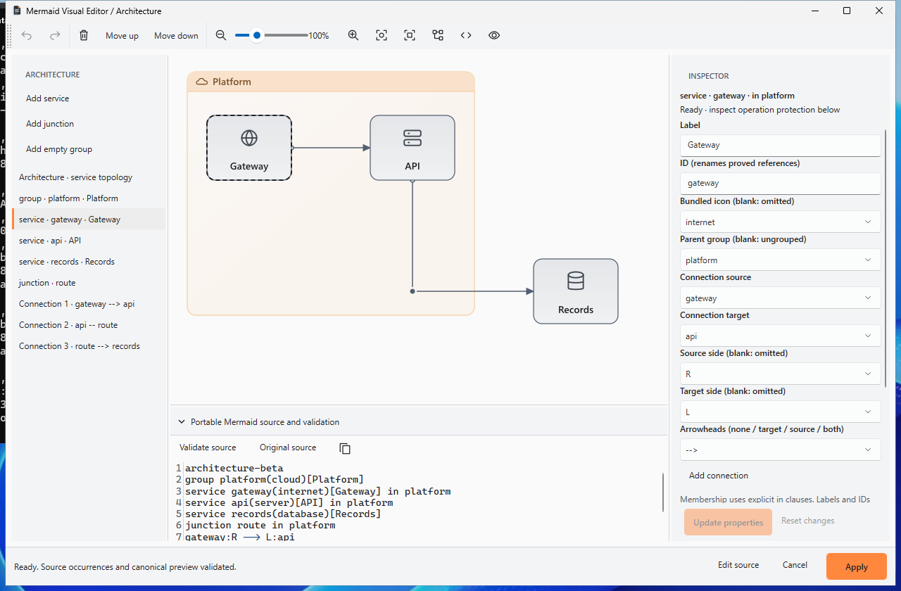
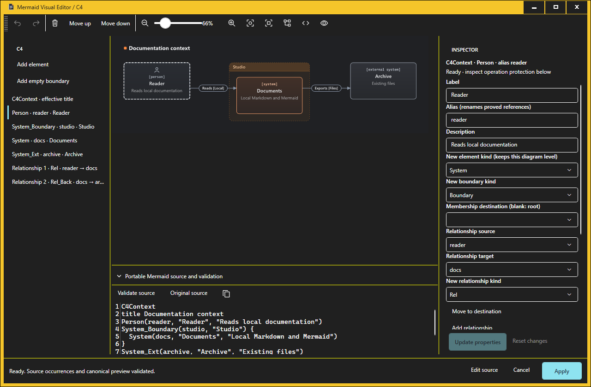
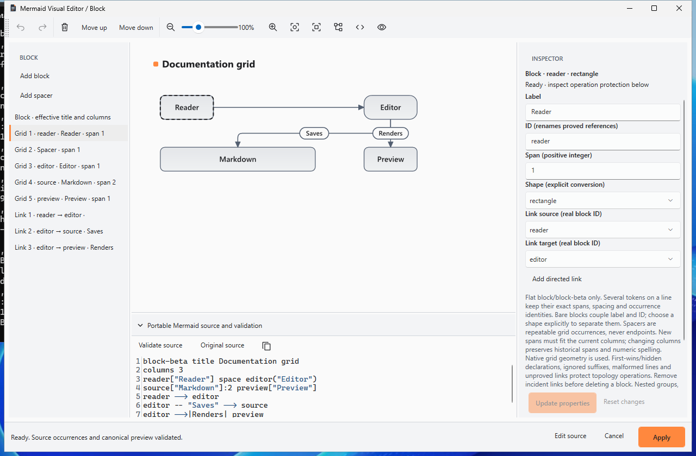

# Architecture, C4 and Block native authoring

Expansion V adds three source-preserving editor families to the previous seventeen. Use the ordinary document **Visual Edit** action, a standalone `.mmd`/`.mermaid` file, or **Insert → Architecture / C4 / Block visually…**. The native catalogue names C4 Context, Container and Component separately, within one C4 editor family. The pinned Mermaider 0.15.1 source is `71b64845570d633a94d29e85579c0a02786fece8`; official .NET 10/WPF, its layout and stock Continuous remain unchanged.

The [engineering receipt](expansion-v-engineering-receipt.md) owns source-labelled results and pending acceptance gates. Earlier receipts and screenshots retain their original sources. This guide describes bounded implementation, not universal syntax support or production certification.

## Shared source and ownership

The existing source/inspector shell supplies an adjustable source panel, independently scrolling inspector, persistent selection, focus and small-window behaviour. Every declaration, relationship and invisible spacer/routing occurrence remains in the keyboard list. Pointer targets use actual canonical native geometry; labels and renderer IDs are never the sole source identity. Smaller actual topology shapes receive pointer priority over enclosing group boxes.

Edits replace exact token spans or complete proved source groups. Untouched Unicode, LF/CRLF, comments, blank lines, indentation, configuration, quoting, ignored text and numeric spelling remain exact. Block occurrence keys travel with tokens through swaps and private history, including several tokens on one line. Complete groups may move across proved independent connection rows without moving those rows. Comment attachment ambiguity protects movement and appending after ambiguous trailing comments; no command reformats the entire diagram.

Invalid pending fields stay visible with an explanation, preserve the last valid private draft and disable Apply. Update/reset resolves pending properties. Private Undo/Redo is bounded by the existing snapshot and character budgets. Apply reparses and natively renders the exact draft, then commits through the existing owner/source/version guard as one owner Undo action. Cancel and stale-owner rejection retain both sources. Save persists only an applied owning document. New IDs are explicitly entered by the user.

## Architecture

The slice is `architecture-beta` with simple root groups, services, junctions and connections. Membership comes from explicit `in group_id` clauses; indentation never defines it. Group/service labels are separate from IDs. IDs share one namespace. A unique rename patches all proved connection and membership references atomically.

Services/groups retain omitted versus explicit icons. Selectable bundled pictograms are **cloud, database, disk, internet, server and generic**, proved as native vectors. An unknown alias can fall back to generic; that does not prove the requested icon. Provider/custom artwork emits embedded SVG images, which remain subject to the existing native image rejection policy. No icon pack is fetched or registered, and no safety rule is relaxed.

Connections expose existing service/junction endpoints, optional explicit L/R/T/B ports and none/target/source/both arrowheads. Actual SVG paths supply selection and fidelity. Junctions retain their real routing geometry and keyboard occurrence; no substitute service is drawn. Empty groups remain list-selectable even without usable pointer area.

Simple add/remove/order and membership commands are available. Deleting a node rejects incident edges and deleting a group rejects children; remove them explicitly first. Deeper hierarchy, missing parents, cycles in membership, shared/duplicate IDs and unknown reference-bearing text protect topology operations. Braced group endpoints are preserved and protected: the pinned parser strips braces, but its layout does not include group boxes in the edge endpoint lookup. No implicit node or rerouted edge is invented. Existing br-tag label spelling remains untouched; new bracket/br/line-break input without proved literal encoding is rejected.

## C4 Context, Container and Component

The family supports **C4Context, C4Container and C4Component** as separately tested views. Existing diagram and element kinds are preserved. Person/System, relevant Db/Queue and external variants retain distinct aliases, labels and applicable technology/description fields. Person/System descriptions occupy the third positional slot; Container/Component use that slot for technology and the fourth for description.

The scanner retains exact quoted, unquoted, empty, named and extra tokens. The pinned splitter drops empty unquoted arguments and filters dollar-prefixed named arguments. Clearing an edited field writes an explicit `""`; missing earlier slots are added as explicit empty values so later fields do not shift. Quotes/commas are encoded only when both pinned quote stages preserve the intended value. Adjacent double quotes without such correspondence remain pending with an explanation.

Complete simple Boundary, Enterprise_Boundary, System_Boundary and Container_Boundary groups retain same-line or next-line braces, attached comments and child membership. Safe ordering moves complete groups. A separate destination command moves an element into/out of a complete root boundary without reindentation. Only empty boundaries can be removed; nested boundary construction remains protected. An unclosed boundary rendered by the engine's EOF flush is still structurally protected.

Rel, BiRel and Rel_Back retain exact label/technology arguments. Rel_Back reverses effective endpoints while preserving its keyword and original argument order. Endpoint selections and unique alias rename patch proved references only. Direction-hint variants and RelIndex remain protected; the native engine ignores routing hints or index information. Missing/duplicate aliases, unknown arguments/directives and unproved parallel/self/cyclic topology protect structural commands. Independent fields remain editable when exact correspondence is established. Connected deletion never cascades.

**C4Dynamic, C4Deployment, Deployment_Node/Node forms, deep deployment semantics, custom tags/styles, arbitrary layout controls and conversion between architecture levels remain source-only.** The family count does not certify those variants.

## Flat Block

The supported headers are `block` and `block-beta`, with an effective header/body title and positive representable columns. Ordered simple blocks retain bare, rectangle or rounded forms. Bare blocks couple label and ID; changing only the label requires an explicit shape conversion. Existing quote and delimiter rules follow the pinned Block parser, without C4/CSV escaping. Quoted labels may contain literal closing delimiters, but embedded quotes remain protected. Explicit shape conversion validates the label against the destination form before preserving its original spelling.

Several declarations may occupy one line. Exact token spans and original inter-token whitespace survive edits, moves and deletion; the editor does not split the line into separate declarations. Repeated `space` occurrences have distinct identities and spans. A spacer is never a real endpoint or renameable ID.

The first non-spacer declaration wins. Duplicate/hidden declarations, malformed partial lines and ignored suffixes protect operations that could reveal, reinterpret or discard them. An unrelated proved field may remain editable. New spans are complete positive integers within the current columns; signs, decimals, incomplete lexemes and overflow are rejected. Raw leading zeroes and historical over-wide spans remain unchanged unless explicitly edited. A column edit does not normalise or truncate other spans.

Simple directed links preserve endpoint and label-token spelling. Unique real-ID rename patches every proved link. Incident links must be removed before deleting a connected block. Unknown targets, self links, parallel/cyclic ambiguity, nested groups, unsupported composite shapes, custom styling, free positioning and replacement routing remain protected/source-only. Actual native grid and spanning geometry remain authoritative.

## Resource and certification boundaries

The existing limits remain: 100,000 diagram characters, 1,500 visual-source lines, 500 rendered elements, the three-second rendering deadline and existing bounded private history. The pinned C4 and Block paths omit upstream element checks; the application now fails closed at that same 500-element budget before their native layout. C4 uses the existing 64-level recursive rendering bound. Ordinary preprocessing retains its own non-comment line checks and does not impose the editor line budget on harmless raw trivia.

PNG conversion checks scaled dimensions as finite doubles before integer conversion, retaining the existing 16,000-pixel edge and 64-million-pixel budgets. This prevents enormous Block column counts from wrapping the image allocation dimensions. Source remains available with a clear error.

Installer execution and actual Windows appearance mutation are limited to disposable hosted Windows runners. Optional associations are excluded. Higher-DPI interactive GUI, physical screen-reader and SDK-free clean-Windows certification remain unavailable unless separately demonstrated. Offscreen DPI or UIA evidence does not establish those certifications. No merge, public release, production signing, updater publication, tag movement, Pages deployment or ordinary desktop installation is part of this goal.

## Actual Windows captures

These unchanged Windows captures come from clean candidate `295dcb7a13660632b9ee59eff7591a5df721df17` in [appearance run 39829430053](https://github.com/DouglasNLima/local-docs-studio/actions/runs/39829430053). Each pictured family/appearance passed its independent UIA job. They show canonical native geometry, source occurrences and inspector fields; they retain their candidate provenance when later source is delivered. The [capture receipt](evidence/expansion-v-captures.json) records source, checks, appearance observations, artefact expiry and exact PNG hashes. Final-source captures are also retained with the delivery evidence.

Architecture, normal Windows appearance:

C4 Context, actual Windows High Contrast:

Flat Block, normal Windows appearance:

