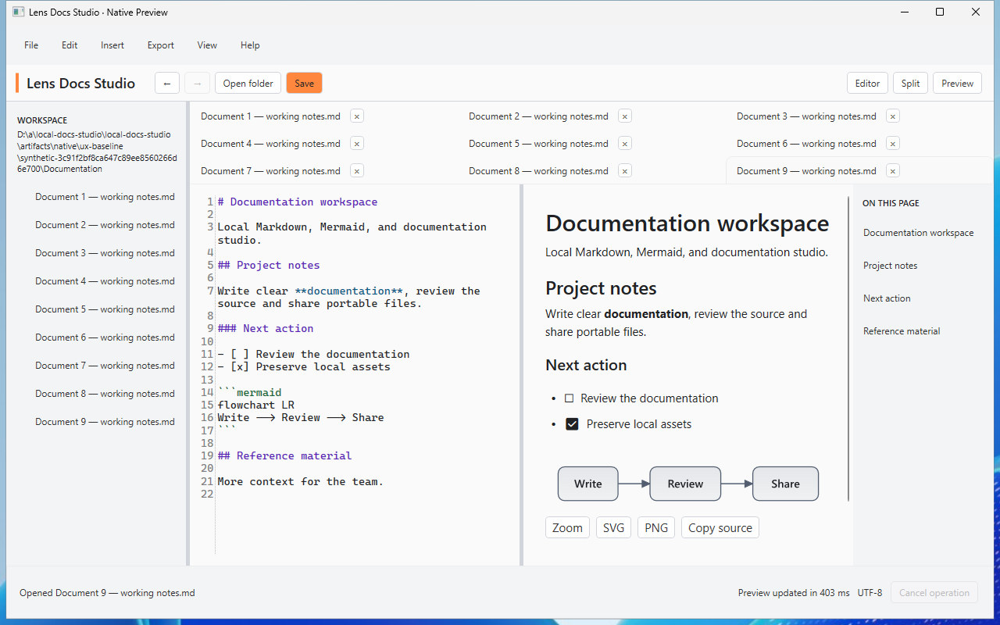
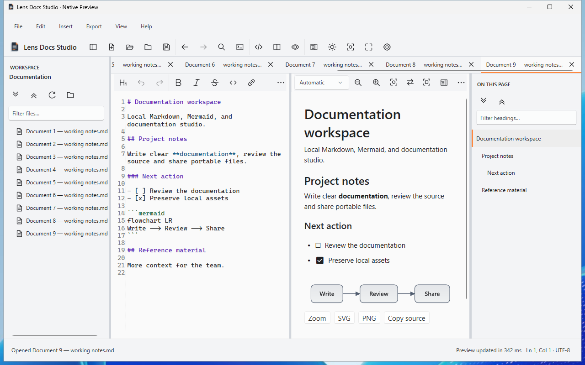

# Native desktop UX modernisation

The requested desktop experience is implemented within the existing .NET 10/WPF/AvalonEdit/Markdig/FlowDocument architecture. Work remains on `feature/native-desktop-ux-modernisation`, in [draft PR 24](https://github.com/DouglasNLima/local-docs-studio/pull/24), from verified base `c566144529c3c0e4393c1604544201b936e4a6a2`.

This report records the immutable application candidate `f06b3c6de7627a29792cf55fb8194ce158ae0d8f` and corrected visual harness `140b39f32b22ad3d73f8ba863da73894e4875a6e`. The latter changes validation only. PR 24 records the subsequent delivery head, its mandatory checks and freshly generated package identities; PR merge packages have a different source identity from branch packages.

## Completed feature audit

The original interface wrapped tabs, exposed a lengthy workspace path, cramped the outline and hid frequent formatting commands. The final implementation and acceptance cover every requested feature group:

| Area | Implemented and verified |
|---|---|
| Visual foundation | Shared colours, spacing, typography, neutral surfaces, restrained `#FF883E`, hover/pressed/focus/disabled states, original vector command icons, accessible names/tooltips and grouped overflow toolbars |
| Application identity | Original documentation-page SVG and transparent ICO at 16/24/32/48/64/128/256; executable/window/About/installer resources; shortcuts use the verified application icon |
| Panels | Independent workspace/outline toggles, hidden splitters, bounded preferred widths, private persistence, source/selection retention and temporary fitting at minimum width |
| Workspace | Concise name/path tooltip, visible filename/path filter, retained nodes/expansion, expand/collapse/refresh, selected/edit/external-change indicators |
| Context actions | Actual clicked-item targeting; open/new tab, Explorer, absolute/relative/Markdown paths, reviewed rename/move, confirmed file/folder recycling and guarded root/escape/reparse/private-state boundaries |
| Tabs | One scrolling row, truncated titles/full-path tooltips, active/dirty states, close/middle-click, keyboard switching, close others/right, copy/reveal, predictable pins and active-tab survival |
| Outline | Hierarchical indentation, full-title tooltips, filter, current section, accurate source navigation, keyboard/group expansion, adjustable width and focus retained when rows are replaced |
| Editing | Six heading levels, bold/italic/strike/inline code, links/workspace links/images, bullet/numbered/check lists, quote/code/Mermaid/table/rule, Undo/Redo and disabled states through existing source commands |
| Productivity | Fuzzy filename/path Quick Open, searchable Command Palette with actual enabled actions, native menus, predictable focus and audited shortcuts |
| Synchronisation | Independent opt-in caret, bidirectional semantic scroll and bidirectional literal selection; both reading modes, repeated occurrences, Unicode, cancellation, stale-result and hidden-pane guards |
| Viewing | Direct Automatic/Pages/Continuous, zoom/search/copy/theme controls, restored Full Screen, temporary Focus Mode, contextual Cancel and initial/current line/column/UTF-8 status |
| Diagrams | Space/middle drag, bounded pan, pointer-centred Ctrl+wheel, Fit/100%/Reset/arrows and unchanged original SVG/PNG/clipboard output |
| Restoration and integrity | Private visibility/widths/sync/theme/layout/reading state, tab order/pins/active identity and logical preview position; existing drafts/snapshots/assets/UTF-8/LF/CRLF/link/Undo/save/export contracts |
| Certification | Expanded Core/WPF/native UIA tests, complete old regressions, inspected native screenshots, self-contained packages, independent metadata/icon/hash inspection and hosted installation lifecycle |

There is no ordinary requested feature deferred as future work. Selection semantics and environmental certification limits below define the supported scope.

Pins require unpinning before normal close; bulk close skips pins and stops after a cancelled dirty prompt. Closing a tab never deletes its file. Folder deletion reviews a bounded inventory, retains saved and unsaved documentation snapshots, stages/rechecks the complete contents and uses Windows recycling; cancellation/failure restores the folder.

Preferred panel widths remain 150–600 pixels for workspace and 160–600 for outline. A narrow window temporarily fits combined widths while preserving a usable document area and the stored preferences. Focus Mode does not rewrite permanent visibility/width choices.

## Shortcuts and focus

| Shortcut | Action |
|---|---|
| Ctrl+P / Ctrl+Shift+P | Quick Open / Command Palette |
| Ctrl+Alt+B / Ctrl+Alt+O | Workspace / outline |
| Ctrl+Tab / Ctrl+Shift+Tab | Next / previous document |
| F11 / Ctrl+Alt+Z | Full Screen / Focus Mode |
| Escape | Open menu/drop-down/overflow first, then Find, then the active viewing mode |
| Ctrl+B / Ctrl+I / Ctrl+S | Existing bold / italic / Save |
| Ctrl+Shift+K / Ctrl+Shift+V | Workspace document link / atomic plain-text paste |
| Diagram Space+drag / middle drag | Pan |
| Diagram Ctrl+wheel / F / Ctrl+0 / Home | Pointer zoom / Fit / 100% / Reset |
| Diagram arrows / Ctrl+C | Pan / copy original drawing |

Searchable windows restore originating focus. Formatting retains source selection and one grouped Undo. Full Screen uses native window placement to restore bounds/state; actual hosted Escape sequencing verifies menu, Find and Full Screen priority. Multiple physical monitors remain outside the hosted evidence.

## Synchronisation and persistence

Caret following, scroll and selection are separately persisted opt-in controls. They operate in Split with both panes visible and preserve the selected Automatic/Pages/Continuous policy.

Events coalesce over 60 ms. Document identity and immutable source versions reject stale results. Source edits, tab/layout/mode/preferences, pointer input and pane focus cancel pending editor and preview navigation. Programmatic changes cannot feed back. Selection and scroll reuse the immutable preview rather than reparsing/rebuilding it.

Parser-bounded UTF-16 literal spans distinguish repeated words and retain exact Unicode, emphasis, code and link-label endpoints. Reverse ranges retain Markdown syntax between literal endpoints. Bounded empty formatting gaps may be crossed; delimiters alone, generated markers, entities/transformed content, images and drawings use a declared semantic block highlight/selection. The adorner does not alter export formatting.

Scroll aligns visible source regions with native text/block geometry and the displayed page. It keeps caret and keyboard focus unchanged; unmappable positions use a defensible neighbouring block, rather than overall document percentages. An unchanged completed preview can be reused across layout changes; pending/stale/edited content follows the normal invalidation path.

Private `Desktop` preferences use safe defaults and merge with current settings. Existing outline/theme/layout/preview contracts remain compatible. Private sessions retain document identity/order/pins/active tab, caret/scroll and logical preview position. Source-version movement updates that position after edits. Opening a restored session and following a hyperlink can complete its persisted active-document write after the editor updates; acceptance observes the exact final identity within the unchanged 20-second deadline without repeating an action.

No new dependency, browser, JavaScript interface or rejected PR 22 viewer was introduced. The separate web edition remains buildless and compatible with GitHub Pages.

## Windows evidence and visual acceptance

The complete candidate passes both [branch native](https://github.com/DouglasNLima/local-docs-studio/actions/runs/38598125471) and [PR native](https://github.com/DouglasNLima/local-docs-studio/actions/runs/38598132573), plus [branch web](https://github.com/DouglasNLima/local-docs-studio/actions/runs/38598125479) and [PR web](https://github.com/DouglasNLima/local-docs-studio/actions/runs/38598132437). Corrected [visual/UIA acceptance](https://github.com/DouglasNLima/local-docs-studio/actions/runs/38602486297) verifies the complete on-screen capture matrix.

| Gate | Result |
|---|---|
| Core | 1,086 passed, zero skipped, compared with the 1,057-test baseline |
| Native rendering | 40 cases, zero failures |
| Browser | 268 cases per full workflow across Chromium and Edge, plus static integrity |
| Persisted native export workflow | 13 checks passed; source/assets retained and exported Docs Site tested on disk/static hosting |
| Desktop contexts | Four complete contexts × 74 groups: source build, installed, upgraded, reinstalled |
| Focused UX | 9 groups, with detailed selection/scroll/outline/panel/tab/folder/diagram observations |
| Recovery/trust | Interrupted failed-save restoration; malformed/Unicode probes; signing policy and disposable certificate checks |
| Packaging | Two self-contained versions, visible wizard, six rejecting negative controls, independent verifier |
| Lifecycle | Install → upgrade → uninstall → reinstall → final uninstall; 22 prior state files and workspace bytes preserved; actual restored sessions and bundled CLR/WPF origins verified |

UIA acceptance exercises actual source changes/Undo, clicked paths, pointer resizing, pins/dirty prompts, complete-folder recycling, repeated/Unicode/formatted/hard-break/cross-paragraph selections, opt-out, hidden preview, edited source, both scroll directions, rapid input, independent caret following, tab cancellation, outline keyboard focus and native diagram controls. Pointer-normalised diagram coordinates remain stable, 0.33404 → 0.33398; copied original pixels remain independent of viewport transforms.

Light/Dark and actual temporary Windows high contrast cover 860×540, 1280×800, 1440×900 and 1920×1080. Inspection includes the active tab/close button, command overflow, filters, panel dividers, readable status, empty state, searchable dialogues, Focus Mode and Full Screen. Earlier 1920 captures extended beyond the hosted desktop and are retained as failed evidence. The corrected harness positions the entire window on screen, rejects taskbar-obscured status and verifies restoration.

The hosted adapter supports only the largest 1920×1080 mode. The guarded test harness temporarily auto-hides its taskbar using the documented [Windows shell API](https://learn.microsoft.com/en-us/windows/win32/shell/abm-setstate), then independently verifies/restores the original shell state and display mode. This happens only on a disposable hosted runner; no ordinary desktop setting or installation was changed.

Before:

After:

Additional inspected captures: [Dark](images/desktop-ux/after-dark-1440.png), [minimum](images/desktop-ux/minimum-dark.png), [high contrast](images/desktop-ux/high-contrast-1920.png), [Focus Mode](images/desktop-ux/focus-mode.png), [Full Screen](images/desktop-ux/full-screen.png), [Quick Open](images/desktop-ux/quick-open.png), [palette](images/desktop-ux/command-palette.png), [actual overflow](images/desktop-ux/overflow.png).

UIA names, keyboard/focus outcomes, system high-contrast resources and pressed text/icon contrast are verified. This is not physical assistive-technology, monitor or DPI certification.

## Performance and preserved failures

The 250 ms input target is unchanged. Comparable hidden-viewport samples preserve exact source, complete text, final-target visibility/selection and the existing Continuous warning:

| Fixture | Baseline first-layout input | Candidate first-layout input | 250 ms acceptance |
|---|---:|---:|---|
| List | 1,349 ms | 1,330 ms | FAIL |
| Mixed | 623 ms | 643 ms | FAIL |

List construction is 365/364 ms and allocation 105.85/106.25 MB; mixed allocation is 50.91/51.20 MB. These samples show no new critical regression, but are not a controlled performance certification. Existing large/mixed/4.14 MB preview limits and intermittent construction pauses remain. Functional compatibility does not establish responsiveness.

Original failure logs, screenshots, state records and diagnostics remain in Actions artifacts, ignored local `artifacts/native/full-*`/`ux-*` folders and Git history. Important corrections include:

- [Earlier full preview focus](https://github.com/DouglasNLima/local-docs-studio/actions/runs/38581680285): a pane-centre click hit SVG; actual text geometry establishes the intended context.
- [Exact deletion](https://github.com/DouglasNLima/local-docs-studio/actions/runs/38584896737) and [line-ending fixture](https://github.com/DouglasNLima/local-docs-studio/actions/runs/38588389617): recovery was correct; native typing omitted LF, then Enter correctly produced CRLF. Assertions now require exact input and separate saved/unsaved records for the target path.
- [Full help catalogue](https://github.com/DouglasNLima/local-docs-studio/actions/runs/38589510482): the new 13-topic guide replaced an old 12-topic assumption; every exact topic title is now checked.
- [Pagination/focus](https://github.com/DouglasNLima/local-docs-studio/actions/runs/38591449171) and [unsupported UIA focus](https://github.com/DouglasNLima/local-docs-studio/actions/runs/38593362749): restored final-page position correctly disabled Next; the fixture establishes page one through supported native input before retaining all paging/search/source assertions.
- [Session observation](https://github.com/DouglasNLima/local-docs-studio/actions/runs/38595234414): visible return navigation preceded its active-document state write; exact persisted state is observed within the normal deadline.
- [Hosted display limits](https://github.com/DouglasNLima/local-docs-studio/actions/runs/38598125486): larger modes were rejected. Complete-window/taskbar assertions and temporary, verified shell restoration replace clipped captures.

Product fixes also include focused-pane cancellation/reconciliation, retained selection after Unicode edits, outline row-replacement focus, active-tab visibility after resize, responsive combined panel widths, visible overflow glyphs and Escape priority. Assertions, fixtures and performance thresholds were retained or strengthened; unchanged failures were not repeatedly rerun to obtain green.

## Internal preview packages and identity

The independently verified branch-source candidate is `f06b3c6de7627a29792cf55fb8194ce158ae0d8f`, native run `38598125471`. Both versions contain 528 payload files and the .NET 10 WPF runtime. Native EXE/Core DLL informational versions match the exact version and source revision; installer, ZIP, update metadata and checksums agree.

| Version/file | SHA-256 |
|---|---|
| 0.1.0-preview.387 installer | `b1e7cb081e38ae5dd6fb418c80bd26ea17e30ef221412f6cfbc1c722e524b283` |
| 0.1.0-preview.387 portable ZIP | `1588edae8565a15973e247f68a9a53f9067c5ca550eef64a0753efabfc73d609` |
| 0.1.1-preview.387 installer | `2981ed3d321df910060a30539774767c1fbc1189876f8871277cd9a4acd2f2c9` |
| 0.1.1-preview.387 portable ZIP | `3247119a432252dc621d132e5d511516c9f3e783d3de20d636dfde07e65030d0` |

Names use `LensDocsStudio.Native-<version>-win-x64-Setup.exe` and `LensDocsStudio.Native-<version>-win-x64.zip`. PR .388 packages identify merge revision `c68c77ea0952931044f2dfcee02e443c5bc657b9`; they are not relabelled as branch artifacts.

Independent local verification pins the downloaded installer/ZIP hashes, source, version, unsigned metadata, complete payload and actual PE icon frames without executing the package. The seven authored frames match both binaries, with transparent corners/opaque artwork; ICO SHA-256 is `39de61f63d5d89cbb5a494828bf8f4dabe9e7ae8e064564e6864c8d8067a4682`. Start Menu/Desktop shortcut records verify targets and inherited icon index.

A separate metadata-only inspection of the shipped Native/Core assemblies finds no WebView2/Chromium/ContinuousViewer/experimental namespace or assembly reference and confirms the native preview type. Package inventory excludes private documents, test/development payloads, keys, PDBs and browser runtimes. No package was installed or executed on the user's ordinary desktop.

## Readiness and limits

The supported application candidate is ready for an **unsigned internal preview**, with the requested features implemented and Windows acceptance completed. The delivery head must retain all mandatory native/web/UX and packaging checks; its exact final identity is maintained in PR 24.

Bounded limits remain: non-literal selection uses semantic blocks; Continuous still fails the documented 250 ms budget; hosted same-revision preview replacement does not certify historical schema migrations, SDK-free clean Windows, physical multi-monitor/DPI/assistive technology or production-signed upgrades. Production signing credentials/trust, unsigned in-app update execution, public releases, tags and merges remain outside this delivery. No production certification is claimed.
