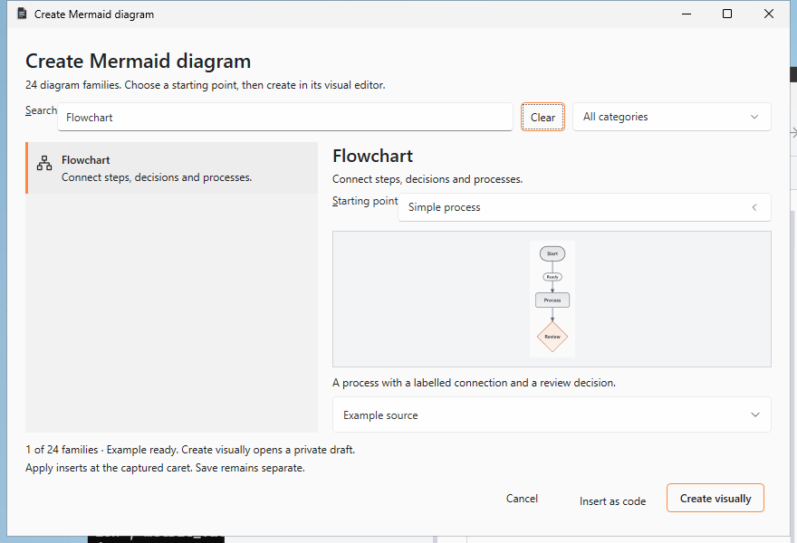
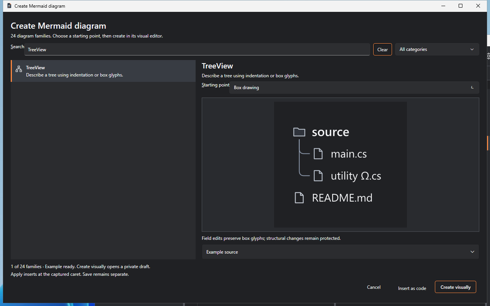
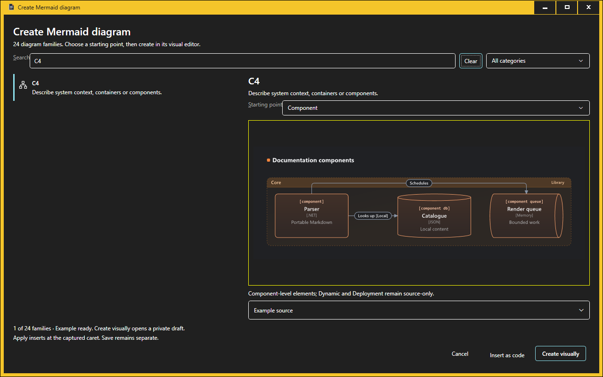

# Goal IX representative native captures

These unedited captures come from disposable hosted Windows, push run
[40230899131](https://github.com/DouglasNLima/local-docs-studio/actions/runs/40230899131),
at source `40f9d3fe3a86a87ba72903681a7f9a0c58fac81c`, tree
`d664a305be624f2ff642604beeb51d6400eec33a`. They were visually inspected for
readable selection, preview, text and visible footer. Per-window DPI was 96.
[screenshots.json](screenshots.json) records original artifact IDs, expiry and hashes.

| Appearance | Actual capture |
| --- | --- |
| Light, 880×600 |  |
| Dark, 1280×800 |  |
| Actual OS High Contrast, 1280×800 |  |

These are intermediate-source examples. The initial full-catalogue resize
captures from that run were incomplete and are explicitly rejected as visual
acceptance; their original artifacts remain unchanged. The final-source receipt
in [Draft PR #49](https://github.com/DouglasNLima/local-docs-studio/pull/49)
must identify fresh full-catalogue and empty-state captures and their inspection.
No alternate-DPI, audible screen-reader or physical-host certification is implied.
