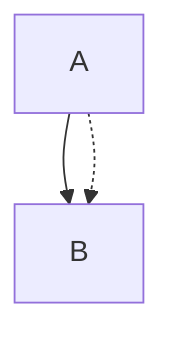

# Independent engine and storage review — PR 55 / Issue 54

Reviewed 28 October 2026. Base `81bcb02f8a0ee618e70260a49a4aab8c0896c12d`; reviewed head `74213763c9deff8554e0dc7f4ba1723995c91520`.

**Decision: NO-GO at the reviewed head.** Two concrete defects require correction and re-review: an external sidecar update can be silently overwritten during backup recovery, and manual Flowchart routing can erase the visible distinction between parallel edge occurrences. The existing arrangement test suite passes, but does not exercise these failure paths.

This is an independent review of actual source/diff and executable current Release Core assemblies, not an adoption of the implementer's validation conclusions. Root `AGENTS.md`, `src/native/AGENTS.md`, the reconstruction brief and the arrangement specification were read. No private SPC material was accessed. Product source, commits and PR state were not changed by this reviewer. Diagnostic files and all outputs are confined to this ignored directory. The root reviewer confirmed the existing Release assemblies correspond to the reviewed head; this reviewer did not build shared projects.

## Findings

### P1 — Hold destination ownership through the final sidecar commit

**Location:** `src/native/LensDocsStudio.Core/Arrangement/ArrangementStore.cs:58–66` (primary correction anchor: line 66).

The last fingerprint check closes its read handle before publication. The `.lock` file only excludes cooperating `ArrangementStore` callers. A normal external editor can update or replace the primary JSON after that check; `File.Replace` subsequently succeeds and silently replaces the newer version. Backup recovery makes the window particularly clear because the async durable `.unreadable-*` write happens *after* the final content comparison and before publication.

**Executed reproduction:** `dotnet run --project ReviewProbe.csproj -c Release -- race`. `RaceProbe.cs` saves a valid sidecar and backup, makes the primary an unreadable but in-budget 2 MiB file, calls `ReadBackupAsync`, then begins explicit recovery. A filesystem watcher waits for `.unreadable-*` creation (which is after the final comparison), writes a different valid sidecar to the primary, and records the result. The first attempt reproduced the defect:

```json
{"attempt":0,"saveError":null,"externalWriteSucceeded":true,"externalWriteSilentlyReplaced":true,"primaryLength":44,"backupLength":34}
```

The save reported success. The external bytes became `.bak`, while the primary contained this window's save. The external version remains recoverable until another save replaces the backup, but there was no conflict notification or user decision. This violates the required protection against overwriting a changed file. It does not depend on junctions, private documents or malicious directory replacement. The normal save branch has the same read/replace gap, although the executed demonstration deliberately uses the much wider recovery branch.

**Evidence:** `race-results.json`, `RaceProbe.cs`, and `race-0-ddc1321cdc924a58a27b10ace386d203/` retain the actual files.

**Correction:** Maintain exclusive destination ownership from final validation to commit. Another earlier hash comparison does not solve this. A managed Windows `File.Replace` cannot safely keep a destination handle that denies delete/replacement. A bounded Core implementation can use an exclusive destination stream, a durable journal and previous-byte backup, and an in-place write under the same handle; honour cancellation before mutation, restore original bytes on write failure, and retain recovery evidence if rollback fails. `FileShare.None` also prevents readers seeing partial JSON. First creation can keep the existing no-overwrite move. This is a deliberate tradeoff from atomic pathname replacement to an exclusive journalled commit and must be documented, with crash/recovery tests. An alternative retaining atomic replacement needs a demonstrable OS-level compare/commit strategy, not only a cooperating lock.

### P2 — Keep parallel Flowchart routes visibly distinct after arrangement

**Location:** `src/native/LensDocsStudio.Core/Arrangement/ArrangementRouter.cs:28` and `:57–65` (port selection and collinear simplification).

All Flowchart occurrences use the same centre port. `parallelIndex` changes only the stub length. When nodes align, the collinear simplification removes those different stubs, yielding identical paths. Two authored relationships with different styles become one visually solid connection; hit testing returns ambiguity along the shared path. The accessible occurrence list retains both identities, but the diagram and exported SVG no longer communicate both visible relationships.

**Executed reproduction:** `dotnet run --project ReviewProbe.csproj -c Release`, using:



Arrange `A` at `(100,100)` and `B` at `(100,600)`. Both accepted edges receive exactly `[(132,142.2),(132,600)]`. The quality object reports zero body intersections, label/body overlaps and crossings. The canonical SVG has separate paths (`x=48` and `x=62`); the arranged SVG has two paths at `x=132`. This is introduced by arrangement, not a canonical baseline limitation.

**Evidence:** `probe-results.json`, `parallel-flowchart-canonical.svg`, `parallel-flowchart-arranged.svg`, `Program.cs`. The parallel ER comparison has two distinct paths and did not reproduce this specific problem.

**Correction:** Allocate bounded distinct lanes/ports or equivalent safe paths for parallel and reciprocal occurrences, retaining shape boundary correctness. Do not let collinear simplification erase the only separation. Add a focused assertion on visible path distinction for mixed solid/dotted parallel Flowchart edges, and verify actual native hit geometry/export. Preserve all endpoint/style/occurrence metadata.

## Contract assessment at reviewed head

| Major contract | Result | Independent basis and limits |
| --- | --- | --- |
| Canonical renderer/cache separation | PASS for inspected changes | Arrangement holds a canonical result, returns copied results, and uses per-call providers; no global provider replacement or canonical cache insertion. `BoundedErLayout` optional spacing parameters keep the old defaults. Existing arrangement source/canonical invariants passed. |
| Source text, endpoints, node/edge semantics and styles | PASS for model/source preservation; FAIL for visible parallel semantics | Manual code copies layout records without source edits; alternative paths use the pinned parser and renderer. Reproduction preserves two model edges but hides their visual distinction. |
| Deterministic distinct candidates/objective improvement | PASS on focused corpus; not universal proof | All 29 existing tests passed, including dense Flowchart/ER repeatability, objective comparison and exact rehydration. Additional probe repeatability checks passed. Candidate order is fixed and tie-breakers are deterministic. |
| Manual routing and labels | FAIL for parallel Flowchart visibility; PASS on covered body/label geometry | Executed parallel failure above. Existing six complex public ER route tests passed, including label-on-actual-connection checks. Manual paths check unrelated node intersections; labels avoid nodes and prior labels, with bounded outside rails. Unrelated edge/label crossing and all shape combinations were not exhaustively certified. |
| Pins and group containment | PASS on covered cases | Existing pin, nested group intrusion and parent containment tests passed. Source inspection shows candidates skip pinned nodes and return no group-moving candidate. No arbitrary group movement was introduced. |
| Resource limits and cancellation | PASS for declared bounds and pre-cancel path; UNVERIFIED hard worst-case latency | Source caps, node/edge limits, grid/search caps, SVG cap, history limits and cancellation propagation exist. Existing cancellation tests passed. This reviewer did not independently stress worst-case 500-node/1,000-edge timing or process-memory ceilings. Do not infer hard deadline certification from passing pre-cancel tests. |
| Strict JSON and portable relative paths | PASS on inspected and executed rejection cases | Duplicate properties, unknown fields, invalid enum, traversal and absolute paths were rejected and bytes retained in independent probes. Existing oversize, corruption and unsafe-coordinate tests passed. Validations reject unsupported schema/depth/counts and call workspace containment checks. |
| Passive load / explicit save | PASS on source and probe | Independent empty-workspace read created zero entries. Only the save workflow calls the store write; recovery is explicit. Ordinary source/export paths are untouched in the inspected diff. |
| Duplicate/changed/renamed identity | PASS for conservative matching in inspected logic and tests | Exact auto-match needs unique source, same family, heading digest and standalone flag; duplicates are ambiguous, changed heading/source stale. UI restricts records to the current path, so rename has no guessed migration. Existing identity regression passed. |
| Cooperating concurrency and pre-existing conflicts | PASS within that scope | Exclusive lock file rejects simultaneous cooperating acquisition; fingerprint mismatch preserves already changed external bytes. Independent pre-existing conflict probe passed. |
| Concurrent external modification during commit | FAIL | Executed P1 race above. The cooperating lock does not authorise replacing external bytes written after final comparison. |
| Backup recovery | FAIL under concurrent modification; PASS ordinary recovery | Existing ordinary recovery test passed. Independent recovery race failed. Current-size limit prevents recovery via this path when the primary itself exceeds 2 MiB; this behaviour was observed by source, not classified as a separate blocker. |
| Read-only and pre-existing reparse points | PASS on existing focused tests | Read-only primary and junction sidecar directory tests passed in the 29-test run; rejected input bytes/targets remain unchanged. |
| Hostile reparse/directory TOCTOU | UNVERIFIED / residual limitation | Repeated path checks are present but not an OS filesystem transaction. No adversarial directory-swap test was run. The specification acknowledges this residual boundary; it does not excuse the ordinary external content race reproduced above. |
| Stale source ownership and generation | PASS for inspected safeguards; GUI timing UNVERIFIED here | Production callback checks open tab, saving, captured path/root and tracked original source span; `MermaidBlockSource.Relocate` rejects edits to the owning block/fence. Generation and ownership are checked before asynchronous geometry publication. This reviewer did not drive real owner-edit/rename/close UI races. Save ownership is checked after the store returns, so it is not a substitute for a commit-time storage lease. |
| Installed product / GUI acceptance | UNVERIFIED by this reviewer | This review is intentionally engine, persistence and ownership code focused. No install, real desktop input, high-DPI or accessibility claim is made. |

## Executed checks

- `dotnet test src/native/LensDocsStudio.Core.Tests/LensDocsStudio.Core.Tests.csproj -c Release --no-build --no-restore --filter FullyQualifiedName~ArrangementTests --logger "trx;LogFileName=arrangement-tests.trx" --results-directory artifacts/native/final-acceptance-review-engine/test-results`: **29 passed, 0 failed, 0 skipped**, six seconds reported by the runner. TRX retained.
- Independent `ReviewProbe.csproj` built only this ignored diagnostic project, using direct references to existing Core/renderer assemblies. Source/canonical preservation, repeatability, basic pins, passive read, strict format/path rejection and pre-existing conflict checks passed; parallel Flowchart distinction failed as documented.
- Independent recovery concurrency probe failed on attempt 0, with valid external bytes retained as backup and overwritten at the primary without a conflict.
- At the end of the original review inspection, `git status --short` was empty and HEAD still matched the reviewed hash. Subsequent root-agent corrections are outside this initial report and require a dated addendum/re-review.

No broad browser/native suite was rerun because this reviewer changed no product files; no shared project build was performed. Passing existing tests does not override the two reproduced failures.

## Resolution review — round 2, uncommitted corrections

The original findings and failure artefacts above are retained verbatim. The reviewer inspected the actual corrected `ArrangementStore`, `ArrangementRouter` and `ArrangementEngine`, plus the production ownership callback change, and ran the original probes against the fresh Release Core DLL. Its SHA-256 was `33A1B13E519B73ACEB65FF15CBF92D00D05DAA3234AA23DFB49239E916AFE9F8` in both the Core test and Native output directories. This is an uncommitted working-tree review, not a claim about a new immutable commit.

- **Original P1 race: RESOLVED in the exercised path.** Existing-primary saves now hold `FileShare.None` from the final byte comparison through backup/journal creation and the commit. All twelve unchanged original recovery-race attempts rejected the competing external write; no external bytes were overwritten. First creation remains a no-overwrite atomic move. Evidence: `review-round-2/race-results.json` and its twelve workspace directories.
- **Original P2 parallel paths: RESOLVED in the exercised cases.** The original two-edge solid/dotted Flowchart now has two distinct routes. Parallel/reciprocal counting is unordered by endpoints, and later occurrences acquire a bounded external lane that simplification does not erase. The second path is longer and increases area/bends, a visible quality tradeoff; it no longer hides the dotted occurrence. Source and endpoint/style metadata remain intact. Evidence: `review-round-2/probe-results.json` and canonical/arranged SVGs.
- The repeated independent strict-format, passive-read, pre-existing-conflict, canonical-preservation and repeatability probes still pass.
- Fresh existing focused suite: **33 passed, 0 failed, 0 skipped**, 12 seconds reported by runner; `review-round-2/test-results/arrangement-tests-round-2.trx`.

**Atomicity tradeoff:** Existing-file saves are now exclusive, journalled **in-place commits**, not atomic pathname replacement. The destination lease prevents external writers/replacers and prevents concurrent readers seeing the write in progress. A durable journal preserves original and intended bytes; `.bak` preserves the last primary on ordinary save, and explicit backup recovery retains unreadable primary bytes separately. Cancellation is honoured before mutation, while the mutation/rollback uses a non-cancellable token. A crash can still leave a partial primary; byte retention is not by itself a complete recovery workflow. The documentation's earlier atomic-replacement statement must be updated.

**New recovery gap found and communicated during this round:** `ReadAsync` currently ignores pending journals. A valid-JSON interrupted primary can therefore auto-load as a hybrid of two arrangements despite the durable evidence showing an incomplete commit. `JournalProbe.cs` fault-injected a primary with `A.x=200, B.x=100`, original `A.x=B.x=100`, and intended `A.x=B.x=200`, with a valid `.bak` and pending journal. `ReadAsync` accepted the hybrid. This was a simulated interrupted on-disk state, not an OS power-loss experiment. Evidence: `review-round-2/journal-result-*.json` and `interrupted-state-a868754957ad4f99b130052c2447d6ee/`.

The agreed correction is to fail closed on pending journals during ordinary reads, permit explicit backup review, and archive pre-existing journal evidence only after successful explicit recovery. The primary-missing recovery branch must receive the same treatment. This round's recommendation is **CONDITIONAL GO for the original two corrections, pending that recovery gate and accurate documentation**. A subsequent dated addendum must record the actual follow-up source and tests; the condition is not treated as already fulfilled here.

## Resolution review — round 3, pending-journal gate

Fresh reviewed Core DLL SHA-256: `15F2BC7EA12669FAEF4C1771462DD1014C3FD8B179BB0E51557C0AD458D43AB1`.

- The original hybrid-primary fault injection now **fails closed**, retains the pending evidence, and directs explicit backup review. Ordinary reads check pending journals before and after reading; ordinary writes reject them under the cooperating lock. Explicit recovery archives pre-existing evidence after commit, including the missing-primary branch. Pending enumeration is bounded and reparse paths are rejected.
- The unchanged original external-write recovery race still passes **12/12 attempts**, rejecting external writes under the primary lease.
- The original parallel Flowchart probe still produces two distinct paths. Other independent probe cases still pass.
- Focused suite: **35 passed, 0 failed, 0 skipped**, eight seconds reported by runner; evidence in `review-round-3/test-results/arrangement-tests-round-3.trx`.

**Additional P2 found: ensure backup publication precedes the commit marker.** At this round's source, `ArrangementStore.SaveAsync` creates the pending journal before creating `.bak`. The first update after initial creation therefore has a window where cancellation or I/O failure creates a pending marker but no backup exists. The new normal-read gate then rejects the still-valid primary, and the offered explicit recovery action reports that no backup is available.

`CancellationProbe.cs` independently reproduced this on attempt 0 by cancelling when the first update's pending file was created. It uses a bounded public synthetic sidecar and actual `SaveAsync`, with no product instrumentation:

```json
{"saveError":"TaskCanceledException","readError":"An interrupted arrangement save needs review. Load backup explicitly before saving a recovered layout; pending recovery evidence has been retained.","backupError":"No arrangement backup is available.","primaryUnchanged":true,"backupExists":false,"pendingCount":1}
```

Evidence: `review-round-3/cancellation-results-*.json`, `CancellationProbe.cs`, and `cancel-first-update-d7a72546ea3b4201869b33126f414ae2/`. Primary data is preserved, but the app's normal load/save and offered recovery path are blocked; manual filesystem intervention is required. This is an executed cancellation failure, not a speculative power-loss claim.

**Correction boundary:** While holding the existing exclusive primary lease, publish the previous-byte backup before creating the commit journal. Explicit backup recovery already starts with a backup and can retain unreadable primary bytes before its new journal. Only after those prerequisites and the journal are durable may mutation begin. Alternatively, reliably remove only this operation's marker on a verified pre-mutation failure; do not discard pre-existing evidence. The ordering change preserves external-writer exclusion.

Recommendation remains **CONDITIONAL GO pending the cancellation ordering correction and accurate atomicity wording**. This does not reopen the resolved original parallel-edge or external-overwrite findings. All previous failure and passing artefacts remain intact.

## Final resolution review — round 4

**Final scoped recommendation: GO for the engine, storage and inspected ownership changes.** All concrete findings raised by this reviewer are resolved in the final reviewed working-tree source and fresh Native Core binary. This is not an overall product, GUI, installation or power-loss certification; those boundaries remain as stated below and in the original contract table.

The authoritative final Core DLL SHA-256 is `79C93FFA239A80C2A3B70967828C6D22265CA38F5BB68B4E8EBB59CF7B9FEAC9`. The diagnostic output DLL hash was checked and exactly matches the fresh Native output. The Core.Tests output had not yet been rebuilt and remained `15F2BC7...`; an initial round-4 cancellation run accidentally used that older copy and reproduced the already-known ordering defect. That run is retained with an explicit `review-round-4/STALE-ASSEMBLY-NOTE.md`. It is excluded from the final correction verdict. The diagnostic project was then explicitly retargeted to the fresh Native Core DLL; all authoritative round-4 outputs are under `review-round-4/fresh-native/`.

Final inspected source SHA-256 values:

| File | SHA-256 |
| --- | --- |
| `ArrangementStore.cs` | `97F13EC1758EB79D77427F52DDEF2559EDCBD4F7014E44E67FBE5A0A51FE59B8` |
| `ArrangementRouter.cs` | `264B235A1D9F8095AABE7D6CAD55B7EA29AEC0A0E8B94E8CDF61518BA077D6ED` |
| `ArrangementEngine.cs` | `8E12C1260AD97B08B509B1210DAFE0124C2B117701F5D2A160B3A59F356AF859` |

Final independently executed results against that binary:

- **Original P1 external-content race: PASS, 12/12.** The competing external writes are rejected while the destination lease is held; recovery succeeds without silently replacing external bytes.
- **Original P2 parallel Flowchart visibility: PASS.** The original solid/dotted fixture retains two distinct visible paths. ER comparison, source preservation, canonical immutability and deterministic checks also pass.
- **Interrupted valid-primary gate: PASS.** The unchanged hybrid-primary fault injection fails closed, leaves journal evidence intact and gives the explicit backup-review message.
- **First-update cancellation and explicit recovery: PASS, 8/8.** Cancellation on journal creation leaves the primary byte-identical, a usable `.bak`, and a pending journal. Explicit backup recovery subsequently restores the original fingerprint, removes pending status, and preserves every prior journal byte under its reviewed name. This exercises the actual store and real filesystem, not a replacement implementation.
- **Strict JSON/path, passive read and pre-existing conflict probes: PASS** on repeated final-binary execution.
- The final cancellation ordering regression in the product test source was inspected. The last independently executed product suite remains the **35-pass round-3 run**; this reviewer did not rebuild shared test projects or mislabel that older suite as a run against the final binary. Final-binary confidence for the last ordering change comes from the eight independent cancellation/recovery runs above. Root-agent suite results may be reported separately with their own provenance.

**Final contract disposition:** All original PASS entries remain supported within their stated scope. The original FAIL entries for visible parallel semantics, concurrent external commit and backup recovery are now **PASS in the reviewed/executed cases**. The follow-up pending-journal and first-update cancellation gaps are also **PASS after correction**. No additional material defect was found in this final review.

**Accepted implementation tradeoff:** New files still publish via atomic no-overwrite move. Existing files use an exclusive `FileShare.None` destination handle, durable prior-byte backup, then durable journal, then non-cancellable in-place write with rollback on write failure. This is deliberately not atomic pathname replacement. A crash may interrupt the primary bytes, but a pending journal blocks ordinary restoration even when those bytes parse; explicit backup review/recovery restores the previous layout and archives evidence. Cancellation before mutation may conservatively require that same explicit review. Final documentation accurately states these behaviours and does not claim an atomic replacement it no longer implements.

**Remaining unverified boundaries:** No real OS power-loss or filesystem fault-injection campaign was run; the interrupted-valid-primary test is a simulated on-disk state. Hostile concurrent directory/reparse replacement remains the acknowledged workspace trust limitation. Worst-case maximum-node timing/memory and full GUI ownership/edit/rename/close races were not certified by this engine/storage reviewer. None is silently recorded as passing. The final GO is scoped to the inspected contracts and concrete reproduced defects, and must be combined with the independent UI/performance/integration reviews before an overall PR decision.

No product files, shared builds, commits, pushes or PR mutations were performed by this reviewer. All diagnostic attempts, including genuine failures and the explicitly identified stale-assembly attempt, remain available for audit.

