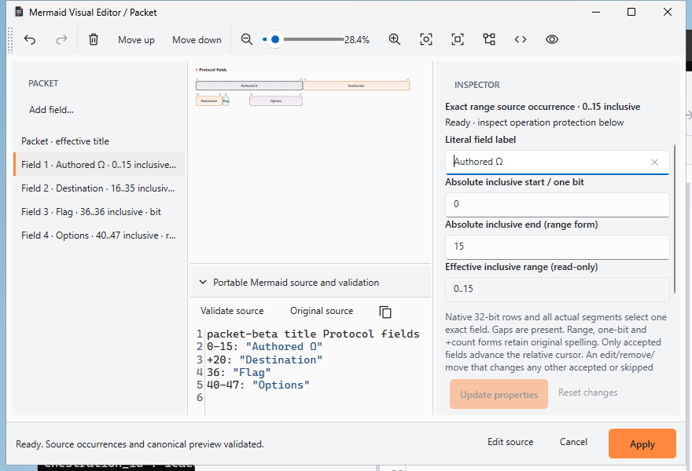
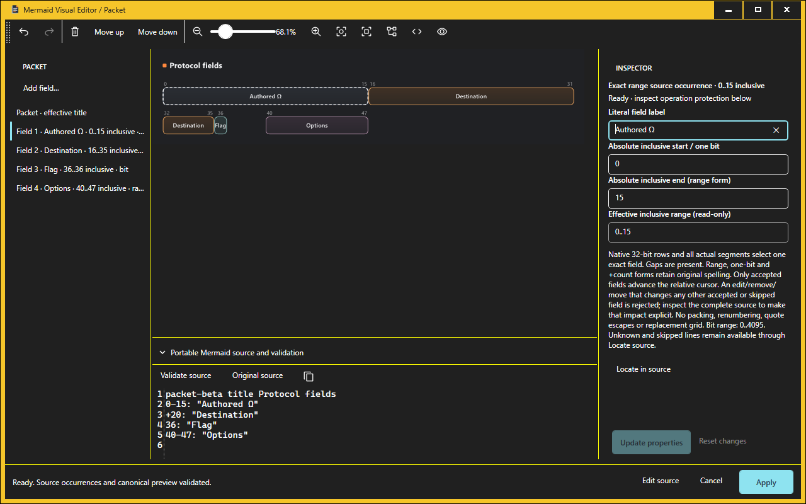

# Goal VII engineering receipt

Recorded 24 October 2026. The [current-status entry point](current-windows-readiness.md)
owns the capability decisions. This source-controlled receipt freezes the audit
and candidate observations; [Draft PR #47](https://github.com/DouglasNLima/local-docs-studio/pull/47)'s **final delivery receipt**, attached
after the final commit, records the actual feature SHA/tree, final runs/packages,
all raw diagnostics and the final verdict. No document claims to contain its own
commit hash or to validate a later source automatically.

## Scope and accepted source

Develop was fetched and independently matched
`33a751c60886a364102c45cb43e36af1e7f13517`, tree
`51912afe438f085bcfbebd33b52e90eb91a7ba33` before edits. Native
[40040943523](https://github.com/DouglasNLima/local-docs-studio/actions/runs/40040943523)
and web [40040943517](https://github.com/DouglasNLima/local-docs-studio/actions/runs/40040943517)
both succeeded on push/attempt 1 at that source. Complete API job lists were
retained; 25 native successes, two deliberate historical skips; three web successes,
Pages skipped. No advancing delta or merge was necessary. The original checkout
and PR #38 were not changed.

Audit deliverables: [24-family matrix](evidence/goal-vii/ux-matrix.json),
[UX audit](goal-vii-ux-audit.md), [manual certification/rollback protocols](goal-vii-certification-runbooks.md).
No new UX product defect was reproduced. Application C#/XAML, renderer, dependencies,
limits, reference pixels, source fixtures and installer defaults are unchanged.
The native help resource includes the short current-status documentation notice;
it adds no help topic or new editor syntax.

## Fresh baseline appearance evidence

| Run / source | Result | Retained boundary |
|---|---|---|
| [Expanded 40096678650](https://github.com/DouglasNLima/local-docs-studio/actions/runs/40096678650), `33a751c…`, dispatch/1 | 38 successful jobs | 19 expanded families × normal/actual OS High Contrast; not 24 × 2 |
| [Original five 40096681728](https://github.com/DouglasNLima/local-docs-studio/actions/runs/40096681728), `33a751c…`, dispatch/1 | 14 successful jobs, historical consolidated-suite-before skipped | Separate original-five windows/shared workspace; 54 normal and 27 actual HC shared-workspace checks; historical comparison sub-checkouts retain their old source identities |

The [capture index](evidence/goal-vii/baseline-captures.json) retains exact image,
source and source-hash metadata. These screenshots precede Goal VII changes and
are explicitly baseline captures, never final-source substitutes:

## Candidate validation changes and before/after proof

The previous package verifier checked a `10.x` WPF declaration but did not enforce
exact Core/WPF 10.0.13. Two independent mutations of the downloaded baseline
`.865` portable package changed one framework declaration to 10.0.12 and recomputed
the ZIP checksum. The exact old verifier from accepted develop **accepted both**;
the candidate verifier **rejected each identical mutated package** with the exact
runtime diagnostic. Raw before-accepted manifests, after-rejection records,
mutated ZIP hashes and verifier hashes remain under the ignored task evidence
root `artifacts/native/goal-vii/runtime-reproduction/`. No product binary was run.

The unmodified baseline package independently passes the candidate verifier with
externally pinned installer/portable/source hashes and 528 payload files. All
**25** negative controls pass, retaining the previous 22 and adding wrong-tree-pin,
wrong-Core and wrong-WPF declaration controls. Historical metadata predates the
tree field and remains readable without a new-tree pin; current package acceptance
passes its independently read Git tree explicitly. New packaging writes the exact
clean committed tree beside its existing source/dirty/checkout provenance.

`Compare-NativePreviewPayload.ps1` compares all entries from independent successful
read-only verification manifests. A baseline `.0`/`.1` pair smoke check finds
five changed paths and 523 unchanged files; the final baseline-to-feature delta
must be produced separately from the actual downloaded final packages. No changed
path is suppressed as an expected version difference.

Local uncommitted-candidate checks pass: locked native restore, Release build
**zero warnings/errors**, **2,114 Core tests, zero failures/skips**, audit integrity
(24 rows, existing source/guide/harness references and explicit certification gaps)
and full static/service-worker integrity (50 modules, 57 shell assets, 150 vendor
assets, 56 runtime dependency scans). These are labelled candidate checks, not
final committed-head results. Local browser execution was not used: npm is absent
from this shell; final hosted Chromium/Edge checks remain mandatory. The bundled
Node runtime executed static checks directly.

The ordinary desktop read-only environment preflight reports BLOCKED due to SDKs/
development tools. All twelve product/installer execution steps remain NOT RUN.
No host display/theme/association setting was changed. Actual display-resolution
helpers on disposable runners do not prove interactive scaling.

## Required final-source delivery record

### Failed combined candidate retained at 54323d2

Candidate `54323d2adc1b2dff368f7444e599130dba2a4f11`, tree
`492c60855b4ef89b586bc3d5c13929c69282184b`, passed 2,114 Core tests,
176 corpus cases, all 38 appearances, the original-five suite and ordinary
installer lifecycle. Its separate installed Journey reinstall failed at the
stale-owner Cancel/discard step with a NullReferenceException in the harness's
unchecked second Yes lookup. Install and synthetic upgrade passed; three version
entries do not turn the failed reinstall into a passed phase. Original artefact
**12562584972**, SHA-256
`20960b50401a6e6d54f0c2a291a4e90c0ae3023bc5ed9644b1f33e246a332be4`,
expires **7 November 2026, 14:17:16 UTC**. Raw log, failed screenshot, UIA receipt,
preserved-file hashes and installed provenance are retained without rerunning it.

The bounded correction retains the button found by the existing PID/Yes wait,
then invokes it once. Workflow and Expansion VI already use this pattern.
No product window, assertion, input, 20-second observation deadline, 25-second
owner budget or fixture changes. The underlying reason a fresh UIA enumeration
lost that button remains unproved; this fixes the redundant observation/null
path, not the historical Journey/.853/.749 root causes. The new exact-source
installed reinstall scenario and unrelated-family gates must pass independently.

The complete source scan finds the identical two-query pattern in the Class,
State, ER, Gantt/Mindmap/Pie and XY/Radar/Sankey harness wrappers. The same bounded
correction is applied there, covering twelve families including Timeline/Journey/
Quadrant. Only Journey reinstall has the actual before-failure in this goal;
the other sites are explicitly source-equivalent copies, not invented runtime
failures. Workflow and Expansion VI already retain the observed button. All
families still require their unchanged final-source actual UIA/lifecycle gates.

The same candidate's [PR web run 40099247242](https://github.com/DouglasNLima/local-docs-studio/actions/runs/40099247242)
retains **135 Chromium PASS; 134 Edge PASS / one FAIL**. Edge's stylesheet request
for `app.css` failed with `net::ERR_NO_BUFFER_SPACE`, yielding a real unstyled
screenshot and `topbar display: block` at the unchanged 20-second assertion,
before ZIP import. Its push web comparator passed 135+135. No socket/buffer
counters were retained, so underlying resource causation is INCONCLUSIVE. No CSS,
server, cache inventory, deadline or assertion is changed, and no failed job is
retried. A later green source is separate evidence, not a correction of that
original transport failure. The candidate remains failed.

After committing all slices, keep the checkout clean and retain one immutable
feature HEAD/tree. The final receipt must include:

1. Every required native/web/UX/interactions/consolidation/38-appearance workflow
   URL, full source, event/attempt, job conclusions/skips and artefact ID/digest/
   expiry. Inspect actual checkout metadata; a PR event can still build branch
   source. Preserve failed/cancelled candidates separately.
2. Unchanged 2,114 Core and 176 ordinary corpus/export cases, 135 Chromium and
   135 Edge cases, static integrity, zero-tolerance native fidelity/canonical
   geometry, original-five normal/actual HC and 38 expanded appearances. Reconcile
   natural changes explicitly; never delete a case or adjust a tolerance/deadline.
3. All 24 installed authoring families × install/SAME-SOURCE synthetic upgrade/
   reinstall = **72 independent passed phases**, with state/workspace hashes,
   no-association policy, native bundled runtime and installed PDF/Unicode/source
   assertions. This is not historical migration certification.
4. Complete installer wizard/lifecycle and disposable trust controls; all 25
   package negatives. Fresh unsigned x64 `.0`/`.1` installer/portable pairs, source/
   tree/clean metadata, independent downloaded inspection, runtime/resource/type/
   licence/icon inventory and **every** payload path/hash delta against `.865`.
5. Actual final-source screenshots and source/focus/owner diagnostics in the run
   artefacts, without offscreen substitutes. Document source-only implementation
   and narrower existing UIA assertions instead of implying exhaustive keyboard
   or physical reader certification.
6. Strict READY/BLOCKED decisions for internal preview, production, clean SDK-free
   Windows, actual high DPI, physical screen reader, historical upgrade, signing/
   updater and Continuous 250 ms. Retain all external prerequisites from the
   runbooks. A failed existing mandatory gate makes the Draft BLOCKED.

No merge, release/tag, production signing, updater publication, Pages deployment,
optional association change or ordinary-desktop install is authorised/performed.
`.749` and `.853` PDF/Journey/intermediate ER causes stay INCONCLUSIVE; the controlled
250 ms objective stays INCOMPLETE. PR #38 remains OPEN/DRAFT/PAUSED at its original
`31fa3ad12f3e0c87f5e45cea6f97801af53b67cb` source.
