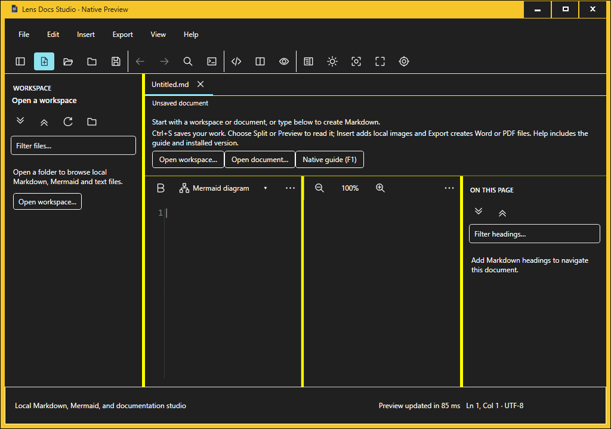

# Goal #56 — High Contrast colour investigation

**HIGH_CONTRAST_ROOT_CAUSE_INCONCLUSIVE**. The original failed 4.5:1 acceptance
remains unresolved. No product correction or existing acceptance-harness change
is justified. **HIGH_CONTRAST_CORRECTION_NO_GO**; **PR73_INTEGRATION_NO_GO**.

This is a completed bounded investigation with incomplete causal evidence. Both
new diagnostic workflows failed their restoration control before reaching the
candidate. There is **no completed same-host baseline/candidate comparison**.
Identical source does not supply the missing candidate observations.

## A. Exact source and governance

| Role | Source commit | Git tree |
|---|---|---|
| Fetched develop / baseline | ab21919a42ec8b3d17d9ba2e39b4e7e41459e206 | f74345a61d0e9320a8826da8cb2ca3478ee3125e |
| PR #73, unchanged | 0e80946eaf15bfd5b6dcf02a3bd16b00d5306569 | ea571be730c48b20a1c70b90f1bcb1883f4dde73 |
| Protocol before hosted execution | 64c0948b8992e5f2050f88783d172c8de505de80 | ff6a9fb3c8abebbef20c84aac4a2591142f1ded1 |
| First diagnostic overlay | 4b1aaea2d97805af419210e166667a4e00f4e4c1 | 06ca75ef470afb472d7896ec8e379dbdbfcb7547 |
| Amended diagnostic overlay | fc143791c47baa78d7de80268d5ebbc27e464e78 | 1c2edb1b204c61e6dcc06a230a0afac0909be748 |
| Corrective product/harness source | NONE | NONE |

Work uses isolated `C:\Code\goal56-high-contrast-colour-rca`, branch
`experiment/goal56-high-contrast-colour-rca`. The original checkout and its existing
untracked attachments are preserved. The final evidence-only commit/tree belongs
in the accompanying Goal #56 receipt; it is distinct from executed overlay sources.

Fresh GitHub reads before and after execution confirm PR #73 is OPEN, DRAFT and
UNMERGED at the same head/base. Both active rulesets are read only. No required
check, merge policy, licence grant, frozen ownership decision, signing/update trust,
installer, product source or benchmark is changed.

All nine inspected theme/style/icon/harness/workflow files have identical Git
blobs between baseline and PR #73. The entire `src/native` subtree has no diff.
[Exact blob and SHA-256 comparison](../open-source/evidence/goal56-high-contrast-colour/source-comparison.json).
The PR's separate notice additions remain intact and are not imported into or
undone by this baseline-derived experiment.

## B. Original raw failure and immediate explanation

Original [workflow 41345774785](https://github.com/DouglasNLima/local-docs-studio/actions/runs/41345774785),
[job 124965136051](https://github.com/DouglasNLima/local-docs-studio/actions/runs/41345774785/job/124965136051),
attempt 1, remains **FAILURE**. Original artefact `13099735465` has 47 members,
3,487,686 bytes and independently verified SHA-256:

`5abffd2f92594d61856c9f9aea6d284ec69f6def3e5b1c268597b70bd2ee439e`.

The exact exception is `System.IO.IOException: Actual Windows high-contrast command
press colours lost readable text and icon contrast.`, at `NativeUxScreenshots.cs:28`.
The command is the existing `--ux-screenshots ... --high-contrast` invocation.

| Original observation | Foreground | Background | Contrast |
|---|---|---|---:|
| Requested ColourSlot and effective bound brushes | #263B50 | #0078D4 | 2.542596386238992:1 |
| WPF SystemColors | #263B50 | #0078D4 | 2.542596386238992:1 |
| Win32 GetSysColor | #263B50 | #8EE3F0 | 7.893273424942036:1 |

Both HC flags are true. Both brushes are unfrozen with Active bindings.
`Fluent.HC.xaml` is loaded. `capturesStarted:false`, zero High Contrast PNGs and
empty failure observations prove that this invocation stopped **inside the
validation process before launching its screenshot application's executable**.
Earlier eight current-source Light/Dark captures are separate evidence.

The immediate colour-ownership chain is established: ThemeService reads WPF
`HighlightColor` and `HighlightTextColor`; those values enter its ColourSlots;
the bindings deliver those same values to PressedBrush and PressedTextBrush;
the unchanged contrast calculation correctly rejects the resulting pair. It
does not read Win32 for the pressed palette. The original data does not show a
binding delivery error or an application-branded fallback. Win32's cyan value is
a later separate system read, not the application's observed pressed background.

What remains unknown is **why WPF supplied that particular hybrid pair then**.
The original record has no pre-transition colour/cache reads, per-read monotonic
times, first-cache-fill history, Windows/WPF notification trace, settled-state
boundary, default-scheme observation or actual pressed application capture.
Its sequential observations are not an atomic system snapshot. No later image
or successful sample reconstructs that missing boundary.

The raw archive, initially fetched decoded job log and subsequent byte-preserving
raw log are retained in `C:\Code\goal56-high-contrast-evidence`. The raw job log
SHA-256 is `91c6fe9e334ed2e02e35866afbf2038511607d480a64e196d75ee5f6218fa568`.
[Original archive/member verification](../open-source/evidence/goal56-high-contrast-colour/original-archive-verification.json),
[raw job text](../open-source/evidence/goal56-high-contrast-colour/original-job.txt),
[unmodified diagnostic](../open-source/evidence/goal56-high-contrast-colour/original-high-contrast-pre-assertion.json),
[failure](../open-source/evidence/goal56-high-contrast-colour/original-failure.json).

## C. Protocol, execution and causal observations

The [committed protocol and bounded amendment](goal56-high-contrast-colour-protocol.md)
define one initial execution and one tooling-repair execution. No original workflow
or failed job is rerun. No third diagnostic execution follows the second failure.
Native application assembly bytes are checked before/after overlay compilation.
This check covers Native.dll, not the complete product/runtime payload. The baseline product
assembly remains SHA-256 `a590d0f6a41a681ae70c69e20e5c9aa22ee6f7723a2a688b5873c189e07cc87f`
in both new environments. Instrumentation is outside the product and packages.

| Execution | Source / run / job | Terminal result | Raw artefact SHA-256 |
|---|---|---|---|
| 1 | 4b1aaea / [41352895301](https://github.com/DouglasNLima/local-docs-studio/actions/runs/41352895301) / 124986700604 | FAILURE | 77ea8db7ff7bfb5ae2ef8a6b830754c3619d0f4fdf49bfc279968570e972c0d0 |
| 2 | fc14379 / [41353431597](https://github.com/DouglasNLima/local-docs-studio/actions/runs/41353431597) / 124988327267 | FAILURE | 87e9a791059518de4141cf14694d3d9dd9e2365fe0b87f4f2721da922bc65b4d |

Artefacts are respectively `13102560763` (460,749 bytes, 44 members) and
`13101779489` (64,548 bytes, 37 members), each independently downloaded/hashed.
Both hosted attempts are attempt 1 of their own runs, not GitHub reruns.

**Execution 1:** exact, uninstrumented baseline HC screenshot acceptance passed
once, preserving the original foreground equality and **4.5:1** assertion, with
four completed captures and ratio 7.893273424942036. This was the baseline source,
not PR #73. Its subsequent separate transition process deliberately read normal
WPF colours and created a diagnostic HWND. A recorded OS HC=true boundary still
had normal Win32 colours and WPF HC=false. Later Win32 colours became HC while
WPF remained normal. Applying System once selected Fluent.Light and a normal
pressed palette. A single idle operation completed before the actual WPF
HighContrast property-change and WM_THEMECHANGED notifications arrived.

The single-idle envelope ends at 21:39:27.700681Z. WPF's HighContrast notification
was observed at 21:39:27.9917931Z and the diagnostic HWND's WM_THEMECHANGED at
21:39:28.0049472Z. These timestamps are from one process and frequency 10 MHz.
They demonstrate that queue idle did not establish settings-transition completion.
They do not measure the historical failed process's notification ordering.

A fresh WPF child under the same active HC scheme read matching cyan/dark colours
and installed the correct HC palette. The actual fresh product then showed the
same correct pressed command/icon pair. Disposal restored the OS flag/default
scheme string, but its immediate single-idle observation still contained HC
colours. The exact restoration assertion failed. A separate PowerShell indexing
defect also attempted to hash the index file while its pipeline had opened it for
output, masking the primary error in the outer job log. Both errors are retained.

**Execution 2:** the amendment repaired diagnostic observation and indexing only.
It retained the early snapshots and waited for actual native WM_THEMECHANGED plus
WPF HighContrast property-change notifications, then completed one idle operation
within the same 20 seconds. It did not wait for a colour/contrast result, inject
messages, retry an input or reapply a theme. Baseline's passed prelaunch acceptance
was not repeated.

| Execution 2 boundary | OS HC | WPF HC | WPF text / highlight | Win32 text / highlight |
|---|---|---|---|---|
| A, normal | false | false | #FFFFFF / #0078D4 | #FFFFFF / #0078D4 |
| B, after SPI return | true | false | #FFFFFF / #0078D4 | #FFFFFF / #0078D4 |
| C, after Apply; D, first idle | true | false | #FFFFFF / #0078D4 | #FFFFFF / #0078D4 |
| D, actual notifications | true | true | #263B50 / #8EE3F0 | #263B50 / #8EE3F0 |
| Fresh WPF/application | true | true | #263B50 / #8EE3F0 | matching fresh WPF probe |
| Restoration after actual notifications | false | false | #FFFFFF / #0078D4 | #FFFFFF / #0078D4 |

The standalone dictionary's normal requested/effective pressed palette remained
unchanged at 12.256016681911959:1 because it was applied once before notifications
and has no MainWindow preference-change subscription. This is not actual HC
acceptance and is not evidence that the real application's live event path fails.
The real MainWindow queues ApplyTheme from UserPreferenceChanged; that lifetime
path was inspected but **not exercised across HC entry/exit** in this investigation.

Execution 2 restored all six sampled Win32 colours and the exact flags (126), but
the `HIGHCONTRASTW.lpszDefaultScheme` string changed from empty to `High Contrast
Black`. That field identifies a **default scheme**, not by itself the currently
active theme. The exact restoration guard remained false and stopped the run
before candidate checkout. No later passing interpretation overrides that guard.
No scheme was explicitly substituted by the diagnostic. See Microsoft's
[HIGHCONTRASTW contract](https://learn.microsoft.com/en-us/windows/win32/api/winuser/ns-winuser-highcontrastw).
Both machines were disposable hosted runners; no owner-host OS setting changed.

Consequently **PR #73's passive control, all candidate A–F controls and the planned
same-host baseline/candidate comparison are NOT EXECUTED**. The protocol's intended
comparison is not presented as achieved. Further execution needs a separately
bounded proposal that addresses this restoration limitation and offers new evidence.

### Environment and runtime identities

Both new environments: Windows Server 2025 Datacenter x64, build 26100;
`win25-vs2026`, image `20261021.278.1`; AMD EPYC 7763, four logical processors;
SDK 10.0.403; framework-dependent .NET/WPF 10.0.14. Diagnostic/fresh/product PIDs
and session 2, UTC/monotonic observations, paths and framework/module hashes are
retained in the source-bound JSON. Identity snapshots observe `aero.theme` before
activation and fresh probes observe `hcblack.theme` after activation.

| Loaded diagnostic framework component, 10.0.14 | SHA-256 |
|---|---|
| System.Private.CoreLib.dll | 69d56e12535d3a8f2f8f89ac8f97577e6dc788d26f2e7b69be8fb5f6ff17ff28 |
| PresentationFramework.dll | 15ec7ac7eaecdeabf3bfb378711f2c45bcd8a59d77bcd8254b9e90b776385189 |
| PresentationCore.dll | 131faa87bce352c2c7ea02fa6d6c36533992fd77a3bf429d1145d21ef3650f1d |
| PresentationFramework.Fluent.dll | 502e8904dfcccbc8376373637e57d7f2f2158b0206959c13618d64e0030b0d47 |
| coreclr.dll | 1bc65b8d45474b19adf3ca85ce881087aff599ffc72b2c1a323e878227757b65 |
| wpfgfx_cor3.dll | 48a8e8100fd38183a0fabfe7fad0bf9e9d28d65a0827298ef0910b31e6e94cbd |

PresentationFramework's actual path is under
`C:\Program Files\dotnet\shared\Microsoft.WindowsDesktop.App\10.0.14` and its
recorded version is `10.0.14-servicing.26522.126+0427b9abbead3fa64c6655eb4290c537397131fa`.
Its hash matches the original failed process. Original CPU, first cache fill and
full module inventory were not recorded. The previous self-contained packages'
10.0.13 runtime is a separate prior receipt; no controlled 10.0.13/10.0.14
comparison occurred and this difference is not attributed as the cause.

## D. Colour ownership and hypothesis assessment

WPF's inspected [10.0.14 SystemColors implementation](https://github.com/dotnet/wpf/blob/4726a1a94599e1c2aa090f5326e2ca930f016c7d/src/Microsoft.DotNet.Wpf/src/PresentationFramework/System/Windows/SystemColors.cs)
keeps independently valid cached colour slots backed by GetSysColor. Highlight
and highlight text use the corresponding Win32 system indices, not AccentColor.
Its [SystemResources notification path](https://github.com/dotnet/wpf/blob/4726a1a94599e1c2aa090f5326e2ca930f016c7d/src/Microsoft.DotNet.Wpf/src/PresentationFramework/System/Windows/SystemResources.cs)
invalidates colour caches on WM_SYSCOLORCHANGE/WM_THEMECHANGED and separately
handles setting parameters/resources. Reviewing a version tag does not prove
instruction-level equivalence to the original loaded binary.

The loaded Fluent dictionary URI is recorded, not inferred from an HC flag.
Inspected Fluent.HC resource keys refer to WPF system colour keys. Application
PressedBrush/PressedTextBrush remain ThemeService-owned ColourSlot brushes.
Desktop.CommandButton/OverflowButton template triggers set Surface.Background and
Foreground from those resources. CommandIcon inherits Foreground and draws its
pen with it; CommandIcons.xaml contains geometry, not a competing colour palette.
Form actions derive from the shared command style. The toolbar's implicit style
is a derived BasedOn style, which explains the observer's direct-reference
`styleMatchesDesktopCommand:false`; it does not establish a different template.

| Hypothesis | Supported observation | Causal limit |
|---|---|---|
| A: WPF cache | Normal WPF values persist after Win32 changes in execution 1; after actual notifications execution 2 agrees | Original slot population/invalidation chronology absent; original hybrid not reproduced |
| B: OS transition | Actual OS HC flag precedes the change of system colours in both executions | Does not prove the original assertion crossed that same transition interval |
| C: API disagreement | WPF getters and Win32 indices are equivalent colour categories in the same diagnostic process/session, sampled sequentially | Neither independently proves what an unlaunched app would display at the original boundary |
| D: dictionary/binding | Original requested/effective values agree, Active/unfrozen; real fresh app bindings agree | No demonstrated ColourSlot delivery defect; standalone probe has no automatic MainWindow subscription |
| E: environment/runtime | Same named image/build/framework hash as the failed WPF observation; default-scheme restoration differs | No runtime or runner cause isolated; equal image names do not establish equal transient state |
| F: actual presentation | Two baseline fresh-app pressed/icon observations agree with HC system colours | Candidate, live transitions, other states and complete application accessibility acceptance remain unproved |

The evidence demonstrates a real OS/WPF transition hazard and an invalid idle-only
assumption in the **new diagnostic**. It does not establish an original product,
acceptance-harness, OS/WPF or environmental root cause. No speculative correction
is introduced into those components.

## E. Validation, captures and limits

- Original failed HC invocation: zero captures; immutable historical FAILURE.
- New uninstrumented baseline acceptance: one invocation, four HC captures, PASS
  at 7.893273424942036:1. No candidate acceptance invocation reached.
- Real baseline command: two separate fresh applications, one mouse-down and one
  completed pressed capture each, both ratio 7.893273424942036 for effective
  Foreground and actual icon against Surface.Background. IsPressed/hover=true;
  keyboard focus=false, consistent with the non-focusable icon-only toolbar
  command. UIA records visible/enabled identity and focus; Invoke has no generic
  pressed-state property, so native WPF observation supplies that state.
- The original failed acceptance and new pressed acceptance observations use the
  opaque effective pair and unchanged 4.5 requirement. Independent Python
  luminance calculations reproduce both
  original ratios exactly. No alternate pair is substituted for a failed pair.
- Local final overlay and observer builds: zero warnings/errors. Preliminary
  missing System.IO import and Rectangle.Center compile errors were corrected
  before hosted execution; their logs remain local. No native test ran on the
  owner's desktop.
- A preliminary final governance check rejected proposed status additions to the
  frozen current-readiness/validation documents. Those additions were removed and
  the protected bytes restored exactly; the findings remain in this separate
  report. No protected digest or licence boundary was changed to accept them.
- A Git round-trip check found line-ending normalisation in new evidence copies.
  Byte-preserving attributes are scoped to this new evidence directory only;
  original archive/log bytes are rechecked against committed blobs. Existing
  protected attributes and evidence remain unchanged.
- Local static integrity PASS: 50 modules, 61 shell assets, 151 vendor assets,
  59 external-dependency scans; service-worker controls cover 212 attempted
  assets with six concurrent fetches and the intentional optional failure.
- Scoped licence/governance checks preserve 1,081 granted paths and 2,421
  protected digests. New diagnostic paths remain ungranted; no licensing decision
  is inferred. Final checks and independent review are recorded in the issue receipt.

All colour snapshots are non-atomic. Initial normal reads intentionally prime
caches, and the diagnostic HWND affects WPF notification registration. These
effects are confined to the declared transition controls. The passive original
command has neither overlay nor startup hook. The real-app startup hook registers
WPF events before normal startup, then observes colours after Loaded/input; it
can affect initialisation timing even without explicitly reading colours early.
The observer's endTicks precedes some trailing WPF/metadata reads, so it is not
a complete atomic/read-completion envelope. Actual product module versions/hashes
were not independently enumerated by that hook; diagnostic/fresh-process loaded
framework inventories must not be relabelled as its own complete module record.
The app hook does not sample Win32 colours directly or dump all resolved Fluent
keys. Its loaded dictionary URI, application palette, template and icon values
are the observed subset; inspected upstream dictionary source is separate evidence.
The observer also records a normal-state ratio of 1 against a transparent Surface.
Its helper ignores alpha/compositing, so that number is **invalid as normal-state
contrast evidence**. It establishes neither a normal-state failure nor a pass.
The two pressed surfaces and original failed pair are opaque, and their ratios
were independently recalculated. No normal-state acceptance is claimed.

The two pressed screenshots were visually inspected. They establish their later
fresh-process state, not the historical failed state or a full-app PASS:

Full Desktop UX, initial Light/Dark, lifetime HC entry/exit, hovered/focused/normal
surface regressions, Core, Mermaid Creation/workspace, package and installed
lifecycle revalidation were **not executed for a correction**, because no correction
was justified. Earlier PR #73 results remain separately attributed: 2,298 Core
tests, 202 corpus cases, all 24 installed-authoring families and 30 protected
functional/compliance contexts pass. Those results do not resolve this failure.
The performance benchmark is unmodified and was not rerun here.

## F. Integration and preserved compliance

**HIGH_CONTRAST_CORRECTION_NO_GO**: no demonstrated independently supportable
product/acceptance-harness correction; diagnostic collection is not acceptance.

**PR73_INTEGRATION_NO_GO**: the relevant failed desktop UX acceptance remains
unresolved and the intended new candidate comparison was not reached. Keep #73
open/Draft/unchanged. No corrective PR is created merely to carry diagnostics.

The previous notice review's 575 distribution files, 14 original and 34
supplemental notices, 507 unchanged third-party/runtime DLLs and 20 official
archive identities remain its independent evidence. Nothing here undoes those
changes or re-certifies their packages. PDFsharp font permissions, Gent/JMathTeX
author-permission history, SharpVectors schema provenance, R3/R4 exclusions and
other provider/compiler provenance questions remain open. Technical agent review
is not human approval or legal clearance.

## G. Release and next evidence boundary

Preserve **NATIVE_CONTINUOUS_250MS_FAIL** (original PR #73 replications 41/66 and
31/66 failed measurements), **SIGNPATH_ELIGIBILITY_UNCONFIRMED** and
**NATIVE_STABLE_NO_GO**. No merge, rebase, PR #73 update, signing, tag, SignPath
application, native Stable release, public release or production publication
occurred. The ordinary web test workflow's default-branch-only deployment guard
is unchanged; experimental pushes do not deploy Pages.

Further causal work would require a newly approved fixed budget, a supported
restoration contract for the default-scheme field, an actually completed equivalent
baseline/candidate comparison and source-bound first-read/notification evidence
that connects the hybrid pair to the failing boundary. Actual live application
theme transitions would still need testing. No later successful state can erase
the original failure, and no product change is justified merely to make CI green.

[Complete investigation index and raw-member hashes](../open-source/evidence/goal56-high-contrast-colour/investigation.json).

Independent agent `/root/independent_high_contrast_review` rehashed all three ZIPs
and independently verified all 47/44/37 extracted members, the 36 completed
execution-2 index entries, source/tree identities, nine identical source blobs,
original failure, contrast arithmetic and the unchanged assertion. It verified
actual pressed-command raster pixels in both baseline captures, including 26
dark-stroke and 848 cyan-fill pixels in each sampled command region. It confirmed
that candidate/same-host results are absent and that measured transition timing
does not prove historical causation. The transparent normal measurement, early
observer timestamp and Native.dll-only binary-check qualifiers are corrected above.

[Independent technical review](../open-source/evidence/goal56-high-contrast-colour/independent-review.txt),
SHA-256 `09cc3f1fdcdff4857f6303498a716bbaff92bdd90edf94a4c31da3a59cefac82`,
agrees with INCONCLUSIVE and both NO-GO decisions. This is not human approval or
legal clearance. The final Goal #56 receipt records final evidence commit and
terminal ordinary web CI; no further diagnostic run is scheduled.
