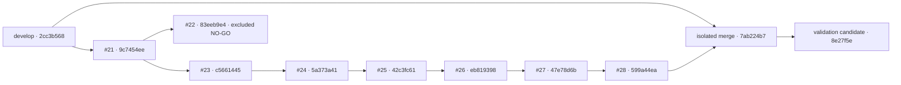

# Native integration readiness

**READY WITH RESTRICTIONS** for the tested application/validation candidate `8e27f5ee0e407fa2fe5cb9b95dcb16db8ce3ccee` and immutable internal unsigned preview `.546`. All six candidate workflows pass: 24 required jobs succeed, including twelve real historical upgrade cases; two Pages deployment jobs are expected skips. This is review readiness, not merge, signing or production-release authorisation.

This report is carried by a later documentation-only commit on `integration/native-wpf-candidate`. Consult [Draft PR 29](https://github.com/DouglasNLima/local-docs-studio/pull/29) and its [live checks](https://github.com/DouglasNLima/local-docs-studio/pull/29/checks) for the exact final documentation HEAD and CI conclusions. That final documentation gate must pass before handoff; it does not relabel the selected binaries. Historical reports keep their original source and environment labels. Inspectable counts, receipt hashes and performance observations are in the [machine-readable evidence](evidence/integration-readiness.json).

## Source and ancestry

Remote references were fetched on 16 October 2026. Baseline `develop`: `2cc3b5680958c9c553dad23856e6010c158fccd7`. Integration application/validation candidate: `8e27f5ee0e407fa2fe5cb9b95dcb16db8ce3ccee`. Initial integration merge: `7ab224b7c45722f6a59db20496faa7e72e479c92`. Its first parent is that baseline, its second parent is the cumulative accepted head `599a44eaa2e11ffbdb020b76a3059b4b37743154`, and its tree is identical to the accepted head. No conflict resolutions, replayed commits or changed author attribution were required.

Every row's previous head is its actual merge-base and an ancestor (`git merge-base --is-ancestor` exit 0). Left/right exclusive commit counts are shown relative to the previous row.

| PR | Head | Previous / head exclusive commits |
|---|---|---|
| Baseline | `2cc3b5680958c9c553dad23856e6010c158fccd7` | — |
| #21 | `9c7454eeb892614af93881b762a1b6aecc3259d2` | 0 / 177 |
| #23 | `c566144529c3c0e4393c1604544201b936e4a6a2` | 0 / 7 |
| #24 | `5a373a412e86b93ea8af1b9e5b867250e3d23ee1` | 0 / 38 |
| #25 | `42c3fc614feb6db6f69a242312604e46ff76c238` | 0 / 21 |
| #26 | `eb81939835a1bb2a92cf76570de77d8d69e571ff` | 0 / 20 |
| #27 | `47e78d6bff490a9b0c0b5cb2022dab262fe14e5e` | 0 / 16 |
| #28 | `599a44eaa2e11ffbdb020b76a3059b4b37743154` | 0 / 22 |

PR #22 head `83eeb9e489bd3c9513f9ffb17fe0b833c1a088ff` is not an ancestor. Its merge-base with the candidate is `9c7454eeb892614af93881b762a1b6aecc3259d2`. All 27 paths unique to that spike are absent, including `src/native/spikes/ContinuousViewer*`, its measurement script and separate workflow. The supported original FlowDocument Continuous reading mode remains present with its existing performance limits. All original PRs remain Draft, open and unmodified.

## Integration changes

The initial cumulative diff has 679 files, 70,243 insertions and 67 deletions. The application is retained as implemented. Integration changes enable native push checks on the named candidate branch, enable desktop UX PR checks targeting `develop`, and add pinned original-package upgrade tests. Web checks continue on both browsers. Pages deployment remains restricted to the repository default branch outside pull requests.

Integration validation additionally checks the complete installed/portable payload inventory, readable recovery snapshots, usable Word templates, reusable Markdown templates/snippets and actual decoded relative images. Evidence inspection exposed the first version of the new content-library check reading the wrong directory and reporting zero entries. `e3c19622` corrects it to `content-library`, requires non-empty representative content and verifies image decoding/hashes. Earlier `.538`/`.539` packages and cancelled migration attempts remain intermediate evidence; they are not the accepted final migration candidate. Assertions and existing timeouts were not relaxed.

Further independent inspection found that the original full UI harness's final session had only saved tabs. `eb6ac95` therefore adds a guard-protected preparation step against the **original installed application**: its native editor value provider changes an existing saved document, Ctrl+N creates an untitled draft, and its own Closing handler persists both after explicitly declining file saves. The harness writes no session schema. Restoration requires non-empty dirty saved-file and untitled-draft populations, checks every exact text/baseline/identity, and leaves workspace file bytes unchanged through upgrade and reinstall. `.540`/`.541` are preserved intermediate evidence, not unsaved-state acceptance.

The intermediate [branch run](https://github.com/DouglasNLima/local-docs-studio/actions/runs/38905096286) failed its `.433` job after migration, during separate interrupted-save input preparation: its retained session contains `こんにはは.` where `こんにちは.` was requested, before any failed save was attempted. The PR scenario passed. The fixture now prepares exact Unicode text through the actual editor's value provider; all rejected-save, process termination/restart, original baseline, BOM and byte assertions remain, as do dedicated keyboard workflow tests. This is a recovery-fixture correction, not a claim to have diagnosed every synthetic keyboard/IME delivery issue. Original failure logs, screenshot and session bytes remain retained under `artifacts/integration/migrations-540/433/`.

`47b5133` scopes the historical matrix to the named integration push and its `develop` PR. This keeps expiring historical artefact pins out of unrelated future PR checks. Native and UX validation still run for PRs targeting `develop`, and deployment permissions remain unchanged.

## Integrated source-tree and dependency audit

The Native and Core application trees are identical to both the accepted cumulative head and `.531` application source `4940c58a542b635e7e008eeaf31b03ca4ec5878a`, despite the separate validation-harness additions. Git tree IDs are Native `fb1a3c4f2b06f5529906c3a442c3b8409a444e2f`, Core `acab5f44d41b9b6c2ef76b435d503cf0cbac7125`, and browser assets `a5eda9906664f2f46b8608ff702c820fcc038bcb`. The linked embedded native help also retains blob `b4cf44e9b59ca5cf89e90e3d4884d5ced09447f0` from `.531`; the report/README changes do not alter that compiled input. The legacy Windows tree remains identical to `develop`: `11c01b8a0b718bb3008a28f90371d7ddd213ad3d`.

No test files were deleted; the browser suite grows from 127 to 134 cases per browser. Stable Git patch IDs show no duplicate patches in the accepted chain. No installer, executable, DLL, ZIP, private Word file or signing key was added to the cumulative source diff. Historical engineering screenshots, fonts/icons and reports remain source evidence. Native project/lock files retain .NET 10, AvalonEdit 6.3.1.120, Markdig 1.4.0, Mermaider 0.15.1 and SharpVectors 1.8.6. Locked Release restore/build pass. The current NuGet transitive vulnerability query reports no known vulnerable packages; npm reports no vulnerabilities. These queries do not prove absence of undisclosed dependency defects.

## Regression evidence

Direct local evidence on the initial integrated tree: Release build passed with zero warnings/errors; 1,229 Core tests passed, zero failed/skipped; static integrity passed (50 modules, 57 shell assets, 150 vendor assets, 56 external-dependency scans). The full local browser suite passed 268 cases, and the latest validation harness also builds with zero warnings/errors. Fresh hosted evidence for `8e27f5e` and its verified PR merge checkout `223cd7e767540beaf5af3f38a680ca608cc60aee` follows. Historical PASS counts are not current acceptance.

| Integrated check | Direct result |
|---|---|
| Hosted Release build and full Core suite | Branch and PR native jobs PASS; 1,229 executed/passed each, zero failed/skipped |
| Rendering/export corpus | Branch and PR native jobs PASS; 70 cases each, zero failures |
| Persisted workspace/export workflow | Branch and PR native jobs PASS; 13 public-service/actual-output checks each |
| Desktop UIA | Branch and PR native jobs PASS; 75 groups in each of built, installed, upgraded and reinstalled contexts (300 executions per job); duplicated root/nested JSON is not counted twice |
| Recovery, source integrity, SVG/input/update defences | Branch and PR native jobs PASS; existing checks retained |
| Package rejection controls | Branch and PR native jobs PASS; seven negative controls each; original package bytes unchanged |
| Same-revision installer lifecycle | Branch and PR native jobs PASS; 22 state files retained; 14 exact tabs including one dirty saved document and one untitled draft; two templates, two snippets, one usable Word template, six readable snapshots and six decoded image references |
| Normal Mermaid authoring | Branch and PR UX PASS; 119 checks each |
| Actual Windows High Contrast authoring | Branch and PR UX PASS; 115 checks each |
| Canonical layout fidelity | Branch and PR UX PASS; 281 assertions each |
| Desktop UX controls | Branch and PR UX PASS; 10 workflow groups each |
| Web Chromium and Edge | Branch and PR web workflows PASS; 134 cases per browser (268 per workflow), static integrity also passes |
| Six historical upgrades in both branch and PR workflows | PASS; twelve real cross-revision cases, including original .317, with both unsaved-state types |

The old 113 focused Mermaid cases are a historical reference, not an additional current suite total. Current related Core cases are included in the full 1,229-test run, alongside fresh native authoring/fidelity evidence. UI groups contain several assertions and must not be presented as individual unit tests.

## Historical compatibility and provenance

All six original installer/ZIP pairs were preserved under the ignored `artifacts/integration/historical/` engineering directory. Their SHA-256 values match the retained original sidecars. No installer or application was executed on the user's desktop. Exact source/run/artifact and independently recorded package pins are in [`native-historical-previews.json`](../../tests/fixtures/native-historical-previews.json). These are original branch-source packages, not rebuilds or PR merge packages.

| Original | Original source | Branch `.546` | PR `.547` | Tabs / dirty saved / untitled | State files / snapshots |
|---|---|---|---|---|---|
| `.317` | `dd6c4c33f1a6fa86206e76b2153afcc7b151a523` | [PASS](https://github.com/DouglasNLima/local-docs-studio/actions/runs/38914784848/job/117032739300) | [PASS](https://github.com/DouglasNLima/local-docs-studio/actions/runs/38914793068/job/117031265015) | 14 / 1 / 1 | 20 / 4 |
| `.393` | `5a373a412e86b93ea8af1b9e5b867250e3d23ee1` | [PASS](https://github.com/DouglasNLima/local-docs-studio/actions/runs/38914784848/job/117032739447) | [PASS](https://github.com/DouglasNLima/local-docs-studio/actions/runs/38914793068/job/117031264961) | 14 / 1 / 1 | 22 / 6 |
| `.433` | `ef392b0df46243805e5596d160d2c077a1c9f8dd` | [PASS](https://github.com/DouglasNLima/local-docs-studio/actions/runs/38914784848/job/117032739348) | [PASS](https://github.com/DouglasNLima/local-docs-studio/actions/runs/38914793068/job/117031265075) | 14 / 1 / 1 | 22 / 6 |
| `.473` | `36b331ac6c2b29ebcf53e1a16735a5696ae8b2ac` | [PASS](https://github.com/DouglasNLima/local-docs-studio/actions/runs/38914784848/job/117032739333) | [PASS](https://github.com/DouglasNLima/local-docs-studio/actions/runs/38914793068/job/117031265093) | 14 / 1 / 1 | 22 / 6 |
| `.497` | `302096110631c6ad5ad12cdc4b44587cc293ccf6` | [PASS](https://github.com/DouglasNLima/local-docs-studio/actions/runs/38914784848/job/117032739578) | [PASS](https://github.com/DouglasNLima/local-docs-studio/actions/runs/38914793068/job/117031264968) | 14 / 1 / 1 | 22 / 6 |
| `.531` | `4940c58a542b635e7e008eeaf31b03ca4ec5878a` | [PASS](https://github.com/DouglasNLima/local-docs-studio/actions/runs/38914784848/job/117032739453) | [PASS](https://github.com/DouglasNLima/local-docs-studio/actions/runs/38914793068/job/117031265092) | 14 / 1 / 1 | 22 / 6 |

Every row passes after upgrade and again after uninstall/reinstall. Each retains two Markdown templates, two snippets, one Word template that exports usable current DOCX, and six decoded/hashed image references. `.317` correctly has four original snapshots and 20 total state files; newer fixtures have six and 22. Excluding the four normally mutable session/preferences files, all 16/18 remaining state files and 13 saved workspace sources remain byte-exact. The `.317` case was prioritised and its restored untitled draft was visually inspected. Original UI harness groups are 68 for `.317`, 74 for `.393` and 75 for later versions; every candidate after-upgrade/reinstalled UI run passes 75 groups. These are workflow groups, not individual unit tests.

All entries below are original `0.1.1-preview` branch-source packages, attempt 1. The two SHA-256 columns identify installer and portable ZIP bytes respectively. Original metadata, checksums and verification receipts are preserved alongside the binaries; no package has been relabelled or publicly republished.

| Preview | Original Actions artefact | Installer SHA-256 | Portable ZIP SHA-256 |
|---|---|---|---|
| `.317` | [38523259733 / 11874889099](https://github.com/DouglasNLima/local-docs-studio/actions/runs/38523259733/artifacts/11874889099) | `77b36337e2df38256375eba4caae76f8a2a656d8b371a203cfc00615201d52e0` | `36d1954a8e4fcac47565971a93e902ea550da60f2485e0df0acc06bd507e3a2f` |
| `.393` | [38614758427 / 11921090952](https://github.com/DouglasNLima/local-docs-studio/actions/runs/38614758427/artifacts/11921090952) | `1823aa5b758330e90553de4d5c6d64f14eb0edff440dc5db88de09e59ed05a27` | `bb0ff3ac6dd57e084394a16bd881bc0d8c1c2fcc5bbb49ddacdde14a4b1a7ec7` |
| `.433` | [38739187969 / 11976154440](https://github.com/DouglasNLima/local-docs-studio/actions/runs/38739187969/artifacts/11976154440) | `8eaa53d04bdc260eb457f44106d9526a84cbdaeffc762630b5122251b36a4361` | `59aed3b6d6184d279aff697d0676495019115fcf56765accc83b478bf4153596` |
| `.473` | [38778919600 / 11996638307](https://github.com/DouglasNLima/local-docs-studio/actions/runs/38778919600/artifacts/11996638307) | `2404b36aa4b1d37c962ca42ad99f1ad59697367727cb60eca7713fda10c862c6` | `31517034d22c00cff7133b799e511204d286dec9d4e29ae35ab807ba96ef6077` |
| `.497` | [38813557924 / 12010778495](https://github.com/DouglasNLima/local-docs-studio/actions/runs/38813557924/artifacts/12010778495) | `30d017d72ce54ff9d30e21024f91581d361b5a0bf182b0ee63fdee3a1b10aa82` | `acef70855f9bc6c16dfcd903d48b3e43a095601c6eaf0343b6ef3d1d450c7860` |
| `.531` | [38890518579 / 12042946581](https://github.com/DouglasNLima/local-docs-studio/actions/runs/38890518579/artifacts/12042946581) | `e39fc3f50efc8f0445f425181d2f6af41b0baee07f0919d85413290c8aea2a4a` | `7d9e4a05479c9da08f2d333c0f25bb872f02282ec96c616ea19a72f302f0808b` |

Availability was checked against GitHub's original run/head identities and unexpired artefact records. `.317`/`.393` expire on 28 October, `.433`/`.473`/`.497` on 29 October, and `.531` on 30 October 2026; local immutable copies protect this evidence from Actions retention. The earlier UX report's selected `.387` remains its own historical candidate; the requested `.393` is separately pinned to the later `5a373a41` branch revision.

Disposable upgrade jobs build each original revision's validation harness, install the pinned original binary and produce synthetic state through its actual UI/services. They then install the integrated package, restore those tabs/text/settings/workspaces, compare retained file hashes and exercise uninstall/reinstall/recovery. Building a historical harness does not rebuild or relabel the historical application package. The feature matrix below defines the acceptance scope. All twelve cross-revision cases pass; every receipt explicitly records a different original/candidate source and use of the original state-producing harness. The additional UI driver writes no modern session schema: the original installed application creates and persists the two unsaved states.

Direct comparison from `.317` source `dd6c4c33` to `8e27f5e` shows that session schema version 1 retains its existing document/preference field names. `RecoveredDocument` adds `IsPinned = false` and `PreviewSourceOffset = 0`; `UserPreferences` adds nullable `Desktop`, whose synchronisation choices are opt-in for existing users. Existing theme/layout/update/recent-path/editor/preview/outline fields remain. Those additions explain safe defaults for older records; they do not establish that `.317` stored newer panel-width or pin preferences. Exact retained known preferences, source baselines and library files still require the runtime checks above.

## Security, performance and production boundaries

The focused cumulative security scan `e020dea9-3e87-47d8-9c8a-162d1eb0c196` completed and sealed with **zero confirmed findings and no deferred work**. Its immutable range is `2cc3b568…599a44e`: all 472 source entries, 69 supporting files (including 33 XAML files) and 138 non-executable changes are accounted for. Integration-only changes received separate source review through `eb6ac95`; the narrower historical CI condition and read-only startup wait were reviewed through `8e27f5e`, with no actionable issue. This is source review, not runtime, dependency-binary or production trust certification. The exact Native/Core tree equality above connects the reviewed application source to the integrated candidate.

Reviewed boundaries include workspace traversal/reparse checks and mutations, recovery, ZIP/DOCX imports, passive attached-template sanitisation, external/embedded resources, PDF budgets, clipboard, exact/stale/parallel-edge Mermaid transformations, SVG metadata identities/external content, cancellation, local state, installer identity and fail-closed signed updates. No browser/editor engine or native HTTP server was introduced. The buildless web edition and service worker remain independent.

The review does not establish hard dependency-internal allocation/time limits for PdfPig, SharpVectors, WPF/font/image codecs, Mermaider or WpfMath, immunity to every filesystem race, or third-party CSV formula neutralisation. No concrete exploitable input or lower-trust path was established for these residual limits. Workbench rollout counters recorded 67,465,862 total tokens (67,334,120 input, including 65,905,280 cached input); these include cached context and nested worker rollouts and are not a billing estimate. Canonical report and full receipts remain in the local Codex Security scan directory; engineering runtime/package evidence is retained separately.

The 250 ms Continuous input diagnostic target remains unmet in representative large documents. Intermittent construction delays remain unresolved. Consolidation does not claim either fixed. Fresh branch native/UX measurements at `8e27f5e` follow; they are single-run observations, not universal latency guarantees.

| Measurement | Observed | Boundary |
|---|---|---|
| Continuous 4,000-item list | **FAIL**, 875.47 ms first-layout input | 250 ms target; 203.19 ms construction; 106,230,680 allocated bytes; complete source and selectable final target retained |
| Continuous mixed document | **FAIL**, 352.73 ms first-layout input | 250 ms target; 213.83 ms construction; 51,142,256 allocated bytes; complete source and selectable final target retained |
| Large workspace | 11.18–12.58 ms enumeration; 8.58–17.36 ms reads; 313.50–379.00 ms parsing | 1,001 documents; 4,140,025 source bytes; warm filesystem caches |
| Large editor | 115.45 ms initial layout; 0.47–91.04 ms insert/layout | 4,120,025 characters; programmatic visible edits exclude OS keyboard delivery and application preview scheduling |
| Actual keyboard text delivery / Save | 626.22 / 107.32 ms | Whole fixture text delivery through exact observation / shortcut through observed UTF-8 write; includes UIA and polling, not individual keystroke latency |
| Warm DOCX / PDF / HTML exports | 3.37 / 45.27 / 2.63 ms | Existing mixed fixture; excludes file writes and subsequent content/schema validation |
| Mermaid 20 / 100 / 300 nodes | 250.80 / 20.42 / 78.00 ms rendering | Cold/warm effects differ; native presentation/layout adds 379.97 / 312.29 / 1,165.93 ms |
| Long labels | 1,698.73 ms native presentation/layout | 20 nodes, 14,602 source characters |
| Dense 190-edge graph | Rejected after 7,574.78 ms; 2,394,172,632 cumulative allocated bytes | Protected source remains exact; cumulative allocation is not peak working set |
| External cancellation | 5,653.45 ms completion; 5,679.69 ms total | Coarse dependency cancellation; the nominal three-second deadline is not a hard wall-clock bound |
| Visual editor startup | 637.69–994.69 ms | Includes native UIA transport; 20/100/300-node canvas observations are 1,550.96 / 2,829.80 / 5,804.83 ms |
| Zoom in/out | 98.88 ms | Includes UIA transport and compositor flush |
| Protected middle-button PAN | 446.61 ms | Includes synthetic drag, UIA transport and compositor flush |
| Native fixture process launch | 2,059.99 ms; 171,184,128-byte working set | Through fixture text/preview readiness; not a cold operating-system launch |

The native receipts are in the [branch native run](https://github.com/DouglasNLima/local-docs-studio/actions/runs/38914784848); the six-scenario Mermaid receipt and actual editor timings are in the [branch UX run](https://github.com/DouglasNLima/local-docs-studio/actions/runs/38914784977). The application tree is unchanged by consolidation; no new critical regression was identified in the exercised observations. Known construction and cancellation costs remain review restrictions.

SDK-free clean Windows certification: **BLOCKED**; hosted SDK-equipped Windows runners do not establish it. Production signing identity: **BLOCKED**. Unsigned in-app update execution remains fail-closed. This work can establish an internal unsigned preview only. Physical DPI/multi-monitor/accessibility and Microsoft Word visual fidelity are not established by schema or hosted UI validation.

Installer acceptance distinguishes byte preservation, usable state and safe refusal. The visible wizard exercises Back/confirmed Cancel before installation and refuses to replace an installed application holding an unsaved draft. The rejected-save test terminates the owned application process, restores its exact draft/baseline in a new process, then explicitly retries the save. Historical acceptance separately restores retained tabs/settings/libraries and compares source/state bytes through upgrade, uninstall and reinstall. This is not certification of killing Setup during payload replacement, power loss or arbitrary schema migration. No downgrade contract is implemented or claimed; an older binary must not be represented as compatible with state written by a newer version. Direct oldest-to-candidate upgrades provide the wider schema interval; a staged six-version sequence remains unexecuted.

## Package and workflow identity

The fresh candidate is `0.1.1-preview.546`, from branch source **`8e27f5ee0e407fa2fe5cb9b95dcb16db8ce3ccee`**, run `38914784848`, attempt 1, clean source. The separate PR package is `0.1.1-preview.547`, from actual merge checkout **`223cd7e767540beaf5af3f38a680ca608cc60aee`**, run `38914793068`, attempt 1. Fetching `refs/pull/29/merge` and the checkout log verifies that merge's parents are the recorded `develop` baseline and `8e27f5e`. Neither package is a relabelled `.531` or a production release. All six original historical versions pass migration to each package, with exact source/version identities retained.

| Package | Installer SHA-256 | Portable ZIP SHA-256 |
|---|---|---|
| Branch `.546` | `ba026e35c884ad012d53c6b62be098bf4227c7b9889def1e1a1e42c2d307d0dd` | `ad375d02c98b6613929eceeeb8907b9ab57a5b1cb43714e15a44a0c63a8396a9` |
| PR merge `.547` | `5493e9540965ab0e0b1a7d6e9a173f7b9198c6a1b39c67fbd235dcd8b848ea3a` | `9787b9960fe771c73e36813b23bd6622029a458f65d95da2921de8be8f3bed23` |

Original hosted package artefacts: [branch `12053906934`](https://github.com/DouglasNLima/local-docs-studio/actions/runs/38914784848/artifacts/12053906934), archive digest `sha256:b71ffe8adf1bf65a2cc673f208cfd3410a9bced67ae84608490aff0b7c76bde5`; [PR `12053316965`](https://github.com/DouglasNLima/local-docs-studio/actions/runs/38914793068/artifacts/12053316965), archive digest `sha256:c5610119c70a18a9f61e587ca64195555139529664a939fe2cc670605bc28611`. They expire on 30 October 2026; authorised local evidence copies retain the original bytes.

Independent read-only verification of both packages passes: every one of 528 payload entries is inventoried and hashed; unsafe/duplicate paths, development/private content, signing keys, browser runtimes and rejected viewer names are absent. Native/Core/apphost product versions match the complete version/source identity. Installer and apphost retain all seven source icon frames, and required Mermaid editor resources/types are present. The self-contained package declares and contains .NET/WPF `10.0.13`; actual installed-process receipts confirm bundled runtime origin. Each installed payload file also matches the corresponding portable ZIP during install, upgrade and reinstall, allowing only Inno's own uninstall files as additions. A separate PE metadata inspection finds 705 Native and 779 Core types, the established native renderer, and no forbidden browser/script-engine/experimental renderer reference or type. This inspection executes no application code locally.

Each package directory retains its original installer, ZIP, `version.json`, `native-update.json`, `SHA256SUMS.txt` and verification receipt. Separate independent receipts are under ignored `artifacts/integration/package-546-independent.json` and `package-pr-547-independent.json`. The verified copies are read-only. Selection is immutable: later documentation commits must not change either version, source label or SHA-256. All distributions remain **internal unsigned previews**; trusted automatic updates remain blocked.

| Workflow | Branch-source run | PR merge run | Conclusion |
|---|---|---|---|
| Native build, regression, package, installer and historical upgrades | [38914784848](https://github.com/DouglasNLima/local-docs-studio/actions/runs/38914784848) | [38914793068](https://github.com/DouglasNLima/local-docs-studio/actions/runs/38914793068) | SUCCESS / SUCCESS; all twelve historical jobs PASS |
| Native desktop UX, actual High Contrast and Mermaid authoring/fidelity | [38914784977](https://github.com/DouglasNLima/local-docs-studio/actions/runs/38914784977) | [38914793282](https://github.com/DouglasNLima/local-docs-studio/actions/runs/38914793282) | SUCCESS / SUCCESS |
| Web static integrity, Chromium and Edge | [38914784874](https://github.com/DouglasNLima/local-docs-studio/actions/runs/38914784874) | [38914792732](https://github.com/DouglasNLima/local-docs-studio/actions/runs/38914792732) | SUCCESS / SUCCESS |

Pages deployment is **expected SKIPPED** on these candidate runs; both browser projects and the web test-summary gate execute. Native installation tests execute only on guard-checked disposable GitHub-hosted Windows. Historical matrix jobs run for this exact integration push and its named-head PR targeting `develop`, without widening deployment permissions or changing existing validation timeouts. After the final report commit, all mandatory workflows must also pass on the final documentation HEAD; its live [Draft PR checks](https://github.com/DouglasNLima/local-docs-studio/pull/29/checks) remain the final gate, while these immutable package identities stay tied to their actual source.

## Proposed later merge strategy

Prefer Option A: review this consolidated Draft PR, then authorise a normal merge preserving the original commits after all mandatory checks and the explicit restrictions are accepted. The chain is cumulative with no divergence, making one integrated target less error-prone. The trade-off is the large review diff; thematic original PRs remain available for review and later administrative closure by separate authorisation.

Option B: merge the original stacked PRs in dependency order, retargeting and validating each step. This gives smaller thematic reviews but requires multiple intermediate states, base changes and validations. No strategy has been executed against `develop`, and original PRs must not be closed or retargeted automatically.

## Feature acceptance matrix

Results below apply to the integrated candidate's synthetic fixtures. Core means the full current Core suite; UI means actual hosted Windows UIA in built/installed/upgraded/reinstalled contexts; UX means hosted desktop controls and genuine High Contrast; corpus means current rendering/export and persisted-workspace checks; Mermaid means the current authoring/fidelity jobs. Successful suites establish these bounded behaviours, not every possible document or physical accessibility scenario.

| Area | Feature | Direct integrated verification | Result |
|---|---|---|---|
| Workspace | Open and close workspace | UI workspace/refinement/context checks | PASS |
| Workspace | File and folder navigation | UI tree, Quick Open and workspace context | PASS |
| Workspace | Markdown/Mermaid icons | Native icon resources, UI file shape checks, UX captures | PASS |
| Workspace | Context menus | UI workspace context and source/editor menus | PASS |
| Workspace | Rename | Core WorkspaceMove/AssetMutation; actual UI rename | PASS |
| Workspace | Move files and folders | Core WorkspaceFolderMove/Move; UI workspace mutations | PASS |
| Workspace | Safe deletion | Core FolderRemoval, reparse and conflict rejection; UI safe deletion | PASS |
| Workspace | Relative paths | Core WorkspaceAsset/AssetTransfer; corpus portable nested workspace | PASS |
| Workspace | Linked documents | Core WikiLink/WorkspaceReview; UI links and Back | PASS |
| Workspace | Workspace images | Corpus exact raster bytes; UI image figures and portable outputs | PASS |
| Workspace | Portable copying | Corpus persisted workspace/bundle/site; Core asset transfer | PASS |
| Workspace | File monitoring | Native workspace validation and UI external-change/conflict checks | PASS |
| Workspace | Unsaved changes | UI tab/workspace switching; interrupted saves; historical restoration | PASS |
| Workspace | Snapshots | Core DocumentSnapshot; corpus; retained snapshot service reads | PASS |
| Workspace | Recovery | Core SessionStore/DocumentSafety; interrupted-save process restart; installer recovery | PASS |
| Editing | Native Markdown editor | Actual AvalonEdit input, Unicode source and saved bytes in UI | PASS |
| Editing | Formatting toolbar | UI formatting and complete Undo/Redo; Core MarkdownEdit | PASS |
| Editing | Quick Open | UX native filtering/navigation and keyboard | PASS |
| Editing | Command Palette | UX actual command execution and focus retention | PASS |
| Editing | Multiple tabs | UI tab order and every restored tab's exact text | PASS |
| Editing | Pinned tabs | UI pin/unpin and restart restoration | PASS |
| Editing | Source-aware links | UI exact-source navigation; Core Navigation/WikiLink | PASS |
| Editing | Find/Replace | UI editor/preview search and replacement; source mapping checks | PASS |
| Editing | Editor/preview synchronisation | UI Synchronisation checks | PASS |
| Editing | Selection synchronisation | UI selection and source-range checks | PASS |
| Editing | Scroll synchronisation | UI ScrollSynchronisation checks | PASS |
| Editing | Follow caret | UI desktop controls; independent persisted choices | PASS |
| Editing | Undo/Redo | UI edit/export/template actions and Core transformation tests | PASS |
| Editing | Session restoration | UI restart; installed-session canonical identity/text comparison; historical upgrades | PASS |
| Desktop | Light/Dark/System | Native theme controls, Core DiagramTheme/DesktopUx, UI/UX captures | PASS |
| Desktop | Actual High Contrast | Hosted Windows theme activation and Mermaid/desktop assertions | PASS |
| Desktop | Adaptive menu/toolbar | UX adjacent-width transition, overflow and native focus checks | PASS |
| Desktop | Collapsible panels | UI/UX toggle, layout and restored visibility | PASS |
| Desktop | Contextual inspector | UI selection-sensitive controls; Mermaid property panels | PASS |
| Desktop | Settings | UI Apply/Cancel/reset, appearance transfer and restart | PASS |
| Desktop | Full Screen | UX actual entry/exit and retained document | PASS |
| Desktop | Focus Mode | UX actual entry/exit and retained focus/source | PASS |
| Desktop | Keyboard shortcuts | UI native input for formatting, search, saves, navigation, F1 and Escape | PASS |
| Desktop | Status/export actions | UI export completion and actual Explorer selection; Core ExportSessionHistory | PASS |
| Desktop | Application/shortcut icons | Independent seven-frame PE icon inspection and installed shortcut identity | PASS |
| Desktop | File associations | Disposable per-user Open with, unchanged Markdown default/legacy registration | PASS |
| Documents | DOCX import | Core Word import suites; synthetic actual UI import and warnings | PASS |
| Documents | Word template library | UI import/rename/copy/archive/restore/use; retained template service reads and DOCX export | PASS |
| Documents | Attached-template sanitisation | Core AttachedWordTemplate/DocxTemplate; UI safe warning; no target retrieval | PASS |
| Documents | Word export | Corpus DOCX structure/styles/images; UI actual saved file; schema/content acceptance only | PASS |
| Documents | PDF export | Corpus selectable Unicode/decorations/links; actual UI saved PDF | PASS |
| Documents | HTML export | Core/corpus passive portable HTML and exact sources | PASS |
| Documents | Markdown Bundle | Core Bundle/DevOps; UI unsaved source, portable assets and private-state exclusion | PASS |
| Documents | Docs Site | Corpus persisted ZIP, static/on-disk browser checks, UI options/profile output | PASS |
| Documents | Images/diagrams | Native corpus, clipboard pixel checks, canonical Mermaid rendering and exports | PASS |
| Documents | Clipboard formats | Actual Windows clipboard formats and source/Undo preservation in UI | PASS |
| Documents | Azure DevOps Markdown | Core DevOpsMarkdownExport; UI session profiles and actual bundle source | PASS |
| Documents | Export history/open actions | Core path/type/hash membership guards; UI completion/open/reveal actions | PASS |
| Mermaid | Visual Edit from preview | Actual preview entry action and correct source range | PASS |
| Mermaid | Protected Flowchart inspection | Read-only canonical inspection, disabled unsafe operations and unchanged source | PASS |
| Mermaid | Separate Edit source | Actual source action and source-aware navigation | PASS |
| Mermaid | Native canvas | Native WPF resources/types and hosted actual pointer interactions | PASS |
| Mermaid | Canonical Mermaider rendering | Fidelity shared drawing/geometry and normalised pixel assertions | PASS |
| Mermaid | Exact source transformations | Core MermaidVisual/Corpus/CanonicalLayout; actual UI source comparisons | PASS |
| Mermaid | Node editing | Authoring text/shape/style and selection assertions | PASS |
| Mermaid | Connection editing | Authoring endpoints/arrows/styles and exact source assertions | PASS |
| Mermaid | Subgraphs | Nested group editing/inspection and source preservation | PASS |
| Mermaid | Source preservation | Core exact text, comments, Unicode and unsupported/protected syntax rejection | PASS |
| Mermaid | Private Undo/Redo | Authoring private history and unchanged main document before Apply | PASS |
| Mermaid | Apply | Actual accepted source replacement with correct document/range | PASS |
| Mermaid | Cancel | Actual dismissal retains original source and document history | PASS |
| Mermaid | Stale document protection | Core stale range/snapshot rejection and actual UI stale Apply | PASS |
| Mermaid | Parallel edges | Exact occurrence identity and independent edge transformations/fidelity | PASS |
| Mermaid | Zoom | Actual Fit/zoom, retained geometry, viewport and timing observations | PASS |
| Mermaid | PAN | Actual middle-button pointer drag, including protected inspection | PASS |
| Mermaid | Light/Dark/High Contrast | Actual authoring in normal and Windows High Contrast contexts plus native theme resources | PASS |

Navigation history is session navigation; durable restoration coverage concerns saved tab/document/workspace state, not a promise of persisted Back/Forward stacks. Word/PDF results do not certify complete Microsoft Word visual fidelity. Physical DPI, multiple monitors and assistive technology remain unexecuted certification. Historical rows exercise state actually created by each original version; defaults for newer preferences do not fabricate support or schemas in older versions.

## Recommendation and remaining restrictions

Prefer the later authorised consolidated normal merge (Option A), preserving original history and attribution. No confirmed critical integration, data-loss or security defect remains in the tested scope. All current functional/regression/package/migration gates pass. The final documentation-only HEAD still requires the complete check set linked above; the handoff records its exact conclusions separately to avoid a self-referential commit/package identity.

Restrictions requiring human consideration are the failed 250 ms Continuous diagnostic, unresolved intermittent construction delays and coarse renderer cancellation; SDK-free Windows and production signing remain blocked. Physical DPI/multiple monitors/assistive technology, complete Microsoft Word visual fidelity, mid-write installer interruption, power loss, staged sequential upgrades and downgrade compatibility are unexecuted or unsupported certification. The migration evidence covers representative state actually produced by each original version, not arbitrary private profiles. Back/Forward navigation is session-only.

The user's installed application, personal state and private Word document were not inspected or modified. `develop` and original PRs remain unchanged, open and Draft; no integration strategy, release publication or trusted unsigned update has been executed. Original packages and selected candidates remain in the ignored engineering evidence directory. Keep that directory when retaining or archiving this worktree; ignored binaries are not Git source and have not been publicly republished.
