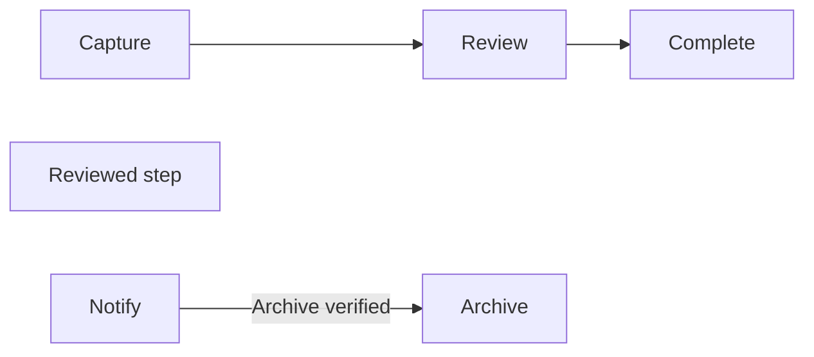
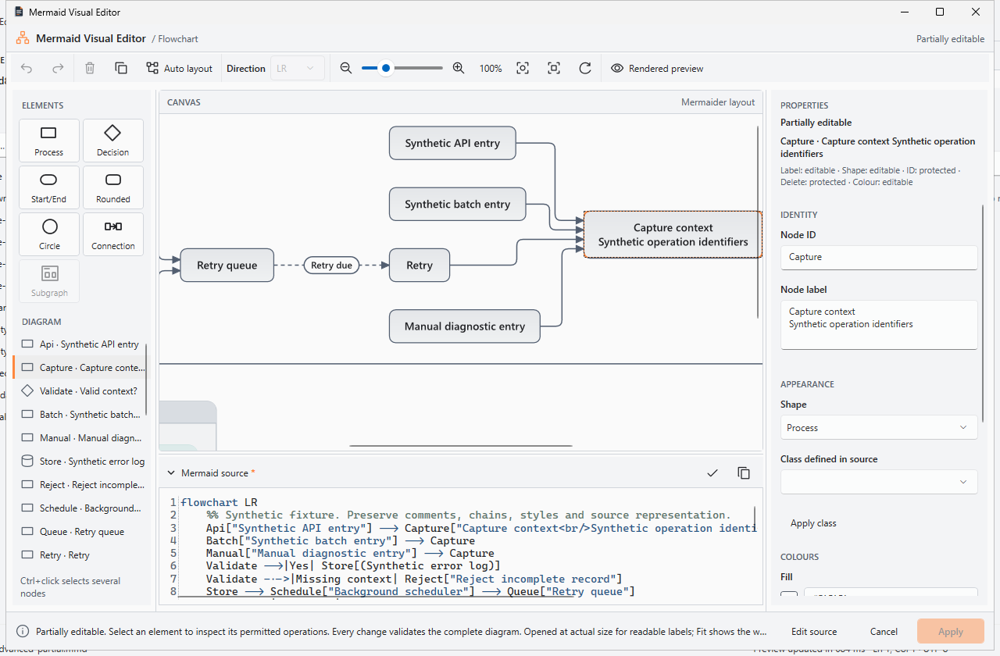
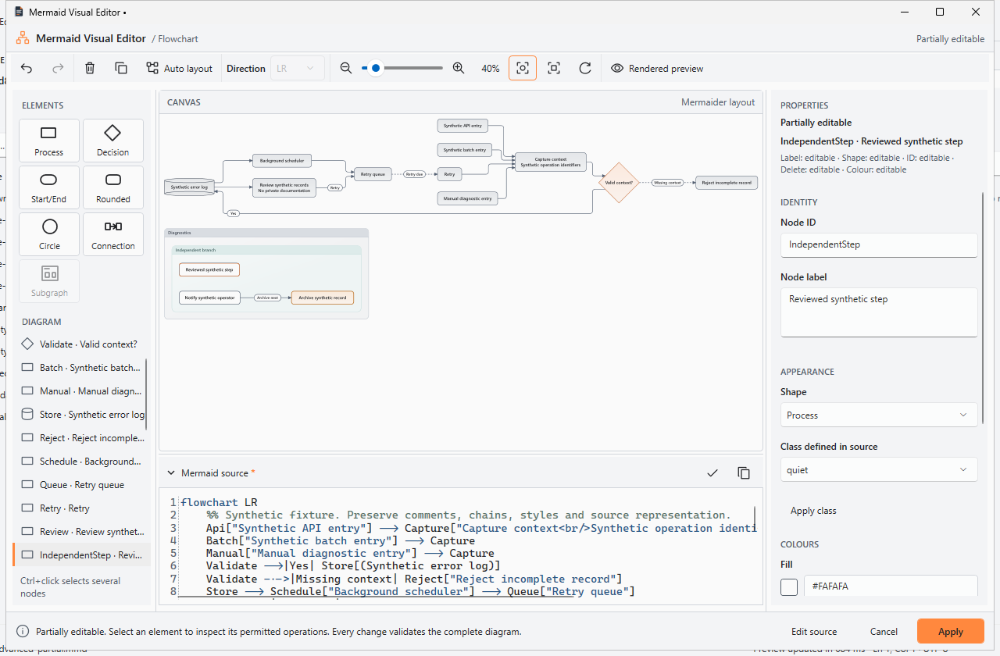
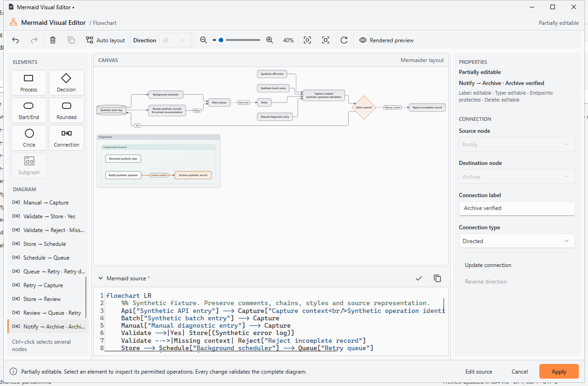
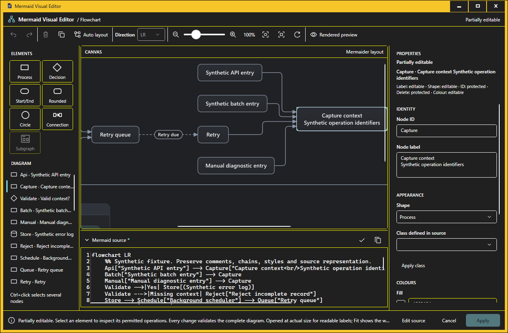
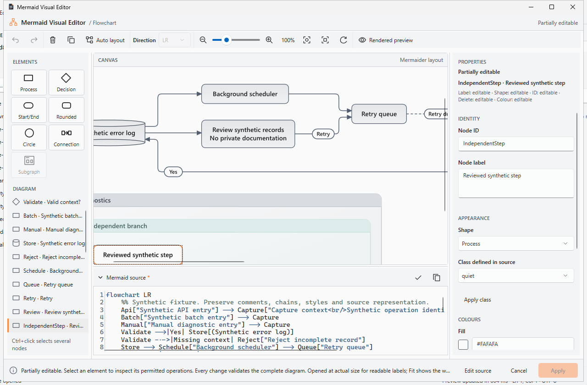

# Advanced Flowchart compatibility and safe partial editing

**Verdict: ready for a scoped unsigned internal preview, within the grammar, resource and certification limits below.**

[Draft PR 31](https://github.com/DouglasNLima/local-docs-studio/pull/31), branch `feature/native-mermaid-advanced-partial-editing`, targets `feature/native-workspace-mermaid-interaction-stability`. The verified application and regression source is `f8772647df65da41079b3c6dd148d9444ea50bfc`. This report pins evidence to that source; later documentation commits do not retroactively change a package's identity.

## Baseline and delivery scope

PR #30 remains open and Draft at `833e9db1f8643f7023143dd94349a2709f9ae9ce`, targeting `develop`. This branch inherits its complete implementation through Git ancestry. There is no replay, cherry-pick, retarget or change to #30, `main` or other worktrees.

At that exact baseline the adapter recorded chain edges, but `CanEdit`, transformation planning, draft validation and presentation identity mapping required whole-diagram editability. A hosted immutable-baseline test reproduces denial of independent node and edge labels beside a chain, preserving source/history. The replacement permits those operations only after complete source, dependency, semantic and render proof.

The native edition remains C#/.NET 10, WPF/XAML, AvalonEdit, Markdig, **Mermaider 0.15.1**, SharpVectors and native FlowDocument preview. Preview and editor share the sanitised canonical Mermaider drawing. There is no browser runtime, alternative layout engine or rejected Continuous viewer. The browser product and static GitHub Pages publication remain intact. No release or merge is performed.

## Capability model

`MermaidCompatibility` distinguishes `Editable`, `PartiallyEditable`, `Protected` and `Invalid`. `CanEdit` still means fully supported source; it never grants blanket permission on protected source. Rendering failures remain a separate result and do not manufacture editing permission.

Core's `MermaidCapabilityAnalysis.Query` returns `MermaidOperationCapability`: target identity, operation kind, permission, source spans, protected dependencies, actionable diagnostic and validation requirements. `HasCompleteSourceMap` and `HasSafeTransformations` are separate from renderability. A weak table caches analysis against an immutable model; new revisions receive new analysis. Selection and hover do not reparse, render or change source.

Known chains and known ordinal/default styles produce partial editability. Unknown statements, configuration, interactions, unresolved dependencies or exceeded editing budgets protect the complete transformation path. A few successful operations never make a mixed diagram fully editable.

## Bounded dependency inventory

The adapter records every supported occurrence, bare implicit nodes, declarations embedded in chains, repeated references, exact arrow/label tokens, statement boundaries, inline classes, class/style targets, ordered edges, group headings/directions and nested membership. It compares these with the complete pinned parser. Being outside a protected span alone never establishes independence.

The **first occurrence**, including a bare implicit node, remains authoritative under the pinned implementation. Later declarations cannot quietly become label/shape authority. Multiple explicit declarations protect label/shape edits; a later non-authoritative declaration also protects identity and movement. Unknown source never implies an empty reference set.

Chain dependencies protect ID rename, deletion and membership changes. Known chains can expose precise node/edge property spans. Ordinal/default `linkStyle` protects edge order: insertion, deletion and reconnection remain disabled even in an independent branch. Nested membership, parent hierarchy and order participate in semantic comparison. Internal group reconnection remains protected because a new occurrence could alter membership.

## Verified grammar matrix

This is the **verified editing subset**, not universal Mermaid support. Parser/render disagreement rejects the candidate.

| Source form | Behaviour |
|---|---|
| `flowchart` / `graph`; `TB`, `TD`, `BT`, `LR`, `RL` | Existing directions; direction changes remain protected in partial diagrams |
| Bare IDs and explicit declarations | Every occurrence tracked; first occurrence remains authoritative |
| Process `[]`, decision `{}`, rounded `()`, terminal `([])`, circle `(())`, double circle `((()))`, subroutine `[[]]`, cylinder `[()]`, hexagon `{{}}` | Exact declaration spans; raw labels retained where representable |
| Unicode, combining characters, quoted/escaped labels, supported line breaks and long labels | Complete parser/render agreement; 4,096-character visual label bound |
| Directed `-->`, undirected `---`, dotted `-.->`, thick `==>`, bidirectional `<-->` | Original arrow retained for label-only edits |
| Pipe labels | Only the proven label span changes |
| Inline `-- text -->`, `-. text .->`, `== text ==>`, `<-- text -->` | Exact label spans and supported quoted forms; quote only where escaping requires it |
| Chained connections | Individual occurrences/edges; no splitting, reordering or statement regeneration |
| Repeated/parallel connections with identical endpoints and labels | Distinct ordered private identities through edits/history |
| Named/nested subgraphs and group direction | Hierarchy, membership, direction and source order retained |
| `classDef`, multi-target `class`, `:::class`, existing `default` classes | Local assignment/override; shared definitions and other targets retained |
| Supported explicit `style` and numeric properties | Merge requested properties; retain unrelated author-defined properties |
| Numeric/default `linkStyle` | Safe properties; edge-order changes protected |
| Edge IDs, interactions, configuration, other arrow/HTML/style grammar, unknown statements | Protected inspection where renderable; no transformation proof |

Removing an inline edge label or changing its type may require equivalent replacement **within that arrow span**. A shape change may need equivalent escaping **within that node span**. Neither permits rewriting other statements. Invalid/unrepresentable labels are rejected. Source is never regenerated from SVG or an incomplete graph.

## Safe and protected operations

All permissions remain subject to complete candidate validation: a permitted capability authorises an attempt at a checked operation.

| Operation | Proven safe case | Protected case |
|---|---|---|
| Inspect node/edge/group | Canonical identity independently of transformation state | Unknown identity never inferred from coordinates |
| Node label/shape | Unique authoritative occurrence, including inside a chain | Multiple explicit declarations, unknown dependencies, renderer disagreement |
| Node ID | Complete independent references, styles/classes included | Chain dependency or later explicit declaration |
| Delete node | Complete independent references and minimal patches | Chain, ambiguous declaration, ordinal style, unresolved membership |
| Duplicate/add node | New unique ID in known scope, within budgets | Unknown source or semantic disagreement |
| Node style/class | Local property merge or known class assignment | Unknown grammar or unrequested global effect |
| Move node | Complete independent occurrences/membership | Chain, repeated declarations, internal connection dependency |
| Edge label/type | Exact known token, including chain edges | Unknown/ambiguous token or semantic effect |
| Reconnect/delete edge | Separate statement, known endpoints/membership | Chain, `linkStyle`, internal group reconnection |
| Add edge | Known existing endpoints and exact new statement | `linkStyle`, unknown dependencies, changed implicit membership |
| Group label | Known heading span | Unknown heading or changed hierarchy |
| Group structure/direction | Existing fully editable workflow | Protected in partial diagrams |
| Apply | Real validated change and final complete proof | Unchanged, pending, invalid, cancelled, stale or conflicted draft/owner |

The inspector distinguishes effective colours from a new local override. Local colours never replace shared class definitions. New class definitions retain the existing unique-name safeguards; they cannot overwrite existing classes or silently restyle other nodes.

## Complete source and semantic validation

1. Capture complete source/revision, occurrences, protected ranges, node/edge order, styles/classes, nested groups and renderer configuration.
2. Require the specific operation's capabilities. Plan expected-text patches; reject stale text, overlaps, duplicate insertion offsets and unknown IDs.
3. Apply privately. Only an explicitly authorised exact chain property patch may touch its protected statement; all other protected spans remain exact.
4. Reparse the **whole** candidate. Compare its complete pinned parser graph against an operation-specific expected delta: node order, IDs, labels, shapes, markdown flags, every ordered edge property, hierarchy/directions, classes, styles, ordinal/default edge styling, redirections and notes.
5. Render original and candidate with the existing bounded renderer. Verify decoded complete semantics captured before layout wraps labels, source identities and group correspondence. Reject parser/render disagreement.
6. Recheck cancellation and revision before committing history. Rejection, cancellation and stale results mutate neither source nor history.

JSON is solely an internal comparison representation; it never becomes Mermaid. Layout wrapping cannot masquerade as a label change. Tests include stale completion racing a newer operation and cancellation between rendering and commit.

## Private history, Apply and Cancel

Capability-checked operations carry their proof into `MermaidVisualDraft.ValidateAndCommitCoreAsync`; partial candidates require that proof. Arbitrary manual source changes use a separate explicit validation path requiring the fully supported subset. Validating unchanged protected source retains inspection instead of falsely reporting invalid Mermaid.

Apply requires a real committed change, final complete semantic/render validation and the existing `MermaidDocumentEditSession`. AvalonEdit version/change history locates the exact container, including the second of identical diagrams; no first-matching-text search is used. Safe surrounding edits relocate. Closed/renamed owners, incompatible wrappers, conflicts, read-only/saving owners and stale results remain rejected. One document Undo restores the complete prior diagram. Cancel, close and rejection leave the owner unchanged.

Private history retains exact bytes, parallel-edge identity, selection and session positions. Positions are never exported into Mermaid. Existing LF/CRLF/mixed endings, Unicode, Markdown/tilde fences, recognised DevOps containers, standalone `.mmd`/`.mermaid`, unsaved documents and relative-workspace safeguards remain.

## Exact source examples

Before:

After two separately validated operations:

Only `Independent step` and `Archive next` change. The comment, complete chain, whitespace, line endings and unrelated semantics remain exact. Private Undo restores each operation; Apply creates one document Undo entry. These are source-corpus assertions, not a visual approximation.

Rejected examples: rename/delete B (chain dependency); change edge order with `linkStyle 0 stroke:red`; edit beside unknown `click`; ambiguous repeated declarations; overlapping/stale spans; duplicate insertions; unpaired Unicode; unknown IDs; or unrelated semantic changes. Every rejection asserts identical source/history.

## Native inspector and synthetic acceptance

Existing Lens styles and native controls remain. Compact text states and individual permissions distinguish Editable, Partially editable and Protected. Read-only values remain inspectable; disabled actions explain dependencies through tooltips and UIA HelpText. Keyboard selection, ordered accessible edge names, focus, live status and Update/Reset pending-value protection remain. Protected reconnection exposes no endpoint handle; safe separate edges retain pointer/keyboard reconnection.

The [synthetic Flow Error Log Lab](../../tests/fixtures/native-mermaid-visual/advanced-flow-error-log-lab.mmd) includes LR direction, three entries, shared capture, storage, background scheduling, retries/cycles, chains, dotted edges, labels/line breaks, implicit references, nested independent branches and shared/local styles. It contains no private documentation.

Both normal and **actual Windows High Contrast** UIA exercise the complete graph; chain selection; safe shape change preserving a raw multiline label; Undo; independent label change with pending-selection protection; independent edge label; private Undo/Redo; Apply; one document Undo/Redo; Save; process restart **without rewriting the fixture**; reopen/render; and Cancel with exact disk bytes. Identical backtick and tilde diagrams separately prove only the tracked second block changes.

[Dark appearance](evidence/mermaid-advanced-partial-editing/mermaid-dark.png) and full-size captures accompany the receipts. Images were inspected at captured resolution. These are hosted Windows captures at measured 96 DPI, not mock-ups or physical screen-reader certification.

## Regression results at the pinned application revision

| Mandatory validation | Result / CI |
|---|---|
| Release / complete Core / transformations | Local Release zero warnings; **1,323 Core passes**, no skips; [native workflow](https://github.com/DouglasNLima/local-docs-studio/actions/runs/39025931169) |
| Capability/dependency/adversarial additions | **86 partial-editing cases**, including 48 deterministic seeds; three renderer-correspondence cases; included in Core total |
| Original limitation | Immutable #30 reproduction test passes; [baseline job](https://github.com/DouglasNLima/local-docs-studio/actions/runs/39025931155) |
| Normal authoring | **143** checks; [receipt](evidence/mermaid-advanced-partial-editing/normal-authoring.json) |
| Actual Windows High Contrast authoring | **139** checks; [receipt](evidence/mermaid-advanced-partial-editing/high-contrast-authoring.json) |
| Canonical fidelity | **369** assertions including complex partial graphs, exact preview/canvas pixels and geometry; [receipt](evidence/mermaid-advanced-partial-editing/canonical-fidelity.json) |
| Drag/drop/reconnection | **240 real drags / 4,080 moves**, 58 normal/53 HC scenario assertions; [interaction workflow](https://github.com/DouglasNLima/local-docs-studio/actions/runs/39025931158) |
| Workspace viewport ownership | All four Pages/Continuous × sync contexts pass independently and inside normal/HC jobs; [receipt](evidence/mermaid-advanced-partial-editing/workspace-viewports.json) |
| Chromium / Edge | **134 + 134 = 268 passes**; [browser workflow](https://github.com/DouglasNLima/local-docs-studio/actions/runs/39025931200) |
| Static integrity | **50 modules, 57 shell assets, 150 vendor assets, 56 dependency scans**, same browser run |
| Native rendering/export corpus | **72 cases**, zero failures, plus **12** Chromium/Edge Docs Site export checks; native workflow above |
| Native desktop UIA | **75 groups in each of four contexts**: build output, initial install, upgrade, reinstall |
| Persisted workspace/export | **13** checks, actual files and source-preserving bundle/save/reopen; [receipt](evidence/mermaid-advanced-partial-editing/persisted-workspace-export.json) |
| Package/installer controls | Five visible wizard checks, seven rejection controls and **20 lifecycle checks** pass; independent downloaded-package receipts below |

The [native UX workflow](https://github.com/DouglasNLima/local-docs-studio/actions/runs/39025931155) passes all three jobs, including actual #30 baseline UIA and source reproduction. Narrow PR target-filter additions enable mandatory native/UX/interaction runs against #30's branch. Pages deployment remains skipped by its existing default-branch condition; it is not a test pass. The historical integration-only upgrade matrix retains its conditional scope.

Generated cases vary whitespace, line endings, declaration order, class sharing, Unicode and parallel labels with reproducible seeds. Accepted/rejected source and history invariants remain. No existing scenario was removed or disabled, and no timeout was raised to hide failures.

## Retained failures and corrections

The initial Core run retained four old all-or-nothing expectations. Those cases now additionally verify independent insertion and unsafe rejection. The focus test previously expected unchanged Apply enabled; it now makes a real private change and undoes it exactly, matching the requested contract.

Rapid presses exposed double-click inline editing starting on press and interrupting drag/Undo. It now opens only on stationary double-click release. Actual double-click and repeated drag/cancellation checks remain. The inherited null-transform protection remains intact.

Undo/Redo correctly rejected an obsolete preview action. The harness records the guard and waits for a different UIA RuntimeId before opening a fresh action, without bypassing document identity.

The workspace fixture's redundant `ScrollIntoView` on an already visible WPF text target jumped to another paragraph. Retained rectangle/scroll/focus traces prove the target was visible. The harness scrolls only when needed and waits for actual preference/editor alignment. All visibility, owner-position, sidebar, latest-request and Back/Forward assertions and deadlines remain. Final four-context runs pass. This harness correction does **not** fix the separate Continuous performance problem.

Failures remain in [initial validation](https://github.com/DouglasNLima/local-docs-studio/actions/runs/39021866672), [rapid-drag interaction](https://github.com/DouglasNLima/local-docs-studio/actions/runs/39021866694), [obsolete preview baseline](https://github.com/DouglasNLima/local-docs-studio/actions/runs/39022683725) and [workspace diagnostics](https://github.com/DouglasNLima/local-docs-studio/actions/runs/39025592171). Cancelled/failed runs are not counted as final passes.

## Performance and resource safety

[Recorded measurements](evidence/mermaid-advanced-partial-editing/performance.json) are one hosted process with warm-up effects. Each row queries cached capabilities 2,000 times; they do not certify end-to-end paint/device latency.

| Partial fixture | Initial analysis ms | Mean query µs | Edit + render ms | Rejection ms |
|---|---:|---:|---:|---:|
| 20 nodes | 1.144 | 0.881 | 3.554 | 0.537 |
| 100 nodes | 0.347 | 1.152 | 13.967 | 0.176 |
| 300 nodes | 0.958 | 1.942 | 19.052 | 0.170 |
| Eight nested groups, long label | 0.232 | 0.700 | 3.399 | 0.125 |
| 90 shared references | 0.388 | 4.343 | 17.756 | 0.158 |
| 450 unknown statements | 1.280 | 0.696 | Rejected, 0.098 | 0.035 |

All rejection/source/history checks pass. No parse/render occurs during hover or pointer movement. Cancellation/stale-result checks remain. Limits remain **100,000 source characters, 300 nodes, 500 elements, eight nested groups**, 500 styling statements, 4,096-character labels and the existing density restriction. Regex timeout/unresolved budgets fail closed.

The separate 20-node/190-edge dense fixture remains protected; rendering was cancelled after about **5.81 seconds**, with about **2.39 GB** of process allocation. It is an unsuccessful dense render, not a performance pass. Synchronous renderer limitations remain. Session positions/guides are private; saved source reopens in canonical layout. The separate Continuous observations retain **FAIL** for list first layout (578.95 ms) and mixed content (265.72 ms) against 250 ms; table is 187.96 ms in this run. A green functional workflow does not convert those observations into performance certification.

## Packages and readiness

Unsigned self-contained Windows x64 preview **`0.1.1-preview.599`** is built and independently verified. The lifecycle upgrades `0.1.0-preview.599` to that version, uninstalls, reinstalls and restores real saved/unsaved session state in disposable Windows CI. The source is PR merge checkout `f1adf3747c06a5355d75654f2d8d990b33f8b646`, whose complete tree `c099eed52cd8275bc8e2732b6a08b388f4348e05` is identical to application commit `f8772647df65da41079b3c6dd148d9444ea50bfc`. Metadata declares `sourceDirty: false`, `pull-request-merge-checkout`, included .NET 10/WPF and `NotSigned`.

| Package | SHA-256 |
|---|---|
| `LensDocsStudio.Native-0.1.1-preview.599-win-x64-Setup.exe` | `4f18835d003523661f4d68b37d65621e4d171abc3b09cb7a710a0698c57a18bc` |
| `LensDocsStudio.Native-0.1.1-preview.599-win-x64.zip` | `6c2aa002889546ab660ffba10a7881397554c3ef0864bf27073b0d99222fcd9a` |
| Lifecycle initial `0.1.0-preview.599` installer | `b4f7adc33cf1d4992e725fa528266fcbefdf780323dc497532e52de0ae2c0a5a` |
| Lifecycle initial `0.1.0-preview.599` ZIP | `48032c662bfaecac251f54cc6bee83880e46d18b0b17b4adb23cc32a9ee26919` |

The [package artefact](https://github.com/DouglasNLima/local-docs-studio/actions/runs/39025931169/artifacts/12099285435) contains both versions, metadata, checksums, package verification and installer evidence (14-day hosted retention). Both downloaded versions were independently verified with explicit source and installer/ZIP hash pins. The retained [candidate receipt](evidence/mermaid-advanced-partial-editing/package-verification-599.json) and [initial receipt](evidence/mermaid-advanced-partial-editing/package-verification-initial-599.json) confirm matching Native/Core/apphost identities, capability/semantic types, editor BAML, original Lens executable/installer icons, included runtime and allowed payload. There is no browser runtime, excluded experiment, private file or development payload. Local inspection records **`executionPerformed: false`**; no native app or installer was launched on the ordinary desktop.

The [20-check lifecycle receipt](evidence/mermaid-advanced-partial-editing/installer-lifecycle-599.json) confirms **all 528 installed payload files** match portable bytes. **22 state files** and workspace bytes survive upgrade, uninstall, reinstall and final uninstall. Actual tabs, preferences, dirty saved and untitled drafts restore; interrupted-save recovery, branding, shortcuts, existing registrations and Markdown defaults pass. This is a same-source, distinct-version upgrade, not a historical cross-revision certification.

[Seven negative controls](evidence/mermaid-advanced-partial-editing/package-rejection-controls.json) reject wrong source/version/hash, dirty metadata, ZIP tampering, an excluded viewer with recomputed checksums and a missing editor assembly with recomputed checksums. The original package remains unchanged. The [visible installer receipt](evidence/mermaid-advanced-partial-editing/installer-wizard-599.json) and [inspected completed wizard](evidence/mermaid-advanced-partial-editing/installer-finished-599.png) retain actual Windows execution evidence.

[Provenance and evidence hashes](evidence/mermaid-advanced-partial-editing/provenance.json) identify the exact source, runs and retained files. Later documentation-only commits generate distinct CI/package identities; this immutable implementation certificate continues to identify the bytes above. The [PR checks](https://github.com/DouglasNLima/local-docs-studio/pull/31/checks) expose delivery-head workflows, inspected separately before hand-off. Older runs are not counted as passing for a later application change.

| Classification | Boundary |
|---|---|
| Implemented and verified | Per-operation permission, whole semantic/render proof, advanced spans, independent safe Apply, exact source/history, mixed inspector, save/reopen, actual HC and interaction regression |
| Implemented with bounded limitations | Verified pinned grammar/resource budgets, chain property edits, session positions, measured 96-DPI interaction |
| Unsupported/protected | Unknown configuration/interactions/edge IDs/dependencies; chain structural edits; ambiguous declarations; ordinal edge order; unsafe membership/global effects |
| Blocked | Trusted update execution remains fail-closed for unsigned previews; production signing outside scope |
| Not completed by this goal | Separate pre-existing Continuous 250 ms layout target and unrestricted dense rendering |
| Not certified | Physical screen-reader use, higher OS DPI, long-duration heap/paint behaviour, separate SDK-free clean-machine installation |

Previous reports retain their original revisions. This is an internal-preview compatibility improvement, not universal Mermaid or production certification. PR #31 remains Draft. No public release, signing setup, merge or unrelated PR modification is performed.
