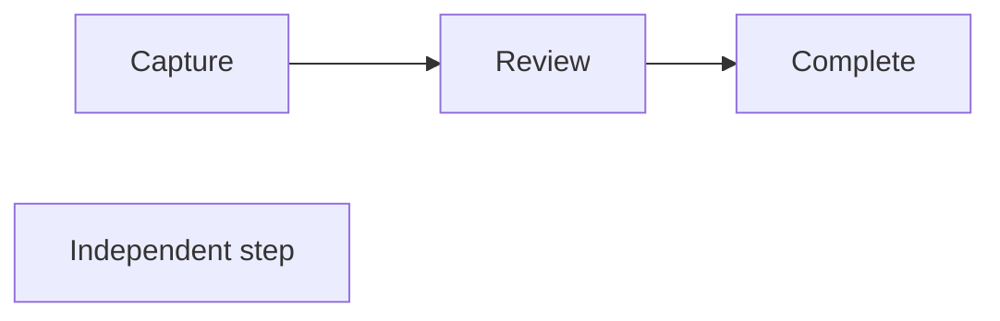

# Advanced Flowchart compatibility and safe partial editing

Status: candidate implementation complete; final hosted native certification and package verification pending.

## Verified baseline

PR #30 remains open and Draft at `833e9db1f8643f7023143dd94349a2709f9ae9ce`.
This branch starts at that exact head and targets
`feature/native-workspace-mermaid-interaction-stability`. Its implementation is
inherited through Git ancestry. The rejected Continuous viewer is excluded.

The source adapter already records individual chain edges, but marks the complete
model protected. Transformation planning, private draft validation and canonical
identity mapping each require global `CanEdit`. An independent node therefore
cannot be changed beside a chain.

## Delivery requirements

- Core owns operation capabilities and bounded source dependency analysis.
- Expected-text patches preserve unrelated original source exactly.
- Every accepted operation requires complete pinned-parser semantic comparison and
  bounded canonical rendering. Unknown dependencies fail closed.
- The native inspector presents individual permissions and diagnostics.
- Private history and document identity/conflict guards remain transactional.
- Synthetic fixtures cover independent branches, chains, repeated declarations,
  styles, nested groups, Unicode, parallel edges and identical document blocks.
- Disposable hosted Windows supplies native execution, actual High Contrast,
  screenshots, regression evidence and unsigned package/lifecycle verification.

Grammar matrices, measured results, immutable CI links and package hashes will be
recorded here as verification completes. Earlier reports retain their original
revision scope. This Draft PR must not be merged or publicly released automatically.

## Capability and validation architecture

`MermaidCapabilityAnalysis` caches a bounded dependency inventory against each
immutable source model. `Query` returns target, operation kind, permission, source
spans, protected dependencies, diagnostic and validation requirements. The legacy
`CanEdit` still means fully editable; it does not grant partial transformation
permission. `PartiallyEditable` and `HasCompleteSourceMap` are distinct properties.
Unknown syntax, configuration, ambiguous membership and resource limits fail closed.

The adapter checks all recognised nodes, ordered connections, labels, shapes and
nested membership against Mermaider 0.15.1. It honours the first occurrence even
when that occurrence is bare. Chains expose exact occurrence/token spans without
being split. Every planned operation must pass its individual capabilities.

The private draft applies expected-text patches off the UI thread, checks protected
overlap, reparses the entire candidate and compares the complete pinned-parser
graph against an operation-specific expected semantic delta. The comparison includes
node order, labels, shapes, markdown flags, every ordered edge property, nested
groups/directions, classes, node styles, ordinal/default edge styles, redirections
and notes. It is an internal comparison representation; it never generates Mermaid.
The original and final candidate also pass bounded canonical rendering and source
identity checks against the actual positioned graph. Rejection adds no history.

`CanApply` requires a real committed private change. Final rendering precedes the
unchanged `MermaidDocumentEditSession` transaction and its AvalonEdit revision,
container and owning-document guards. Direct manual source validation still requires
the fully supported subset; it cannot masquerade as an authorised partial operation.

## Current operation boundaries

| Operation | Known partial Flowchart | Protection |
|---|---|---|
| Inspect | Canonical nodes, ordered connections and groups | Independent of transformation permission |
| Node label / shape | Unique authoritative occurrence, including inside a chain | Repeated explicit declarations remain protected |
| Node ID / delete / move | Complete independent references | Any chain dependency or repeated declaration blocks these operations |
| Connection label / type | Exact token, including chain edges | Entire graph and original edge identity are verified |
| Reconnect / delete connection | Separate root statement | Chains, internal membership and `linkStyle` order remain protected |
| Add node | Unique ID, known scope, within budgets | No insertion into unknown source |
| Add connection | Existing known nodes | All insertion blocked when ordinal/default `linkStyle` is present |
| Local style / class | Targeted override or defined class assignment, including existing `default` classes | Shared class definitions and unrelated custom properties retained |
| Group label | Known heading span | Group hierarchy retained |
| Group structure / direction | Existing fully editable workflow | Protected in partial diagrams |

Supported links retain `-->`, `---`, `-.->`, `==>`, `<-->`, pipe labels and pinned
inline text forms (`-- text -->`, `-. text .->`, `== text ==>`, `<-- text -->`).
Quoted label content uses the pinned parser's quote semantics. Label-only edits
retain original delimiters and quotes where representable. An unquoted inline
label gains quotes only when escaping requires them; removing an inline label or
changing its type can replace only its arrow span with an equivalent supported
form. Shape changes preserve raw labels where representable, otherwise checking
equivalent target-label escaping against both complete semantics and rendering.
Other arrow combinations, edge IDs,
interactions, unknown directives and unknown dependencies remain protected.

## Source preservation example

Changing D to `Reviewed step` changes only `"Independent step"` to
`"Reviewed step"`. The comment, chain, whitespace and line endings remain exact.
Renaming or deleting B is rejected because its chain structure is protected.
Adding or deleting a connection with ordinal `linkStyle` is rejected before
candidate rendering. Arbitrary source text has a separate explicit validation path.

## Native inspector and synthetic acceptance

The existing inspector now exposes a compact text capability state and individual
read-only fields, disabled actions, tooltips and UIA HelpText. Effective colours
are distinguished from a new local override. Update/Reset still protects pending
values when selection changes. Protected chains have no endpoint handles; safe
separate root connections retain them. Canonical drawing and pointer paths remain
the inherited PR #30 architecture.

The synthetic `advanced-flow-error-log-lab.mmd` includes multiple entries, shared
capture, storage, scheduling, retries, cycles, chains, dotted links, labels, implicit
references, nested independent branches and shared/local styles. New native UIA
checks exercise mixed permissions, pending values, node/edge edits, private history,
Apply, one document Undo, Redo, Save, process restart without rewriting the file,
reopen/render and Cancel. These checks run in normal and actual Windows High
Contrast alongside all existing authoring and interaction tests.

Local Release builds and the full Core suite pass **1,323 tests**, with no skips.
The new partial-editing class has 86 cases, plus three renderer-correspondence
cases. Static integrity passes 50 modules, 57 shell assets, 150 vendor assets and
56 runtime external-dependency scans. Final hosted evidence is pending.
The initial retained run had four old global-read-only expectations fail;
those cases now also verify safe insertion and explicit unsafe-operation rejection.
No existing scenario has been removed. Forty-eight deterministic seeds exercise
whitespace, LF/CRLF/mixed endings, Unicode, declaration order, class sharing and
parallel edge labels, checking exact source and history restoration.

Hosted normal authoring at `e92174b` passes 140 checks, including the complete
synthetic sequence and both identical fenced-block mappings. Its screenshots were
inspected: the chain inspector and connection permissions are clear; the independent
node capture accidentally toggled the selected node off and is corrected in the
later harness. Final-source images and actual High Contrast remain required.

Additional corrections retain stationary double-click label editing while allowing
rapid successive drags and active-drag Undo; preserve unchanged inspector label
semantics when only another property changes; preserve sibling/member order when
flattening fully editable groups; and protect later non-authoritative declarations
from destructive movement. Unsupported style grammar is protected inspection,
not an editing permission. Bounded regex analysis failures also use protection.

The historical baseline UIA run exposed the intended stale-preview revision guard
after document Undo/Redo. The harness now records that rejection and waits for an
actually replaced UIA preview action before opening, with no timeout increase or
guard bypass. The earlier synchronised Continuous workspace failure is retained;
a later unchanged-workspace revision passes all four viewport contexts. This does
not certify the separate Continuous preview performance target.

At application source `f71ac3b`, hosted authoring passes 143 normal and 139 actual
Windows High Contrast checks, and canonical fidelity passes 369 assertions.
Both stress appearances complete 120 drags and 2,040 moves each; the normal job
then fails its separate Continuous synchronised workspace check. These outcomes
remain distinct. The workspace fixture now waits for actual preference application
and editor alignment before requesting a separate UIA preview scroll; it retains
all ownership assertions and original deadlines. The initial harness correction
also handles the application's valid null/default desktop-preference representation.

Queued-context tests additionally prove that cancellation between rendering and
commit leaves source/history unchanged, and that an older completed validation
cannot overwrite a newer accepted operation. Cancellation is rechecked after
asynchronous work and before committing or applying a draft.
