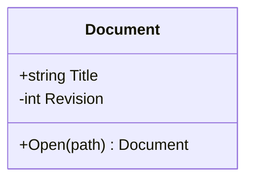

# Native Mermaid Class Diagram Visual Editor

Engineering work in progress. This branch is not a certified preview.

## Baseline and architecture

The feature starts at consolidated `develop` revision
`5b732cd187f2c5d0742a0eaa3c978a2d95ba4815`, fetched on 18 October 2026.
The existing Flowchart, Sequence, State and ER editor windows and Core modules
are present. The browser/static post-merge run
[39080262674](https://github.com/DouglasNLima/local-docs-studio/actions/runs/39080262674)
passed both browsers. Native post-merge run
[39080262652](https://github.com/DouglasNLima/local-docs-studio/actions/runs/39080262652)
completed successfully, including native validation and installed State/ER
authoring. The historical-upgrade job was intentionally outside this baseline
branch condition; it was not counted as a passing mandatory check.

Class authoring will use a dedicated Core semantic/source adapter, exact source
patches, private occurrence identities and bounded history. The existing native
document ownership and single-Undo Apply contract remain authoritative. The
canonical Mermaider drawing supplies the canvas; WPF supplies interaction overlays.
No coordinates or private identity metadata enter portable Mermaid source.

## Pinned upstream discovery

Mermaider 0.15.1 identifies upstream revision
`71b64845570d633a94d29e85579c0a02786fece8` in its NuGet metadata.
The exact revision has been checked out separately for inspection:

- [ClassParser](https://github.com/nullean/mermaider/blob/71b64845570d633a94d29e85579c0a02786fece8/src/Mermaider/Parsing/ClassParser.cs)
- [Class model](https://github.com/nullean/mermaider/blob/71b64845570d633a94d29e85579c0a02786fece8/src/Mermaider/Models/ClassDiagram.cs)
- [Positioned model](https://github.com/nullean/mermaider/blob/71b64845570d633a94d29e85579c0a02786fece8/src/Mermaider/Models/PositionedClassDiagram.cs)
- [Class SVG renderer](https://github.com/nullean/mermaider/blob/71b64845570d633a94d29e85579c0a02786fece8/src/Mermaider/Rendering/ClassSvgRenderer.cs)

Critical observations: unrecognised global lines can be ignored; class-block
lines can be interpreted as broad attribute text; repeated declarations append
members to one class; attributes and methods occupy separate ordered lists.
Method flags are detected anywhere in the signature, but flags in return types
remain part of the displayed type. Attribute flags depend on the final marker.
Safe authoring must therefore use a bounded subset and preserve other forms.

Lollipop layout can introduce synthetic target classes. This requires explicit
protection rather than assuming a one-to-one source/layout class mapping.

## Verification status

Implementation, capability matrices, source examples, native acceptance,
screenshots, performance observations, final regression totals, hosted CI and
package provenance will be recorded from actual results as work proceeds.
No new editor, package or readiness claim is made by this initial report.


## Pinned grammar matrix

The following matrix separates recognised source from authoring permission.
“Render” describes the pinned pipeline, rather than universal Mermaid support.
Exact source remains available in all protected cases.

| Construct | Pinned parser | Render | Independent adapter | Inspection | Exact transforms / protection |
|---|---|---|---|---|---|
| `classDiagram`, case variants | Yes | Yes | Header span | Yes | Header retained |
| Other Class headers | No verified alias | No claim | Invalid/protected | Source | Protected |
| Explicit declaration/block | Yes | Yes | Declaration and closing spans | Class header/list | Add, properties, rename, duplicate, independent delete |
| Implicit relationship class | Yes | Yes | First occurrence identity | Header/list | Materialise after first occurrence; preserve class order |
| Inline `A : member` | Yes | Yes | Owner and signature tokens | Exact member/list | Local properties, duplicate/delete; bounded reorder |
| Attributes | Broad text | Yes | Ordered occurrences plus tokens | Verified row/list | Bounded type/name, visibility and static attribute marker |
| Methods | Parentheses | Yes | Ordered occurrences plus parameters/type | Verified row/list | Bounded name, parameter text, return type and visibility |
| `+`, `-`, `#`, `~`, absent visibility | Yes | Yes | Independent enum/token | Inspector | Exact token patch |
| Static attribute `$` | Yes | Underline | Flag and exact token | Inspector | Safe creation/update/preservation |
| Abstract attribute `*` | Yes | Italics | Flag and exact bytes | Inspector | Protected: portable attribute classifier not verified |
| Method classifiers after `()`/return type | Yes, retained in type | Contaminated return-type text | Full pinned semantics and raw bytes | Read-only | Protected: pinned compatibility defect |
| Method classifiers before `()` | Yes, strips name suffix | Underline/italics | Full semantics and raw bytes | Read-only | Protected: differs from documented portable syntax |
| Single generic `A~T~` | Yes | Display `A<T>` | ID and generic spans | Inspector | Bounded identifier; inline annotated form protected |
| Unfamiliar generic delimiters | Broad ID fallback possible | May render literal ID | Exact protected statement | Source/list | Protected |
| Block/inline `<<annotation>>` | Word annotations | Yes | Annotation occurrences | Inspector | Exact single annotation update; ambiguous repeats protected |
| Namespace | Flat, explicit declarations only | Yes | Boundaries and membership | Header/list | Membership/name editing protected; known class rename preserves membership |
| Direction | TD/TB/LR/BT/RL | Yes | Independent direction | Source | Preserved |
| Inheritance/composition/aggregation | Both marker ends | Yes | Type and marker owner | Path/list | Add/edit/reverse/reconnect/delete/duplicate |
| Association/dependency/realisation | Both marker ends | Yes | Type and marker owner | Path/list | Same bounded operations |
| Bare solid `--` | Association in pinned model | Arrow in pinned renderer | Exact token | Path/list | Retained for unrelated changes |
| Lollipop | Yes | Synthetic targets possible | Original occurrences | Source/list | Structural authoring protected; canonical drawing retained |
| Relationship labels/cardinalities | Broad labels; quoted cardinalities | Yes | Endpoint-owned spans | Path/label/list | Bounded text; reverse swaps endpoint cardinalities and marker owner |
| Notes | Global or `for ID` | Yes | Target/text and exact occurrence | List | Read-only; class rename patches known target |
| Repeated class declarations | Merges members | Yes | Every declaration retained | Source/list | Owning class protected |
| Duplicate member names/signatures | Yes | Separate rows | Distinct private IDs | Verified rows/list | Edit exact occurrence; identical-row move creates history |
| Parallel/identical/self relationships | Yes | Separate routes | Distinct private IDs | Path/list | Compare full tuple in exact positioned input order |
| Unknown global statements/directives | May ignore | Success can hide ignored input | Protected span | Source/list | Structural edits fail closed |
| Unknown class-block statements | Broad member interpretation | May display as attribute | Bounded subset plus protected raw span | Source/list | Dependent class edits fail closed |
| Unsupported class labels | Broad ID or ignored | No semantic label guarantee | Protected/invalid | Source | Protected |

Method classifier limitations were checked against the
[official Mermaid syntax reference](https://mermaid.js.org/syntax/classDiagram.html#visibility)
and the pinned parser implementation. The application does not generate the
non-portable name-suffix workaround.

## Operation capabilities and source integrity

| Operation | Implemented boundary | Verification so far |
|---|---|---|
| Add/duplicate class | Unique bounded ID; no unknown dependencies | Core tests |
| Class ID rename | All declarations, inline members, relationship endpoints, note targets and namespace IDs known | Core tests |
| Generic/annotation properties | Single known declaration; exact supported spans | Core tests |
| Independent class delete | No incident relationships, targeted notes or namespace membership | Core tests; rejection leaves source/history intact |
| Add/edit/duplicate/delete member | Exact owning occurrence; stable classification; bounded property grammar | Core tests |
| Member up/down | Same compartment, adjacent source rows without intervening comments/statements | Core tests; ambiguous attachment rejected |
| Static attribute | Portable trailing `$` | Core tests |
| Method/abstract classifiers | Preserve, render and inspect only | Core rejection tests |
| Relationship CRUD/reverse/reconnect | Known endpoints; no orphaned implicit class; marker/cardinality ownership explicit | All six primary types, both orientations and cardinality combinations in Core tests |
| Notes/namespaces | Inspect and preserve; known references participate in rename | Core tests |
| Private history | At most 100 snapshots / bounded source retention; failed/cancelled/stale validation never commits | Core tests |
| Apply/Cancel | Existing document session and AvalonEdit version contract | Integrated; Windows acceptance pending |
| Source validation | Complete independent semantics compared with captured pinned semantics | Core tests |

An operation plans non-overlapping exact source patches and an independent
expected complete semantic diagram. The private draft reparses the result,
restores statement/class identities, compares the expected full semantics,
checks protected bytes, renders, verifies correspondence and validates native
presentation before committing one history entry. No complete-diagram serialiser
is used. Comments, line endings and untouched tokens remain in place.

For example, editing the second duplicate attribute changes only that occurrence:



The original first attribute, method and surrounding source are unchanged.
Reversing `A "1" *-- "0..*" B : owns` produces
`B "0..*" --* "1" A : owns`: the composition marker remains owned by A.

## Native interaction and drawing

`DiagramService` captures immutable Class semantics and positioned geometry from
its existing `LayoutClass` call. `NativeClassPresentation` uses the same sanitised
SVG conversion as preview. It verifies class `data-id`/label/annotation, SVG frame
bounds, ordered complete relationship tuples and actual path endpoints. Member
rows use the renderer's compartment geometry and 28-pixel cap, plus actual SVG
text-centre verification. Unverified rows remain list-selectable; no approximate
text matching grants an editable target.

The WPF window provides class/member/relationship lists, contextual properties,
portable source validation, private history, zoom, pan, rendered preview and
Apply/Cancel. Endpoint movement uses a lightweight guide, with parsing and
rendering only at commit. Classes use canonical positions and bring-into-view;
no drop-position or manual-layout guarantee is claimed. Namespace headers are
inspectable. Notes remain list-only where SVG lacks an exact note identity.

## Current engineering evidence and outstanding certification

The native solution builds with zero warnings/errors. The latest local complete
Core run passed 1,639 tests (including 111 Class tests), with zero skips.
Static integrity passed for 50 modules, 57 shell assets, 150 vendor assets and
56 runtime dependency scans. These are development observations, not final-HEAD
certification; additional changes require fresh results.

Class normal/actual High Contrast UIA and canonical fidelity jobs have been added
to `native-ux.yml`, on feature pushes and Draft PRs. Their acceptance flow exercises
the second of two identical Markdown fences, class/member authoring, inheritance,
composition, endpoint reconnection, private history, Validate, Apply, one document
Undo/Redo, Save, restart/reopen and cancellation of a separate changed draft.
It captures five window sizes plus light/dark/actual High Contrast appearances.
The harness refuses execution on an ordinary developer desktop.

Package verification now requires all five editor type sets and Class BAML.
A new negative control removes only the Class resource key and recomputes the
ZIP checksum; independent verification must still reject it. The installed Class
job uses disposable hosted Windows and verifies install/upgrade/reinstall payload
parity before exercising the actual installed application. These jobs have not
yet produced Class certification receipts.

Outstanding: actual hosted Class acceptance/fidelity results and screenshot
inspection; broader adversarial document tests; Class UI performance observations;
final regression totals; final CI URLs; unsigned package versions/checksums and
independent receipts. The feature remains **not certified** and **not ready for
internal-preview delivery** until those results are complete and reviewed.


### First hosted Class revision: `5f1e790`

[Push UX run 39082076781](https://github.com/DouglasNLima/local-docs-studio/actions/runs/39082076781)
passed all 28 light/dark Class fidelity contexts in both normal and actual High
Contrast jobs before their real UIA step failed. The exact failure reports and
screenshots are retained under the `native-class-normal` and
`native-class-high-contrast` workflow artefacts. Failure occurs during relationship
creation after class/member edits and new class insertion; the final marker
selector popup remains open. Selector completion and command state are being
investigated. No completed native authoring acceptance is claimed.

The same revision's full Core run exposed an outdated exact help-topic count
(14 expected, 15 actual) after the new Class topic was added. The correction
retains exact topic-count/unique-anchor checks and adds a Class-specific topic
assertion. Original failing TRX remains under `artifacts/class-core/core-5f1e790.trx`.

Windowless performance observations at that hosted revision include successful
100-class/150-relationship canonical rendering in 45.9 ms and native conversion
in 1,773.4 ms, with approximately 340 MB total allocations across the observed
scenario. This does not certify real editor opening/selection responsiveness or
all dense workloads. The existing 500-element/three-second renderer budgets were
unchanged. SharpVectors conversion remains non-interruptible while its STA call
runs; cancellation rejects stale results after conversion.


### Relationship selector diagnosis

The instrumented `03ae936` High Contrast run identified an invalid endpoint
binding: `SelectedValuePath` was `Idclass`, while the source-backed choice record
exposes `Identity`. A broad text substitution during initial XAML adaptation had
changed that property path. Displayed labels were correct, but the planner received
empty endpoint IDs and refused the operation. The two bindings are corrected to
`Identity`. The rejection retained the private source/history and owning document.
Original `5f1e790` and instrumented `03ae936` failure receipts/screenshots are
retained in `docs/native/evidence/class-visual-editor/`.


### Source-preservation and guide follow-up

Focused regressions now cover visibility-only edits retaining method parameter
spacing/semicolons, label-only edits retaining quoted empty cardinalities, and
rejection of direction reversal on a portable bare `--` link. Member types and
parameters remain source text, rather than inferred references to other classes;
ID rename updates actual Mermaid identity references and leaves such text intact.

The `53df214` native corpus found a second exact help-topic count in the native
help integration harness. Its clearing-search assertion is updated from 14 to 15
alongside the existing Core topic/anchor checks. The original hosted failure log
is retained in `evidence/class-visual-editor/53df214-native-help-failure.txt`.
Installer jobs skipped after this failure are not passing certification evidence.


### Verified native authoring at `53df214`

Both Class jobs in [UX run 39082652476](https://github.com/DouglasNLima/local-docs-studio/actions/runs/39082652476)
pass canonical fidelity, real authoring and real-process performance. Each covers
28 light/dark fidelity fixtures, 237/238 correspondence/document checks and
31/32 native UIA acceptance groups in normal/actual High Contrast respectively.
These are revision-specific results; later source-preservation corrections still
require final-HEAD runs. Receipts are stored in
`evidence/class-visual-editor/53df214-*`.

The actual Windows workflow completed Open → Select class → Add/edit attribute →
Add/edit method → Add class → Create inheritance → Change composition/label/
cardinalities → Reconnect → private Undo/Redo → Validate → Apply → one document
Undo/Redo → Save → restart/reopen → verify exact source → cancel a separate changed
draft. Additional native checks passed identical attributes, parallel self-links,
unknown dependencies, deleting the final class, outside edits, conflicting edits,
closed owners and another active tab.

### Inspected screenshot gallery

The following genuine hosted screenshots at `53df214` were visually inspected.
All five requested window sizes retain footer actions and keyboard-accessible
inspector scrolling. Source and element lists retain their own scrollbars.
Selection outlines remain WPF overlays over the same canonical diagram. Some
captures retain an ordinary hover tooltip; no image has been cosmetically edited.

| Size | Normal | Actual Windows High Contrast |
|---|---|---|
| 880 × 600 | [Method inspector](images/class-visual-editor/normal-method-viewport-880x600.png) | [Method inspector](images/class-visual-editor/high-contrast-method-viewport-880x600.png) |
| 1024 × 768 | [Method inspector](images/class-visual-editor/normal-method-viewport-1024x768.png) | [Method inspector](images/class-visual-editor/high-contrast-method-viewport-1024x768.png) |
| 1280 × 800 | [Method inspector](images/class-visual-editor/normal-method-viewport-1280x800.png) | [Method inspector](images/class-visual-editor/high-contrast-method-viewport-1280x800.png) |
| 1440 × 900 | [Method inspector](images/class-visual-editor/normal-method-viewport-1440x900.png) | [Method inspector](images/class-visual-editor/high-contrast-method-viewport-1440x900.png) |
| 1920 × 1080 | [Method inspector](images/class-visual-editor/normal-method-viewport-1920x1080.png) | [Method inspector](images/class-visual-editor/high-contrast-method-viewport-1920x1080.png) |

[Dark appearance](images/class-visual-editor/dark.png),
[relationship properties](images/class-visual-editor/normal-relationship-inspector.png),
[saved/reopened document](images/class-visual-editor/normal-saved-reopened.png).

### Real-process performance observations at `53df214`

Timings include UIA transport. They describe these synthetic fixtures only.

| Classes / relationships | Editor open | 20 class selections | 20 member selections | 20 relationship selections | Private member edit | Working set after |
|---|---:|---:|---:|---:|---:|---:|
| 10 / 15 | 639 ms | 727 ms | 473 ms | 453 ms | 1,366 ms | 219 MiB |
| 30 / 60 | 1,245 ms | 903 ms | 674 ms | 546 ms | 2,279 ms | 260 MiB |
| 100 / 150 | 2,817 ms | 1,463 ms | 491 ms | 521 ms | 3,456 ms | 369 MiB |

All three actual processes remained responsive and retained exact source, saved
bytes and private Undo. Actual pointer updates measured a maximum of
0.090–0.127 ms with no parsing/layout/conversion during movement. Native conversion
and complete edit validation dominate larger operations. The 100-class case
passed here; that does not erase the earlier ER workload's genuine resource failure
or justify relaxing budgets. Native conversion cancellation limitations remain.


### Final validation tightening

The Class adapter now owns its label normalisation independently of the ER parser.
Plain double-quoted labels match pinned semantics, while exact quote delimiters
are retained on label edits. Formatted and empty quoted labels remain protected.
A canonical SVG transform that cannot be reconciled with positioned source
geometry refuses hit-region creation instead of guessing coordinates.

The final native acceptance harness adds physical class-header, attribute-row,
method-row and relationship-label pointer selection, invalid/valid endpoint drops
and graceful application close after Save. This strengthens the earlier passing
keyboard/SelectionItem, picking, drag-cancellation and restart workflow. Additional
windowless performance fixtures cover dense inheritance, parallel relationships
and namespace membership. All final-HEAD results remain to be checked after these
changes; preceding receipts retain their exact revision scope.

Exact source example (second duplicate attribute only):

```diff
 classDiagram
     class Document {
         +string Title
-        +string Title
+        -int Revision
         +Open(path) Document
     }
```

The later package run at `0a7293b` passed both positive independent package checks,
then failed an established whole-editor negative control because the new Class
resource diagnostic ran before the missing-native-type diagnostic. The verifier
now checks native types before family resources. All nine negative controls pass
against those unchanged packages in the local read-only recheck, including both
ER-only and Class-only resource removal with recomputed checksums. The original
hosted failure and revision-scoped recheck are retained in
`evidence/class-visual-editor/0a7293b-*`. No installer ran locally; hosted installed
lifecycle checks remain required.

Additional Core regressions independently predict first-reference class ordering
after reversing/reconnecting/deleting relationships involving implicit classes,
while retaining each class's private GUID through Undo/Redo. Grouped attribute
insertion retains method ordering and comments; source statements after a block
remain authoritative. Initial scanning is cancellation-aware and bounded to 500
semantic elements / 1,500 statements, below the existing 100,000-character source
limit. Invalid or timed-out scans retain the exact source with a diagnostic.
