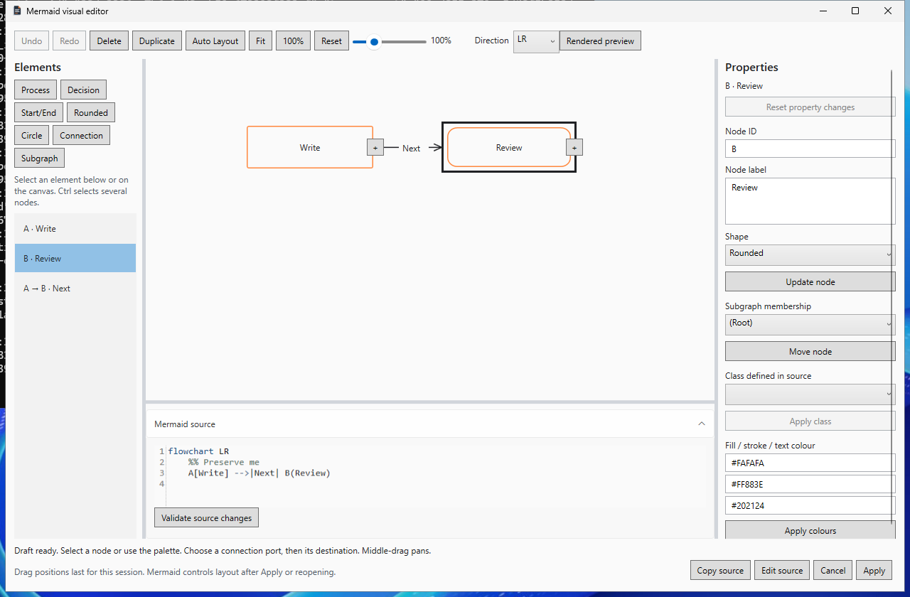
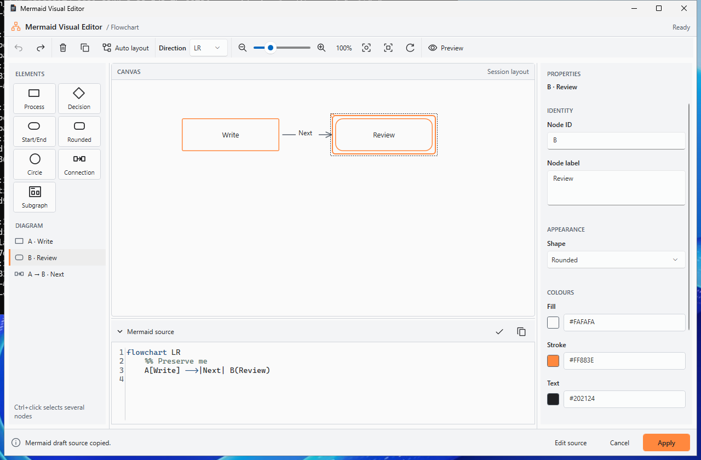

# Mermaid editor visual polish

Draft [PR 27](https://github.com/DouglasNLima/local-docs-studio/pull/27), branch
`feature/native-mermaid-editor-visual-polish`, targets the verified PR 26 head
`eb81939835a1bb2a92cf76570de77d8d69e571ff` on `feature/native-mermaid-visual-editor`.
PR 26 and its ancestors, the installed preview and personal workspaces are untouched.
This is a presentation change to the native editor; the buildless web app is unchanged.

## Baseline and visual decisions

Retrieved actual Windows evidence from verified run 38784102160, then rebuilt the
same revision in an isolated CI worktree for a repeatable comparison. Inspected
main-window and editor captures in equivalent themes and representative documents.
The final comparison harness uses 1280 x 840 owner/editor windows, the same two-node
source, selected B, expanded source and 100% zoom. Earlier screenshots used Fit,
whose percentage differs with the new inspector width; the settled comparison below waits for 100% in both windows.

The established regression baseline is recorded in the [original editor report](mermaid-visual-editor.md):
1,220 Core cases including 73 focused Mermaid cases, 60 rendering cases, 268 browser
cases, 44 normal / 43 High Contrast authoring checks and 75 desktop checks in four
contexts. The verified `eb819398` baseline was rebuilt and its 44 original normal
authoring checks rerun by the final comparison workflow.

The old editor had generic local Button/TextBox/ComboBox/Label styles, wrapping text
commands, irregular insertion buttons, a flat list, square permanent ports, crowded
properties, an isolated Validate button and two footer rows. The main window uses
Segoe UI, outline CommandIcons, neutral panels, compact commands, themed Fluent
inputs and an accent selection marker. Those existing resources are the reference.

| Area | Shared resource / resulting presentation |
|---|---|
| Commands | `Desktop.DiagramToolbar`, `Desktop.DiagramToolbarButton`, native overflow, existing command icon control |
| Forms | `Form.Label`, `Form.TextInput`, `Form.ComboBox`, `Form.Field`, `Form.Help`, `Form.Action`, `Form.PrimaryAction`, `Form.CheckBox` |
| List | `Desktop.SelectionItem`, icon plus ellipsised text, full tooltip, retained Selection/SelectionItem |
| Panels | `Desktop.PanelHeading`; existing Window/Panel/Border/Text/MutedText/Hover/Pressed/Accent brushes |
| Theme | Existing application ThemeService and Fluent dictionaries; Windows system colours in actual High Contrast |
| Local styles | `Resources/MermaidEditorStyles.xaml` derives palette, actions and toolbar controls from shared styles; owns canvas/source/splitter presentation |

No global theme change, new dependency, UI framework or colour-token set is added.
The Lens icon is retained. Existing icon geometries are reused for history, zoom,
fit, reset and preview; small original vectors cover delete/duplicate/layout,
source actions and every supported node shape. No raster or emoji palette artwork.

## Workspace and interactions

The compact identity header displays Ready, Draft modified, Pending properties,
Source unvalidated, Validation failed or Protected source. A single overflow toolbar
groups editing, direction and view commands. Icon-only controls have names and
action/shortcut tooltips. Existing command handlers and automation IDs remain.

The two-column palette has consistent native shape tiles and native drag/drop.
The diagram list distinguishes nodes, connections and subgraphs by vector icon;
long labels truncate with tooltips. Multi-selection and keyboard navigation retain
the original list contract. Compact tiles leave more space for the list at 880 x 600.

The canvas has a bounded neutral surface and compact Session layout help. Nodes
retain authored colours and supported geometry, with balanced label padding.
Selection adds an outline and small handle; focus adds a separate dashed ring.
Ports retain named buttons and larger 32-pixel targets, revealed by selection,
hover or keyboard focus. Connections have rounded joins, centred labels, a broad
transparent pointer target and a lightweight dashed connection guide. Subgraphs
retain subtle surfaces and labels. Hover never rebuilds the graph. Pointer motion
updates native geometry without parsing or invoking the Mermaid renderer.

Properties have a stable summary and independently scrolling contextual body.
Identity, Appearance, Colours and Structure group the node fields; connections
and subgraphs show only their own sections. Labels target their controls. The
pending Update node action stays above the scrolling body; Reset changes appears
only while needed. Absent source-defined classes do not leave an empty selector.
Existing membership/class/colour actions remain available. Their atomic pending-node
commit behaviour is unchanged. No automatic property application is introduced.

Fill, Stroke and Text have labelled hexadecimal inputs and safe native swatches.
Swatches accept only the existing six-digit syntax and never interpret CSS or URLs;
the existing transformation validator remains authoritative. Invalid values retain
both source and pending-property protection. High Contrast uses system swatch surfaces
and keeps the authoritative values readable.

The source header now contains validation and copy controls, a state marker and
collapse control. AvalonEdit, syntax highlighting, text shortcuts and invalid-source
retention remain. Source adopts the owning editor's typography and is populated before first layout.
Equal-text refreshes no longer reset it, and a padded bounded source body keeps the
first line clear. Actual
first meaningful and settled captures are inspected separately; no timer or arbitrary
delay is introduced. The retrieved original High Contrast frame visibly hides the
first line beneath its source header; final Light and High Contrast meaningful frames
show the complete `flowchart` line inside the padded body. Collapsing source reclaims canvas space and disables its splitter
until expanded; it does not reset source or selection.

The fixed footer contains a single ellipsised live status with full tooltip, supporting
Edit source, secondary Cancel and accent Apply. Long diagnostics cannot grow the
footer or push its actions away. Copy belongs to the source header. The former
permanent session-position paragraph is now discoverable canvas help.

## Safety, accessibility and responsive acceptance

Core Mermaid parsing, source patching, bounds, private history and document-conflict
contracts are untouched. A small interaction correction enforces the existing pending-edit
contract on every node entry path. `CanTransform` deliberately allows explicit property
commits, so pointer connection completion and F2 could previously reach a source operation
while inspector values were still pending. Node pointer/drag, keyboard connection and
inline-entry guards now require Update or Reset first. Escape still cancels connection
mode, retains pending selection/values and reports that state accurately. Real pointer,
Space, F2 and Escape regressions assert exact source, field and position retention.
Existing exact-source authoring checks still exercise Apply to the second identical block, one document Undo/Redo, safe relocation,
conflicting Apply, invalid/unsupported source, standalone Mermaid, Cancel and reopen.
An independent byte comparison of the saved before/after fixture confirms that only
the intended second fence changes: the first identical block, surrounding Markdown,
comments and CRLF line endings remain intact. The JSON retains exact UTF-8 source
and SHA-256 values. Presentation changes add no persistent coordinates or proprietary
metadata.

The extended real UIA sequence also verifies pending-property selection/theme
protection, collapse/expand draft preservation, actual zoom values, reversed connection
endpoints, invalid-colour rejection/reset and native 20/100/300-node canvases plus the
nested/styled complex fixture. It checks action/panel containment at 880 x 600,
1024 x 768, 1280 x 800, 1440 x 900 and 1920 x 1080 in normal and actual High Contrast.
Minimum size intentionally uses toolbar overflow, scrollable list/properties/source
and PAN/fit; it does not promise every graph label fits without zooming.

All 50 original XAML Automation IDs are retained among 58 current IDs. Named ports,
Toggle states and list patterns are retained. New
icon controls have accessible names/tooltips; new form labels use target associations.
Keyboard commands remain in the original handler; text entry retains its own keys.
These are tested control paths, not physical screen-reader certification.

## Evidence and certification status

The first integrated candidate `2316415` passed 44 normal / 43 High Contrast authoring
checks; inspected screenshots prompted smaller palette tiles and a stable contextual
inspector action. The second candidate `5f94d11` passed 83 normal / 81 High Contrast
checks in branch and PR runs. First-frame source and compact/complex/pending-theme
screenshots were actually reviewed, then splitter, hit-target and comparison
refinements were compiled for final validation. Dark hover review exposed inherited
primary-action text with inadequate contrast; the local derived style now follows the
shared hover/pressed text brushes. Keyboard review added a separate dashed focus ring
so focus remains visible over an accent-filled Apply button. Review also restored the original 4,096-character
property-input limit: a seven-character colour cap could truncate an invalid pasted
value into a valid prefix. Actual keyboard-input regressions reject the complete
invalid value without source changes.

Retained failure: baseline run 38800356300 recorded the unchanged main window's
active-tab visibility assertion during a 1440-wide screenshot. Its raw screenshot
and tab bounds are preserved; the parallel PR run 38800362715 passed the identical
assertion. No assertion/deadline was weakened, and no retry loop was added. Final
validation retains that original desktop regression.

Two harness setup failures are also retained in the JSON: [38801884280](https://github.com/DouglasNLima/local-docs-studio/actions/runs/38801884280)
read the clipboard before asynchronous UIA Invoke completed; the test now waits for
the exact clipboard value. [38802470725](https://github.com/DouglasNLima/local-docs-studio/actions/runs/38802470725)
carried deliberate multi-selection into a single-node case, then toggled the target
off. It now explicitly clears that fixture selection. The same semantic assertions
remain; deadlines are unchanged. Original failed logs, JSON and screenshots are
preserved in the local review artefacts, with raw error records retained in Git.

The final package/source candidate is
`302096110631c6ad5ad12cdc4b44587cc293ccf6`. It passes 102 normal and 98 actual
Windows High Contrast authoring checks at measured 96 DPI. The final test-only
refinement waits for real connection destination mode
before recording its guide; it adds no application delay or behaviour change. The
first capture had raced asynchronous UIA Invoke and showed the preceding state;
its exact-source connection outcome already passed. The corrected capture observes
the existing mode, moves the real pointer and flushes composition before recording.
The final visual refinements add direct pointer-target and complete-popup containment
checks, readable primary hover/press text, a dashed keyboard focus ring, and the owning
editor's font family/size before source layout. The following delivery audit records
evidence; it changes no application source.

Earliest HWND captures can be blank before WPF composition. They are retained as
raw evidence and are not labelled a meaningful source frame. The audit separately
waits for actual source layout, observes compositor completion and records the first
meaningful frame; it also waits for 100% zoom and the selected inspector before
matched captures. These are test capture conditions, not delays in the application.

The completed regression, package identity, independent verification and bounded
readiness verdict are recorded below.
All native GUI, High Contrast/display changes and installer lifecycle execution use
disposable GitHub-hosted Windows with restoration guards. Local work compiles source
and inspects pixels/PE metadata; it never launches or installs the new app.

Physical multi-monitor/DPI at 125/150/200%, screen readers, input latency on real
hardware and a genuinely SDK-free Windows machine remain unexecuted certification.
Unsigned trusted in-app update execution stays blocked by the existing policy.
No merge, public release, tag movement or production signing is performed.

## Inspected visual evidence

The images are unmodified Windows captures. The [JSON evidence](evidence/mermaid-editor-visual-polish.json) records SHA-256 values,
source revisions, raw checks, timings, preserved failures and exact source examples.
The primary before/after captures use the same 1280 x 840 window, selected B,
expanded source, exact diagram source and 100% zoom. The opening/complex/resize
frames retain their actual Fit or zoom states and are labelled separately.

| Visual state | Inspected capture |
|---|---|
| Main application reference | [Light](images/mermaid-polish/main-light.png), [Dark](images/mermaid-polish/main-dark.png), [actual High Contrast](images/mermaid-polish/main-high-contrast.png) |
| Theme comparison | [Original Dark](images/mermaid-polish/before-dark.png), [integrated Dark with pending values](images/mermaid-polish/after-dark.png), [original High Contrast](images/mermaid-polish/before-high-contrast.png), [integrated High Contrast](images/mermaid-polish/after-high-contrast.png) |
| Contextual inspector | [Node and colours](images/mermaid-polish/inspector-node.png), [connection](images/mermaid-polish/inspector-connection.png), [subgraph](images/mermaid-polish/inspector-subgraph.png) |
| Selection and pending values | [Multiple nodes](images/mermaid-polish/multi-selection.png), [pending properties](images/mermaid-polish/pending.png) |
| Keyboard and hover | [Dark hover](images/mermaid-polish/apply-hover-dark.png), [Dark keyboard focus](images/mermaid-polish/apply-focus-dark.png), [High Contrast keyboard focus](images/mermaid-polish/apply-focus-high-contrast.png) |
| Source states | [Invalid](images/mermaid-polish/invalid-source.png), [protected](images/mermaid-polish/protected-source.png), [collapsed](images/mermaid-polish/collapsed-source.png) |
| Creation | [Empty diagram](images/mermaid-polish/empty.png), [palette drop](images/mermaid-polish/palette-drop.png), [connection guide](images/mermaid-polish/connection-creation.png) |
| Responsive desktop | [880 x 600](images/mermaid-polish/narrow.png), [1920 x 1080](images/mermaid-polish/wide.png), [880 x 600 High Contrast](images/mermaid-polish/narrow-high-contrast.png) |
| Rich content and guards | [Complex flowchart](images/mermaid-polish/complex.png), [source conflict](images/mermaid-polish/conflict.png), [existing native rendered preview](images/mermaid-polish/rendered-preview.png) |
| First meaningful paint | [Light](images/mermaid-polish/first-meaningful.png), [High Contrast](images/mermaid-polish/first-meaningful-high-contrast.png), [complete native overflow popup](images/mermaid-polish/toolbar-overflow.png) |
| Preserved early/failure evidence | [Earliest HWND capture](images/mermaid-polish/first-frame.png), [baseline tab assertion](images/mermaid-polish/retained-baseline-tab-failure.png) |

Visual judgement: typography, neutral surfaces, border treatment, command artwork,
selection markers, form fields and action hierarchy now follow the main Lens window.
The minimum-size source/list/inspector scroll and toolbar overflow are deliberate;
PAN/fit remains necessary for graph content beyond the current viewport. Explicitly
authored light node fills remain light in Dark; no palette rewrite is hidden in styling.
Dense graphs retain simplified native routing and can need the existing rendered preview.

## Performance observations

No grid, blur, animation framework or renderer was added. Selection/hover uses WPF
style triggers. The temporary guide reuses one `LineGeometry`; node drag keeps the
existing coalesced connection geometry updates. Pointer movement does not parse source
or call Mermaider. No new synchronous `UpdateLayout` loop was introduced. The existing
Ctrl+wheel layout synchronisation is unchanged.

The final Windows runner used .NET 10.0.13 and four logical processors. These are
single-run cold/warm observations, with no new acceptance threshold or performance
improvement claim. Allocation is measured for the complete scenario process work,
not an isolated effect or steady-state frame.

| Fixture | Parse ms | Native layout ms | Render ms | Edit + render ms | Allocated bytes |
|---|---:|---:|---:|---:|---:|
| 20 nodes | 108.60 | 19.81 | 224.32 | 35.40 | 1,910,528 |
| 100 nodes | 2.73 | 1.13 | 12.67 | 20.88 | 7,750,800 |
| 300 nodes | 7.95 | 5.18 | 62.81 | 52.45 | 20,369,480 |
| Nested groups | 7.21 | 7.81 | 40.96 | 19.93 | 11,851,592 |
| Long labels | 1.60 | 0.26 | 9.41 | 11.53 | 5,084,448 |

The 20-node/190-connection dense fixture stays protected by the original density
guard; the rejected edit preserves exact source. It is not counted as a rendered
success. The native UIA open/fit/compositor/capture sequence measured 1.68 s for 20
nodes, 2.60 s for 100 and 5.77 s for 300. Those include automation and PNG capture,
so they are not pointer latency or frame-rendering measurements. Long labels and
nested groups remain usable through the list, fit/PAN, source and rendered preview.

The earlier Continuous document-preview 250 ms acceptance budget remains unchanged
and is a separate known limitation; passing this UI integration's tests does not
certify that earlier performance target. Physical input latency and matched cold/warm
A/B profiling on user hardware remain unexecuted.

## Acceptance audit

| Area | Evidence and result |
|---|---|
| Shared identity and controls | Existing DesktopStyles, FormStyles, CommandIcons and ThemeService reused; actual main/editor comparisons reviewed |
| Toolbar and palette | Native overflow, grouped vector commands, shape tiles, real click/drag/drop and exact-source checks pass |
| Canvas | Selection/focus geometry, 32-pixel ports, broad edge targets, group surfaces and actual connection guide reviewed; no new renderer |
| Properties | Contextual labelled sections, safe swatches, sticky pending Update/Reset; pointer/Space/F2/Escape protection passes |
| Source/footer | AvalonEdit typography, first meaningful source frame, collapse/resize, validation/copy and stable primary/secondary actions reviewed |
| Themes and sizes | Light, Dark and actual Windows High Contrast; all five required dimensions pass containment, with scrolling/overflow at minimum size |
| Native accessibility | Original 50 XAML IDs retained; UIA selection/toggle/named ports and real keyboard/pointer paths pass; physical screen readers unverified |
| Source safety | Core/patch/limits unchanged; unrelated Markdown, private history, conflict rejection and one document Undo retain exact assertions |
| Packaging | Final independent package verification and disposable installer lifecycle recorded below |
| Physical certification | 125/150/200% DPI, real monitor/input and SDK-free Windows remain unexecuted; 96 DPI is verified |

## Final regression and CI

| Validation | Result |
|---|---|
| Release build | Zero warnings and errors |
| Core | 1,220 passed; zero failed/skipped, including the existing 73 focused Mermaid cases |
| Native Mermaid corpus and exports | 60 cases; zero failures |
| Native Docs Site on disk/static hosting | 12 Playwright cases passed |
| Real Mermaid authoring | 102 normal and 98 actual Windows High Contrast checks passed |
| Existing desktop | 75 checks in each of four contexts: build, first installed launch, upgraded installation and reinstallation |
| Main UX comparison and controls | Verified baseline/current/actual High Contrast captures and 10 desktop UX control paths passed |
| Web regression | 134 Chromium + 134 Edge = 268 passed; static integrity passed |
| Package rejection controls | Seven controls pass: source, version, independent hash, dirty source, tampered ZIP, excluded viewer and missing editor |
| Installer lifecycle | First launch, upgrade, restored session, uninstall/reinstall, interrupted-save recovery and final cleanup; 22 state files retained |

Each count is a workflow's result rather than a sum of repeated branch and PR runs.
The four desktop contexts deliberately repeat the same 75 checks. UIA includes real
native pointer/keyboard actions, actual source/clipboard assertions, geometry and
UI Automation patterns. It is not screen-reader or physical-device certification.

All six candidate workflows use the final source `3020961` (PR packages identify
their generated merge checkout separately). The accepted packages use the branch
source and have been independently pinned to its full revision.

| Mandatory workflow | Branch | Draft PR |
|---|---|---|
| Native build, Core, renderer, exports, packages and installation | [38813557924](https://github.com/DouglasNLima/local-docs-studio/actions/runs/38813557924) | [38813564758](https://github.com/DouglasNLima/local-docs-studio/actions/runs/38813564758) |
| Authoring, visual comparison and actual High Contrast | [38813557838](https://github.com/DouglasNLima/local-docs-studio/actions/runs/38813557838) | [38813564529](https://github.com/DouglasNLima/local-docs-studio/actions/runs/38813564529) |
| Browser and static integrity | [38813557763](https://github.com/DouglasNLima/local-docs-studio/actions/runs/38813557763) | [38813564533](https://github.com/DouglasNLima/local-docs-studio/actions/runs/38813564533) |

The subsequent documentation/evidence commit changes no application or validation
source. Its complete mandatory checks are recorded on [Draft PR 27](https://github.com/DouglasNLima/local-docs-studio/pull/27/checks).
The final PR description identifies the audit revision and its six workflow URLs.
Package/source identity remains the immutable candidate above; it is not silently
relabelled as the later documentation commit or a PR merge checkout.

## Accepted unsigned Windows preview

Accepted version: **0.1.1-preview.497**, Windows x64, self-contained .NET 10 WPF.
Exact source: **302096110631c6ad5ad12cdc4b44587cc293ccf6**. Both binaries and metadata
identify this clean branch checkout from native run **38813557924**, attempt 1;
`sourceKind` is `branch-source`, not a PR merge checkout. No tag or public release
was created. [Download the native-validation artefact](https://github.com/DouglasNLima/local-docs-studio/actions/runs/38813557924/artifacts/12010778495)
and use its `packages/0.1.1-preview.497/` directory. The verified files are also
retained locally under `artifacts/visual-polish/certified-native/packages/`.

| Deliverable | SHA-256 |
|---|---|
| `LensDocsStudio.Native-0.1.1-preview.497-win-x64-Setup.exe` | `30d017d72ce54ff9d30e21024f91581d361b5a0bf182b0ee63fdee3a1b10aa82` |
| `LensDocsStudio.Native-0.1.1-preview.497-win-x64.zip` | `acef70855f9bc6c16dfcd903d48b3e43a095601c6eaf0343b6ef3d1d450c7860` |
| Upgrade predecessor `0.1.0-preview.497` installer | `7644068143ddc2e5fed64375632a45558bd67b6f93e91d732cf7aca40268559a` |
| Upgrade predecessor `0.1.0-preview.497` ZIP | `406d2583c77756193671201d142492341ce4ff0e3316eb3bf1a4cc92cb4c4b23` |

After downloading the CI artefact, a separate local PowerShell verifier process
checked each version with explicit source, installer and ZIP SHA-256 pins. Both
passed. It inspected PE identity/resources, payload hashes, original Lens icon frames,
required Mermaid types, editor BAML, DesktopStyles, FormStyles, CommandIcons and
MermaidEditorStyles. It verified the included .NET 10 WPF runtime, unsigned apphost
and installer, matching update metadata and payload hygiene. Browser runtimes,
ContinuousViewer, private/development payload and unsafe ZIP paths are rejected.
These inspections execute no application or installer code. Raw verification results,
file inventories and metadata are retained in the JSON evidence.

The disposable CI lifecycle upgraded `0.1.0-preview.497` to `0.1.1-preview.497`,
verified installed binary/registration/version identities, preserved **22 native
state files and workspace source byte-for-byte**, restored actual tabs/text/settings
after upgrade and reinstallation, exercised interrupted-save recovery, and removed
installation/shortcuts/registration while preserving the existing Markdown default.
Installed runs verified use of the bundled runtime. Both preview versions share the
same source revision: this certifies package replacement and state/session continuity,
not historical schema migration, production signing or an SDK-free clean image.

Readiness verdict: **ready for controlled unsigned internal preview**. The cohesive
Lens presentation is a visual judgement based on inspected Windows captures;
functionality and package identity have separate automated/byte-level evidence.
Physical screen readers, 125/150/200% DPI, multiple monitors, real hardware latency,
historical migration and SDK-free Windows remain unexecuted certification. Dense or
advanced grammar remains protected; positions remain session-only and simplified
native routing can need fit/PAN or rendered preview. The earlier Continuous-preview
performance budget remains a separate known limitation. Trusted unsigned in-app
update execution stays blocked. The installed user preview, ancestor PRs, production
signing configuration and public release/tag state remain untouched.
