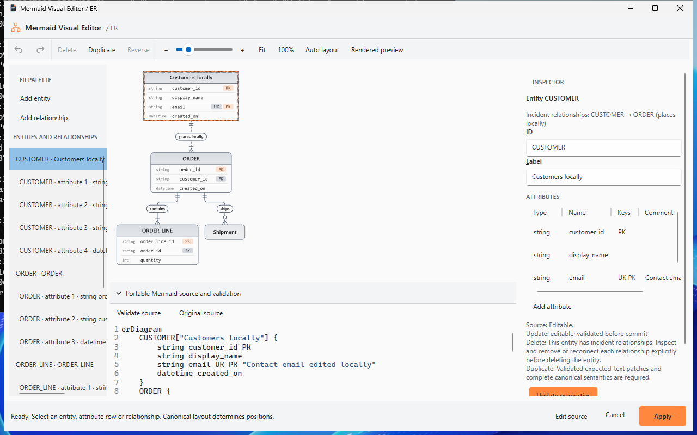
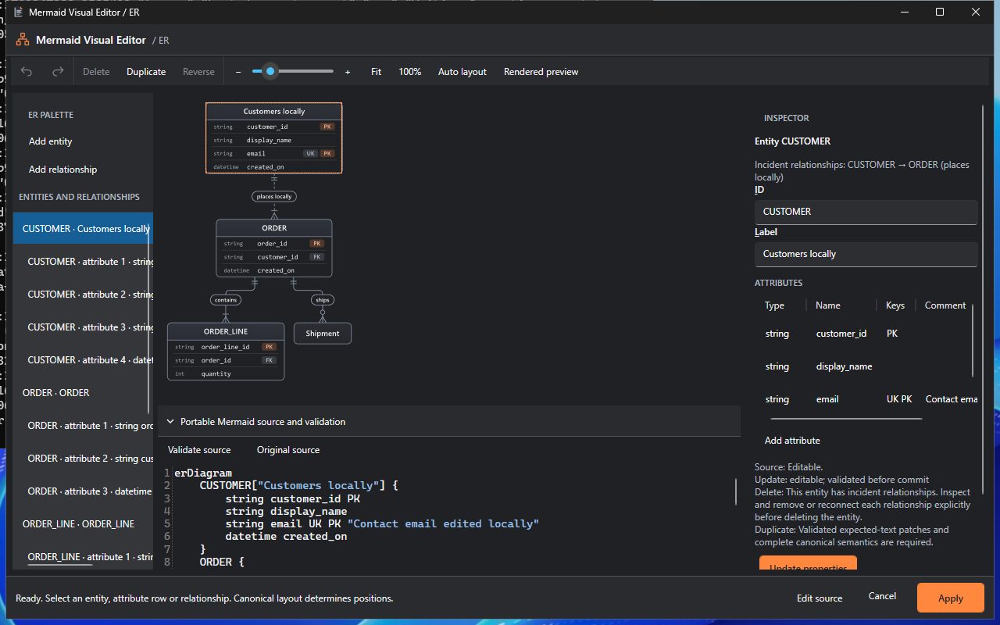
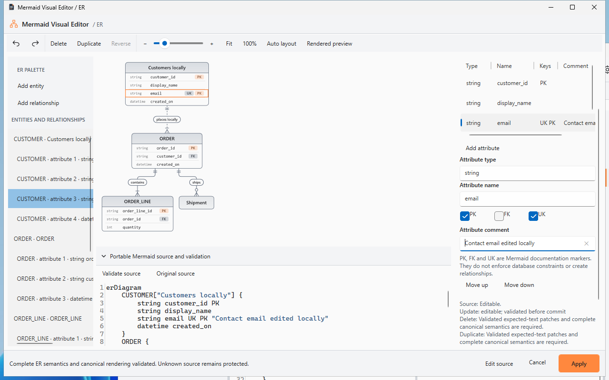
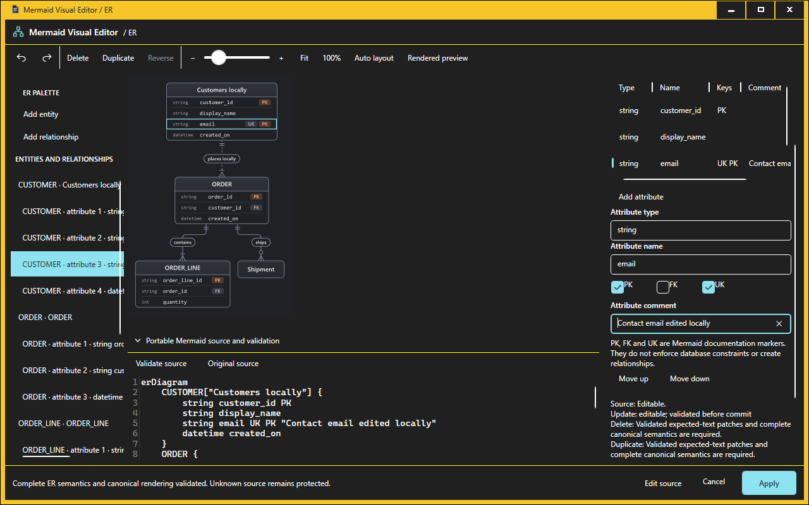
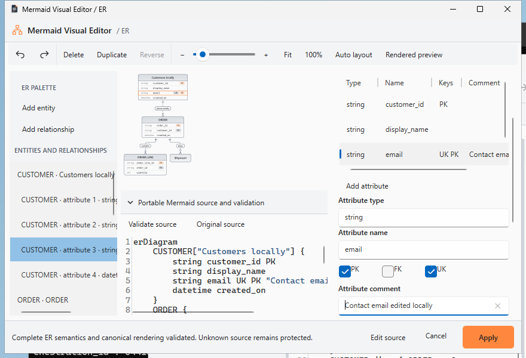
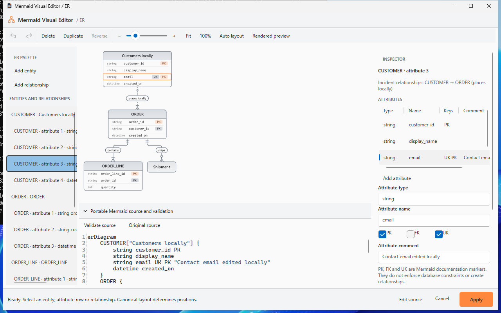

# Native Mermaid ER visual editor v1

Implementation and certification are separate. This work starts at consolidated
`develop` `3229246af356829771a200134a5df38d3cc8a04c`, containing the normal merges
of PRs #30, #31, #32 and #33. Main remains untouched. Post-merge browser/static
[run 39061522521](https://github.com/DouglasNLima/local-docs-studio/actions/runs/39061522521)
passed Chromium and Edge; Pages deployment was skipped. The native
[post-merge run](https://github.com/DouglasNLima/local-docs-studio/actions/runs/39061522483)
has now passed both the complete native build/Core/export/package/installer job
and the separate installed/upgraded/reinstalled State authoring job. The
consolidated baseline is accepted from these actual post-merge results.

The local Release solution builds with zero warnings/errors. All 1,526 Core cases
pass, including 102 ER cases. Actual Windows authoring, High Contrast, canonical
fidelity and all existing editor UX regressions pass at `03869b8`; later identity
hardening requires its own exact-source checks. The
[Draft PR delivery record](https://github.com/DouglasNLima/local-docs-studio/pull/34)
identifies the delivered commit, completed mandatory runs, package versions,
literal hashes and independent receipts. Earlier State/Sequence/Flowchart reports
retain their original evidence scope. No production qualification is claimed.

## Architecture and source authority

`LensDocsStudio.Core.ErDiagrams` owns complete bounded source recognition, exact
statement/token spans, semantic entities, implicit entities, ordered attribute and
relationship occurrences, protected statements, operation permissions, expected-text
patch plans, independent expected semantics and a bounded private draft. The source
revision is a SHA-256 of the complete source. Whitespace, comments and mixed LF/CRLF
remain in the original string; they are never reconstructed from a graph.

`DiagramService` uses the existing per-render `MermaidEntityLayoutProvider`. Its
`LayoutEr` delegates exactly once to the original provider and captures immutable
parser semantics and positioned geometry for that revision. Mermaider 0.15.1,
SharpVectors and the existing native FlowDocument preview remain authoritative.
No database, external rendering service, browser runtime or replacement layout is
used. The browser product and GitHub Pages publication remain static and separate.

## Pinned grammar investigation

The installed NuGet metadata pins Mermaider 0.15.1 to
[`71b64845570d633a94d29e85579c0a02786fece8`](https://github.com/nullean/mermaider/tree/71b64845570d633a94d29e85579c0a02786fece8).
The exact source was fetched and inspected: `ErParser`, `ErDiagram`, `ErEntity`,
`ErAttributeInfo`, `ErRelationship`, `ErCardinality`, `PositionedErDiagram`,
`PositionedErEntity`, `PositionedErRelationship`, `LightweightErLayoutEngine` and
`ErSvgRenderer`. The adapter is deliberately narrower than permissive parser regexes.

In the following table, correspondence means every captured parser entity,
attribute, ordered key marker, comment, direction and relationship matches the
source model. Every accepted edit must also match its independent expected complete
semantics. SVG success alone never grants permission.

| Construct | Pinned parser / renderer | Correspondence and inspection | Source transformation / protection |
|---|---|---|---|
| Exact `erDiagram` header | Recognised; normal source renders | Exact header required | Header editing uses source |
| Comment before header | Renderer family detection fails | Original source retained | No private edit/history commit |
| Implicit entity | Created by recognised relationship | Semantic ID and first occurrence order checked | Label/attribute edit adds explicit block; last-reference removal requires explicit block first |
| Explicit block | Separate opening/closing lines; attributes accumulated | Full block and ordered row spans | Ordinary single block supported; repeated declarations protect structure |
| `ENTITY["Label"]` alias | Recognised on block opening; latest explicit alias wins | Alias value/span retained | Existing alias token edited in place; repeated authority protected |
| Unquoted block alias | Recognised by pinned Mermaider; spaced bare aliases fail browser Mermaid | Exact token retained | Bare alias forms remain protected; source editing preserves the user's control of their syntax |
| Attribute type/name | Pinned parser accepts broad non-space tokens | Every row counted; safe single-token grammar independently checked | Safe type/name spans edited; unsupported tokens protected |
| PK, FK, UK | Case-insensitive marker tokens retained in order | Complete ordered marker list checked | Single markers supported; multiple markers use isolated commas: `PK , FK , UK`, retained by pinned Mermaider and portable Mermaid |
| `PK, FK` | Comma token silently ignored, FK retained | Entire original statement protected | Never repair or rewrite the recognised prefix |
| `PK FK UK` | Pinned parser retains all markers; standard Mermaid rejects this syntax | Inspected with original bytes | Protected rather than emitted or silently normalised |
| Quoted attribute comment | First double-quoted comment parsed; HTML breaks normalised | Complete comment and exact original source retained | Ordinary single-line quoted comment supported; quote/braces/newline injection rejected |
| Relationship endpoints | Both semantic IDs recognised | Exact endpoint token spans | Reconnect existing entities; unknown global references protect reconnection |
| Cardinalities | One, zero/one, many, zero/many; token characters normalised | Both endpoint values checked independently | All 16 endpoint pairs, solid/dotted: 32 cases |
| Optional relationship label | Pinned parser recognises unlabelled, plain and quoted forms | Complete semantic label checked | Unlabelled/plain/double-quoted editing supported; single quotes and quotes embedded in plain labels remain protected |
| Identifying `--` | Solid relationship | Identifying semantic flag checked | Explicit identifying choice |
| Non-identifying `..` | Dotted relationship | Non-identifying semantic flag checked | Explicit non-identifying choice |
| Self-relationship | Supported; laid out after ordinary relationships | Reconciled to original occurrence, not global source ordinal | Independent editing, reversing and duplication supported |
| Repeated/parallel relationship | Distinct ordered source occurrences retained | Verified tuple and actual positioned order | Exact private identity; overlapping routes offer occurrence menu/list |
| TD, TB, LR, BT, RL | Direction parser accepts all five | Direction matches captured pinned semantics | Inspected and preserved; change using source |
| Comments and blank lines | Trimmed/comment lines skipped by renderer | Exact original bytes retained | Outside patches unchanged; row moves leave intervening comments in place |
| Unknown inside a block | Ignored line or partially parsed attribute | Owner and statement protected; known semantics still fully checked | Entity structural and attribute rewrites blocked; unrelated safe label may remain editable |
| Unknown outside a block | Often silently ignored | Global unknown dependencies retained | ID/add/delete/reconnect protected; proven independent properties may remain editable |
| Unsupported relationship/direction | Can be silently ignored | Retained as protected, never claimed as supported meaning | Source editing required |

Canonical cardinality notation is endpoint oriented:

| Meaning | At first entity | At second entity |
|---|---|---|
| Exactly one | `\|\|` | `\|\|` |
| Zero or one | `\|o` | `o\|` |
| One or more | `}\|` | `\|{` |
| Zero or more | `}o` | `o{` |

The parser also recognises character permutations of these pairs; an unchanged
cardinality keeps its original bytes. Reverse explicitly swaps endpoint IDs and
cardinalities together, retaining each entity's original cardinality.

Portability is a separate check from pinned authorisation. The shared
`portable-keys.mmd` fixture is checked against pinned Mermaider semantics and the
repository's browser Mermaid 11.15.0 parser. Quoted aliases, Unicode entity IDs and
double-quoted relationship labels are checked too. Isolated comma tokens retain all keys
in both parsers; attached commas can lose keys in Mermaider and space-only lists
fail browser Mermaid. Dotted attribute type/name tokens are also protected because
the browser grammar rejects them. New operations emit the verified intersection.
Bare alias forms and single-quoted relationship labels are also protected; the
native writer emits quoted aliases and double-quoted labels. The newer browser parser never grants permission to rewrite source; pinned complete
semantics, exact patches and native correspondence remain mandatory.

## Operation capabilities

| Target | Supported | Protected limitations |
|---|---|---|
| Entity | Add; display label; ID and all recognised references; implicit-to-explicit; duplicate with unique ID; independent delete; inspect incident relationships | Duplicate declarations, bare aliases, unsupported IDs/quoting, unknown references/contents; implicit materialisation requires known dependencies; connected delete requires explicitly removing/reconnecting each relationship |
| Attribute | Add; type/name; PK/FK/UK; comment; duplicate; delete; move up/down | Unknown suffix/statement in owning entity; unsupported quoting/type/name; invalid move; no inferred FK relationship |
| Relationship | Add; label; endpoints; both cardinalities; identifying/non-identifying; delete; duplicate; explicit semantic reverse | Single-quoted or quote-bearing plain labels; unknown dependencies for structural changes; last-reference removal of implicit entities requires explicit materialisation |
| Source | View immutable original; edit and validate candidate; locate exact occurrence | Invalid or semantically unreconciled candidate cannot commit |

The inspector table shows type, name, keys and comment. Separate native fields edit
the selected occurrence. Entity IDs are semantic IDs; attributes and relationships
have distinct private GUID identities even when every visible field repeats.
Patch planning carries exact statement identity order through insertion, deletion,
reorder and Undo/Redo. No IDs or coordinates are written into Mermaid.

## Complete validation and history

Each operation plans the smallest supported expected-text changes against a captured
revision. Existing patch validation rejects stale text, invalid boundaries and
overlaps. It then reparses the complete candidate, restores planned private
identities, compares the full independent expected semantics, verifies protected
statements byte-exact, renders canonically and verifies native conversion before
committing history. Cancellation, stale presentation and conversion failures cannot
commit. No whole-diagram serialisation is used.

Private history retains up to 100 entries and an 8-million-character aggregate
budget; selection and exact source are restored. Reordering byte-identical rows
records their changed private occurrence order, so the following property edit
targets the moved row. Its Undo/Redo restores identities and selection even while
source bytes remain identical. Rejected operations and ordinary no-op property
updates create no entry. A new successful edit invalidates redo. Source editing requires explicit
validation; pending inspector properties require Update or Discard before selection,
other operations or Apply.

## Actual layout and visual identity

The pinned engine filters self-loops from ordinary layout, emits ordinary routes
in source order, then appends self-loops in source order. `RelationshipOrder`
reconciles that order and verifies each complete tuple. Native conversion verifies
entity IDs/labels, path endpoint IDs, both cardinalities, identifying flags, labels
and endpoint geometry against the same snapshot. Attribute hit rows come from the
verified entity ID, ordered source rows and canonical header/row dimensions;
SVG text never supplies attribute identity.

The displayed drawing uses the same native conversion as preview/export. Neutral
overlays are transparent until selected. Relationship paths/labels, entity headers
and ordered attribute rows are selectable; overlapping routes offer exact occurrences.
The element list and inspector provide keyboard alternatives and native SelectionItem
patterns. Endpoint drag only updates one guide geometry during movement; parsing,
SVG conversion and layout occur after a valid drop. Invalid drop/cancellation releases
capture and retains source/history. Zoom, middle-button PAN, Fit and actual size are
available. Entity manual positioning/palette drop positioning is currently absent;
canonical Mermaider layout always determines positions.

## Document integration

`MermaidDocumentEditSession` retains owning document identity, exact container spans,
AvalonEdit versions and final revision checks. ER routes separately from Flowchart,
Sequence and State. Insert → ER diagram visually… supplies a portable starter.
Standard/tilde fences, recognised DevOps containers, `.mmd`, `.mermaid`, repeated
identical fences, unsaved source and concurrent edits use existing ownership guards.
Apply is one document Undo action. Cancel retains owner source; Save persists portable
Mermaid. The mandatory actual Windows harness must verify Save/restart/reopen and
the complete native workflow before certification can be reported.

## Evidence and remaining work

Initial local evidence: Release compilation 0 warnings/errors; full Core 1,489/1,489;
ER 65/65. A first ER test exposed the pinned leading-comment/header limitation;
the original failing TRX is retained under ignored local evidence and the corrected
test now verifies safe rejection as a separate case.

Hosted ER jobs run normal and actual Windows High Contrast, strict canonical pixel
comparisons, grammar observations, resource cases (10/15, 30/60, 100/150, many rows,
convergence/clusters and long labels), document conflicts and real application UIA.
No rendering resource limit is raised. Native SVG conversion remains non-interruptible;
stale results are discarded. Hosted timings are observations, not hardware-independent
guarantees. Existing Continuous 250 ms and dense-render limitations remain separate.

The inspected screenshot gallery and revision-scoped measurements appear below.
Final-head CI URLs, exact commit, package versions/hashes and independent receipts
belong to the linked delivery record and immutable CI artefacts. This containing
documentation commit cannot embed the hashes of its own packages. The mandatory native
workflow produces self-contained Windows x64 unsigned installer/portable previews,
verifies ER compiled resources beside all three previous editors, checks runtime,
branding, payload identity and rejection controls. A separate installed ER job
reverifies downloaded packages and runs install/upgrade/reinstall authoring.
Historical cross-revision migration remains distinct from same-source two-version
testing. No ordinary-desktop native execution/installation, merge, release or tag
movement is authorised. A source revision is **ready for unsigned internal preview**
only after all mandatory exact-head jobs and independent package/lifecycle receipts
pass. A queued, failed, cancelled or earlier run does not qualify a later head.

## Retained first-run failure

At `684291f`, both ER fidelity jobs in
[run 39063103201](https://github.com/DouglasNLima/local-docs-studio/actions/runs/39063103201)
failed before UIA: WPF `Geometry.Parse` returned a read-only geometry and assigning
the coordinate transform raised `InvalidOperationException`. The correction clones
that geometry before assigning its transform and freezes it afterwards. Original
normal/High Contrast logs are retained; this does not count as a passing acceptance.
The following source-integrity milestone passed 82 ER cases locally, including alias
forms, entity duplicate/delete, self-to-normal reconnection, native-conversion
rejection, invalid property atomicity and quoted/unlabelled relationship labels.

At `d0d4604`, High Contrast fidelity, grammar/resource observations and document
ownership checks pass. Actual UIA reaches entity/attribute editing, keys, relationship
cardinalities/type, creation, private Undo/Redo and inspector reconnection, then
fails its invalid-drop check. Inspection of the retained native screenshot shows
an unintended discard prompt: the parent canvas intercepted endpoint-handle clicks,
rebuilt the selected relationship controls and prevented capture before Escape.
The correction excludes endpoint-control descendants from parent path selection.
The cancellation check now also requires measured native pointer updates, preventing
a source-only assertion from falsely establishing that a drag actually occurred.
Original [run 39063313555](https://github.com/DouglasNLima/local-docs-studio/actions/runs/39063313555)
logs and captures are retained. Later successful acceptance is recorded separately.

At that same revision the High Contrast fidelity report passes 104 assertions,
covering six fixture/theme pixel comparisons and document ownership checks. Hosted
parse/render/native-conversion observations are respectively 0.36/59/244 ms for
10 entities and 15 relationships, and 10.90/894/858 ms for 30/60. The 100/150 case
fails the existing renderer deadline (reported after 5.66 seconds); its attempted
edit also fails safely. No limits were increased. Approximately 1.43 GB of
current-thread cumulative allocations were recorded across that failed scenario,
including repeated validation; this is neither live nor peak process memory and
excludes worker-thread allocations. The 250-attribute case renders/converts in
4/1,005 ms; convergence/clusters in 12/168 ms; long labels in 0.4/83 ms. These
revision-scoped hosted observations do not establish complete UI acceptance or
hardware-independent performance guarantees. Actual editor process measurements
are captured separately by `--er-performance-ui`.

At `3814db8`, both ER jobs pass in run 39063821569: 22 normal and 23 actual High
Contrast UIA assertions; 103 normal and 104 High Contrast fidelity/ownership
assertions; and actual process performance at 10/15 and 30/60. The 100/150 editor
case is explicitly recorded as a renderer resource failure. This proves the
complete authoring, cardinality, endpoint-pointer, Apply/document Undo/Redo,
Save/restart/reopen workflow at that revision. Later source changes still require
their own exact-head certification.

Screenshot inspection found a partially clipped UK control caused by native minimum
width. The next candidate constrains the key row and adds focus/visibility assertions
for all six attribute inputs at every required window size. It also covers deleting
and recreating the last independent entity, real owner conflicts/close/other-tab
Apply, repeated canvas attribute hits and self-loop canvas SelectionItem identities.
A source-integrity review additionally found that key changes could rewrite a
normalised formatted comment. Unchanged comments now retain their original quoted
bytes and spacing; unchanged relationship labels retain original quoting/escaping
through cardinality edits. Four pinned formatting/escaping regressions verify this.

## Windows acceptance and screenshot gallery

The `03869b8` native run [39064786435](https://github.com/DouglasNLima/local-docs-studio/actions/runs/39064786435)
passed the complete native/package job and all three installed ER authoring phases.
Its separate State install and upgrade phases passed, but reinstall stopped at
Insert State after successful editing, Apply, Undo/Redo and Save/reopen. The retained
failure screenshot shows the Insert menu still open. The harness now expands the
menu and invokes the native UIA command, as the existing Sequence harness does;
canvas pointer coverage and all assertions remain. This explains the observed test
failure without claiming an application defect or a passed run. Final-source State
and ER lifecycle qualification is recorded separately in the delivery record.

At `03869b8`, [PR desktop UX run 39064786469](https://github.com/DouglasNLima/local-docs-studio/actions/runs/39064786469)
passes 35 normal and 36 actual High Contrast ER UIA assertions, plus 114 normal and
115 High Contrast fidelity/ownership assertions. The
[branch UX run](https://github.com/DouglasNLima/local-docs-studio/actions/runs/39064783108)
passes all nine jobs, including Flowchart, Sequence, State, historical presentation
and independent partial-source regressions. The corresponding
[browser/static run](https://github.com/DouglasNLima/local-docs-studio/actions/runs/39064786439)
and [workspace/interaction run](https://github.com/DouglasNLima/local-docs-studio/actions/runs/39064786534)
pass; feature Pages deployment is skipped. These are genuine earlier-revision
results; final-head qualification is identified in the delivery record.

The actual native workflow edits entity labels, attributes/comments/keys, row order,
relationship labels/cardinalities/type, adds entities and relationships, reverses
and reconnects endpoints, tests measured pointer cancellation and invalid/valid
drops, validates, applies only the second identical fence, performs document
Undo/Redo, saves, restarts and reopens the complete source. Separate real-app cases
cover standalone source, repeated attribute canvas hits, reordered self-loop canvas
identities, protected unknown suffixes, independent safe edits, empty-draft recovery,
outside/inside owner edits, closed owners and Apply while another tab is active.

These are unmodified Windows captures from `03869b8`, inspected at their actual
pixel dimensions. All six attribute inputs were focused and verified inside the
inspector at every required size. Later captures, additional identical-row history
checks and final package acceptance are retained in the final-head CI artefacts.

| Light | Dark |
|---|---|
|  |  |

| Attribute inspector | Actual Windows High Contrast |
|---|---|
|  |  |

| Small-window attribute controls | Save, restart and reopen |
|---|---|
|  |  |

Inspected windows: [880 × 600](images/er-visual-editor/viewport-880x600.png),
[1024 × 768](images/er-visual-editor/viewport-1024x768.png),
[1280 × 800](images/er-visual-editor/viewport-1280x800.png),
[1440 × 900](images/er-visual-editor/viewport-1440x900.png),
[1920 × 1080](images/er-visual-editor/viewport-1920x1080.png).

Attribute controls at [1024 × 768](images/er-visual-editor/attribute-viewport-1024x768.png),
[1440 × 900](images/er-visual-editor/attribute-viewport-1440x900.png) and
[1920 × 1080](images/er-visual-editor/attribute-viewport-1920x1080.png) retain the key
markers and comment input; the inspector scrolls while footer Apply/Cancel stays
visible. [Repeated/self relationships](images/er-visual-editor/occurrences.png) and
[protected unknown source](images/er-visual-editor/unknown-protected.png) remain
available for exact occurrence and protection inspection.

## Measured resource and interaction observations

Normal hosted measurements at `03869b8`; milliseconds include cold work where stated.

| Scenario | Scan | Render | Native conversion | Core label operation |
|---|---:|---:|---:|---:|
| 10 entities / 15 relationships | 0.59 | 60.80 | 271.10 | 115.61 |
| 30 entities / 60 relationships | 2.65 | 1,021.10 | 697.91 | 2,011.57 |
| 100 entities / 150 relationships | 3.42 | **Failed**, reported after 6,396.64 | Not run | **Rejected**, 4,629.01 |
| 250 attributes in one entity | 0.68 | 2.76 | 767.34 | 8.65 |
| Convergence and disconnected clusters | 0.15 | 10.15 | 94.63 | 33.94 |
| Long labels | 0.07 | 0.37 | 68.53 | 6.95 |

Actual process editor opening is 668 / 1,308 ms at 10/15 and 30/60, including UIA
transport. Twenty entity selections take 2,652 / 3,281 ms; twenty attribute selections
451 / 518 ms; twenty relationship selections 424 / 495 ms. Working set grows from
approximately 166 / 187 MiB before opening to 218 / 256 MiB after interaction.
Actual endpoint dragging records 21 / 20 updates, a maximum measured handler update
of 0.120 ms in both cases, and 10,912 / 10,368 handler-allocated bytes across those
updates. The complete synthetic drags take about 2.5 seconds including the driver's
pointer transport; that duration is not per-frame latency. Source remains exact
and processes respond throughout.

The 100/150 source fails the unchanged renderer deadline; its native editor is not
opened and no large-diagram UI timing claim is made. Approximately 1.43 GB of
current-thread cumulative allocations occur across that failed scan/render/edit
scenario, not a peak/live-memory measurement. Cancellation checks retain exact
source/history. Hosted observations do not promise hardware-independent timing.

## Final protection and qualification boundaries

A late portability check found that the initial space-only key writer produced
source accepted by Mermaider but rejected by standard Mermaid. The correction uses
`PK , FK , UK`, verifies all pinned ordered keys after edits, and adds an independent
browser semantic regression over the shared fixture. Space-only multiple keys,
attached-comma tokens and dotted attribute type/name forms remain byte-exact and
protected. Earlier screenshots/packages showing space-only combinations are earlier
candidate evidence, not the delivered portable-source certification.

The later documentation candidate `2d06a5d` exposed a benchmark assumption in
[run 39069037180](https://github.com/DouglasNLima/local-docs-studio/actions/runs/39069037180):
10/15 and 30/60 interactions completed, then the 100/150 preflight happened to render
inside the deadline while the actual editor's independent render exceeded it.
The retained screenshot shows the precise cancellation diagnostic and disabled
editing. The harness now records that exact deadline failure at either stage for
100/150, verifies private/owner/disk source, empty history, disabled Apply/palette
and process responsiveness, and makes no successful large-editor timing claim.
Small scenarios must complete; unrelated diagnostics and mapping timeouts still
fail the job. Partial measurements are also retained on any future failure. No
deadline, renderer budget or existing interaction assertion is increased or removed.

- Implemented: entities, supported attribute types/names and unique key combinations,
  exact quoted comments, row order/duplication/removal, relationship labels, both
  endpoint cardinalities, identifying semantics, safe reconnection, exact occurrences,
  canonical presentation, private history and document Apply/Cancel/Save integration.
- Known-source conditions: implicit materialisation requires fully recognised
  dependencies. Removing the last implicit reference is protected until an explicit
  declaration exists. Structural edits that alter unrelated first-occurrence entity
  ordering are rejected by complete semantic comparison; use earlier explicit blocks
  or Edit source. Duplicate declarations and unsupported alias quote fallbacks remain
  protected. New field inputs use the documented bounded single-line grammar.
- Occurrence identity: moving byte-identical attributes is a private identity change.
  It creates one private step and supports the next targeted property edit; an Apply
  with unchanged portable bytes creates no document Undo step. IDs remain private.
- Session layout: entity positions follow Mermaider. Manual entity dragging and palette
  drop positioning are absent. Newly created palette entities are brought into view
  through WPF's existing zoom/scroll transform. No coordinates are persisted.
- Resource limits: 100,000 source characters, existing 500-element renderer budget,
  unchanged three-second requested render deadline, native geometry/bitmap budgets
  and non-interruptible SharpVectors conversion remain in force. The dense ER failure
  above is retained explicitly; Continuous preview's separate 250 ms issue is unchanged.
- Packaging: self-contained unsigned Windows x64 previews, all four compiled editors,
  exact .NET/WPF payload and Lens resources are independently inspected. Negative
  controls include an ER-only BAML resource removal with a recomputed ZIP checksum;
  required types and original assembly versions remain intact, and the verifier must
  still reject that copy. Installer/portable payload equality is checked after install,
  upgrade and reinstall. Historical cross-revision migration is a separate result.
- Not production certified: production signing, trusted automatic updates and separate
  release/clean-machine qualification. No merge, tag, public release or ordinary-
  desktop native execution/installation is performed by this work.
