# Mermaid preview fidelity and visual editing access

Implementation and certification work for draft [PR 28](https://github.com/DouglasNLima/local-docs-studio/pull/28),
branch `feature/native-mermaid-preview-fidelity`, based on
`47e78d6bff490a9b0c0b5cb2022dab262fe14e5e`. PR 27 and its ancestors remain unchanged.
The application/package candidate is `4940c58a542b635e7e008eeaf31b03ca4ec5878a`.
Later validation instrumentation and this evidence audit do not change application,
Core, packaged guide, installer or packaging inputs. The accepted package remains
pinned to that candidate; it is not relabelled as a later evidence commit.
The candidate is accepted for bounded unsigned internal preview, with the exact
package hashes and completed lifecycle evidence below. Production certification
remains outside that verdict.

## Causes and entry point

The document renderer required the lexical adapter's `CanEdit` before creating its
visual authoring button. A valid chained Flowchart could render successfully while
losing that button. Recognition now uses the diagram family independently of the
transformation classification. **Visual Edit** is the first authoring action;
**Edit source** remains separate. Existing `DiagramEditVisually{sourceOffset}` IDs
are retained. Document size and source-container mapping checks remain unchanged.

Opening still checks document identity, revision, lifetime, save state, format and
source span. Apply still passes through `MermaidDocumentEditSession`; rendering
metadata never supplies editing offsets. Identical fences are distinguished by
their original container and AvalonEdit version history.

## Shared presentation decision

The former canvas called `MermaidGraphLayout.Arrange` and drew its own shapes,
straight connections and guessed label positions. It no longer calls that layout.
The old utility remains solely for the established Core regression assertions.

The chosen presentation is native SVG plus WPF interaction overlays. Mermaider
0.15.1, package source commit `71b64845570d633a94d29e85579c0a02786fece8`, exposes
`RenderOptions.LayoutProvider` and `IGraphLayoutProvider`. A provider created for
each render delegates to the existing provider, preserves numeric-escape decoding
and captures the positioned graph returned to that very rendering call. No global
provider is replaced and no dependency version or library binary is modified.

`DiagramResult` carries that snapshot beside its SVG. Preview/export continue
using the established SVG sanitisation and SharpVectors conversion. The canvas
uses the same sanitised SVG, font settings and native converter, with inert
temporary IDs for native drawing groups. Text remains converted to geometry.
No browser, JavaScript editor, web server or SVG link activation is introduced.

Repainting independently from positioned nodes was rejected: it would reproduce
positions but still duplicate Mermaid's shape, rounded-path, arrowhead, label and
style rendering. Parsing arbitrary SVG as an authoring model was also rejected.
Only the output of this Mermaid render and its associated positioned graph enter
the presentation adapter. Original Mermaid and verified lexical spans remain the
authority for transformations.

## Geometry and source identity

Node and nested-group IDs and labels must agree with generated metadata. Their
bounding rectangles come from the captured positioned graph. Shape hit geometry
comes from the actual generated SVG. Drawing bounds supply a single translation
for the image, paths, ports and outlines. XML processing prohibits DTDs and external
entities, limits document size and element count, and rejects unsupported
transforms, non-finite coordinates and conflicting identities. Existing active
content and external-reference rejection remains ahead of conversion.

Connections use the exact rounded SVG `d` path and generated label rectangle.
Metadata order is checked against the positioned edges, then against the source
adapter's ordered edges. Stable private draft IDs distinguish parallel connections,
including equal endpoints and labels; those IDs are never saved in Mermaid.
At physically overlapping broad path targets, pointer selection asks users to
choose the intended connection in the element list. It never guesses an edge from
overlapping bounding rectangles. Unmapped elements cannot enable transformations.

Selection, multi-selection, keyboard list navigation, properties, ports, inline
labels, node identity/shape, colours/classes, endpoints, reversal, group membership,
deletion, duplication and private history retain the existing source-patching flow.
Pending inspector values continue blocking selection changes, source validation
and Apply until explicitly updated or reset.

## Protected inspection and editing refresh

A renderable protected Flowchart displays its full original drawing. Partial lexical
information may supply safe inspection targets, but never a reconstructed substitute
for the complete diagram. Apply, palette operations and transformations remain
disabled. Zoom, PAN, source editing and Rendered preview remain available. The
compact status explains the protection; diagnostic details are available by tooltip.
Actual rendering errors display diagnostics and retain source. If only geometry
mapping fails, the original sanitised drawing remains available for inspection.

Every accepted semantic edit still validates portable Mermaid, commits only the
private draft, rerenders through the shared pipeline and restores logical selection.
The editor keeps the user's zoom and scroll position; only the initial view fits
automatically; very wide diagrams open at 100% around the first safely mapped node
for readable labels, with Fit available for an overview. Auto layout restores the canonical drawing without another parser
or layout engine. Cancellation reaches Mermaider's supported asynchronous render
pipeline; generation, source and theme checks reject obsolete results. Frozen native
geometry crosses worker boundaries; UI mutations belong to the WPF dispatcher.

Session dragging translates the actual native node drawing groups. Affected
connections become explicitly dashed temporary guides. This deliberate editing
affordance is not claimed as canonical routing. Source edits and Auto layout restore
the exact original rendering, and no proprietary coordinates are saved. Hover and
pointer motion do not parse SVG or invoke Mermaider. Long-lived render and drawing
caches retain their existing bounds, and closing cancels pending work.

The adapter's editing grammar is deliberately unchanged. Chained statements and
other unproven transformations stay protected. Dotted paths, multiline labels,
implicit nodes and repeated references are displayed by Mermaider whether or not
their lexical representation can be transformed safely.

## Viewport

Canvas extent follows actual drawing bounds rather than a 600 by 400 minimum with
extra margins. Smaller content is centred. Initial fit avoids enlarging a small
diagram beyond 100%; explicit Fit and Actual Size remain available. The standalone
Rendered preview adds Fit width and centres smaller drawings. When a whole-diagram
fit would be below 60%, both surfaces initially use readable Actual Size; explicit
Fit dynamically lowers the zoom minimum below 1% when required by actual bounds, and PAN explores the wide drawing. Both surfaces use
WPF coordinate transforms to preserve the pointer's diagram anchor while zooming.
Space+drag, middle-button PAN and keyboard alternatives remain. Very wide diagrams
necessarily shrink when fitted into narrow viewports; Actual Size and PAN allow
inspection without changing aspect ratio.

## Repeatable visual certification

The five synthetic fixtures under `tests/fixtures/native-mermaid-fidelity` contain
no private documentation. `--mermaid-fidelity` runs in disposable hosted Windows,
uses the actual FlowDocument image, actual DiagramWindow image and canvas drawing,
and normalises bounds, scale, translation, source and theme. Ten Light/Dark pairs
pass **281 assertions**, including exact raster equality (zero pixel tolerance),
canonical node rectangles and centres (0.001 native-unit tolerance), routed edge
paths, label geometry, nested membership, safe session IDs and malformed metadata
rejection. DTD, external SVG, conflicting IDs and non-finite geometry fail safely.
The extremely wide viewport case verifies actual Fit below 1%.

| Fixture | Nodes | Connections | Groups | Canonical bounds (native units) | Capability |
|---|---:|---:|---:|---|---|
| Simple | 3 | 2 | 0 | 451.4214 × 129.9600 | Editable |
| Flow error log lab | 10 | 13 | 0 | 2268.9354 × 302.3403 | Protected inspection |
| Complex | 20 | 16 | 4 | 1152.5542 × 657.1440 | Editable |
| Parallel | 2 | 3 | 0 | 412.9214 × 189.9500 | Editable; equal endpoints and labels |
| Shapes | 9 | 8 | 0 | 1325.6800 × 185.0000 | Editable; all supported node shapes |

All three surfaces paint the same drawing, including shapes, dimensions, rounded
routes, arrows, labels, direction and subgraph boundaries. Adorners, selection,
viewport scale and deliberately temporary drag guides are excluded from normalised
pixel equality. Whole-window screenshots are not claimed to be pixel-identical.

The lab combines LR direction, chained/dotted/labelled paths, multiline labels,
implicit nodes, repeated references, branching and cycles. The renderer places
its synthetic source at the right because of the cycle arrangement. This is an
existing Mermaider layout choice reproduced faithfully by the editor; this change
does not claim to improve Mermaider's graph solver or make an entire wide graph
readable at 100% inside a narrow viewport.

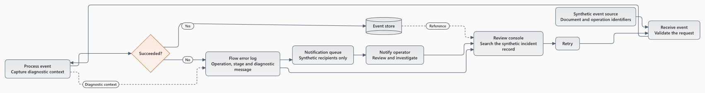

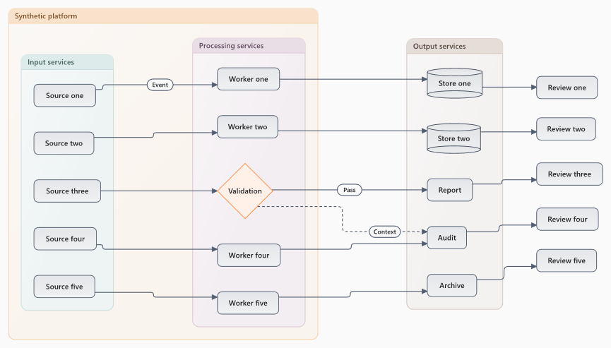

## Inspected Windows captures

Original PNGs are copied without retouching from
[Windows UX run 38889908632](https://github.com/DouglasNLima/local-docs-studio/actions/runs/38889908632).
The baseline is rebuilt from exact `47e78d6` with the current capture harness.
Both comparison windows use the same source, Light theme, 1280 × 840 window and
100% scale. The old simplified arrangement is visibly replaced by Mermaider's
actual dimensions, rounded route, arrow and label geometry.

Before:

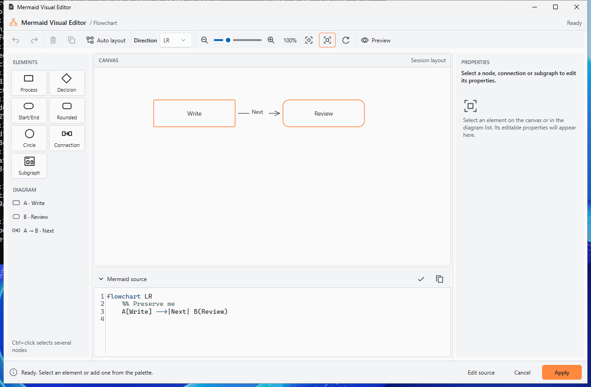

After:

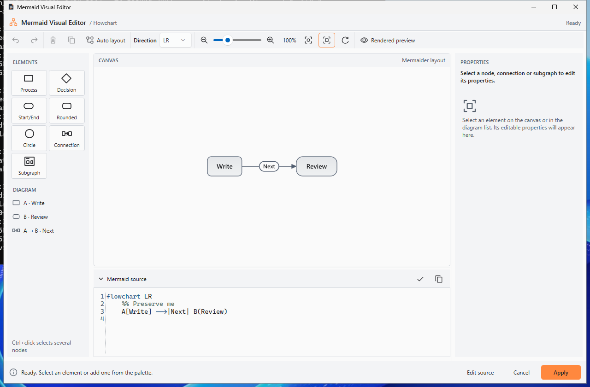

The actual preview exposes Visual Edit first, with Edit source separately available:

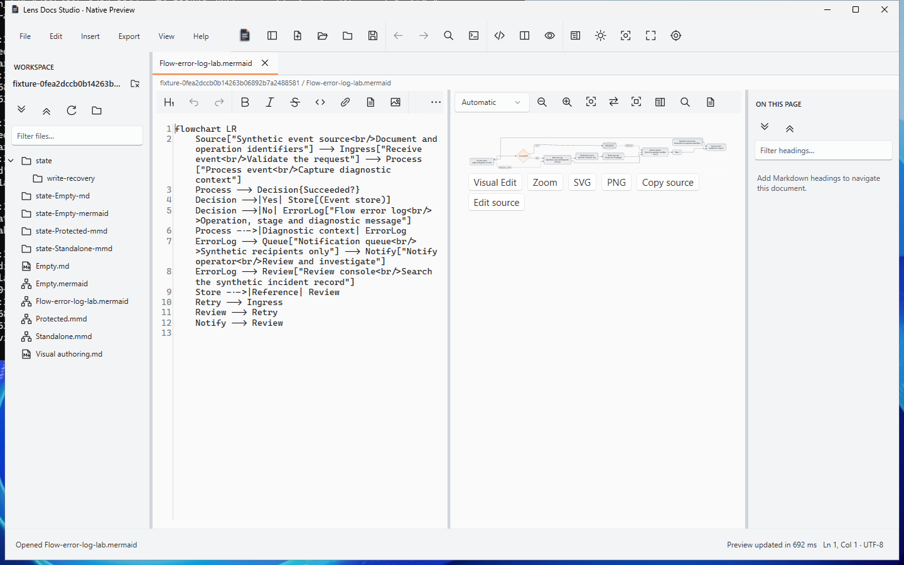

The lab initially opens at readable 100%; PAN exposes the remaining graph:

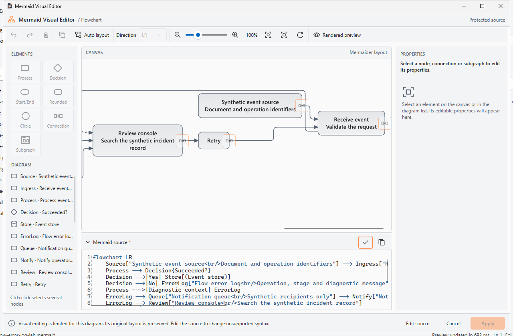

Explicit Fit shows the complete canonical graph with transformations and Apply
disabled. The private-source marker in this test records source validation; the
assertions verify byte-for-byte equality with the original Mermaid throughout.

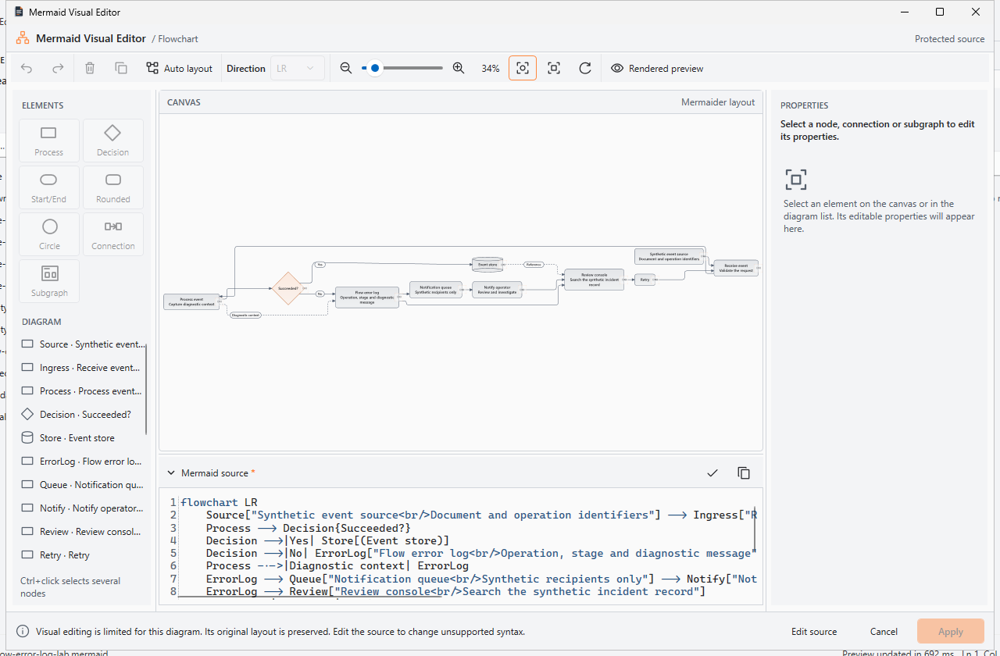

The Rendered preview provides the same graph with Fit diagram, Fit width and 100%:

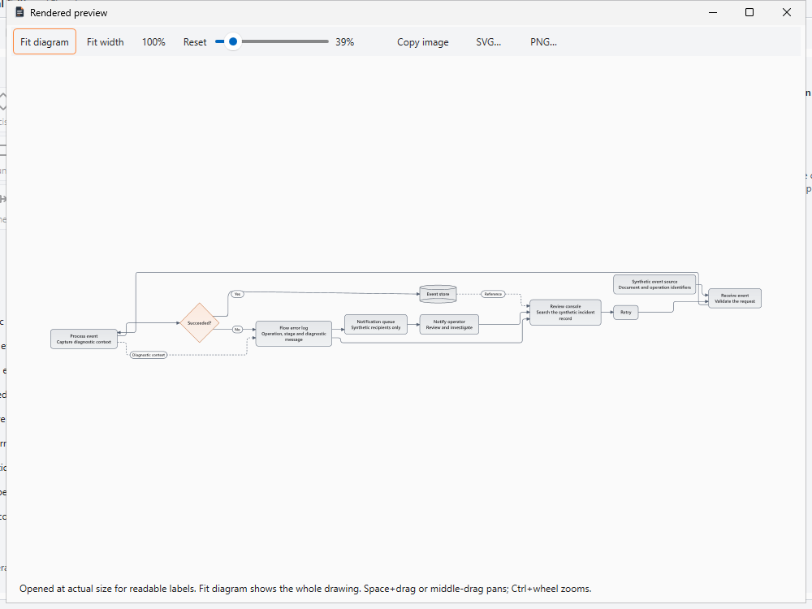

Compound-shape centre hit testing and selection follow actual SVG geometry;
property defaults now come from effective canonical colours while authored style
values remain intact, including in High Contrast:

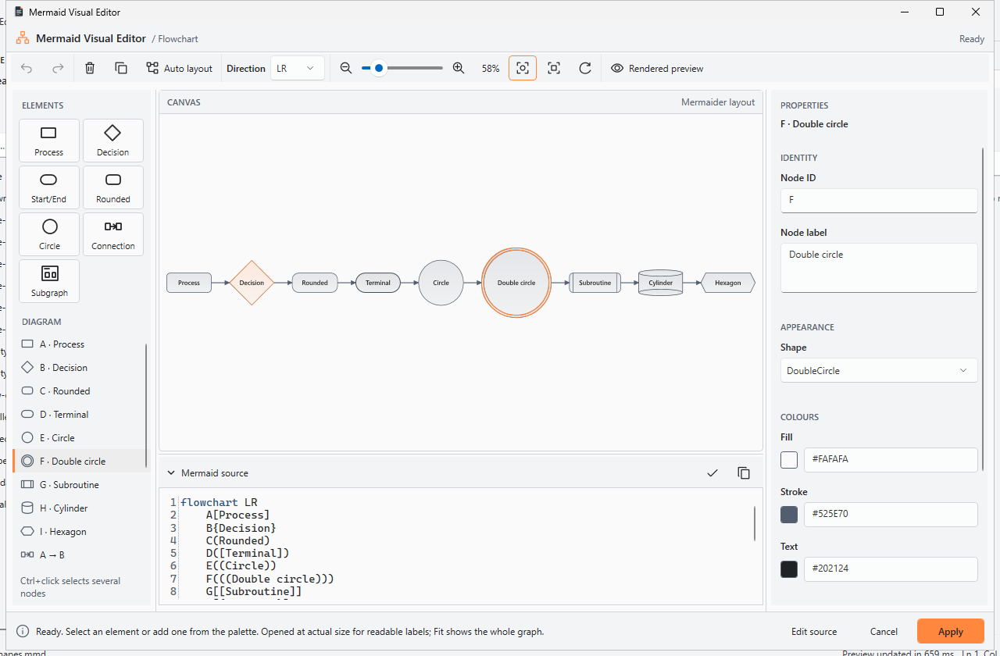

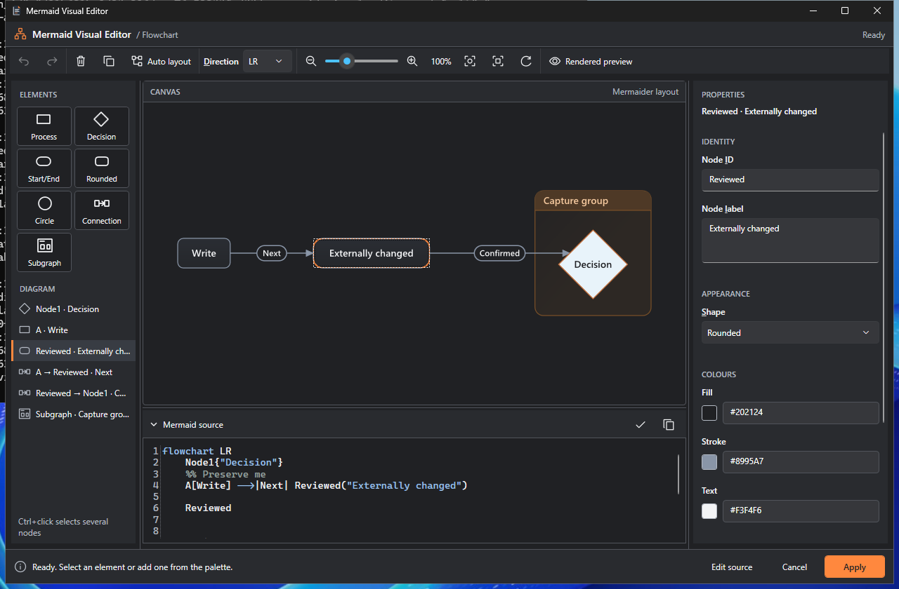

Actual Windows High Contrast retains distinct accessible source-order identities
for parallel edges. The selected second connection has the same endpoints and
label as the first; editing/deleting it and private Undo target only that edge:

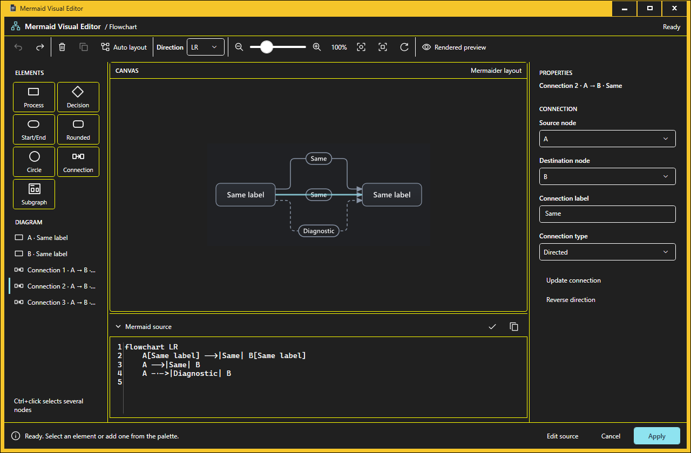

Inspection found no editor-specific routing, label, group-membership, shape or
arrowhead divergence in these fixtures. Selection outlines and hit targets align.
The lab's fitted text is necessarily small; its initial actual-size capture and
PAN test demonstrate the readable inspection path.

## Source integrity and actual interactions

The real UIA suite invokes `DiagramEditVisually{offset}` in the running document
preview. A Markdown file with identical fences opens its second block, edits only
that block, preserves the first and surrounding Markdown exactly, then restores
source with one native document Undo. Cancel and protected inspection preserve
both in-memory source and original disk bytes. `.mmd` and `.mermaid` paths never
persist synthetic fences.

Coverage also retains private Undo/Redo, node ID/shape/label/colours/class edits,
connections/endpoints/reversal/deletion, group membership, multi-selection and
duplication, broad routed-edge hits, real double-circle centre clicks, pending
inspector guards, theme changes, source validation and viewport commands. Parallel
edge label changes/deletion cannot affect neighbouring equal-label connections.
Overlapping source edits, stale revisions, source relocation, tab switching,
closing the actual owning tab, save/conflict state, changed wrapper syntax and
changes during asynchronous final validation reject stale Apply. Invalid source
keeps diagnostics and its original text. No proprietary IDs or coordinates enter
saved Mermaid, exported SVG or surrounding Markdown.

The protected source adapter is not broadened speculatively. Chained statements
and other unproven transformations remain protected; the supported render grammar
and supported transformation grammar are deliberately independent capabilities.

## Regression and Actions evidence

| Validation | Candidate result |
|---|---|
| Release build | Zero warnings/errors |
| Core | 1,229 passed, zero failed/skipped; all original 1,220 retained |
| Filtered Mermaid Core | 113 passed; includes all previous 73 source/model/corpus cases and nine new canonical-layout cases |
| Native rendering/export corpus | 70 passed (all original 60 plus ten new fixture/theme renders); zero failures |
| Browser | 268 passed: 134 Chromium + 134 Edge; static checks passed |
| Native visual authoring | 119 normal + 115 actual Windows High Contrast; previous 102/98 retained |
| Canonical comparison | 281 assertions, ten fixture/theme pairs, three native surfaces |
| Desktop workflows | 75 passed in each of source, installed, upgraded and reinstalled contexts (300 checks) |
| Installer lifecycle | Install, upgrade, uninstall, reinstall and final uninstall passed; 22 state files preserved |

Candidate [UX, comparison, performance and actual High Contrast](https://github.com/DouglasNLima/local-docs-studio/actions/runs/38889908632)
and [both browser projects](https://github.com/DouglasNLima/local-docs-studio/actions/runs/38889908745)
passed. The [exact branch-source native/package run](https://github.com/DouglasNLima/local-docs-studio/actions/runs/38890518579)
owns installer identity rather than a pull-request merge commit. The subsequent
[viewport timing instrumentation run](https://github.com/DouglasNLima/local-docs-studio/actions/runs/38890805110)
changes only the validation harness. Final evidence-commit checks are also required
on [Draft PR 28](https://github.com/DouglasNLima/local-docs-studio/pull/28/checks).
The application, Core, packaged user guides, installer and packaging scripts must
remain byte-identical to the accepted source candidate.

Local final checks also passed: Release build, all 1,229 Core tests and filtered
113 Mermaid tests. No WPF application or installer was executed on the user's
machine. Hosted execution uses synthetic files, isolated state and disposable
Windows desktops; High Contrast/display/clipboard restoration is recorded.

Original failures remain available in Actions: [frozen WPF geometry](https://github.com/DouglasNLima/local-docs-studio/actions/runs/38877901190),
[multiline XML metadata/deadline handling](https://github.com/DouglasNLima/local-docs-studio/actions/runs/38878215646),
[centred-canvas drop target and baseline entry point](https://github.com/DouglasNLima/local-docs-studio/actions/runs/38878726107),
[narrow viewer toolbar overflow](https://github.com/DouglasNLima/local-docs-studio/actions/runs/38879424059),
and [obsolete built-in help label assertion](https://github.com/DouglasNLima/local-docs-studio/actions/runs/38887867232).
Their logs/captures were downloaded before repair. Production defects were fixed;
the help assertion now checks the new label, separate source action and protected
inspection. The unchanged baseline uses its original Insert path because it lacks
the corrected protected preview action. No failure fixture was removed, no timing
threshold was relaxed and no timeout was increased to obtain acceptance.

## Performance and resource observations

These are four-core hosted Windows/.NET 10.0.13 observations from the exact
application candidate, including cold/warm effects and contention. The native
presentation column is sanitisation, SharpVectors conversion and interaction
geometry, rather than a competing layout. Allocations are cumulative process
allocations across that scenario, not retained cache size.

| Scenario | Mermaider render (ms) | Native presentation (ms) | Edit + render (ms) | Allocated MB | Working set MB |
|---|---:|---:|---:|---:|---:|
| 20 nodes, cold | 204.79 | 327.90 | 23.80 | 14.65 | 85.36 |
| 100 nodes | 11.60 | 268.80 | 23.42 | 66.23 | 152.38 |
| 300 nodes / 199 edges | 94.60 | 977.35 | 47.02 | 194.77 | 188.58 |
| Nested groups / 100 nodes | 42.88 | 380.95 | 25.34 | 81.28 | 200.43 |
| Long labels / 20 nodes | 19.38 | 1548.50 | 5.74 | 361.33 | 247.23 |
| Dense protected / 190 edges | 6852.93, rejected | None | Rejected | 2394.12 | 201.18 |

Actual UIA open/readiness observations were 510–892 ms for the small editing
scenarios. Open plus Fit for 20/100/300 nodes was 1.47/2.56/4.67 seconds. Selection
was 55–84 ms including UIA transport. These are application/control readiness
measurements, not physical input-to-photon timings. A validation-only follow-up measured zoom-in plus zoom-out at 65.53 ms normal /
68.99 ms High Contrast, and protected middle-button PAN at 451.69 / 450.58 ms.
Those timings include UIA transport, compositor flush and the deliberately timed
synthetic drag; they are not isolated event-handler or physical display latency.

The three-second renderer deadline and existing character/element/density budgets
are unchanged. The upstream layout has coarse cancellation points: the dense
fixture returned its deadline diagnostic after 6.85 seconds and external
cancellation completed after 5.25 seconds (5.28 seconds total). Both preserve exact
source. These are bounded limitations, not claims of a strict three-second wall
clock or immediate cancellation. Dense allocations are material even though the
observed retained working set is much lower.

No hover/pointer movement reparses SVG or rerenders. An unchanged source/theme
reuses the frozen presentation. Edits retain zoom/scroll and logical selection.
Per-editor serialisation prevents overlapping obsolete render/conversion work;
cancellation plus source/theme/generation checks discard stale results and close
awaits/disposes owned work. SharpVectors' synchronous conversion cannot be
interrupted mid-call, so it finishes on its worker before disposal. Existing
bounded caches remain. The separate Continuous Markdown 250 ms limitation is
outside this goal and is not claimed fixed.

## Exact internal-preview packages

The accepted package is **`0.1.1-preview.531`**; `0.1.0-preview.531` is its
isolated upgrade predecessor. Both are clean `branch-source` builds of
`4940c58a542b635e7e008eeaf31b03ca4ec5878a`, from
[run 38890518579 / native-validation artifact](https://github.com/DouglasNLima/local-docs-studio/actions/runs/38890518579/artifacts/12042946581).
They are unsigned, self-contained win-x64 previews.

| Version | Payload | SHA-256 |
|---|---|---|
| 0.1.1-preview.531 | Installer | `e39fc3f50efc8f0445f425181d2f6af41b0baee07f0919d85413290c8aea2a4a` |
| 0.1.1-preview.531 | Portable ZIP | `7d9e4a05479c9da08f2d333c0f25bb872f02282ec96c616ea19a72f302f0808b` |
| 0.1.0-preview.531 | Installer | `72d791de80e46c6a9234f3fd097fbfff8399ede5f9a7fa7cf0fcca79d47836f6` |
| 0.1.0-preview.531 | Portable ZIP | `950c8ea6708a9ee5827ac5a9fe6f147629b6ce50520cb8dd157473eb1e9ea73f` |

The full hosted lifecycle passed: visible installer wizard, initial installed
launch, upgrade, restored session, uninstall, reinstall, interrupted-save recovery
and final uninstall. Seventy-five desktop assertions pass in each of the four
contexts. Twenty-two state files and workspace source remain byte-for-byte intact;
original shell registration, Markdown default and application shortcut icons are
preserved. This tests same-revision version replacement, not historical schema
migration. Independent verification executed no package locally.

The read-only package verifier is rerun independently against the downloaded
artifacts with expected version, exact source revision and pinned installer/ZIP
SHA-256. It checks binary/version metadata, checksums, self-contained .NET/WPF
runtime, AvalonEdit/Mermaider/SharpVectors/resources/icon, absence of browser or
rejected viewer payloads, no private test documentation and blocked unsigned
updater execution. Supplementary static PE metadata inspection confirms the
canonical presentation/provider types, no Native reference to
`MermaidGraphLayout`, and no process-global `SetLayoutProvider` call. Neither
verification executes the application or installer locally.

The durable [evidence index](evidence/mermaid-preview-fidelity.json) records source,
Actions/artifact provenance, screenshot hashes, observations, source-integrity
assertions and independent package-verification results. GitHub artifacts have a
14-day retention period; the committed index and unmodified selected PNGs remain.

## Readiness and genuine limits

**Implemented and verified; ready for bounded unsigned internal preview.**
Direct preview entry, full protected inspection, canonical three-surface drawing,
validated identities and native editing/source guards pass the requested synthetic
acceptance scenarios and retained regression baseline. Package identity, independent
hash verification and complete hosted lifecycle are recorded above. There is no
remaining failed functional acceptance case in that tested scope.

Implemented with bounded limitations: grammar beyond the proven source adapter
remains read-only; ambiguous overlapping path hits require the element list;
session dragging uses temporary dashed guides and never persists coordinates;
Mermaider's own solver choices are preserved; very wide graphs need Fit or PAN;
large/long-label conversion and coarse upstream cancellation remain measurable
costs. No requirement to replace the renderer or broaden protected grammar is
claimed complete.

Not certified: physical screen-reader usability, real mixed-DPI/multiple-monitor
hardware, an SDK-free clean Windows 11 image, production signing/trust, historical
cross-revision migration or public-release readiness. UIA runs at 96 DPI on hosted
Windows and does not substitute for that certification. The installer upgrade is
between two versions built from this same candidate; that limitation is explicit.
PR 28 remains Draft, its base and ancestor PRs are unchanged, and there is no merge,
release, moved tag, signing configuration or change to the user's installed app.
