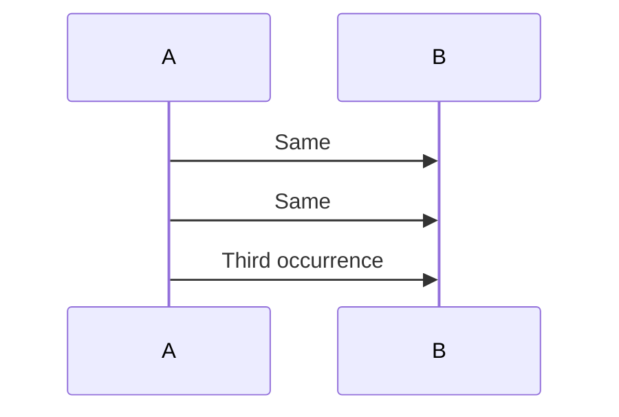
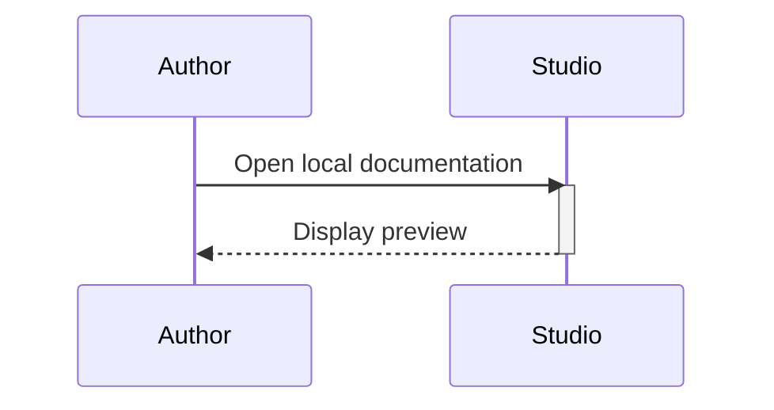

# Native Mermaid Sequence visual editor

This work extends the native editor independently from Draft PR #31. The baseline is `7bd2207b9c18e451b17678f4dd417134070a5722` on `develop`. Saved diagrams remain ordinary Mermaid. This report is updated as implementation and certification proceed; unrecorded checks are not certified.

## Verified renderer grammar

Mermaider **0.15.1**, NuGet repository commit `71b64845570d633a94d29e85579c0a02786fece8`, is the authority. Inspection covered [SequenceParser](https://github.com/nullean/mermaider/blob/71b64845570d633a94d29e85579c0a02786fece8/src/Mermaider/Parsing/SequenceParser.cs), `SequenceDiagram`, `PositionedSequenceDiagram`, [SequenceLayout](https://github.com/nullean/mermaider/blob/71b64845570d633a94d29e85579c0a02786fece8/src/Mermaider/Layout/SequenceLayout.cs), [SequenceSvgRenderer](https://github.com/nullean/mermaider/blob/71b64845570d633a94d29e85579c0a02786fece8/src/Mermaider/Rendering/SequenceSvgRenderer.cs) and `MermaidRenderPipeline`. Sequence layout bypasses `IGraphLayoutProvider`; the renderer path is unchanged.

| Construct | Pinned renderer | Source recognised | Selectable inspection | Safe transformation | Protected scope |
|---|---|---|---|---|---|
| `sequenceDiagram` | Yes | Exact header | Source | New diagram creation | Header rewriting |
| `participant`, `actor`, `as` | Yes | Explicit ID/type/label spans | Headers/lifelines/list | Add, alias/type, known-reference rename, bounded order/delete | Duplicate/late declarations; unknown references |
| Implicit participants | Yes | First-use identity/order | Headers/lifelines/list | Message text/arrow; insertion with proven actor identity/order | Declaration, endpoint/reorder changes; unproven insertion |
| `->>`, `-->>`, `->`, `-->` | Yes | Exact arrow/endpoints/text | Path/label/list | Add/update/delete/duplicate/bounded order | Dependency/block constraints |
| `-)`, `--)` | Open head | Yes | Path/label/list | Same as other messages | No distinct asynchronous glyph in pinned renderer |
| `-x`, `--x` | Filled head | Yes | Path/label/list | Same as other messages | No distinct cross head in pinned renderer |
| `<<->>`, `<<-->>` | Yes | Bidirectional token | Path/label/list | Bounded message edits | Activation shorthand; reverse head omitted on self messages |
| Self messages | Yes | Sender equals recipient | Canonical polyline/label/list | Bounded message edits | Same dependency constraints |
| Message `+` / `-` | Yes | Marker and trigger identity | Message inspector; unique simple bar | Simple lifecycle marker changes | Nested/unmatched lifecycles; blocks |
| Standalone `activate` / `deactivate` | Adjacent subset through Lens adapter | Command spans and exact trigger | Command/message inspector; unique simple bar | Change/remove original command | Non-adjacent/conflicting/ambiguous lifecycles |
| Notes left/right | Yes | Placement, text, participant | Note/list | Add/update/delete | One participant; block-bound deletion/insertion |
| Notes over | Yes | Placement, text, participant pair | Note/list | Add/update/delete | One or two participants; block-bound deletion/insertion |
| `autonumber [start [step]]` | Yes | Numbering state | Source; numbered messages | Preserve through message changes | Numbering-control authoring; overflow/mismatched semantics |
| `loop`, `alt`, `opt`, `par`, `critical`, `break`, `rect` | Yes | Boundaries/type/label/depth | Block/list headings | Bounded message labels inside blocks | Structural rewrites; insertion/deletion/reorder inside blocks |
| `else`, `and`, `end` | Yes | Boundary statements | Source | Preserve | Structural changes |
| `box` | Yes | Protected raw span | Canonical drawing/source | Preserve only | Entire dependency-sensitive draft |
| `create participant/actor`, `destroy` | Yes | Protected raw span | Canonical drawing/source | Preserve only | Entire dependency-sensitive draft |
| Unknown statements/directives | May be ignored by renderer | Protected raw span | Original drawing/source | Preserve only | All visual transformations fail closed |

The editable identifier subset is letters, digits and underscores, beginning with a letter or underscore. Plain Unicode labels and verified ` `/escaped-newline representation are supported. Rich markup is retained for source editing.

## Source and history architecture

Dedicated `Core.Sequence` records describe participants, messages, notes, activations and statements. Every recognised occurrence has exact body/line/token spans and a private identity. Transformations return bounded expected-text patches and a planned identity order; the whole diagram is never serialised. Unchanged comments, whitespace and mixed line endings remain intact. A separate private draft validates the complete candidate through the existing `DiagramService` and compares renderer metadata with recognised semantics before adding one bounded history entry. Rejected, cancelled and superseded operations do not commit source/history. Undo/Redo restores model, source, selection and private history identity.

For example, editing the final repeated `A->>B: Request` patches only that occurrence's label token. Renaming `B` patches its declaration and known endpoint/note/activation reference tokens, leaving comments and unrelated labels untouched. Unknown dependencies prevent this rename.

## Verification status

The expanded local suite passes **1,294 Core cases, including 60 Sequence cases**, with no skips. Release builds have zero warnings/errors; static integrity and all **268 Chromium/Edge browser cases** pass locally. No native application has been executed or installed on the ordinary desktop.

At source `ca331b92c66b8b4868eca1af0145db18684a922c`, [desktop UX CI](https://github.com/DouglasNLima/local-docs-studio/actions/runs/39033004555) passed the Sequence normal and actual High Contrast jobs, with 18 UIA assertions each and 73 Sequence fidelity/geometry assertions per appearance job. The complete existing Flowchart UIA/fidelity and baseline jobs also passed. [Workspace and interaction CI](https://github.com/DouglasNLima/local-docs-studio/actions/runs/39033004553) passed. [Both browser projects](https://github.com/DouglasNLima/local-docs-studio/actions/runs/39033004612) passed. These results belong to that source revision; subsequent enhancements require fresh certification.

Initial native captures were inspected at all five requested window sizes, plus light, dark, selected message/note/participant, activation inspector, message creation and source collapse/expansion. Apply remained visible at the minimum size. The initial source-specific captures and performance observations are retained in the CI artefact `native-sequence-normal` / `native-sequence-high-contrast`. Package and final-HEAD results are delivered with their exact source identity in the PR and verification receipts; no skipped mandatory check counts as a pass.

The expanded run at `e1cad9205c6c04cf0474265d055fcc40b3f2c8e9` passed **101 fidelity/ownership assertions, 27 normal UIA assertions and 28 actual High Contrast assertions** in [desktop UX CI](https://github.com/DouglasNLima/local-docs-studio/actions/runs/39033667815). The additional cases cover participant rename/actor creation/reorder/deletion, real pointer message selection, message ordering/duplication, empty diagrams, protected blocks, repeated occurrences and standalone `.mermaid` Apply/Undo/Save. Source-specific receipts are retained under [evidence/sequence-visual-editor](evidence/sequence-visual-editor/).

Screenshot review of that run found that an inherited Flowchart hover fill obscured a canonical message label in dark mode. The [retained before image](evidence/sequence-visual-editor/before-hover-dark.png) records the defect. The subsequent Sequence-only hit-target style uses transparent interiors with focus/selection outlines; it has no apparent drag handles. A focused regression also retains shorthand activation selection through message edits and private history.

At `269b288ae89714add99e3f74937ce6382b3b6665`, both Sequence appearances and existing Flowchart authoring passed in [desktop UX CI](https://github.com/DouglasNLima/local-docs-studio/actions/runs/39034075723). The corrected dark capture was inspected: message labels remain visible through hovered hit targets. Receipts prefixed `269b288` retain that source-specific result.

The expanded protected-grouping performance case exposed a native colour-adapter failure at `13d0457`: WPF's `ColorConverter` rejected functional `rgb(...)` inside Mermaider colour interpolation. [The failure receipt](evidence/sequence-visual-editor/13d0457-colour-failure.json) retains its source/job/artefact identity. The correction parses bounded RGB/RGBA channels, retains the original scenario and adds real native PNG regressions for numeric, percentage and alpha forms. Sequence conversion failures also retain source and a visible diagnostic instead of escaping the asynchronous window handler. The pinned layout, sanitisation and protected grouping policy are unchanged.

Style materialisation now leaves inert `data-*` source metadata literal. Labels mentioning `var(...)`, `color-mix(...)` or `rem` units cannot be mistaken for style declarations or corrupt correspondence checks. Sequence and Flowchart native regressions exercise those labels through canonical mapping and PNG output. Active/external SVG checks still run before attribute materialisation.

## Screenshot gallery

These native captures come from disposable Windows at accepted application revision `37c622022c235ca97dcf4be7e96eaa651ac5c338`. The hover correction is visible in the dark capture; the implicit-participant capture retains ordinary declaration-free Mermaid.

| Area | Captures |
|---|---|
| Starting states | [Empty](images/sequence-visual-editor/empty.png), [starter/multiple participants](images/sequence-visual-editor/starter.png), [new diagram](images/sequence-visual-editor/new-sequence.png) |
| Selection and authoring | [Participant](images/sequence-visual-editor/selected-participant.png), [message](images/sequence-visual-editor/selected-message.png), [note](images/sequence-visual-editor/selected-note.png), [activation](images/sequence-visual-editor/activation-inspector.png), [message creation](images/sequence-visual-editor/message-creation.png), [reordering](images/sequence-visual-editor/message-reorder.png) |
| Protected and repeated source | [Block inspection](images/sequence-visual-editor/protected-block.png), [repeated messages](images/sequence-visual-editor/repeated.png), [implicit message creation](images/sequence-visual-editor/implicit-message-created.png), [reopened document](images/sequence-visual-editor/reopened.png) |
| Source and appearances | [Collapsed](images/sequence-visual-editor/source-collapsed.png), [expanded](images/sequence-visual-editor/source-expanded.png), [dark](images/sequence-visual-editor/dark.png), [actual High Contrast](images/sequence-visual-editor/high-contrast-note.png) |
| Window sizes | [880 × 600](images/sequence-visual-editor/viewport-880x600.png), [1024 × 768](images/sequence-visual-editor/viewport-1024x768.png), [1280 × 800](images/sequence-visual-editor/viewport-1280x800.png), [1440 × 900](images/sequence-visual-editor/viewport-1440x900.png), [1920 × 1080](images/sequence-visual-editor/viewport-1920x1080.png), [High Contrast minimum](images/sequence-visual-editor/high-contrast-880x600.png) |

## Safe operations and protected boundaries

| Area | Implemented operations | Restrictions |
|---|---|---|
| Participants | Add participant/actor; edit alias/type; rename all known ID references; explicit declaration reorder; dependency-free delete | Implicit declarations inspect only; duplicate/late declarations and unknown dependencies protect the source; remove known dependencies before deletion |
| Messages | Add, update text/endpoints/arrows, duplicate, insert before/after, delete, earlier/later | Endpoint changes, deletion and reordering require explicit participants. Insertion into implicit diagrams must preserve the complete actor identity/label/type/order sequence. Activation-triggering endpoints stay fixed; only adjacent top-level messages without activation dependencies may move |
| Notes | Add, update text/placement/participants, remove; defined insertion position | Left/right notes use one participant; over uses one or two; note insertion and changed participant references require explicit declarations; block-bound removal/insertion protected |
| Activations | Inspect triggering participant/message; change/remove marker or adjacent standalone command | Simple non-nested lifecycles only; block/bidirectional changes protected; unmatched deactivation rejected; existing standalone representation retained |
| Structural blocks | Canonical display; heading inspection; bounded message-label edits | Source-only block creation/rewrite, boundary-crossing moves, deletion inside blocks, boxes and create/destroy |
| History | Atomic batches; one private step per successful visual operation; exact Undo/Redo and selection; 100-step/8-million-character bound | Rejected/cancelled/superseded candidates retain source/history; new edits discard obsolete Redo branches |

## Canonical mapping and rendering

The exact pinned layout pipeline calls internal `SequenceLayout` directly and has no public Sequence layout hook. The editor uses the documented fallback: verify actors, message ordinals/endpoints/styles/labels, notes, blocks and simple activation participant counts against generated SVG metadata. Only then derive hit bounds from that render's canonical rectangles, message lines/polylines, label boxes and note primitives. Source spans/identities come exclusively from the lexical model. Repeated identical messages map by verified source/render order, never text search. Repeated block headings and a participant with several activation lifecycles retain exact-list/message inspection when their canvas regions cannot be mapped uniquely; the status explains that restriction. Failed interaction correspondence retains the current canonical drawing for read-only inspection and disables visual changes.

The drawing is the unchanged existing `NativeSvgService.Render` result, including its SVG sanitisation. Selection overlays do not regenerate SVG. Parsing/candidate validation run off the UI thread; native conversion uses the existing serial STA worker with cancellation and stale-generation checks. Conversion itself is non-interruptible in SharpVectors; obsolete work finishes before another conversion starts, bounding threads/drawings. Hover and pointer movement perform no parsing or rendering.

## Document lifecycle and accessibility

`MermaidBlockSource` and `MermaidDocumentEditSession` own exact body/container tracking, version relocation, stale/overlap rejection and the one-change AvalonEdit commit. Sequence validation and final rendering finish before the session prepares/commits. Owner closure, saving/renaming and competing source revisions reject Apply without source loss. Cancel affects only the private draft. The native UIA fixture exercises a second identical Markdown diagram through selection, message/note edits, activation changes, private history, validation, Apply, document Undo/Redo, Save, close and reopen.

WPF lists expose Selection/SelectionItem; named controls and canonical hit targets expose stable automation names and private occurrence IDs. Text fields retain their normal shortcuts. Creation, ordering, deletion, validation, source navigation, zoom, Fit, scrolling/PAN, Apply and Cancel have keyboard command alternatives. Pending properties prevent silent selection/Apply loss and remain available after rejection. Disabled structural/dependency actions include diagnostic help text. Actual High Contrast is enabled/restored only on disposable GitHub-hosted Windows. Physical higher-DPI certification remains outstanding.

## Initial performance observations

Hosted measurements at `ca331b9`, in milliseconds; these are observations rather than responsiveness guarantees:

| Participants / messages | Parse | Semantic validation | Render | Native conversion | Allocations |
|---|---:|---:|---:|---:|---:|
| 2 / 5 | 0.19 | 0.49 | 1.48 | 35.51 | 5.2 MB |
| 10 / 50 | 0.44 | 1.85 | 3.35 | 253.42 | 40.7 MB |
| 20 / 150 | 1.22 | 4.34 | 7.80 | 876.96 | 116.2 MB |

Allocation figures combine the measured stages. The 150-message conversion motivated moving conversion onto the existing STA worker in the subsequent candidate. A thousand private selection changes took under 0.7 ms in these hosted measurements; this excludes real UIA transport/native focus and is not a UI latency guarantee. The historical Continuous preview 250 ms limitation is unchanged.

## Accepted application evidence

Application revision **`37c622022c235ca97dcf4be7e96eaa651ac5c338`** passes 183 Sequence fidelity/ownership assertions, 29 normal Sequence UIA assertions and 30 actual High Contrast Sequence assertions. The [desktop UX run](https://github.com/DouglasNLima/local-docs-studio/actions/runs/39035922529) also passes 293 Flowchart fidelity assertions, 122 normal authoring checks and 118 actual High Contrast checks. The [interaction run](https://github.com/DouglasNLima/local-docs-studio/actions/runs/39035922572) passes 240 native drags and 4,080 pointer movements across normal/High Contrast, plus workspace viewport checks. [Chromium and Edge](https://github.com/DouglasNLima/local-docs-studio/actions/runs/39035922576) pass; Pages deployment is intentionally skipped for the PR.

The frozen historical application `47e78d6` failed one first-attempt screenshot assertion: its active tab close button remained beyond the tab strip after a 1440-pixel resize. [Original failure](evidence/sequence-visual-editor/37c6220-historical-baseline-first-attempt.json), [tab bounds](evidence/sequence-visual-editor/37c6220-historical-baseline-tabs.json) and [screenshot](evidence/sequence-visual-editor/37c6220-historical-baseline-failure.png) remain intact. An unchanged rerun of that job passed all baseline/current captures and desktop controls. No assertion, deadline or failure evidence was removed. This historical retry is separate from the first-attempt successful candidate Sequence/Flowchart jobs.

Current performance observations, milliseconds, at the accepted application revision:

| Scenario | Parse | Semantic validation | Render | Native conversion |
|---|---:|---:|---:|---:|
| 2 participants / 5 messages | 0.12 | 0.26 | 0.73 | 30.92 |
| 10 participants / 50 messages | 0.41 | 1.54 | 2.72 | 195.24 |
| 20 participants / 150 messages | 1.21 | 3.69 | 7.27 | 839.15 |
| Long labels | 0.12 | 0.33 | 1.38 | 195.86 |
| Notes / standalone activations | 0.26 | 0.48 | 1.41 | 49.29 |
| Nested blocks | 0.27 | 0.45 | 1.38 | 37.54 |
| Protected grouping | 0.09 | Source-only | 1.08 | 17.09 |

Ten complete validated message edits took 29.01 ms; a pre-cancelled edit returned without source/history changes in 0.40 ms. Twenty actual native participant selections, including UIA calls, took 4.15 seconds in total. Initial editor opening, including UIA transport and source-panel expansion, ranged from 0.40 to 0.80 seconds across seven recorded cases. Current-thread allocations for the three size cases were approximately 5.2, 40.7 and 116.2 MB. These measurements are hosted observations; native font conversion is the dominant large-case cost and is serialised off the UI thread. [The complete receipt](evidence/sequence-visual-editor/37c6220-fidelity.json) retains the scenarios, allocations and cancellation scope.

## Source preservation examples

Editing the third repeated occurrence changes one label token:

The first two `Same` messages retain their private identities and exact bytes. Undo restores the original third `Same` token. No IDs or coordinates are written into Mermaid.

Updating a message label beside a standalone activation retains its representation:

The visual operation changes the selected message token; it does not rewrite the standalone commands into shorthand. Renaming `Studio` uses separate expected-text patches for its declaration and every known endpoint/note/activation reference. Unknown dependencies reject the rename without a history entry.

## Windows preview package certification

The accepted application package is **`0.1.1-preview.614`**, built from exact branch revision **`37c622022c235ca97dcf4be7e96eaa651ac5c338`** in [native run 614](https://github.com/DouglasNLima/local-docs-studio/actions/runs/39036561155). Its source kind is `branch-source` and `sourceDirty` is false. Subsequent evidence/documentation commits are separate from that application/package identity.

| File | SHA-256 |
|---|---|
| `LensDocsStudio.Native-0.1.1-preview.614-win-x64-Setup.exe` | `3d083cbbfea7a7c477551d2db0b93c276e58f0bd4bc551a78f8c47e9715b4a0f` |
| `LensDocsStudio.Native-0.1.1-preview.614-win-x64.zip` | `ade40f4e06d6aa55f2d87a374ede9206b03b8bfe7aec9a7aea8721758d816bae` |

[Download the native validation artefact](https://github.com/DouglasNLima/local-docs-studio/actions/runs/39036561155/artifacts/12103267365); the package files are under `packages/0.1.1-preview.614/`. GitHub artefact retention applies. [Version metadata](evidence/sequence-visual-editor/preview-614-version.json), [independent static verification](evidence/sequence-visual-editor/preview-614-independent-verification.json), [negative controls](evidence/sequence-visual-editor/preview-614-negative-controls.json) and [installer lifecycle](evidence/sequence-visual-editor/preview-614-installer-lifecycle.json) retain the identities and actual outcomes.

The package contains the new Sequence Core/native types and compiled editor XAML, existing Flowchart resources, original application icons and the self-contained Windows x64 .NET 10/WPF runtime. Static checks verify binary/source versions, hashes, update metadata, excluded browser/experimental runtimes and payload hygiene. Seven negative controls reject wrong source/version/hash, dirty source, tampered ZIP, excluded experimental payload and a missing editor. Local independent verification reads package metadata/bytes only (`executionPerformed=false`); all application execution and installation occurred on disposable GitHub-hosted Windows.

Installer lifecycle testing passed 20 assertions, including all 528 payload files matching portable bytes, actual installed version/source identity, upgrade from `0.1.0-preview.614` to `0.1.1-preview.614`, uninstall/reinstall, interrupted-save recovery and restored dirty saved/untitled documents. It preserved 22 native state files and workspace source byte-for-byte. Existing shell registration and Markdown defaults remained intact. This is a same-revision version upgrade; the integration-only six-version historical migration matrix is intentionally ineligible for this feature branch and is not counted as a pass.

The complete native run passes 82 rendering/export cases with zero failures, including the Sequence source fixtures through native SVG/PNG and document/export preparation. Desktop UIA passes all 75 groups in each of four contexts: development, first installed launch, upgraded and reinstalled. DOCX/PDF and Docs Site checks retain their existing assertions. The PR merge-checkout run also passed independently as [native run 613](https://github.com/DouglasNLima/local-docs-studio/actions/runs/39035922527); its synthetic merge revision/package is distinct from the exact-branch package delivered above.

## Readiness and remaining limitations

**Readiness: scoped unsigned Windows internal preview for Sequence Editor v1.** All saved source remains portable Mermaid. No merge, stable release, tag movement or unsigned automatic update has been performed.

| Area | Classification | Practical scope |
|---|---|---|
| Dedicated source model, exact patches, private history | Implemented and verified | Complete original source; bounded expected-text patches; stable private occurrences; rejected/cancelled edits retain history/source |
| Native Sequence authoring | Implemented with bounded limitations | Explicit participant/actor editing; safe message/note operations; proven implicit message insertion; simple activation lifecycles |
| Apply/Cancel/Undo/Save/reopen | Implemented and verified | Exact owner/container/version protection; one document Undo; duplicate diagrams and standalone files |
| Canonical fidelity and normal/High Contrast UIA | Implemented and verified | Pinned native drawing; 183 Sequence assertions; 29/30 normal/actual High Contrast authoring assertions; five requested window sizes at hosted 96 DPI |
| Flowchart and browser regression | Implemented and verified | Existing authoring, stress, exports and static hosting checks retained; source-specific counts above |
| Advanced structural rewrites, boxes, create/destroy, unknown dependencies | Protected/unsupported | Complete source and canonical inspection retained; no silent syntax rewriting |
| Duplicate block/activation canvas regions | Implemented with bounded limitations | Ambiguous hit regions omitted with an actionable diagnostic; exact interaction-list inspection remains available |
| Installer/ZIP integrity and disposable lifecycle | Implemented and verified | Exact-source preview 614; independent receipt; payload parity; runtime identities; state preservation |
| Six-version historical migration matrix | Not completed for this feature branch | Conditional integration gate is not a successful feature-branch check; no cross-revision migration claim |
| Physical higher-DPI / physical accessibility | Not certified | Hosted display/UIA evidence does not replace physical device testing |
| Genuinely clean Windows / production signing / trusted automatic updates | Not certified | Unsigned preview only; signing/update trust remains blocked by its existing production requirements |

Rich/unknown grammar, unsupported label encodings, renderer/source correspondence mismatches, nested activation rewrites and unproven implicit ordering remain source-only. Other functional CSS colour spaces beyond the tested RGB/RGBA subset can still produce a native diagnostic; they are not certified by this work. SharpVectors conversion cannot be interrupted mid-call, and the 150-message hosted conversion still takes approximately 0.84 seconds off the UI thread. No universal responsiveness, Mermaid compatibility or Word visual-fidelity claim is made.

## Integration considerations

Shared integration surfaces are `MainWindow.MermaidVisualEditor.cs`, native preview family routing, menu/command registration, theme propagation and owner-close handling. Sequence semantics and transformations live separately from Flowchart nodes/edges and do not depend on PR #31. Existing `MermaidBlockSource` and `MermaidDocumentEditSession` remain the document identity and exact-container authority.
