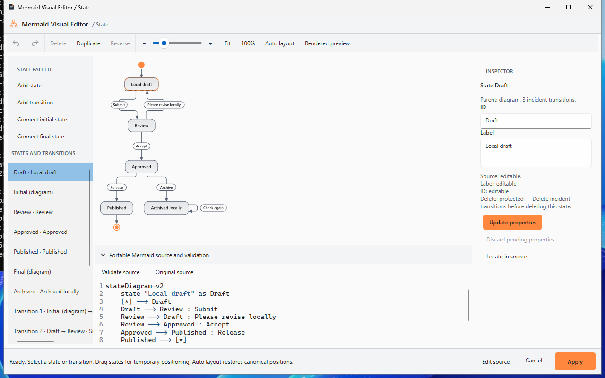
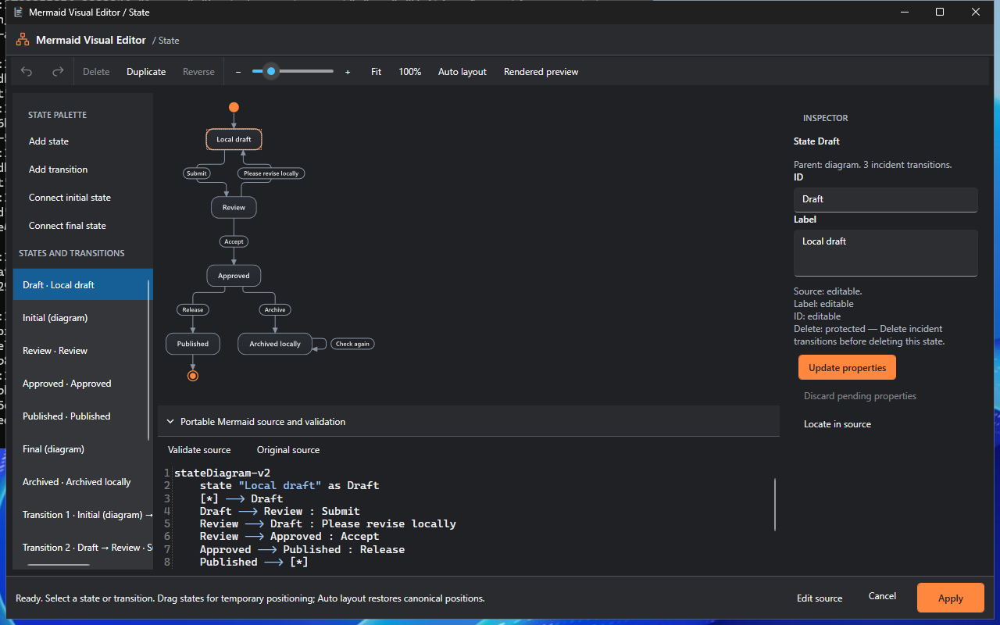
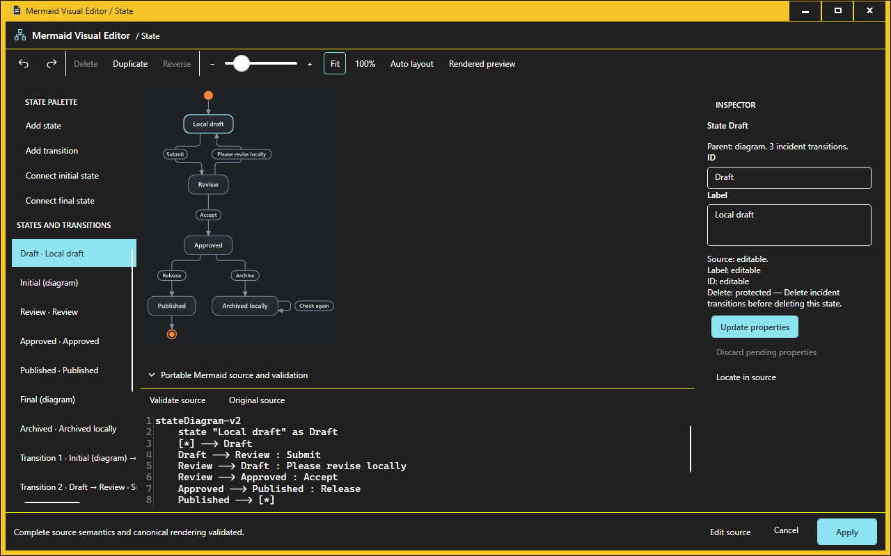
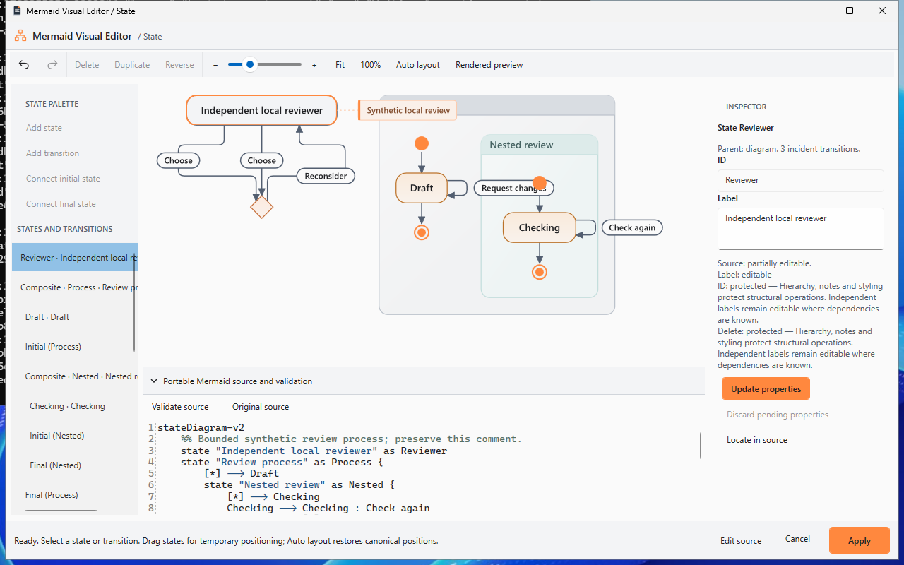
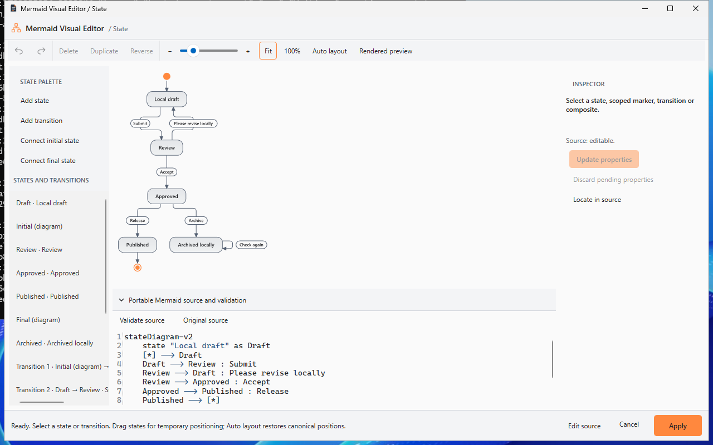
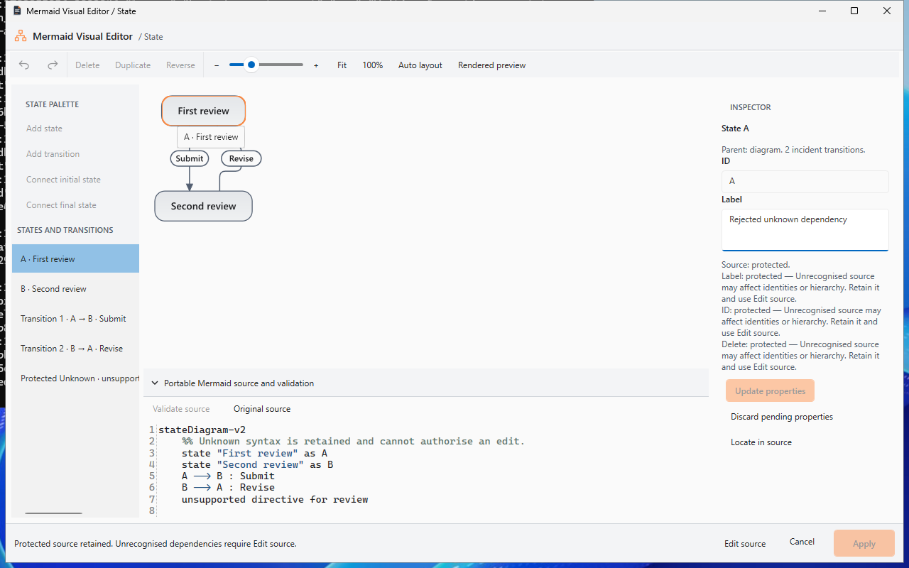

# Native Mermaid State Visual Editor

Status: implemented; native authoring and performance accepted at `357e11f`.
Exact-head unsigned-preview certification is recorded by mandatory PR checks and
immutable package artifacts, as described below.

The feature branch starts at consolidated `develop` commit
`77dff109d84c0730c5b6b3574c71b02b112b082f`, including advanced Flowchart
editing (PR #31, merge `91f541ce`) and the Sequence editor (PR #32).
The integrated web checks passed in [run 39045995936](https://github.com/DouglasNLima/local-docs-studio/actions/runs/39045995936).
Native post-merge [run 39045995957](https://github.com/DouglasNLima/local-docs-studio/actions/runs/39045995957)
was running when work began and subsequently completed successfully, including
desktop, package verification and installer lifecycle. The consolidated baseline
is certified within those workflow scopes, rather than inferred from earlier PR checks.

## Engineering scope

Add a dedicated State source model, expected-text transformations, private
history and native WPF editor. Preserve canonical Mermaider rendering and
existing document ownership/version guards. Verify the actual Mermaider
0.15.1 source at package repository commit
`71b64845570d633a94d29e85579c0a02786fece8` before exposing operations.

## Pinned syntax matrix

Inspection used the actual NuGet package repository revision, including
`Parsing/StateParser.cs`, `MermaidRenderer.cs`, `MermaidRenderPipeline.cs`, the
positioned graph records and emitted SVG. Executable fixtures use the application
`DiagramService` with its existing 100,000-character, 500-element and three-second
rendering limits. Rendering success alone does not establish intended semantics:
this parser silently ignores several unsupported statements.

| Construct | Recognised by pinned parser | Renders | Source model | Safe inspection | Safe edits | Protected / unsupported |
| --- | --- | --- | --- | --- | --- | --- |
| `stateDiagram-v2`, `stateDiagram` | Yes | Yes | Exact header | Source | Retained | Other header casing source-only |
| Named states through transitions | Yes, first reference creates state | Yes | Exact ID/reference spans | Canvas/list | Simple implicit label materialisation; known dependencies | Complex implicit declarations |
| `state "Label" as ID` | Yes, word IDs | Yes | First declaration and all references | Canvas/list | Label; safe simple ID rename | Duplicate/shared declarations |
| `ID : description` | Yes, first occurrence wins | Yes | Exact description span | State and source | Display label | No internal-action semantics inferred |
| Bare `state ID` | Ignored | Empty/partial possible | Unknown statement retained | Source span only | None | Unsupported |
| `[*] --> ID`, `ID --> [*]` | Yes | Yes | Initial/final identities per scope | Canvas/list | Simple scoped connections | No global ID rename |
| Directed, labelled, self and cyclic transitions | Yes | Yes | Ordered identity and endpoint/label spans | Verified path/label/list | Safe labels, endpoints, reverse, delete/add | Dependency checks per operation |
| Repeated identical transitions | Yes, ordered edges | Yes | Distinct private occurrences | Exact list/path; overlap choice | Exact selected occurrence | Never selected by label alone |
| Composite and nested blocks | Yes | Yes | Boundaries, parent and references | Canvas/hierarchical list | Unambiguous heading labels | Membership, creation and movement |
| Internal actions/transitions | No separate grammar | May become a description | Original description/unknown retained | Display/source only | No action authoring | Intended action semantics unsupported |
| `<<choice>>`, `<<fork>>`, `<<join>>` | Yes | Yes | Special-state identity | Canvas/list | Independent ordinary labels only | Special-state authoring |
| Inline and block left/right notes | Yes | Yes | Full statement and target | Protected list/source | Independent declared labels | Notes and structural dependencies |
| Direction commands | Yes, scoped | Yes | Exact command retained | Source | Explicit source editing | Visual direction changes |
| Full-line comments | Skipped | Yes | Original source bytes | Source | Never rewritten by visual edits | No invented semantic identities |
| Concurrent regions `--` | Separator ignored | Partial possible | Unknown dependency | Source only | None | Unsupported; operations protected |
| `classDef`, `class`, `style`, shorthand / inline classes | Yes | Yes for fixtures | Protected statements/tokens | Source/list where available | Independently proven labels | Structural edits, including unresolved inline classes |
| Configuration directives | Preprocessed | May render | Protected dependency | Source span only | Explicit source editing | Never treated as inert comments |
| Unknown directives / malformed boundaries | Ignored or rejected | Partial possible | Original statement / diagnostics | Retained source only | None visually | Unknown dependencies / invalid source |

The hosted `state-fidelity.json` report contains the exact probe sources,
recognition/mapping results and render outcomes. No online newer Mermaid grammar
is used to infer support. The source adapter currently recognises the standard
case-sensitive header spellings above; other casing remains source-only.

## Model, identity and source integrity

`Core/StateDiagrams/` is independent of both Flowchart and Sequence authoring
models and the existing persistence namespace. It records the original source,
header, lexical statements, token and line spans, states, declarations/references,
ordered transitions, parent scopes, composite boundaries and scoped pseudo-nodes.
The original source retains comments, whitespace, unsupported statements, Unicode
and line endings verbatim. No graph is serialised back into Mermaid.

Every transition statement receives a private occurrence identity. An edit plan
carries the retained identity sequence through complete reparsing; Undo restores
the original model object, identities and selection. Initial and final markers
have separate identities for each enclosing composite, verified against the
pinned parser's generated `_start`/`_end` nodes. These generated IDs never become
user-renamable source IDs.

Each transformation checks capabilities, builds expected-text patches, rejects
stale/overlapping spans, applies privately, reparses the full source, compares the
complete pinned parser graph against only the authorised semantic delta, renders
the candidate and verifies renderer/source correspondence before committing.
The native host also validates SVG conversion and hit geometry before the private
history commit. Its verified presentation is reused by model identity for the
canvas refresh. Native conversion rejection is an atomic failed edit.
The comparison includes notes, styles, directions, node order, hierarchy and
composite endpoint redirections. Implicit label materialisation may move only
that selected state's first occurrence; unrelated state order is checked.

Private history is capped at 100 snapshots and eight million retained source
characters. Failed, cancelled and no-op operations add no entry. Generation guards
reject stale validation. A history branch gets a fresh identity even when its
source coincidentally matches an earlier snapshot. Text source editing is validated
as a separate private revision; it never borrows old occurrence identities.

## Operation capabilities

| Operation | Implemented | Protection |
| --- | --- | --- |
| Add ordinary state | Explicit portable alias declaration | Complex hierarchy/notes/styles or unknown dependencies |
| State label | Exact declaration token, or earlier declaration for simple implicit state | Duplicate declarations, special states, shared scopes, unknown dependencies |
| Rename ID | All known ID references in simple diagrams | Incident unknown/hierarchical/styling/note dependencies; duplicate/reserved/invalid ID |
| Duplicate state | New independent explicit state | Complex/special states |
| Delete state | Independent explicit declaration | Incident edges or unresolved references |
| Add transition | Existing states or correctly oriented root pseudo-markers | Unknown endpoints, group membership or complex dependencies |
| Transition label | Exact occurrence token | Unknown dependency or failed complete semantic/render check |
| Reconnect / reverse | Minimal endpoint tokens, complete graph comparison | Scope/role conflict, disappearing implicit states, changed unrelated order or complex dependencies |
| Delete transition | Exact full line | Lost implicit states or complex dependencies |
| Composite label | Exact heading token / portable labelled heading | Ambiguous source boundaries or failed semantic validation |
| Add/move composite membership, notes, choice/fork/join | Protected | No unproven authoring command exposed |

The inspector displays property/operation capabilities, with disabled-action
explanations available through tooltips and UI Automation help text. A valid
complex drawing can permit independent declared-state and transition-label edits
without permitting structural operations. Unknown dependencies fail closed.

## Native presentation and interaction

State uses the actual sanitised `DiagramService` result and native SharpVectors
conversion used by FlowDocument preview. Pinned State rendering demonstrably uses
the same graph layout/SVG metadata as Flowchart; the existing geometry adapter is
shared only after State-specific semantic verification. Neither editor's semantic
model is reused or changed. SVG supplies geometry, never source spans.

State/pseudo/group hit geometry and transition ordinals are verified against that
same positioned graph. Transition labels and precise native path hit tests select
private occurrences. Overlapping paths offer explicit source-order choices. The
element list and canvas expose keyboard/SelectionItem alternatives.

Simple ordinary states can be dragged by translating the existing native drawing
groups, using a fixed drawing origin and null-safe transforms. Flattening occurs
once per canonical render. Pointer movement is coalesced at dispatcher render
priority; incident lines use cached session guides. Positions remain private,
survive compatible edits and private history, and are discarded by Auto layout.
No hidden coordinates or proprietary format enter saved Mermaid. Canonical
preview is always available independently of temporary positions.

Rendering/conversion is serialised and stale generations rejected; SharpVectors
conversion cannot be interrupted mid-call. Existing rendering resource limits
and the separate Continuous 250 ms/dense-render cancellation limitations remain.

## Document integration and keys

Preview Visual Edit routes State, Sequence and Flowchart to their dedicated
editors. Insert → State diagram visually… creates a valid supported starter.
Markdown fences, Azure DevOps containers and standalone `.mmd`/`.mermaid` use
the existing `MermaidDocumentEditSession`, document identity/version chain and
final wrapper validation. Identical diagrams are mapped by their owning source
container/version, never by text equality. Apply commits one AvalonEdit document
update; Cancel preserves the owning source. Ordinary Save retains disk-conflict
checks.

Outside text fields: Ctrl+Z/Ctrl+Y private Undo/Redo; Ctrl+Shift+S adds a state;
Ctrl+Shift+T adds a transition; F fits; Ctrl+0 shows actual size; F2 focuses the
label; Delete removes an eligible selection; Ctrl+Enter applies. Middle mouse
pans; Ctrl+wheel zooms. Escape cancels a pointer interaction before closing.
Inspector endpoint selectors provide an alternative to canvas picking.

## Validation and certification status

Implemented: dedicated source model, expected-text transformations, complete
semantic validation, bounded private history, canonical WPF canvas/inspector,
source validation, family routing, insertion and document Apply integration.

Local Release build: zero warnings/errors. Complete Core suite: **1,424 passed**,
without skips, including **41 State cases**. Complete static/browser regression:
**268 passed** across Chromium and Microsoft Edge. Static integrity passes.
At `ff7dfb0`, both normal and actual High Contrast State native UIA acceptance,
Sequence regressions, Flowchart interaction regressions and the complete native
desktop UX workflow passed. The first `0afabbc` State UIA attempt reached the
authoring operations but then requested a source control after collapsing its
panel; the corrected harness retains the source panel during pointer checks.
Both failure JSON reports are retained alongside the first passing fidelity
report under `evidence/state-visual-editor/`. No assertion or timeout was relaxed.

At `6db27df`, 41 normal and 41 High Contrast native State checks pass, including
owner closure, external edits, safe relocation, another active tab and live High
Contrast during dragging. Actual High Contrast fidelity also passes. The larger
repeated-transition acceptance at `0f1f09a` exposed off-screen WPF row virtualisation
in the harness; its failure reports are retained. Selection now uses native
keyboard navigation to realise and verify the exact occurrence. A local stale
validation test also exposed an invalid timing assumption; explicit validation
barriers now make the interruption deterministic, without delays or retries.
The current State unit suite passes 41 tests, including native conversion rejection,
nested example fences, exact composite-heading whitespace, inline-class dependencies,
implicit ID rename/display-label preservation, shadowed declarations and explicit
source-to-positioned ordinal rejection for dropped/reordered geometry.

At accepted application `357e11fdf0fda630fdde2f4d74b87702edf29ada`,
[native UX run 39051251622](https://github.com/DouglasNLima/local-docs-studio/actions/runs/39051251622)
passes all seven jobs: State normal/actual High Contrast, Sequence normal/actual
High Contrast, Flowchart authoring/fidelity, the frozen baseline and advanced
partial-editing baseline. Both State appearances pass **47 native acceptance
checks**. State fidelity/source ownership passes **110 normal checks** and **111
actual High Contrast checks**, with zero pixel tolerance. Three source fixtures
are compared in light and dark rendering in each appearance.

[Interaction run 39051251621](https://github.com/DouglasNLima/local-docs-studio/actions/runs/39051251621)
passes normal/actual High Contrast Flowchart pointer/reconnection stress and
workspace viewports. [PR browser run 39051251617](https://github.com/DouglasNLima/local-docs-studio/actions/runs/39051251617)
and [push browser run 39051247434](https://github.com/DouglasNLima/local-docs-studio/actions/runs/39051247434)
both pass Chromium, Edge and static integrity. Pages deployment is skipped.

These revision-scoped reports are retained in `evidence/state-visual-editor/`.
The final documentation head must independently pass its mandatory workflows;
the [PR checks record](https://github.com/DouglasNLima/local-docs-studio/pull/33/checks)
is authoritative for that head. Earlier green runs do not certify a later revision.

## Source preservation and real native acceptance

The native workflow opens the **second of two identical Markdown diagrams**,
selects Draft by its canvas SelectionItem identity, edits its label, selects the
Review → Draft transition, edits its text, adds Archived and a transition, reconnects
both endpoints through native pointer targets, reverses/undoes, creates a self-loop,
and exercises private Undo/Redo. Initial/final palette connections also validate
and undo. The owning document and disk remain byte-exact throughout private work.

Complete validation precedes Apply. One document Undo restores the whole original;
Redo restores the exact edited block. Save writes the expected Markdown; process
restart and reopen recover the exact source and canonical image. Visual insertion
creates an ordinary Markdown fence. Cancel after private edits preserves owner
and disk. Real tab closure, another active tab, overlapping source edits and safe
outside-container relocation are exercised with ownership/version guards.

The protected fixture keeps nested composites, scoped markers, repeated identical
transitions, choice, notes and styles. An independent label and the second repeated
transition edit without changing their siblings. Unknown source disables visual
operations with accessible reasons; source, history and the `.mermaid` owner remain
unchanged. Core/native ownership checks additionally cover CRLF/LF, Unicode and
combining characters, duplicate IDs/labels, invalid IDs, missing destinations,
incident-edge deletion, overlapping patches, Markdown wrapper closure, Azure DevOps
containers, cancelled/stale validation, independent history branches and bounded
history. Unsupported content is retained as original source.

## Performance observations

Normal hosted Windows measurements at `357e11f`; milliseconds rounded. The native
column includes complete correspondence checking and native SVG preparation/conversion.
Source operation timing is the Core transaction; UI opening/selection includes UIA.

| States / transitions | Lexical parse | Mermaid render | Semantic/native presentation | Core label operation | Real editor opening | 20 real canvas selections |
| --- | ---: | ---: | ---: | ---: | ---: | ---: |
| 10 / 15 | 0.26 | 22.59 | 76.76 | 26.50 | 578 | 2,311 |
| 30 / 60 | 0.50 | 37.54 | 359.50 | 61.41 | 878 | 3,369 |
| 100 / 150 | 2.07 | 69.81 | 1,249.96 | 150.16 | 2,156 | 5,293 |

Actual High Contrast editor opening: 578 / 811 / 1,933 ms at those sizes. All six
real native performance processes remain responsive with byte-exact private/disk
source. Each performs 20 selections and a real 20-move drag with 35 dispatcher
updates. Maximum measured update work is 1.18 / 1.50 / 1.72 ms normally and
1.29 / 1.54 / 2.00 ms in High Contrast. This excludes other dispatcher/raster work;
the UI-thread allocation and total gesture duration are retained separately.

Normal working set grows from approximately 166 / 175 / 197 MiB before opening
to 208 / 226 / 266 MiB after interaction. Parse/render/native benchmark allocated
bytes are approximately 14 / 52 / 146 MiB, excluding worker-thread allocations.
These are observations from hosted machines, not universal latency/memory promises.

Long labels render/convert successfully (2 / 180 ms); nested/protected source
renders/converts in 4 / 64 ms. Ten repeated Core edits take 16 ms; pre-cancelled
validation returns in 0.6 ms with unchanged history/source. No rendering, element,
geometry or deadline limit was increased. Existing Continuous preview 250 ms and
dense-render cancellation limitations are outside this State result.

## Hosted screenshot gallery

Actual Windows captures at `357e11f`, not mock-ups. Source inspection, capabilities,
native focus and Apply remain available. At 880 × 600 the inspector/source scroll;
Fit intentionally prioritises the complete canonical drawing over label size.

| Light | Dark |
| --- | --- |
|  |  |

| Actual Windows High Contrast | Protected nested diagram |
| --- | --- |
|  |  |

| Saved, restarted and reopened | Unknown dependencies protected |
| --- | --- |
|  |  |

Inspected window captures: [880 × 600](images/state-visual-editor/viewport-880x600.png),
[1024 × 768](images/state-visual-editor/viewport-1024x768.png),
[1280 × 800](images/state-visual-editor/viewport-1280x800.png),
[1440 × 900](images/state-visual-editor/viewport-1440x900.png),
[1920 × 1080](images/state-visual-editor/viewport-1920x1080.png).

## Retained failures and corrections

The `ff7dfb0` PR Edge run failed one existing browser-fallback test because the
top bar had browser-default `display: block` instead of the required stylesheet
value; Chromium and the same-revision push browser run passed. The failed trace
is retained for investigation; the earlier successful run is not a substitute
for final-head browser certification. The trace identifies `ERR_NO_BUFFER_SPACE`
for `app.css`; the unchanged focused local Edge test passes. A later `6db27df`
Chromium PR run failed during context teardown in the legacy-redirect test while
133 other tests and the same-revision push browser run passed. These failures
remain visible and do not waive the final-head browser checks.

The first native performance harness failed while reading an optional AutomationId
from an unrelated Windows title-bar element. The corrected scan still requires
exact State IDs and then validates actual pointer updates. The passing normal and
High Contrast performance reports retain every measurement. No assertion, rendering
budget or timeout was relaxed to obtain these passes.

## CI, packaging and provenance

State source/semantic tests are part of the mandatory Core suite. Normal/actual
High Contrast State fidelity, UIA and real process performance are mandatory
`native-ux.yml` jobs on PRs to `develop`. Existing Flowchart, Sequence, native corpus,
export, workspace and browser gates remain intact. Native package builds and State
jobs check out the exact PR head. Pages deployment remains restricted to default-
branch non-PR events and cannot publish this Draft PR.

`native.yml` builds self-contained Windows x64 unsigned installer/portable versions,
independently verifies metadata, SHA-256, runtime, icons and compiled resources for
all three editors, and runs rejection controls plus the existing installer lifecycle.
A separate mandatory `state-installed-authoring` job verifies the downloaded
installer/ZIP again, compares every installed file with the portable payload, and
runs the complete State acceptance against install, upgrade and reinstall.
This keeps existing lifecycle assertions/time budgets intact.

Package outputs contain `version.json`, `SHA256SUMS.txt` and
`package-verification.json`; State lifecycle emits `state-installer-results.json`
and phase-specific UIA JSON/screenshots. Exact final-head source revision, version,
installer/portable SHA-256 and independent verification results belong to those
immutable CI artifacts and the delivery report. The containing documentation
commit cannot embed its own hash. Do not substitute an earlier package's provenance
for the final delivered head. Artifacts have the workflow's 14-day retention;
keep the downloaded internal preview and checksums for longer use.

An exact-head deliverable is **ready for unsigned internal preview** only when its
general native, State installed-authoring, UX, interaction and browser workflows
all complete successfully. The delivery report identifies that commit, completed
run URLs, package versions and literal installer/ZIP hashes. A queued, cancelled,
failed or earlier run does not certify a later head. Production signing, trusted
updates and release/clean-machine certification remain outside this preview scope.

## Genuine limits and readiness scope

- Implemented: ordinary states/transitions, exact identities/patches, private history,
  scoped markers, self-loops/cycles, canonical native interaction, document Apply,
  Undo/Redo, Save/restart/reopen, protected inspection and capability explanations.
- Protected: composite membership changes/creation, special-state insertion, note
  authoring, directions/styles, unknown dependencies, shared/duplicate declarations
  and any structural edit whose complete dependencies cannot be proven. Complex
  explicit labels may remain independently editable.
- Session only: manual positions and connection guides; Auto layout restores the
  renderer. Position changes are not independent source Undo entries and are never
  persisted. The pinned layout can overlap some complex labels/notes; this editor
  deliberately retains the canonical image.
- Not certified for production: signing, trusted automatic updates and a separate
  clean-machine release certification. These are excluded from the unsigned
  internal-preview goal. SharpVectors conversion is non-interruptible; stale
  results are rejected and conversion failure cannot commit private history.
- No automatic merge, tag, public release or ordinary-desktop installation is authorised.
