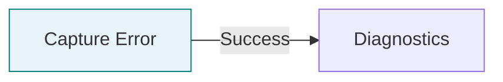
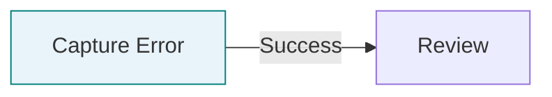
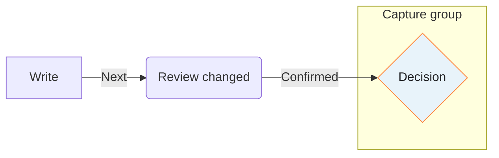
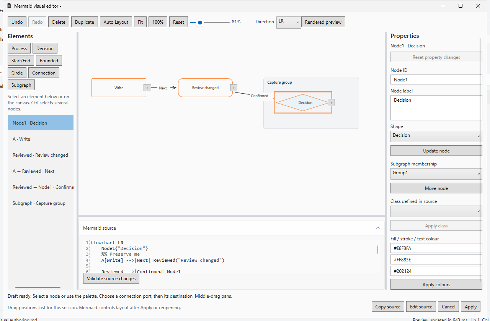
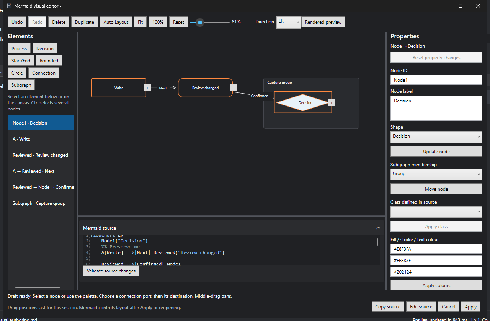
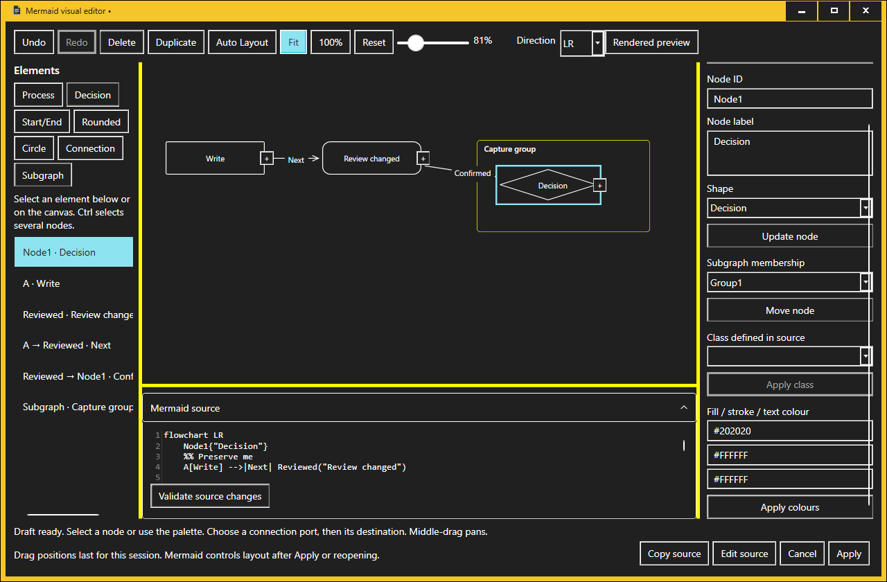
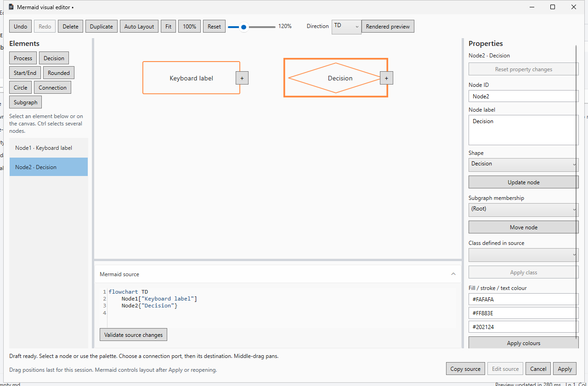
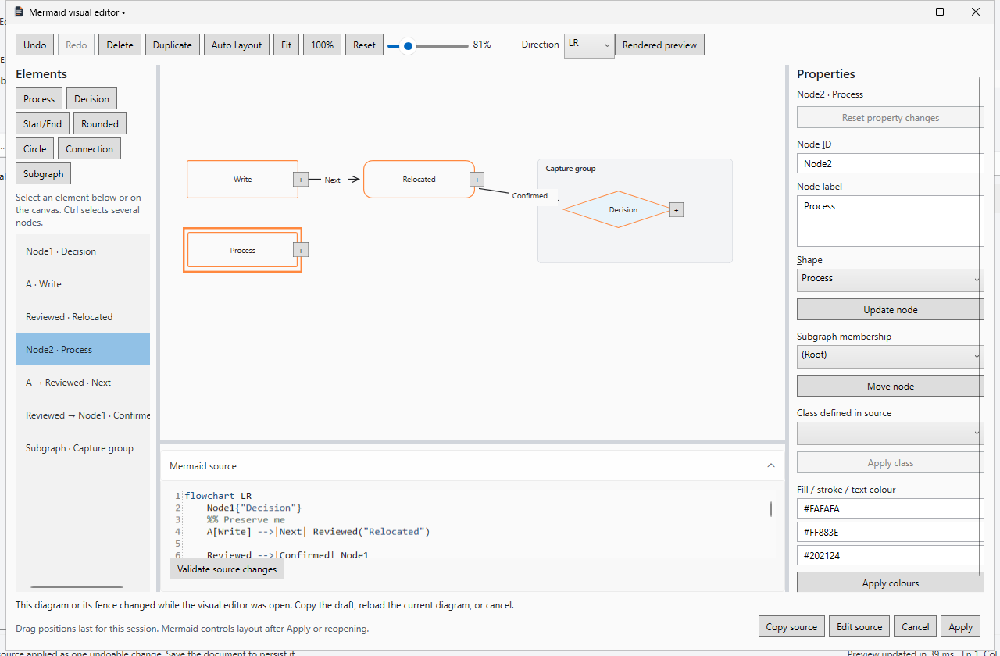

# Native Mermaid visual editor

The subsequent [visual integration report](mermaid-editor-visual-polish.md) records
the Lens design-system integration in Draft PR 27. The source/authoring contract
and historical verification below remain the reference for supported semantics.

Implementation branch: `feature/native-mermaid-visual-editor`, based on verified
`42c3fc614feb6db6f69a242312604e46ff76c238` and targeting `feature/native-ux-refinement`
in [Draft PR 26](https://github.com/DouglasNLima/local-docs-studio/pull/26).
This report records the supported authoring contract and revision-specific evidence;
the original checkout and PR 25 remain untouched.

## Source model and transformations

`Core/Mermaid` contains a bounded lexical source adapter, semantic model, exact text
patches and private draft history. Mermaider 0.15.1 independently parses the graph;
the adapter must agree on node identities, labels, shapes and connection endpoints
before it enables transformations. Every candidate is reparsed and rendered by the
existing `DiagramService` before it becomes a committed draft. Its existing limits
are unchanged. WPF owns interactive presentation; source owns the saved diagram.

Labels change through their source spans. Other edits use disjoint, expected-text
patches, applied from the end of the source. Comments, line endings, existing IDs,
unaffected styles and surrounding source are retained. Deleting a connection or
changing endpoints retains its inline node declarations, including implicit nodes.
Mermaider honours the first node occurrence; newly moved declarations therefore
precede references, and changed connections follow existing declarations.

The verified adapter accepts `flowchart`/`graph`, TD/TB/BT/LR/RL, process, decision,
rounded, terminal, circle, double circle, subroutine, cylinder and hexagon nodes;
separate directed, undirected, dotted, thick and bidirectional connections with
pipe labels; nested named subgraphs; class definitions/assignments and node styles.
Class definitions remain authored in source. New explicit styles accept six-digit hexadecimal
fill, stroke and text colours; overrides retain existing custom style properties.
Labels are escaped as literal text. Shape-only edits retain the original label
syntax where it remains compatible. Renaming an implicit node ID retains its
original visible label. Copied classes/styles accept only bounded hexadecimal and
numeric/dash/font-weight values; active or unknown properties reject the paste.

The model records diagram family/direction, stable node IDs, node occurrences and
shapes, edge endpoints/type/label and session identity, nested group hierarchy,
class/style references, exact source spans and protected regions. Session edge IDs
survive neighbouring edits, endpoint changes, parallel edges and Undo/Redo; they are
never written as Mermaid extensions. New nodes receive collision-free IDs.

Bounds: 100,000 source characters, 300 nodes, 500 total elements, eight nested
subgraphs, 500 styling statements and 4,096 characters per label. Graphs with more
than 100 connections **and** more than four connections per node open protected.
The established renderer can reject a
candidate within these bounds. This is a supported grammar, not universal Mermaid
Flowchart compatibility.

Unknown shapes, edge IDs, interactions, link styling, configuration directives,
raw HTML labels beyond `br`, repeated declarations, multiple group membership,
chained connections and parser disagreements protect the entire draft from visual
transformation. Advanced identifiers and invalid Unicode/XML controls are rejected.
Source stays verbatim and inspectable. No partial editing is claimed for these cases.
Other Mermaid families retain the existing renderer and source editing.

Moving a node between subgraphs currently requires its connections to be declared
outside subgraphs. This prevents a remaining reference from silently restoring
its old membership. Deleting a group either flattens it, preserving its members,
or explicitly deletes descendant members and their incident connections.

Undo/redo stores exact source, edge identities and selection, bounded to 100 snapshots
and eight million source characters. Rejected,
cancelled and obsolete operations do not enter history. Drafts are independent of
documents and recovery; discarded operations do not modify documents.

## Native interaction

Use **Edit visually** beside a supported preview, or **Insert → Flowchart visually**
to start a new diagram. Existing `.mmd` and `.mermaid` files use their raw source.
The editor is modeless: Apply always targets its owning tab, even after switching
documents. Closing/renaming that tab or changing the tracked diagram rejects
Apply. Safe edits outside its container relocate through AvalonEdit history.
Apply changes the in-memory document in one Undo group; ordinary Save retains the
existing disk-conflict checks. Cancel discards only this editor's draft.

Before Apply, the complete candidate Markdown is reparsed away from the UI thread
and must still contain the exact intended diagram body at its tracked span. This
protects against outer-fence changes and valid Mermaid text that would prematurely
close its Markdown fence. The UI-thread commit then rechecks the exact document
version and expected text, rejecting changes during validation. The owner must be
open, retain its original file identity and not be saving. Whole-document validation
is limited to four million characters. Repeated identical blocks are distinguished
by the existing AvalonEdit version/change chain, never first-occurrence searching.
Standard/tilded fences and recognised Azure DevOps containers retain their wrappers.
Blockquote/list-prefixed containers without a proven map remain source-only.

Choose a palette element, select native canvas elements or use the element list.
The list exposes SelectionItem/Selection patterns; each canvas node/edge/group has
an accessible name and Toggle state. Ports expose named native buttons. Selection
uses border thickness as well as colour. Physical screen-reader certification is
not claimed. Properties have explicit Update actions; unapplied field values block
Apply and selection changes until updated or explicitly reset. Inline labels use
Enter to confirm and Escape to cancel. Source changes require explicit validation;
invalid or unsupported text stays in the source panel and disables visual edits.

Copy/duplicate/paste retains supported node shapes, internal connections and basic
classes/styles. Each insertion is one visual Undo action. Conflicting class names
are remapped; copied active/unknown style values reject the entire insertion rather
than partially inserting nodes or silently dropping styling. Existing style text
outside the operation remains unchanged.

Keyboard: Tab reaches the palette, element list and properties; arrows navigate
the list. Insert adds a process; F2 edits a node label; F4 focuses properties;
Delete removes the selection with incident-connection information; Ctrl+D
duplicates; Ctrl+C/Ctrl+V copy/paste nodes; Ctrl+A selects all; Escape deselects or
cancels connection creation. Ctrl+Z/Ctrl+Y use visual history outside text fields.
F fits, Ctrl+0 restores actual size, Home resets, Shift+arrows pan, F11 toggles
Full Screen and Ctrl+Enter applies a validated draft. Text fields keep their own
ordinary editing shortcuts. Middle-drag/Space+drag pan and Ctrl+wheel zooms around
the pointer. Splitters resize the element list, properties and collapsible source
panel. Auto Layout discards temporary positions; structural group edits relayout
the compound graph. No coordinates or proprietary layout metadata are saved.

The native canvas uses WPF geometry, ToggleButtons, text and connection ports;
the accessible element list offers an alternative to graphical navigation. Edge
endpoints/type/label change through properties, including Reverse direction.
Group properties show ID, parent, direction and members. Context menus offer insert,
connect, delete and fit. Pointer movement updates geometry at dispatcher render
priority without parsing or laying out the graph again. Source parsing, operation
planning and renderer validation run in background work with stale-result checks.
The existing Mermaider/SharpVectors preview remains the final rendering authority.
The interactive canvas uses simpler straight connection routing and bounded node
labels; dense crossings and long labels can be clearer in Properties, source or
Rendered preview. Its geometry is not an exact reproduction of Mermaider layout.
Auto follows live application appearance; fixed diagram palettes retain their
own surfaces/text colours. High contrast uses Windows system colours.

## Exact source examples

The passing `Rename_changes_only_the_requested_label_span` regression starts with
CRLF source below. Renaming B's label changes only `"Diagnostics"` to `"Review"`:

The real authoring scenario opens the **second of two identical blocks**. Its body
starts as follows; the first block and surrounding paragraphs remain byte-for-byte
equal after Apply, and one document Undo restores the complete second body:

After node/ID/shape, connection, subgraph membership and colour commands, the body is:

The deliberate bare `Node1` inside the group records membership while its earlier
declaration preserves Mermaider's first-occurrence semantics. Complete before/after
Markdown is retained in the authoring evidence, including exact CRLF bytes.

## Verification record

Application/package candidate: `36b331ac6c2b29ebcf53e1a16735a5696ae8b2ac`.
Subsequent delivery-audit changes contain documentation/evidence and native menu
automation corrections; application implementation is unchanged. The final head
and its checks are recorded in Draft PR 26.
No new build was installed or launched on the user's ordinary desktop. All native
GUI and installer execution used synthetic workspaces on genuine GitHub-hosted
Windows, with display, high-contrast and clipboard restoration guards.

| Check | Result at the application candidate |
|---|---|
| Core Release suite | 1,220 passed, zero skipped; includes the 73 focused Mermaid cases |
| Focused source/model/corpus suite | 73 passed locally; all are also included in hosted Core validation |
| Native Mermaid rendering corpus | 60 passed: original 40 + 20 new fixture/theme cases; four expected malformed-input rejections, zero failures |
| Mermaid authoring | 44 normal / 43 actual high-contrast checks passed in both branch and PR workflows |
| Authoring count composition | 21 AvalonEdit/document-guard checks plus 23 normal or 22 high-contrast UI outcome checks |
| Existing desktop / installation regression | 75 checks in each of four contexts; full install/upgrade/uninstall/reinstall, 22 retained state files and actual session restoration pass |
| Existing browser regression | 134 Chromium + 134 Edge = 268 passed in each branch/PR workflow |
| Static web checks | 50 modules, 57 shell assets, 150 vendor assets and 56 runtime scans pass |
| Native solution build | Zero warnings/errors; pinned dependencies retained |

Source regressions cover every supported shape and direction, exact LF/CRLF and
multiline labels, repeated visible labels/blocks, inline and implicit declarations,
classes/custom styles, Unicode/combining characters/escapes, parallel edge identities,
atomic batch/history changes and rejection without source/history mutation. The
10-file editing corpus includes a synthetic error-log lab with nested groups,
multiline labels and styling. Invalid, duplicate and unsupported fixtures remain
verbatim. The original 40 rendering cases continue covering other diagram families; the new
fixtures add 20 light/dark cases to that same native renderer corpus.

The actual UI sequences exercise connection ports and destination clicks, edge
labels/delete/Undo/Redo, node/ID/shape editing, group membership/colours, invalid
source retention, pending-inspector guards, zoom/actual scroll PAN/fit, exact Apply
and one document Undo/Redo, ordinary Save, Cancel, safe surrounding relocation and
conflict rejection. Standalone/new `.md`/`.mmd`/`.mermaid`, native clipboard,
inline Enter/Escape, palette drag/drop, node dragging, duplicate/history, protected
inspection, live dark appearance and 880×600/1440×900 resizing are included.

UIA exposes names, Toggle state and an alternative Selection/SelectionItem list;
selection also changes border thickness. Text fields retain their own shortcuts.
This verifies concrete keyboard/control paths, not complete physical screen-reader
or physical display/DPI certification.

| Pipeline | Branch source | PR merge checkout |
|---|---|---|
| Native, packages and lifecycle | [run 38778919600](https://github.com/DouglasNLima/local-docs-studio/actions/runs/38778919600) | [retained submenu-automation failure 38778926943](https://github.com/DouglasNLima/local-docs-studio/actions/runs/38778926943); final delivery checks on PR |
| Authoring, actual high contrast and existing UX | [run 38778919617](https://github.com/DouglasNLima/local-docs-studio/actions/runs/38778919617) | [run 38778926756](https://github.com/DouglasNLima/local-docs-studio/actions/runs/38778926756) |
| Existing browser/static | [run 38778919629](https://github.com/DouglasNLima/local-docs-studio/actions/runs/38778919629) | [run 38778926874](https://github.com/DouglasNLima/local-docs-studio/actions/runs/38778926874) |

Historical failures remain in Actions and local ignored evidence. These include
first-reference/escape behaviour, retained WPF multi-selection, CRLF-only semantic
disagreement ([run 38766341864](https://github.com/DouglasNLima/local-docs-studio/actions/runs/38766341864)),
old help/action expectations and the covered owner-menu automation click
([run 38777274120](https://github.com/DouglasNLima/local-docs-studio/actions/runs/38777274120)).
Visual review of `995de7f` also caught unreadable live-theme labels; `36b331a`
retains Auto as a live choice and uses palette-consistent surfaces and themed
inspector labels. No test was disabled or weakened: the valid-diagram action check
now asserts the exact existing four actions plus the intentional Edit source action.
The candidate PR installation run passed built/first-installed checks, then found
a closed Export submenu after a physical submenu click during upgrade testing.
Its 55 completed checks and [closed-menu capture](images/mermaid-profile-menu-failure.png) are retained. The delivery audit uses
native ExpandCollapse patterns and observes submenu readiness for the same save/
generic-profile actions, retaining all preference/source assertions and deadlines.
Final delivery CI must pass that corrected sequence in every installed context.

## Performance and bounded limitations

Branch visual CI at `36b331a`, .NET 10.0.13, four logical processors. Values are
single-process observations in milliseconds, including cold/warm runtime effects.
Allocations are cumulative managed allocation across each scenario, not peak RAM.

| Scenario | Parse | Native layout | Existing renderer | Edit + rendering | Allocation |
|---|---:|---:|---:|---:|---:|
| 20 nodes / 19 edges (cold) | 108.49 | 19.56 | 223.48 | 35.59 | 1.88 MB |
| 100 nodes / 99 edges | 2.56 | 1.16 | 12.44 | 20.88 | 7.78 MB |
| 300 nodes / 199 edges | 7.89 | 5.11 | 61.31 | 51.90 | 20.36 MB |
| 100 nodes / 99 edges / 20 nested groups | 7.15 | 8.16 | 40.43 | 20.19 | 11.85 MB |
| 20 long labels / 14,602 source characters | 1.64 | 0.25 | 9.30 | 11.55 | 5.08 MB |
| Dense 20 nodes / 190 edges | 0.96 | 0.74 | Protected; skipped | Rejected in 0.58 | 0.54 MB |

The initial unguarded dense probe took 5.66 seconds rendering and allocated about
4.79 GB cumulatively across the scenario. That retained failure exposed the existing
renderer deadline's cooperative nature. The visual density guard prevents repeated
validation of this case without changing the established renderer's limits.
These probes do not certify physical input latency or universal three-second
termination. The earlier Continuous-preview responsiveness limits remain unchanged;
see [performance-and-responsiveness.md](performance-and-responsiveness.md).

## Inspected native screenshots

Unmodified PNGs from branch visual run 38778919617 at the application candidate.
The hosted desktop was temporarily enlarged to 1920×1080 and restored afterwards.
The full artefact also retains node/edge/group, source error, standalone, wide,
inline and main-preview captures. Screenshot hashes and raw outcome summaries are
recorded in the accompanying delivery evidence.

[880×600 editor capture](images/mermaid-visual-narrow.png) shows wrapped commands,
scrollable properties and visible Apply/Cancel at the minimum size. The canvas can
require PAN/fit at that width; the source and property panels remain resizable.
Long property captions can require widening the inspector. Some immediate opening
captures show a partially painted/clipped first source line; settled interaction
captures show the source correctly. Source/model assertions use actual text rather
than inferring correctness from these early frames.

## Unsigned preview packages

The accepted branch-source candidate is **`0.1.1-preview.473`**, with
`0.1.0-preview.473` used as its isolated upgrade predecessor. Both have the exact
application source above, `sourceDirty: false`, `sourceKind: branch-source`,
self-contained x64 .NET 10/WPF and unsigned internal-preview metadata.
Files are named `LensDocsStudio.Native-<version>-win-x64-Setup.exe` and
`LensDocsStudio.Native-<version>-win-x64.zip`.

| Version | File | SHA-256 |
|---|---|---|
| 0.1.1-preview.473 | Installer | `2404b36aa4b1d37c962ca42ad99f1ad59697367727cb60eca7713fda10c862c6` |
| 0.1.1-preview.473 | Portable ZIP | `31517034d22c00cff7133b799e511204d286dec9d4e29ae35ab807ba96ef6077` |
| 0.1.0-preview.473 | Upgrade predecessor installer | `8af433de2f7d1d58330586dfcedda3bc166ab1217665110ce6ec15b9c1f869f3` |
| 0.1.0-preview.473 | Upgrade predecessor ZIP | `3ac59b80d487bdf512bc15c32bbc8291fb19945c8e530685f4d0110b7005fadd` |

The downloaded bytes independently pass the verifier with these explicit pins and
expected source. Both contain 528 payload files, seven original icon frames, the
new editor BAML and eight required Native/Core editor types. PE metadata inspection
also finds no rejected ContinuousViewer types or browser/script-engine assembly
references. No private document, development payload or embedded-browser dependency
is present. This inspection executes no application or assembly code locally.

Hosted verification passes seven negative controls, including a package with its
editor assembly removed and checksum recomputed. Actual installed processes load
`coreclr.dll` and WPF graphics from their own installation in all three installed
contexts. Upgrade, uninstall and reinstall preserve 22 existing state files and
workspace bytes; actual previous tabs/settings/drafts are restored. All 75 desktop
checks pass in built, first-installed, upgraded and reinstalled contexts. Thirteen
separate persisted-workspace/export checks and interrupted-save recovery pass.
Upgrade evidence covers same-source preview version replacement; historical schema
migrations, SDK-free Windows and production signed upgrades remain uncertified.

Retrieve the `native-validation` artefact from branch native run 38778919600.
PR-merge `.474` packages have different source/hashes and are not substituted.
The [durable delivery evidence](evidence/mermaid-visual-editor.json) retains exact
identities, independent inspection summaries, raw authoring outcomes, performance,
before/after source and screenshot hashes. GitHub Actions artefacts require
repository access and have 14-day retention; they are not public Releases.

## Readiness classification

- **Implemented and verified:** supported source transformations, private history,
  document guards, native authoring and actual high-contrast interaction described
  above, complete branch regression/lifecycle and independent package inspection.
- **Implemented with bounded limitations:** explicit Flowchart grammar/resource
  limits, source-declared classes/basic styles, connection-inspector endpoint edits,
  temporary dragging, simplified canvas layout and protected group-move cases.
- **Unsupported:** other diagram families for visual editing, advanced/chained/active
  syntax listed above, persistent manual coordinates and unproven partial editing.
  These remain source/preview workflows; source is never simplified to enable edits.
- **Not tested/certified:** physical screen readers, real DPI/multi-monitor/hardware
  and genuinely SDK-free clean Windows. Hosted Windows includes development tools.
- **Blocked by the existing trust policy:** trusted unsigned in-app update execution.
  Production signing/trust and production readiness remain outside this preview.

No merge, release, tag movement, production signing change or replacement of the
user's installed application is authorised or performed. There is no claim of
universal Flowchart editing or production accessibility/performance certification.

**Recommendation: ready for controlled unsigned internal preview within this
supported contract.** There is no remaining implementation blocker for that scope.
The final validation/evidence audit is checked through Draft PR 26; it retains the
same application implementation and corrects the observed menu-automation failure.
Production trust, physical accessibility/DPI and genuinely clean Windows remain
separate certification gates.
