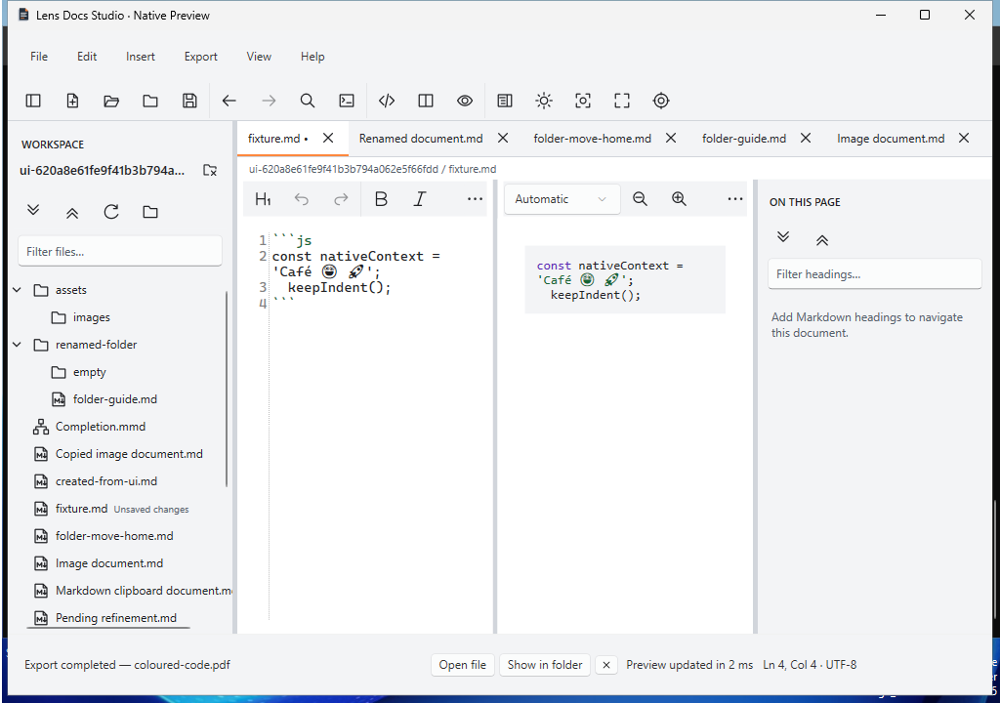

# Post-merge .853 PDF lifecycle repair receipt

Status at source freeze: **INCONCLUSIVE historical RCA; independently proved CI
policy divergence corrected; targeted diagnostic instrumentation implemented.**
The Draft PR's final receipt owns the exact clean repair SHA/tree, executed gates,
attempts, package checksums and later replay results. A source-branch success cannot
replace the failed develop acceptance or prove an unobserved historical mechanism.

## Original evidence, preserved before source changes

Actual remote develop was `358147cd6da2265efb49e4922698796f9399fcf6`, tree
`d37a5701bd01ed52d07f7ab1a8e85eacff5d3f7b`. PR #44's reviewed source
`2cd7e41938e98a05dcf3f73e7934c224a06591f8` has the same tree. The repair branch
starts from that actual develop in an isolated managed worktree. The ordinary
checkout stays on main; existing attachments and all other worktrees are preserved.

- [Original failed native run 39856703884, attempt 1](https://github.com/DouglasNLima/local-docs-studio/actions/runs/39856703884),
  [job 120096656823](https://github.com/DouglasNLima/local-docs-studio/actions/runs/39856703884/job/120096656823).
  No retry was requested and its failed source attribution is unchanged.
- [Original .853 archive 12460044301](https://github.com/DouglasNLima/local-docs-studio/actions/runs/39856703884/artifacts/12460044301):
  339,027,263 bytes, SHA-256 `1249e817e676e3fba9fa996587fa8c6e4f49bfba05f371e5d1c092a7aa6be49f`;
  reported expiry **5 November 2026, 21:44:58 UTC**.
- [Accepted feature run 39836641315, attempt 1](https://github.com/DouglasNLima/local-docs-studio/actions/runs/39836641315)
  and [its .852 archive](https://github.com/DouglasNLima/local-docs-studio/actions/runs/39836641315/artifacts/12453122541)
  remain separate evidence. The original archive checksum was independently verified.
- [Merged web push 39856703893](https://github.com/DouglasNLima/local-docs-studio/actions/runs/39856703893)
  passed Chromium, Edge and aggregate; Pages was skipped.

Both compressed archives, raw decoded job logs, API run/job/step/artifact/PR
responses, complete member hash inventories, package comparison and the pre-change
RCA are retained in `C:/Code/lens-native-853-evidence/original-run-39856703884-attempt-1/`.
The [compact provenance inventory](native-853-original-evidence.json) records the
original bytes/hashes and capture paths. Inspection extracted diagnostic files only;
no original binary or installer was executed on the developer desktop.

## What the original failure proves

The failing call was the after-upgrade `NativeUiChecks.cs:805` combined predicate:
`File.Exists(codePdf) && ExportCompleted(window, codePdf)`, through the original
20-second `Wait` at line 1799. The exception establishes only that this combination
was not observed. The prior DOCX assertion does not prove PDF acceptance.

The complete after-upgrade `native-ui.json` records 45 earlier checks. Its
`native-save-dialogues.json` records the labelled filename field accepting
`coloured-code.pdf` with keyboard focus. It does not record the chosen directory,
resolved final path or dialogue closure. The failure screenshot below is copied
byte-for-byte from the original archive:

At capture time it visibly shows **Export completed — coloured-code.pdf**,
**Open file** and **Show in folder**. Both UIA control dumps contain only TitleBar
and SystemMenuBar; the window inventory contains one app window. No error or Save
modal is visible in that screenshot. A 33-thread x64 thread-information minidump
exists; its streams/stacks do not provide a full managed heap or export receipt.
Static dump string inspection found no PDF destination.

The installed-phase upload did not retain `coloured-code.pdf`, an output-directory
inventory or application export-stage logs. Absence from the archive is therefore
**not evidence of file absence on the runner**. Exact output path, size/hash/header,
UI state during the deadline, foreground ownership and process exit state were not
independently recorded. No crash, exporter exception, cancellation, corruption,
association causation or sole UIA cause is established by the available record.

## Product trace and comparison

`MainWindow.ExportDocument` collects the actual Save result, snapshots the source,
awaits `DocumentExportService`, then `ExportFileStore.WriteAsync`, then
`WorkspaceViewModel.CompleteExportAsync`. `SavedExport.FromSavedBytes` verifies the
selected file exists with the expected length before completion status/actions are
published. `RunAsync` retains cancellation feedback and displays real exceptions.
The captured completion text supports completion at some selected path at that
later instant. It does not establish that path, its content, or observations
throughout the preceding deadline. No exporter algorithm correction is justified.

Both jobs used `windows-2025-vs2026` image `20261018.275.1`. Each upgraded payload
contains 528 files; 523 hashes match, including renderer/runtime dependencies.
Five version/source-bearing entries differ: Core DLL, Native DLL/apphost/deps and
`version.json`. Source-tree equality must not be described as binary equality.
Feature lifecycle duration was 16m29s; the failing develop lifecycle was 8m35s and
stopped during after-upgrade. They did not complete equivalent work.

The original installer receipt verifies both installed payloads against their
portable packages and preserves 22 state files plus workspace bytes through
upgrade and restored-session validation. Feature .852 passed its complete cycle.
**Both .852 and .853 version-pair upgrades are SYNTHETIC same-source upgrades,
not historical preview migration.** Replacement pairs have the same limitation.

## Separate bounded corrections

1. `native.yml` now declares `internal-no-associations` for its internal acceptance
   job purpose. Central arguments supply both visible wizard and every lifecycle
   harness, including all twenty installed families and the separately guarded
   historical job. Develop pushes, feature PRs and manual acceptance use the same
   switches; branch allowlists no longer select optional tasks. Existing absence
   checks remain. The released installer defaults and association implementation
   are unchanged. A static contract check covers all seven command sites.
2. The coloured PDF check still invokes the real Export menu and Save dialogue
   once, and uses the original 20-second deadline. Independent disk/UI samples
   retain target existence, length/last-write, actual status, action visibility,
   enabled state and exact paths, plus observation errors. File presence alone,
   a wrong destination or a missing completion action cannot pass. Actual PDF
   header, selectable `Café😀🚀`/`keepIndent();`, editor/saved source and all other
   existing PDF assertions remain mandatory. Other export waits are unchanged.
3. Diagnostic evidence adds exact entered filename and native dialogue state on
   Save return, final process/exit/responsiveness, Win32 foreground/owner/windows,
   bounded output inventory and file hash. The opt-in, bounded local application
   journal records accepted destination, preparation, bytes written, completion,
   cancellation/error stages and model status without document text. It rethrows
   the original error to the unchanged user-facing handler. Generated PDF/DOCX,
   observation JSON and journal now survive installed-run uploads.

The product remains .NET 10/WPF with Mermaider 0.15.1 and stock Continuous. All
twenty authoring families, saved-source fidelity, fixture bytes, history/resource
limits and timing thresholds are unchanged. No new Mermaid family is implemented.

## Targeted controls and source-labelled validation

| Scope | Required evidence |
| --- | --- |
| Deterministic observation controls | Actual native PDF generation/file write/header/selectable Unicode; missing/wrong/empty output; incomplete/error/cancelled feedback; missing actions; absent/stale UIA; unrelated provider error propagation; real exporter exception; persistent failure at a bounded test-only deadline |
| Ordinary native acceptance | Locked build, 2,009 Core tests, 166 corpus/export cases, existing fidelity/compatibility, actual UI, package integrity and 18 existing negative controls |
| Installed repair-source acceptance | Visible excluded-association wizard; install/synthetic upgrade/after-upgrade PDF/uninstall/reinstall; all 20 families × three phases = 60 |
| Web | Static integrity plus Chromium/Edge smoke; Pages skipped |
| Original .853 replay | Manual `native.yml` input `replay_original_853=true`; fixed original package hashes, original product SHA and separate instrumented harness SHA; disposable included/excluded association matrix; no original package rebuild or republication |

The original replay is diagnostic and cannot stand in for repair-source acceptance.
Its association-enabled path is an explicit reproduction control; ordinary
acceptance always excludes associations. A successful replay cannot rewrite the
original failure or establish an unobserved historical cause.

Development locked build passed with zero warnings/errors and the new observation
controls passed. One development Core run retained two regex-budget failures
(Architecture node ordering and invariant chart numeric spelling): 2,007 passed,
two failed. Their Core sources/fixtures are unchanged; no budget, retry or expected
result was changed. Final-source gates must be recorded separately, with every
failure retained. Provider rejection controls are labelled injected observations;
they never substitute for genuine installed file/menu/Save/UIA evidence.

## Handoff and remaining certifications

[PR #38](https://github.com/DouglasNLima/local-docs-studio/pull/38) remains open,
Draft and PAUSED at `31fa3ad12f3e0c87f5e45cea6f97801af53b67cb`. Its worktree and
earlier packages/evidence are untouched. The repair branch preserves the paused
benchmark skip while running ordinary/High Contrast correctness; the historical
250 ms deadline is unchanged. Earlier .852/.853 archives retain their hashes.

Higher-DPI interactive testing, a physical screen-reader session, SDK-free clean
machine installation and production-trust certification remain unavailable and
unclaimed. No signing, release, tag, updater publication, Pages deployment,
ordinary desktop install or merge is authorised by this repair.

**Post-merge verification STILL REQUIRED:** only after separate user authorisation
and merge must the new actual develop SHA pass both native and web push workflows,
including the full installed lifecycle and all family gates. Expansion VI stays
blocked until that evidence is inspected. The final decision must also preserve
the historical RCA's remaining unknowns; a green branch badge cannot resolve them.

## PR #45 final acceptance: Journey launch observation

The reviewed source `08171f0d90315dca9db75a812c1d3b1849524b84`, tree
`8a672e3927153958942bd97263d17d8816eaafa9`, finished with 80 successful checks,
one failure and 12 explicit skips. The independently successful .854 PDF and
association-policy evidence above remains valid at that source. Historical .853
PDF RCA remains **INCONCLUSIVE**; its successful replay does not establish cause.

The additional blocker was [Journey actual Windows High Contrast, job
120402325422](https://github.com/DouglasNLima/local-docs-studio/actions/runs/39950139759/job/120402325422),
run `39950139759`, attempt 1. Its original [archive
12499959746](https://github.com/DouglasNLima/local-docs-studio/actions/runs/39950139759/artifacts/12499959746)
was freshly downloaded before remediation and independently verified: 19,177,739
bytes, SHA-256 `443effe2adff9d3dc4bfd7f5429f6c45b8f64e697bbaa8255744b0686a266fcc`,
674 hashed members, expiry **2026-11-22 12:13:01 UTC**. Original compressed bytes,
full job log, raw API metadata, member inventory and comparative archives are
preserved at `C:/Code/lens-native-journey-evidence/`; the previous preserved copy
under `C:/Code/lens-native-853-evidence/repair-source-08171f0/` is untouched.

`source-editors/authoring-ui.json` (SHA-256
`449b226f619d412b8d4c28949d12bfed59a30739f353526cca2ec773d80d6897`)
records ten successful checks, including owner Apply/Undo/Redo/Save. The full log
then reports `PatternNotSupportedException` wrapping COM `0x80131505`, at
`IUIAutomationElement.GetCurrentPattern`, unchanged
`NativeExpansionEditorUiChecks.cs:114`, called by the second `Launch(path)` at
line 101. The complete UI step lasted approximately 33.9 seconds; the individual
launch/acquisition duration was not recorded. The exception precedes evidence of
any Resize invocation. No process crash, permanently unsupported pattern, failed
Resize action, stale resized observation or product/editor malfunction is proved.

The archive retains selected and 880×600/1280×800 editor screenshots, display
restoration, saved fixture and state bytes. The 1280×800 screenshot shows the
actual High Contrast editor before Apply. **There is no `failure.png`, timed
launch observation, PID/HWND ownership record, window/control dump or thread
dump.** The catch block only uses `visual?.CaptureToFile`; `WaitClosed` had
cleared that editor reference after Apply, so it supplies no restarted-owner
capture. Missing evidence cannot establish what the restarted process
or its provider was doing. Journey's underlying cause therefore remains
**INCONCLUSIVE beyond the observed UIA acquisition timeout**.

Before editing, all twelve original/comparative archives were independently
downloaded and member-hashed. The detailed local `forensic-receipt.json` and
`comparison.json` retain their source, job, artefact, digest, expiry and log labels.

| Source/run | Timeline normal/HC | Journey normal/HC | Quadrant normal/HC |
| --- | --- | --- | --- |
| `08171f0`, `39950139759`, attempt 1 | PASS/PASS | PASS/**FAIL** | PASS/PASS |
| #44 feature `2cd7e41938e98a05dcf3f73e7934c224a06591f8`, `39836632380`, attempt 1 | PASS/PASS | PASS/PASS | PASS/PASS |

The failing job records Windows image `20261021.278.1`; same-source Journey normal
and #44 Journey HC record `20261007.264.1`. Same-run Timeline/Quadrant HC pass on
`20261021.278.1`. These are recorded versions of the `windows-latest` runner,
not an image pin or proof of image causation. The failed check itself verifies
actual HC; no per-restart HC/process/window observations were available for any
of those old runs. The Launch source is unchanged between merged develop and
reviewed PR #45. No upstream FlaUI defect or installer-association causation is
inferred.

### Narrow harness correction and fail-closed controls

Only the existing Timeline/Journey/Quadrant owner-launch path changes. Native
process enumeration identifies the actual main HWND; independent Win32 PID,
top-level ownership, visibility/enabled state and bounded WM_NULL responsiveness
must agree with UIA HWND/PID and the enabled, visible editor's exact saved source.
Current Windows HC is sampled, and required HC must remain active. This is a
readiness correction supported by the previously unguarded acquisition site,
not a retrospective explanation of the provider's timeout.

`NativeLaunchReadiness` uses the existing Wait observation filter and polling
cadence with **one shared 25-second clock starting before process launch**.
There is no outer full wait or additional GetMainWindow budget. Each UIA call is
capped at the lesser of the existing three-second provider limit and remaining
time. Known provider timeout observations may be sampled again before mutation;
genuine unsupported Transform, wrong ownership and process exit propagate. A
persistent unavailable/hung provider fails at the shared deadline. Late success
does not satisfy that deadline. No new sleep or larger timeout is introduced.

After acquiring the **real** UIA Transform and confirming CanResize/readiness,
the harness sends `Resize(1280, 800)` once, outside the observation loop. Exact
Win32/UIA resulting bounds and the same owner/source must then agree within the
remaining budget. A timeout of the mutation is a failure, with no reissue. All
original real authoring, geometry, visual-editor viewport, restart/reopen,
Cancel, conflict, standalone/Insert, protected-source and keyboard tests remain.
No product renderer, parser, exporter, WPF UX/style, fixture, pixel tolerance or
appearance matrix assertion is changed.

Each `launch-N.json` records source revision, restart ordinal, PID/HWND, process
state, bounded responsiveness, HC, observation/provider errors, bounds, elapsed
budget, Resize count and expected/observed owner and saved-file SHA-256. Each
`launch-N.png` captures only the test-owned real fixture window. Failure also
attempts the existing native window/stack diagnostics. This evidence contains no
document source text and makes no external telemetry call.

Twenty deterministic controls exercise the same orchestration: transient and
persistent acquisition, genuine unsupported patterns, unrelated errors,
PID/HWND/owner mismatch, process exit, missing/invisible/unresponsive windows,
expired budget, failed/uncertain Resize, and stale or wrong post-action bounds.
They count at most one mutation and retain timeout errors. Their injected
observations never establish actual installed/HC success. They run through the
existing observation-validation/corpus entry points.

### Candidate and final-source acceptance receipt

Local development logs are retained separately, including an initial build
failure while new source files were still being added and an unchanged Core
workspace-map render failure (2,008 PASS, one FAIL). The complete-source locked
build subsequently passed with zero warnings/errors; all twenty controls and
static integrity passed. These uncommitted development observations are not
final-source hosted acceptance. Local full appearance testing is unavailable
because its existing display/HC harness requires disposable hosted Windows.

The existing Draft PR #45 receipt must record the immutable final commit/tree,
every attempted candidate, all individual final-source jobs, 30 appearances,
60 installed phases, package/artefact digests/expiry and explicit skips after
new hosted runs finish. Until those gates are green, acceptance is **BLOCKED**.
No historical failed job is rerun or relabelled. New success cannot erase either
the original Journey failure or the historical .853 uncertainty. PR #38 remains
Draft/PAUSED. Packet, TreeView, Treemap and Venn remain untouched and unstarted.
