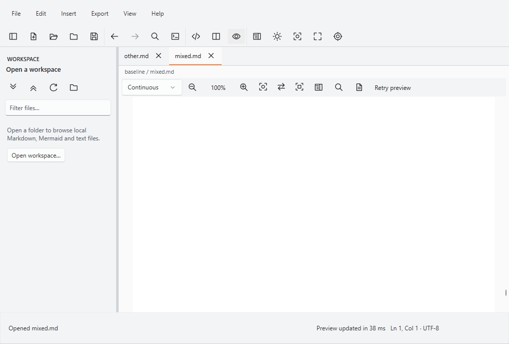
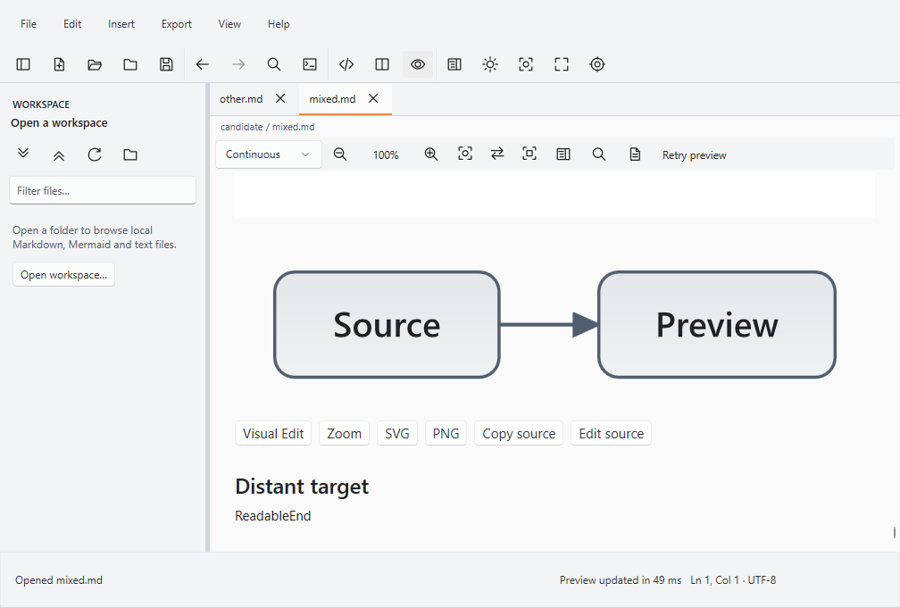

# Native blank preview — source-position recovery

Goal [#79](https://github.com/DouglasNLima/local-docs-studio/issues/79) and
[Draft PR #80](https://github.com/DouglasNLima/local-docs-studio/pull/80), targeting develop.

**Confirmed cause in the reproduced failure: the reused document retained a pixel
scroll offset whose meaning changed during width reflow.** The current document
was attached and correctly laid out, but its source text moved below the viewport.
The correction preserves a visible source position and only restores a successful
status after that position is visibly arranged in the current document.

This is a shared baseline correctness fix. Attribution to PR #76 as a regression
remains **INCONCLUSIVE**. PRs #76 and #78 stay Draft. ADR 007 and the proposed
performance policy are not imported or activated. The historical 250 ms gate,
actual OS High Contrast requirements, original 30-second action deadline,
assertions and 240-second child supervision bound remain unchanged.

## Frozen identities and original observations

| Role | Commit | Tree |
| --- | --- | --- |
| Exact develop | `99349d82eb06960eb1f9785cf384db2373aed4fa` | `e4d137a12cbdd827583fcb841612890dd88736ec` |
| Exact PR #76 | `75de42474514af0e7a6e521235a6517f4acad14b` | `6cb88161e24573649321bcb1d9f3418ba128194b` |
| Historical | `0237b08390d5d1d946c0b19b81d671ccd54fb951` | `fa21b42ca71a4665c618a560679e9c835aad65f3` |
| Original PR #78 probe/evidence | `f839182ceb16c20c4a8d58ddd39513aa81c267b5` | `62c359f62ff9ca3ebd66fe1ac2246277ecf0653d` |
| First complete candidate campaign | `8198fe9d0f897dfbabb8b5efafc2ed01900f2c07` | `abd2850e182ea83f6d1e408b722943439b837384` |

The original final campaign is
[42306706590](https://github.com/DouglasNLima/local-docs-studio/actions/runs/42306706590),
with its [terminal receipt](https://github.com/DouglasNLima/local-docs-studio/pull/78#issuecomment-6698243971).
All six failed observations (two develop, three PR #76, one historical) are retained
byte-for-byte under [original evidence](evidence/blank-preview/original/sha256.json):
screenshots, failure/state records, input journals, identities, appearance and
earlier successful distant Find captures. All six failure screenshots were
independently inspected. They remain failures; no later run overwrites them.

The original mixed fixture is unchanged: SHA-256
`6B7CD92A7DCF1DD88FF31E68FB196BDE2AB76655F99E9F9FEE93D82BF57280A0`,
4,475 UTF-8 bytes, 150 list items, 101 table rows, one diagram and one local image.
The journey starts in Editor, renders Split, audits complete content, performs
actual distant preview Find, returns to Editor, types/restores text, selects,
finds, scrolls, switches documents, toggles Outline, then changes
Split → Preview → Editor. Three interaction cycles precede input during rendering,
cancellation and exact source/file preservation checks.

## Demonstrated mechanism

The white one-pixel image is responsive. At the retained deep reading position,
changing Split to Preview enlarges it from about 328 to 717 DIP and the diagram
from about 95 to 207 DIP high. The document extent grows by about 469 DIP. The
baseline keeps its former absolute offset, so the enlarged white image fills the
viewport while the heading and `ReadableEnd` move below it. The physical capture
and UIA independently agree that there is no usable visible text.

The trace excludes a stale source or detached document in these reproductions:
active/rendered owner and source version match; attached/rendered FlowDocument
identities match; the template, content presenter and FlowDocumentView remain
visible and attached with a visual child and valid Measure/Arrange. The layout
reuse branch issues no new render generation. Its old `Preview updated` status
survives without a new usable-viewport check.

| Exact develop controlled transition | Split | Preview |
| --- | ---: | ---: |
| Preview width (DIP) | 384 | 773 |
| Viewport height (DIP) | 425.45 | 425.45 |
| Extent height (document units at 100%) | 10,769.53 | 11,239.00 |
| Baseline vertical offset | 10,344.08 | 10,344.08 |
| Candidate vertical offset | 10,344.08 | 10,813.55 |
| Candidate `ReadableEnd` top (DIP) | 374.45 | 374.45 |

See the exact [baseline control](evidence/blank-preview/causal/develop-control.json),
[candidate control](evidence/blank-preview/causal/candidate-control.json) and
[copy provenance](evidence/blank-preview/causal/provenance.json).
The foreground candidate also retains the deep position: 18 traced Split/Preview
boundaries across three processes keep current source and document ownership.
This is not merely a campaign that always starts at the top.

Eight initial untraced processes without a failure did not establish a fix.
Reproduction depends on the earlier journey retaining a deep position; successful
baseline samples sometimes return to the top. Controlled placement and subsequent
foreground reproductions establish causality independently of this timing variation.
No framework defect is inferred from an empty-looking image region.

## Correction and ownership

Only four product components change:

- `MainWindow.SetLayout` captures a visible mapped source pointer before changing
  geometry, retaining it while the preview is hidden in Editor.
- `MainWindow.PreviewReflow` owns one cancellable restoration, guarded by active
  document, exact preview instance, source version, synchronisation generation and
  current layout. New document binding clears the anchor; new input,
  synchronisation or rendering cancels pending restoration.
- `PreviewViewportAnchor` observes ordinary WPF layout, converts screen displacement
  to document units using the existing zoom, and makes one native scroll request.
  Completion requires the same mapped pointer visibly arranged in the current
  document. Completion, cancellation and unload remove handlers.
- Preview installation clears the obsolete anchor through the existing
  synchronisation lifecycle.

Status is `Updating preview layout…` with UIA Busy while presentation is pending.
A stale callback cannot restore success. Cancellation reports a layout change;
unsuccessful restoration reports preview unavailable. There are no added sleeps,
larger deadlines, repeated layout forcing, document reconstruction, performance
budgets or source mutations. Find/selection, editor focus and caret are not reassigned.

The isolated product commits are
`3f58591743abf81a5c96df5a4183c5b0b46fb995` (source-position lifecycle),
`4f133d1b110dd6b600d3e1ae06fe725a598feb4a` (zoom unit conversion), and
`a798eaf051baa14470a14b1af1825abe2284a9ec` (same-layout request ownership).
An additional 75% control caught under-scrolling and a stuck Busy status in the
first implementation. Its [failure](evidence/blank-preview/causal/candidate-75-before-conversion-failure.json)
is preserved. Local final controls at 50%, 75%, 100%, 150% and 200% pass. A separate
200% test initially assumed the distant heading could not wrap; the retained
[failure](evidence/blank-preview/causal/candidate-200-wrapping-assertion-failure.json)
shows valid visible text. The additional zoom assertion now accounts for measured
heading wrapping while still checking visible mapped text, reading position,
source, independent selection and ownership. Original foreground assertions and
deadlines are untouched.

Re-selecting Preview while its restoration was pending exposed a second candidate
edge: the unchanged layout path cancelled the restoration without replacing it.
The [failed control](evidence/blank-preview/causal/candidate-duplicate-layout-failure.json)
is preserved. A one-condition guard keeps the current operation when the same
layout is selected; real superseding layout/input/document changes still cancel it.
Fresh local controls pass at all five zoom levels and in Pages with repeated
selection, rapid transitions and replacement documents. Final hosted controls
include this case.

## Evidence and regression results

The exact PR #78 launcher, fixtures, report auditor and foreground SendInput
implementation are reused without the proposed policy. Optional test-only
`LENS_NATIVE_TRANSITION_TRACE=1` records input/usable boundaries, request/phase/version
ownership, cancellation, attached identity, presenter/template state, visual tree,
visibility, layout validity, viewport/extents/offsets and UIA range geometry.
It records no authored contents or paths. Bounds are 4,000 snapshots and 16 MiB
per process. Ordinary product diagnostics gain no authored-content logging.

[Initial investigation 42312451634](https://github.com/DouglasNLima/local-docs-studio/actions/runs/42312451634)
started with exact develop, then compared PR #76 and historical. The first eight
untraced children completed. The traced matrix had eight genuine normal
layout-preview failures (five develop, three PR #76) before observer controls.
Sixteen historical children hit an observer null-field bug; forty children later
hit an observer-control deadlock. All remain recorded; that matrix is not qualified
acceptance. The trace now treats absent historical counters as null and detaches
before the deliberately blocked observer control. [Archive identities](evidence/blank-preview/investigation-archives.json)
retain all nine downloads; raw archives/extracted files are retained locally.

[Complete campaign 42314810073](https://github.com/DouglasNLima/local-docs-studio/actions/runs/42314810073)
uses 24 cohorts: three exact baselines, both initial orders, normal/actual OS High
Contrast, tracing disabled/enabled, four fresh processes per product, three cycles.
All archive digests were checked. See the [summary](evidence/blank-preview/candidate-8198-summary.json)
and [archive identities](evidence/blank-preview/candidate-8198-archives.json).

| Product | Complete foreground processes | Original blank failures |
| --- | ---: | ---: |
| Exact develop | 31 / 32 | 1 |
| Exact PR #76 | 28 / 32 | 4 |
| Historical | 23 / 32 | 9 |
| Candidate 8198fe9 | 96 / 96 | 0 |

All 14 failures are normal Split-to-Preview observations. The overall workflow
therefore remains FAIL. Candidate evidence includes 288 of each layout transition,
Find, caret, selection, document-switch and Outline action; 96 exact source/file,
input-during-construction/attachment and stale-render cancellation checks; and
96 matching complete-content/structure pairs. Forty-eight candidate processes use
actual OS High Contrast, with Win32/WPF flags verified and all probe palette checks
passing. Normal runs mark that HC-only check NOT RUN. Independently inspected
captures show readable text, correct geometry and retained deep content. UIA
TextPattern and current source/document ownership are required independently of
completion status by the unchanged foreground observer.

Candidate controlled processes pass 72/72 across Continuous, Automatic and Pages,
covering rapid supersession, separate preview selection/editor caret and selection,
replacement documents and unsaved outgoing content. These are off-screen natural
layout tests, not foreground or physical-display evidence. Develop/PR #76 reproduce
the empty viewport in all 32 Continuous/Automatic controls; zero exit means the
expected defect was observed, **not** acceptance PASS. Develop's eight Pages
controls pass. All 24 historical controls and eight PR #76 Pages controls fail to
reach a required initial/distant position: those comparisons remain incomplete.
No timeout or assertion is removed to turn them green.

Final verification repeats all 24 foreground cohorts at the final head and adds
candidate Continuous controls at 50/75/150/200% alongside all three 100% reading
modes. Its exact commit/tree, terminal workflow/job outcomes, artefact identities
and independent review are recorded in PR #80's terminal receipt. The 8198fe9
results above are an earlier revision and do not substitute for that final-source
record.

Local validation: 2,298 Core tests, ten inherited observer auditor controls and
static asset checks pass; probe Release builds have zero warnings/errors. The
first hosted OSS check caught a stale file ledger; the existing generator refreshes
hashes/path inventory without extending any licence grant.
The existing preserved-file mechanism also receives a narrow Goal #79 amendment
for nine exact source/document/attribute/workflow paths. Previous digests must match
the frozen develop baseline; all other notice, trust and performance pins remain
strict. Negative controls reject out-of-scope paths and changed historical hashes.
Full native, web, selection, workspace, Mermaid and unchanged Continuous 250 ms workflows are
retained in the PR receipt, including failures and signing/deployment skips.

A supplementary local foreground attempt stopped when Computer Use twice reported
a mismatch for its returned window/app identity. No input was sent. Only the
isolated test process was closed after verifying its executable path. This is
NOT RUN. Hosted input is not physical workstation, screen-reader, multi-monitor
or installed-app certification.

## Integration and remaining limits

The measured geometry, deterministic baseline reproduction, retained candidate
source position, foreground/UIA evidence and cancellation checks jointly support
the correction. Absence of an intermittent failure alone would not establish it.
The bounded matrix cannot prove every document, viewport, display or future race
free of defects. Historical High Contrast and 250 ms acceptance remain independent
and blocking wherever their unchanged workflows fail; no policy waiver is granted.

Incorporate **all three isolated product commits** into PR #76 as a separately reviewed
integration, then independently run the original mixed journey, both orders and
appearances, reader modes, comparison panes, Find/selection, recovery,
export/clipboard and unchanged performance gates at its new exact commit/tree.
PR #76 is not modified or post-fix certified here. Its comparison-only features are
absent from the develop candidate and explicitly NOT RUN there. Keep PRs #76, #78
and #80 Draft until their own acceptance is resolved.

No merge, deployment, signing, release, tag or branch-protection change is made.
Actual disposable-certificate signing is skipped on this branch to honour the
requested boundary; mock signing tests and unsigned validation remain. Web source,
service worker, exports, original Continuous workflow and performance policy are
unchanged.
