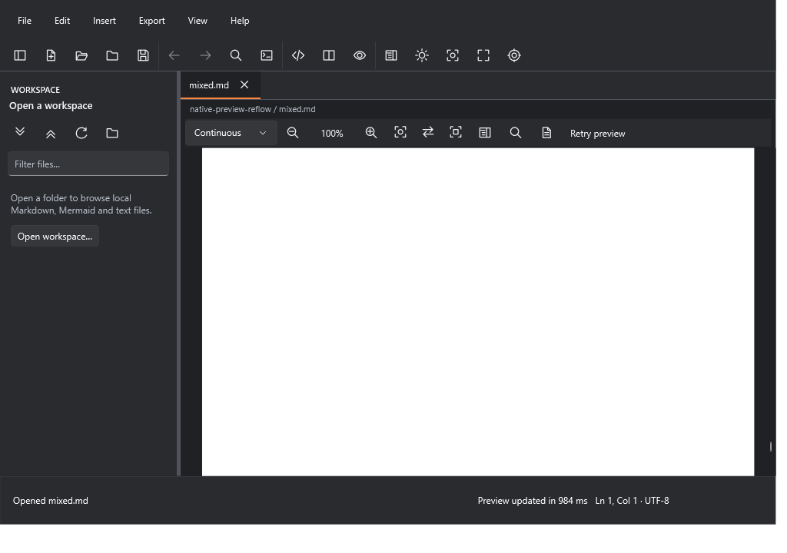
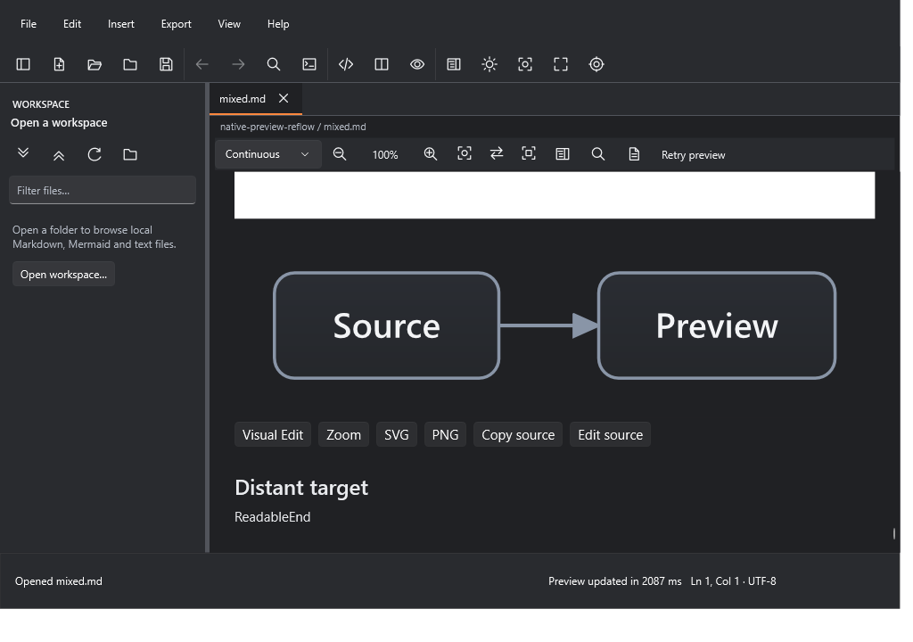

# Native preview reflow integration recovery

**Focused correction isolated for Draft review; NO-GO for integration.** The
original source-position defect still reproduces on accepted develop. The
extracted correction passes 11 focused controls, including actual Windows High
Contrast. A shared dense-ER lifecycle failure, independent review, provenance
approval and all 30 mandatory hosted contexts remain unresolved.

## Frozen source and baseline

| Role | Commit | Tree |
| --- | --- | --- |
| Fetched accepted develop | `3cd08bc2de31564e06973c5211e1aa231731f9cb` | `d5d07c445a12803f64dd36276a86511143a73648` |
| Historical Draft PR #80 | `22c223c6f56fa41fda2a36102e1eed0af44974ec` | `89e012f468801ac7f445113b811ca2fbe041c8d9` |
| Tested product/control source | `2003c1f24de3fa8c7b98e18ec543655cec281cf0` | `540eae1bff9effcede132793c14847d985bf8202` |
| Candidate with fixture byte preservation | `752b2c26e6c309b77fe23b812c6f3d1a5114d369` | `9835e2b16bdd113683effbed85a10416cd636b39` |

The candidate differs from the tested source only by a fixture-local
`.gitattributes`, preserving its original bytes on Windows checkouts. Native
subtree `fe3d78249f388df1488bf09c1941f147363e63c1` and test code are identical.
The final preparation commit adds documentation, evidence and the current rights
inventory; its identity is supplied in the delivery receipt.

The original [causal report](https://github.com/DouglasNLima/local-docs-studio/blob/22c223c6f56fa41fda2a36102e1eed0af44974ec/docs/native/native-blank-preview-recovery.md),
three product diffs and [final receipt](https://github.com/DouglasNLima/local-docs-studio/pull/80#issuecomment-6700496712)
were inspected. The receipt records the historical independent inspections and
96/96 corrected foreground processes, together with failed performance and High
Contrast gates. The PR's formal GitHub review list is empty; the receipt is not
an independent approval of this extraction. No original failed observation is
reclassified or replaced.

## Baseline analysis and direct reproduction

Between the old develop baseline `99349d82` and current develop, PR #81 changed
`NativeMarkdownRenderer.cs` in Native and PR #82 changed
`MainWindow.PreviewLoading.cs`. Neither modified the layout/synchronisation files
at issue. Neither of PR #80's new restoration components exists in develop.
All three original product corrections are still missing: capture/restoration,
zoom-unit conversion and repeated-layout ownership.

PR #82 retains request-owned loading, masking, failure and cancellation. Its
single clock observation fixes presentation at the visibility-delay boundary;
it does not restore source geometry. The port uses that accepted lifecycle and
does not change the presenter, loading state or its 200 ms visibility delay.
PR #81's Flowchart warning/styling path is unchanged and checked separately.

The unchanged original fixture has SHA-256
`6b7cd92a7dcf1dd88ff31e68fb196bde2ab76655f99e9f9fee93d82bf57280a0`:
4,475 UTF-8 bytes, 150 list items, 101 table rows, one responsive image, one
Mermaid diagram and distant `ReadableEnd` text. The same compiled focused
control is loaded with exact develop and the candidate assemblies. It navigates
to a mapped text pointer, observes natural layout, and changes Split to Preview.

| Observation at 100% | Develop Split | Develop Preview | Corrected Preview |
| --- | ---: | ---: | ---: |
| Vertical scroll offset | 10,343.27 | 10,343.27 | 10,813.60 |
| `ReadableEnd` top, DIP | 376.12 | 846.45 | 376.12 |
| Viewport height, DIP | 427.12 | 427.12 | 427.12 |
| UIA visible text | Yes | **No** | Yes |
| Source and attached document match | Yes | Yes | Yes |

Develop incorrectly retains `Preview updated` while the white image fills the
viewport. The correction moves the scroll offset once so the same source text
remains visible. The [baseline record](evidence/preview-reflow-integration/baseline-control.json)
and [candidate record](evidence/preview-reflow-integration/committed-normal-100.json)
include exact source, active/rendered identity, layout, source generation,
loading generation and arranged geometry.

| Before: current develop | After: focused correction |
| --- | --- |
|  |  |

These are captures of the owned shown WPF window's rendered surface, backed by
source mapping and UIA visible-range geometry. They are not physical desktop
scan-out or evidence of injected keyboard/mouse input.

## Exact extraction and integration

The historical commits were inspected, not cherry-picked:
`3f58591743abf81a5c96df5a4183c5b0b46fb995`,
`4f133d1b110dd6b600d3e1ae06fe725a598feb4a` and
`a798eaf051baa14470a14b1af1825abe2284a9ec`.

| Component | Change |
| --- | --- |
| `MainWindow.xaml.cs` | Capture before geometry changes, retain across Editor, restore on reuse, keep same-layout operations, clear on document binding and cancel for new rendering or preview keyboard input. |
| `MainWindow.Synchronisation.cs` | Cancel obsolete restoration with existing synchronisation cancellation and clear the anchor when installing a new source map. |
| `MainWindow.PreviewReflow.cs` | Own one restoration, guard source/document/render/synchronisation/loading generations and zoom/mode, use existing loading start/terminal helpers, and publish success only after visible arrangement. |
| `Rendering/PreviewViewportAnchor.cs` | Retain the historical source-pointer geometry and zoom conversion unchanged; issue one native scroll request and observe natural layout. |
| `MainWindow.Find.cs` | One cancellation hook prevents a pending layout restoration from competing with newer Find navigation. |

The additional loading/Find/keyboard hooks adapt the correction to current
ownership and interaction semantics. They do not mutate Markdown, editor
history, workspace files, exports or persistent user preferences. The new
restoration does not assign selection, caret, zoom or focus. Existing layout
behaviour still closes the Find bar; query and match state are preserved.

There is no direct dependency on Draft PR #76 and no PR #76 comparison/slash
feature, instrumentation, performance policy or historical campaign imported.
Existing preview navigation still performs document-return/source-map
restoration; the new path is limited to reusing the same completed document
across a layout change. No forced layout loop, added sleep, repeated scroll
request, timer extension or renderer rewrite is introduced.

## Bounded validation

Full records and binary/evidence digests are in [results.json](evidence/preview-reflow-integration/results.json).
Reproduction instructions are in [the control guide](native-preview-reflow-controls.md).

| Check | Result |
| --- | --- |
| Exact develop control | Original empty-text viewport reproduced; expected-negative exit zero is **not** acceptance PASS. |
| Corrected normal controls | 7/7: Continuous 50/75/100/150/200%, Automatic and Pages. |
| Actual Windows High Contrast controls | 4/4: Continuous 75/100/200% and Pages. Win32 and WPF flags true. |
| Repeated/rapid layouts, source edits and document replacement | Pass in all 11 controls; current mapped text, selection/caret, source and outgoing unsaved content retained. |
| Find and zoom cancellation | Pass in all 11 controls; no obsolete success or failure publication. |
| Keyboard focus | Shown normal/HC controls retain a persistent focus target across reflow; no restoration focus assignment. |
| Offline Core | 2,320/2,320. Core source is unchanged by the integration. |
| PR #81 native Flowchart | 19 checks pass, including actual WPF preview, native SVG/PNG export and inspection. |
| Find routing / selection navigation | 48 checks / 16 cases pass. |
| PR #82 offline presentation | 11/11 controls pass. |
| Existing shown loading lifecycle | **FAIL on both develop and candidate**, after 104 passing checks each. See below. |
| Static web integrity | PASS; web source and assets unchanged. |
| Baseline governance | PASS, including 49/49 governance controls. |
| Candidate active governance | **BLOCKED** by the unapproved successor native tree; 48 controls pass and the active-source check rejects the candidate. |
| Inert provenance proposal | PASS, including six rejected mutations; no activation. |
| Hosted qualification / Continuous 250 ms | NOT RUN. All 30 mandatory contexts remain required; historical 250 ms FAIL unchanged. |

The actual Windows Aquatic contrast theme was enabled through Settings for the
focused controls, then the original None setting was restored. The
[High Contrast capture](evidence/preview-reflow-integration/candidate-high-contrast.png)
shows the same visible distant text and diagram. This scoped pass does not
relabel either historical High Contrast failure or certify unrelated controls.

The computer-use helper twice rejected its own returned identity for the ordinary
native app; the alternative supported UI route reported the same failure.
No input was sent through that invalid binding. The isolated test process was
closed after checking its executable path. Settings remained accessible.
The owned-window controls establish actual WPF/UIA geometry, not a separate
manual foreground journey, screen-reader or physical-display qualification.

### Smallest outstanding lifecycle blocker

The unchanged `--preview-loading-ui` suite passes its first 104 checks on both
products, including Light/Dark, Continuous/Pages, selection/focus/zoom,
loading visibility, supersession, document switching, failure/cancellation and
first-page readiness. Its dense ER case then reports:

> Rendering resource deadline reached (6 seconds). Retry the preview or reduce the diagram size.

The expected complete `39/115/284` document assertion fails. Candidate and
baseline [failure records](evidence/preview-reflow-integration/candidate-loading-failure.json)
([baseline](evidence/preview-reflow-integration/baseline-loading-failure.json)),
logs and failed captures are retained. This is an observed shared failure,
not a demonstrated regression from the reflow port and not a PASS. The final
application-close-during-work assertion after that case is NOT REACHED.
No candidate retry, deadline increase, benchmark change or diagnostic campaign
was used to turn it green. Qualification of this existing lifecycle requirement
remains necessary before integration; it is not covered by an inferred waiver.

## Review, provenance and integration decision

The implementing agent reviewed the diff, cancellation ownership, generation
guards, source geometry, handler cleanup and result evidence. This is a
**technical self-review**, not independent approval. Independent technical
review remains pending; no review-agent delegation was performed without the
requested authorisation. Historical PR #80 review cannot approve the new loading
and Find integration.

The [inert provenance proposal](../open-source/evidence/preview-reflow-integration/proposal.md)
enumerates exactly three protected substitutions, pins new files/native trees,
preserves prior approvals and excludes any licence or performance-policy
expansion. The active validator is deliberately unchanged and rejects the
candidate until an explicit owner-approved amendment is implemented.

The live [develop rules](evidence/preview-reflow-integration/develop-rules.json)
retain all 30 mandatory contexts. Hosted CI is not authorised by pushing this
Draft: preparation commits carry `[skip ci]`. Only after provenance is authorised
and the candidate is ready should normal hosted qualification be explicitly
requested. No PR #81/#82 personal-use exception is inherited. If mandatory and
functional checks eventually pass but the optional 250 ms diagnostic fails,
any internal-integration exception needs its own narrow owner decision.

**Recommendation: review the isolated correction; do not integrate yet.** The
remaining concrete gates are independent review, the shared dense-ER lifecycle
failure, exact provenance approval/activation, the separately authorised hosted
qualification and all 30 required results. PRs #76/#78/#80 remain untouched. No
merge, deployment, release, distribution, updater publication, signing-policy
change or Native Stable certification is performed.
