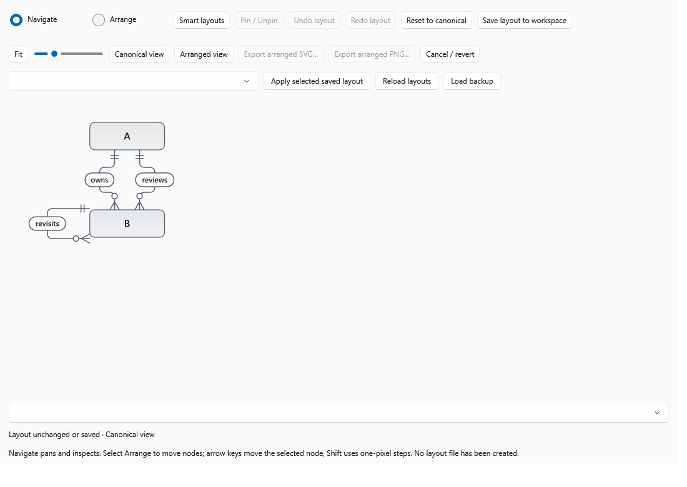
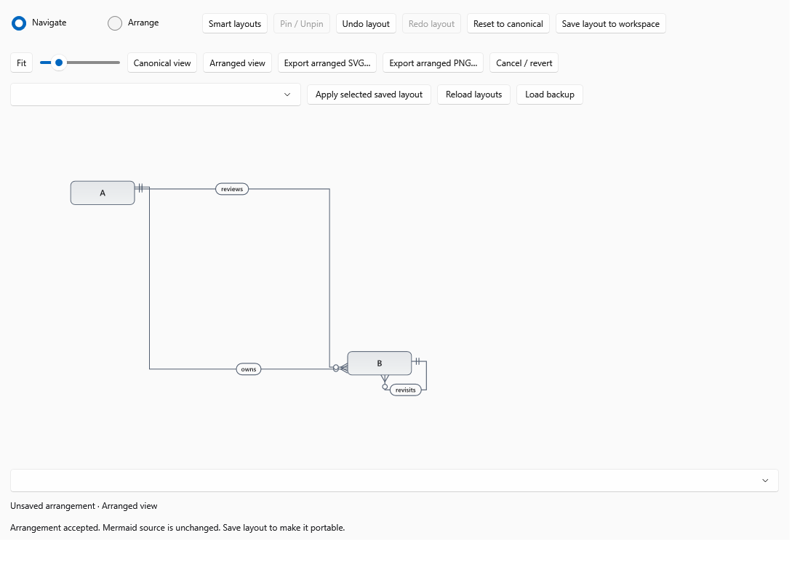
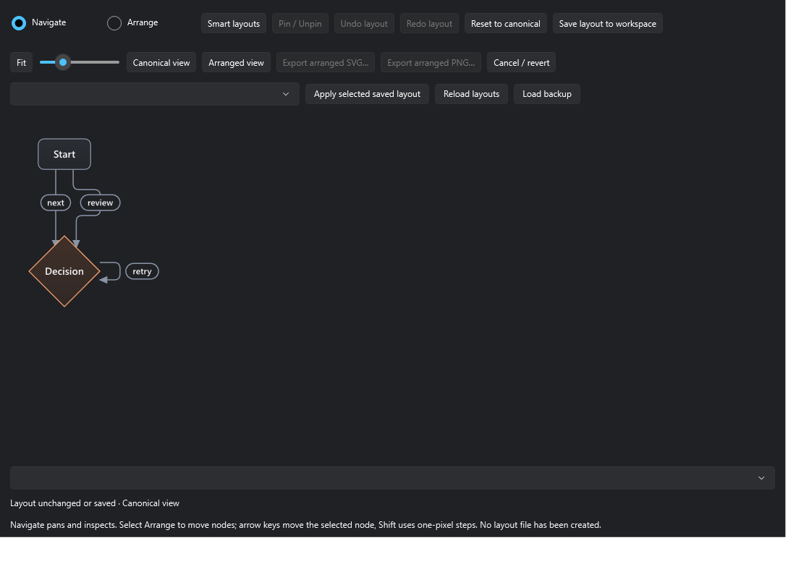
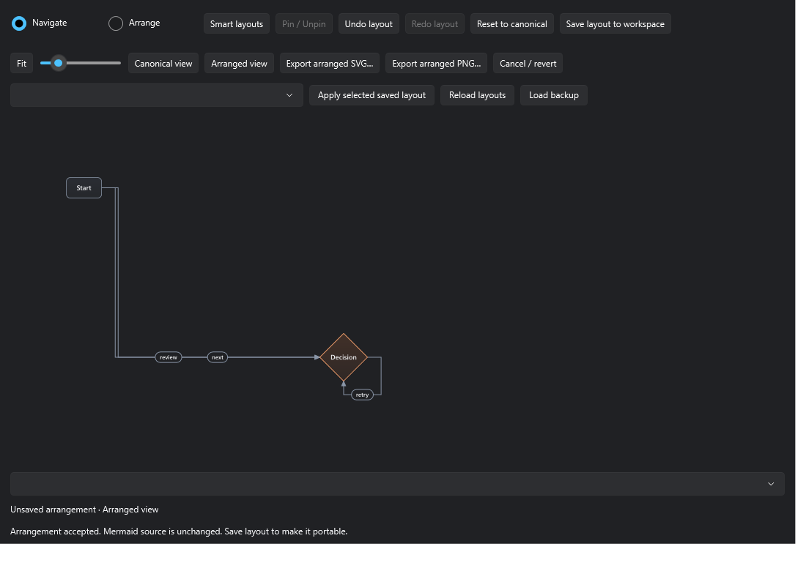
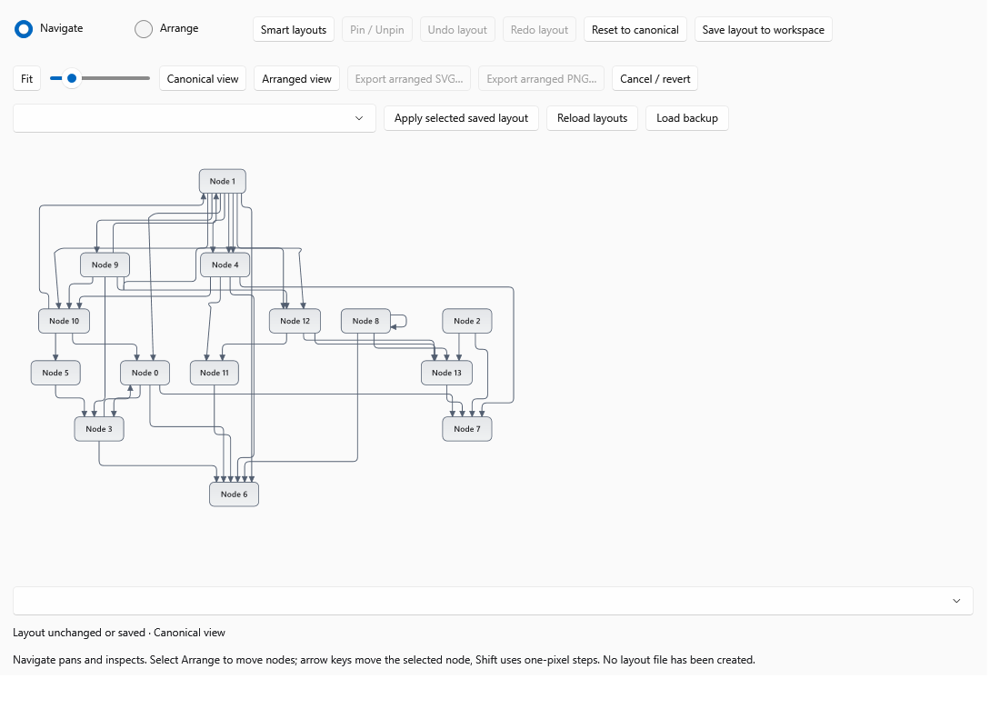
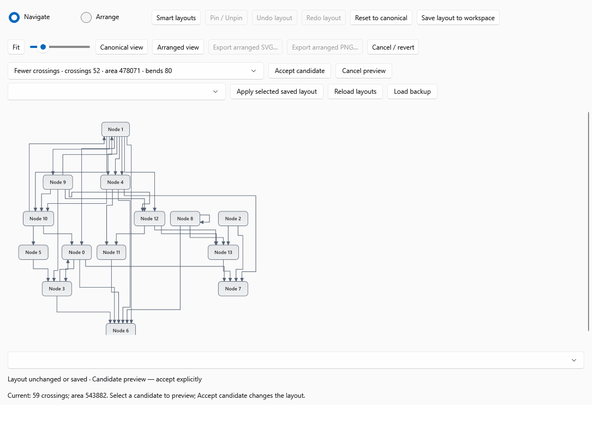

# Smart diagram layout and manual arrangement — Goal 54

This candidate implements a separate arranged presentation for native ER and
Flowchart diagrams. It requires human review through one Draft PR to `develop`.
It does not certify production installation or change the browser edition.

## Source and baseline

- Base: `81bcb02f8a0ee618e70260a49a4aab8c0896c12d`.
- Base tree: `3d00c5f93d845be1daa459027c6bd5c523cf6223`.
- Branch: `feature/native-smart-diagram-arrangement`.
- Specification: [Issue 54](https://github.com/DouglasNLima/local-docs-studio/issues/54).
- The post-merge PR 53 [native run 40652748132](https://github.com/DouglasNLima/local-docs-studio/actions/runs/40652748132)
  and [web run 40652748018](https://github.com/DouglasNLima/local-docs-studio/actions/runs/40652748018)
  both finished successfully before implementation. Independent Continuous
  performance acceptance remains separate; its 250 ms threshold is unchanged.

## Workflow and supported scope

Open an exact source-owned ER or Flowchart visual editor, then **Arrange…**.
The detached canonical preview also routes to the owning editor. Apply any
pending source edits and reopen before arranging that changed source revision.

Navigate is the default: drag to pan, click or hover to inspect. Select Arrange
to drag a node; empty background, Space+drag and middle drag pan. A threshold
separates clicks from drags. During movement a dashed rectangle is provisional;
on release the complete verified drawing replaces it. Escape, capture loss,
deactivation and zoom cancel a drag. With the viewport focused, arrow keys move
the selected node by ten drawing units; Shift uses one unit.

Pin / Unpin, Undo layout, Redo layout, Reset to canonical and Cancel / revert
operate on layout state, independently of source history. Cancel / revert
returns to the last loaded or saved arrangement. Saving is explicit. A dirty
window asks before discarding unsaved positions. Canonical view and Arranged
view are separate. Only the accepted arranged view enables its explicit SVG
and PNG export commands.

| Input or operation | Support |
| --- | --- |
| Bounded ER entities, attributes, cardinalities, self and parallel relationships | Manual placement, pins, candidates, inspection, persistence, SVG/PNG |
| Bounded Flowcharts, cycles, self and parallel edges | Same, using exact node and edge occurrences |
| Nested Flowchart subgraphs | Manual placement within existing containing boundaries; no group movement or automatic candidates |
| Group endpoints, notes, asymmetric and parallelogram shapes | Arrangement rejected; canonical viewing and source editing retained |
| Compact / Fewer crossings | Offered only when a distinct safe candidate improves that objective |
| Direction overrides, alignment, distribution, multiselect | Not implemented; source direction and group membership remain unchanged |
| Missing workspace or unsaved document | Session arrangement; portable saving explains the missing owner |
| Changed, renamed, deleted or duplicate owning block | No speculative automatic reconciliation |

## Presentation and candidate design

`ArrangementEngine` owns immutable snapshots of the existing `DiagramResult`.
It copies node positions, routes, label locations and complete bounds, retaining
the authored source, attributes, endpoints, styles and cardinalities. It uses
the pinned Mermaider 0.15.1 parser and SVG generator through a per-call layout
provider. There is no second Mermaid grammar, global provider replacement,
WebView, JavaScript runtime or canonical-cache mutation.

Three deterministic existing-engine variants and up to six deterministic grid
variants are evaluated. Grid order uses authored order or connection degree;
columns and spacing vary. Pinned rectangles remain fixed; engine variants are
excluded when pins exist. The search is bounded, not globally optimal.

Compact minimises complete canvas area. Fewer crossings minimises proper
segment crossings. Shared endpoints and collinear coincident runs are excluded
from this crossing metric; it is not a full human readability score. Both
scores, bends, length and aspect ratio are measured. Node overlap, unrelated
body intersections and label/body overlaps are hard rejection conditions.
Compact can increase crossings considerably. The candidate list reports this
trade-off before explicit acceptance; no candidate is applied automatically.
Escape or Cancel / revert can cancel an active candidate search.

Manual routing uses bounded orthogonal obstacle search, node-specific ports,
separate self/parallel occurrences and label placement against node bodies and
previous labels. Congested labels may require an outside rail, increasing area
and length. Final geometry is checked before publication and native inspection.
ER occurrence identifiers use source-order indices within the exact source
revision rather than transient draft GUIDs. Unknown identities fail closed.

Limits: 100,000 source characters, 500 nodes, 1,000 connections, finite positions
inside 90,000 drawing units, 180,000 routing cells/expansions, six seconds per
manual operation and twelve seconds per candidate search. The final SVG is
limited to 8 MB. History retains at most 100 entries and 16 million SVG
characters. Work runs off the WPF thread; pointer frames only update a rectangle.
Source ownership and generation are checked before applying asynchronous work.

## Portable format and conservative identity

Only **Save layout to workspace** writes `.lens-docs/diagram-layouts.json`.
Opening, rendering and passive loading create no sidecar. Version 1 contains
record IDs, workspace-relative document paths, ER/Flowchart family, source and
nearest-heading SHA-256 fingerprints, standalone/unique-source flags, positions,
pins, strategy and a bounded routing variant number. Source text and absolute
customer paths are never embedded. The variant reproduces engine routes exactly;
manual movement changes it to zero. Unknown format versions are rejected, not
silently migrated.

Matching is path-local. Automatic restoration requires a uniquely matched exact
source fingerprint, the same heading context and a record originally saved from
a unique source block. Offsets, block order and draft GUIDs do not grant authority.
Duplicate identical blocks remain ambiguous even if one is later removed. Unique
blocks can reorder with their heading. Edits or heading changes become stale.
Renames and deletes leave the old record unapplied. The saved-layout selector
permits explicit reassociation at the current path only after complete family,
node and geometry validation. Renamed documents currently require moving back
to the recorded path or saving a new arrangement; no guessed rename mapping.

Reads reject duplicate JSON properties, unknown fields, unsupported versions,
invalid paths, reparse points, non-finite/overflow coordinates, excessive counts
and oversized files (2 MB, 200 records, depth 12). Writes use existing containment
checks, a cooperating-process lock, content fingerprints before and after the
durable temporary write, atomic replacement and `.bak`. External conflicts keep
external bytes and require reload/review. Explicit backup recovery retains the
unreadable primary bytes separately before publication. No background repair.
Path checks and content comparison do not constitute an OS transaction against
a malicious concurrent directory replacement. This is the existing local
workspace trust boundary, not a new filesystem sandbox.

The private directory stays out of document navigation. Whole-folder filesystem
copies retain it; Markdown Bundle and ordinary source-based exports remain
unchanged. No arrangement is inserted into Mermaid, Word, PDF or Docs Site output.
Explicit arranged SVG is vector output from the verified snapshot; PNG uses that
same native drawing, without inspection overlays or zoom/scroll cropping.

## Acceptance evidence and outstanding certification

Local checkpoints on 28 October 2026:

- Release solution build: zero warnings/errors.
- Core: 2,283 passed, zero failed/skipped, including 28 arrangement cases.
- Web: static checks and all 270 Chromium/Edge tests passed.
- Native corpus: all 202 cases/export checks passed; desktop UX and dynamic
  theme-resource regressions passed. All 12 native Docs Site browser tests passed.
- Shown owned WPF windows: 118 assertions, Light/Dark ER/Flowchart, real loaded
  controls and saved sidecars, reopen, stable inspection and exact SVG/PNG outputs.
- All six public complex ER fixtures accept a far-corner manual move with zero
  unrelated-body intersections and zero label/body overlaps (11–1,884 ms in a
  local diagnostic run; machine observations, not universal latency guarantees).
- Attempt 1 found a stale dirty-state label and was retained; fixed before passing
  attempts 2 and 3. Evidence stays under ignored `artifacts/native/arrangement-*`.
- Later expanded Core acceptance found one six-second canonical timeout while
  complex arrangement tests ran alongside the broad suite. The new tests now
  use the existing non-parallel Complex ER collection; the deadline is unchanged.
  A subsequent native candidate-rehydration timeout is retained in
  `arrangement-routing`; the complete subsequent `arrangement-review` run passed.
  These observations remain relevant to slower or heavily loaded machines.
- The final nested-group regression increases arrangement coverage to 29 focused
  cases, all passing. A later full local run passed 2,283 and failed one unchanged
  canonical complex-ER case at its six-second deadline. That original outcome is
  retained; final hosted full-suite results must be read alongside local results.
- Sidecar tests include actual Windows junction rejection and read-only writes,
  external conflicts, retained corrupt bytes, backup recovery and portable copying.
- Candidate search in the passing local WPF run took 30–5,750 ms; maximum sampled
  process working set was 486 MiB. Allocation totals in the receipt include native
  conversion and export work after candidate generation, not search alone.

Representative deterministic objectives (complete canvas area in drawing units
squared; values rounded):

| Fixture | Canonical crossings | Fewer crossings | Canonical area | Compact area |
| --- | ---: | ---: | ---: | ---: |
| Complete detailed, 39 entities / 115 relationships | 599 | 476 | 35,402,747 | 12,365,654 |
| Complete relationships | 608 | 454 | 15,307,740 | 11,239,133 |
| Monitoring, 13 / 46 | 61 | 42 | 10,532,705 | 5,399,943 |
| Operations, 22 / 68 | 108 | 89 | 21,117,181 | 9,345,661 |
| Workflow assignment | 6 | 4 | 3,544,912 | 2,425,499 |
| Workflow definitions | 3 | No safe improvement found | 3,386,642 | 2,224,572 |
| Dense Flowchart, 14 nodes / 36 edges, seed 2 | 59 | 52 | 543,882 | 251,716 |

The [local machine-readable receipt](evidence/smart-arrangement/local-arrangement.json)
contains full metrics. These are synthetic, non-sensitive shown-WPF captures:

| Canonical | Arranged |
| --- | --- |
|  |  |
|  |  |
|  |  |

The [extended native candidate receipt](evidence/smart-arrangement/local-candidate-ui.json)
adds shown-window search cancellation, candidate preview without mutation,
explicit acceptance, saving and exact automatic-route restoration, plus editor
entry readiness before/after canonical mapping and pending source (118 checks).
Viewport captures retain their zoom and scrolling; SVG/PNG exports contain the
complete drawing.

The first hosted arrangement-input run on commit `5a32f9e` passed actual ER
pointer movement, pinning, Escape, deactivation/capture loss, keyboard and
Undo/Redo. It failed to find the exported SVG at the requested test path although
the window reported export completion. The failing log and screenshots remain
in run [40667182236](https://github.com/DouglasNLima/local-docs-studio/actions/runs/40667182236).
The harness now follows the existing shell-dialogue pattern: focus the labelled
filename input, type the destination, verify its value and click Save. This is a
test correction pending hosted revalidation, not a suppressed export assertion.

The second hosted input attempt in run
[40668395351](https://github.com/DouglasNLima/local-docs-studio/actions/runs/40668395351)
exposed an editor-readiness race before opening Arrange. The entry now stays
disabled until canonical mapping finishes and while source/properties are
pending. Both editors have shown-window regressions for this state. Manual
placement also rejects entering a nested group absent from the node's authored
membership. The original failed artefacts remain available. The independent
Continuous run [40668395045](https://github.com/DouglasNLima/local-docs-studio/actions/runs/40668395045)
failed its controlled gate while both visible interaction jobs passed; its
threshold and workflow are unchanged.

The actual compiled native executable was launched on this Windows host with a
fresh synthetic workspace and isolated state before committing. Computer Use
could list the window but rejected its process identity on both the initial call
and the permitted refresh. No desktop-input certification is claimed from that
attempt. The owned-WPF harness shows real windows and verifies controls but is
not substituted for actual pointer/keyboard evidence.

The dedicated hosted `diagram-arrangement` job exercises actual mouse movement,
arrow keys, pins, Undo/Redo, Save/reopen and file-dialogue SVG/PNG exports in both
families, including actual Windows High Contrast. The existing native job retains
source/export fidelity, installed package/lifecycle and other family checks. No
hosted-environment markers are spoofed locally. Large-DPI input, private original
SPC topology and independent engineering review remain explicit gaps until
verified. No private SPC pack was present in this chat's attachment directory;
public structural counts are not claimed to certify its original topology.

Current review recommendation: **NO-GO for acceptance until hosted interaction,
High Contrast, installed lifecycle and regression results reach terminal states**.
This source document records local evidence; the Draft PR receipt records exact
final commit/tree, terminal CI links and any remaining conditional acceptance.
