# Native UX refinement and Word templates

Delivered on `feature/native-ux-refinement` in [draft PR 25](https://github.com/DouglasNLima/local-docs-studio/pull/25), targeting `feature/native-desktop-ux-modernisation` from verified base `5a373a412e86b93ea8af1b9e5b867250e3d23ee1`. The accepted application/package candidate is **`ef392b0df46243805e5596d160d2c077a1c9f8dd`**. Subsequent documentation-only delivery commits record this immutable evidence and leave application/test implementation unchanged.

**Ready for a controlled unsigned internal preview within the scope below.** All eight implementation milestones, six mandatory candidate workflows, the disposable installation lifecycle and independent package inspections pass. Production trust, physical accessibility/DPI certification and the existing Continuous input-budget limitation remain separate.

## Implementation and acceptance ledger

| Milestone | Status |
|---|---|
| A — attached-template compatibility | Verified: 61 focused Word cases within the full Core suite, plus successful private original/library/export acceptance |
| B — template library inspection and empty state | Verified: accessible empty state, real import/summary/warning/sample, rename/copy/archive/restore/export and restart |
| C — file icons | Verified: case-insensitive mapping, property notifications, actual filesystem reconciliation, monochrome artwork and Windows theme captures |
| D — shared dialogue form layout | Verified: label/target geometry, staged filtering, fixed footer and actual native dialogue interactions |
| E — workspace closure | Verified: monitor shutdown, draft/root/Undo retention, empty/256-file cases, actual UI closure/reopen and closed-session restoration |
| F — export completion actions and session history | Verified: receipts, cancellation/failure, ten-output history, real visible actions/copied path, actual Explorer selection and stale-byte rejection |
| G — adaptive application header | Verified: actual control geometry, adjacent transition widths in both directions, Alt+F, retained focus/source, minimum overflow and existing viewing modes |
| H — document location, Settings search and polish | Verified: native location/empty states, staged Settings search, exact Cancel/Apply and compact status actions |
| Regression, visual acceptance and packages | Verified: 1,146 Core tests, 40 rendering cases, 13 persisted-workflow checks, 268 browser cases, 75 UIA groups in each of four desktop contexts, visual workflows, installer lifecycle and independently inspected previews |

## Word compatibility and security

The original service rejected every external resource relationship, including Word's passive attached-template metadata in the document settings part. It now accepts exactly one matching external `attachedTemplate` relationship belonging to the actual settings part and one corresponding direct settings reference. Neither target resolution nor target I/O is performed. The relationship and settings reference are excluded when reusable formatting is extracted into a fresh package. A non-blocking warning explains the omission without displaying the target.

Relationship XML is checked before SDK loading for duplicate/missing identifiers, malformed metadata and unsupported external types. Inconsistent, misplaced, internal and duplicated attached-template references are rejected. Existing safe ordinary hyperlinks retain their existing policy. Other external media, OLE, alternate content and unknown resource relationships remain blocked. ZIP path/entry/CRC/size, XML, macro, field, retained-resource and generated-package validations remain in force.

Formatting extraction retains supported styles, numbering, themes, the final section's supported page settings, inherited header/footer references and supported embedded static resources. It excludes the original body, unrelated personal metadata and unsupported structures. It does not reproduce cover designs or promise complete page fidelity.

The privately supplied original DOCX was independently exercised through an isolated copy: the baseline rejected it; corrected import, private-library persistence/selection and generated DOCX export now pass. The generated document passes Microsoft 365 Open XML schema validation, both original and isolated input bytes remain identical to the baseline copy, and no attached-template reference or external settings relationship remains. The private document, retained content and target paths are excluded from source control, hosted CI and public evidence.

The real export probe also exposed a pre-existing numbering-order defect: generated list instances were appended after Word's optional `numIdMacAtCleanup` marker. New instances and definitions are now inserted before that final marker, preserving its value and existing numbering. Synthetic cases cover packages with and without prior instances, along with real embedded header/footer pixels, constrained font samples and classified rejection of other external resources.

## Native behaviour

The template library inspects the validated retained package asynchronously. Its summary lists bounded style names, heading styles, numbering definitions, page size/margins, headers/footers, embedded images and original import notes. The typography sample uses an allowlist of local font families and clamped sample sizes; imported font strings cannot become WPF font resource URIs. Existing library records and integrity checks are unchanged. Empty and archived-empty states explain import and original-byte preservation.

Workspace identities are `.md`/`.markdown` → Markdown page cue; `.mmd`/`.mermaid` → connected nodes; `.txt` → lined page; images → image geometry; folders → existing folder; fallback → generic document. Shapes use inherited foregrounds, including selected and Windows high-contrast states. Mutable paths notify both icon and accessible description. Enumeration retains its existing supported-file scope.

Close Workspace stops and detaches monitoring before clearing the root, tree and filter. Existing queued callbacks fail their watcher-identity guard. Tabs retain their individual roots, snapshots, draft assets, source and Undo; session persistence records a null visible workspace while retaining those document records. Recent workspaces remain available. The action is shared by File, workspace toolbar and Command Palette.

Each successful file export creates an immutable receipt for the actual saved destination. Actions verify membership in the session history, safe output type, ordinary filesystem path/reparse boundaries, length and SHA-256 before passing a filename to its registered Windows application or an absolute item identifier to the native Shell folder-selection API. No external-command field is interpreted. Failed/cancelled writes do not publish a receipt. New status events and dismissal hide current actions; the newest ten distinct outputs remain in memory under Export → Recent exports. DOCX/PDF/HTML, bundles, Docs Site/review ZIPs, CSV, Mermaid SVG/PNG and configuration/library/template-copy exports share this completion model.

The adaptive panel measures the existing menu and full toolbar. If their widths plus the compact brand icon and spacing fit, it arranges them on one row; otherwise the toolbar occupies the next row with its existing overflow. Controls are neither duplicated nor reparented, and layout does not request a document render. Headless geometry checks cover 860×540, 1280×780 (retained regression), 1280×800, 1440×900 and 1920×1080, plus the measured boundary ±1 in both directions. Native hosted geometry, keyboard and focus checks independently pass.

Shared form resources define labels, help, field spacing, sections, validation, progress and keyboard-accessible footer actions. Settings uses vertical fields and a scrolling body with a fixed footer. Search hides existing fields rather than recreating them and retains unsaved values. Workspace visibility and independent synchronisation use the existing desktop preference fields, atomically merged only on Apply. Appearance transfer keeps its existing contract. Docs Site and image figure forms now scroll and resize; document-link labels/footer, table alignment, workspace-asset footer and update-channel layout receive targeted corrections. Other inspected list/review/library windows retain their established scrolling structures.

The active tab exposes a concise relative location and full-path tooltip. Workspace, filter, outline and recent-export empty states provide concise guidance. Cancel actions appear only for active operations; output names and long errors keep full accessible status/tooltip text without expanding the footer.

## Regression and preserved failure evidence

The unmodified base passed **1,086 Core tests**, with zero failures/skips. The first compatibility change passed **52 focused Word tests**, with zero failures/skips. Tests include file/UNC/HTTP/HTTPS targets, a listening loopback endpoint with no connection, an exclusively locked local target, byte preservation, retained formatting and generated DOCX schema checks, malformed references and unsafe external resources. Existing tests retain embedded image, macro, package-size and cancellation coverage.

Current local evidence: **1,146 Core tests, zero failures/skips**; **40 native diagram cases and export checks, zero failures**; **268 browser cases passed** across Chromium/Edge; complete native solution builds with zero warnings/errors; static integrity passes. Workspace tests exercise externally renamed files, pending notifications, dirty tabs with relative images, null-root restart, reopen and a different workspace, without mutating existing document bytes. Settings tests verify actual label/target geometry, staged values across filters and Cancel/Apply. Native export feedback checks validate exact shell descriptors, cancelled receipt suppression, status replacement and rejection before launch. Native monochrome artwork is independently rendered at 16/20 logical pixels in Light/Dark and checked for distinct, non-empty geometry. Shell/control captures were inspected locally; they are hidden-window/raster evidence and do not replace the hosted desktop captures.

Initial compatibility push/PR web and visual runs passed. The initial PR native run [38719464153](https://github.com/DouglasNLima/local-docs-studio/actions/runs/38719464153) failed its existing 15-second static-server startup deadline after Core/rendering checks passed. The corresponding branch passed that stage. Original failure logs are retained locally and in Actions; server diagnostics are now enabled without changing its deadline or retrying unchanged assertions. Final-source runs supersede initial compatibility evidence.

The [initial branch lifecycle](https://github.com/DouglasNLima/local-docs-studio/actions/runs/38719458456) reached installation and upgrade, each with 74 UIA groups and restored 13-tab sessions, then failed a save during the reinstalled context. The retained screenshot shows a sharing violation while the validation process polled the source file. Text observers now share read/write/delete access without changing exact content assertions, deadlines or input counts; a regression verifies coexistence with the producer's writer contract. The application's conflict/write protection remains intact.

The first full refinement [visual/UX](https://github.com/DouglasNLima/local-docs-studio/actions/runs/38722556267) and [native](https://github.com/DouglasNLima/local-docs-studio/actions/runs/38722563136) runs exposed an actual Pages scroll boundary: a visible section's paragraph began on the next printed page, hiding its heading. Editor scroll alignment now prefers a heading already visible above the scroll point, with the exact source-point fallback for long paragraphs/code without a visible heading. Selection semantics, independent controls, source/Undo/focus checks, no-render assertions and the existing failing regression remain unchanged. Original screenshots/geometry/logs are preserved; corrected hosted checks pass on the accepted candidate.

Subsequent [PR UX evidence](https://github.com/DouglasNLima/local-docs-studio/actions/runs/38724655219) exposed dropped rapid scroll input while an asynchronous alignment was already active. Focused-pane events now supersede that work, preserving the hover-only feedback guard and the original 60 ms coalescing interval. The [branch UX run](https://github.com/DouglasNLima/local-docs-studio/actions/runs/38724649341) reached the new resizing checks and established that its default 1024-pixel desktop constrained the requested 1280-pixel window. New UIA captures now use the existing guarded disposable-display helper with verified restoration. Compact branding also allows all application commands to fit at 860 pixels; minimum-window acceptance still executes genuine formatting overflow and Settings, asserting exact source/Undo instead of requiring Settings to be hidden. These are recorded corrections, not waived assertions or increased deadlines.

Windows GUI checks and installers ran only on disposable hosted Windows infrastructure. No newly built app or installer was launched on the ordinary desktop. Full browser, hosted visual/installation and independent package checks pass. Physical DPI/assistive technology and production signing remain outside the hosted evidence. Continuous retains the existing **250 ms** diagnostic target and its documented performance limitation; functional CI success does not establish that performance acceptance.

## Dialogue audit

| Dialogue or surface | Result and scope |
|---|---|
| Settings | Vertical labels/associated controls, common input metrics, searchable existing fields, scrolling body and fixed Cancel/Apply footer; native minimum/normal geometry in both themes |
| Word template library and selection | Useful empty state, bounded list/scrolling formatting inspector, explicit sample limitation, retained warnings and fixed footer; direct selection and persistent library use the same sanitisation service |
| Docs Site export and image figure | Resizable scrolling forms, shared input/label/help styles and fixed primary actions |
| Document links | Label targets and stacked status/footer avoid minimum-size crowding; existing keyboard result navigation retained |
| Table editor | Alignment field stacks its label and control; cell editing, selection and complete Undo/Redo remain covered |
| Content catalogue/library, review and workspace assets | Existing scrolling list/editor structures retained; idle operation cancellation hidden and workspace asset footer wraps |
| Updates, naming and confirmation windows | Update channel stacks its label/control; bounded confirmations and meaningful accessible labels retained |

The shared form dictionary supplies field spacing, label/help/section styles, TextBox/ComboBox/Slider/CheckBox metrics, validation/progress and ordinary/primary footer actions. Windows Fluent control templates and theme accessibility remain the underlying controls. Hidden-window scaling captures at 100/125/150/200% are layout stress evidence, not physical monitor DPI or assistive-technology certification.

Additional failure evidence is retained without raising deadlines. The [workspace Undo fixture](https://github.com/DouglasNLima/local-docs-studio/actions/runs/38727631520) typed a sentence as multiple keyboard events, then incorrectly expected one Undo to remove it; the captured result removed only the final punctuation. The fixture now inserts exactly one native literal-paste transaction and still requires one Undo to restore every original character after close/reopen. The [export reveal check](https://github.com/DouglasNLima/local-docs-studio/actions/runs/38728653705) opened the correct Explorer folder but did not establish the required selected item. Reveal now uses the documented [SHOpenFolderAndSelectItems](https://learn.microsoft.com/en-us/windows/win32/api/shlobj_core/nf-shlobj_core-shopenfolderandselectitems) API on an explicitly initialised STA worker with a validated absolute item identifier, HRESULT handling and guaranteed resource release. The actual selected-file assertion is retained.
Visual inspection of the [first passing refinement UX run](https://github.com/DouglasNLima/local-docs-studio/actions/runs/38730114604) caught a further issue: rebuilding Recent exports during its native SubmenuOpened event could hide the popup even though its items existed in UIA. History changes now refresh the menu before opening. The strengthened acceptance requires both real outputs and all three actions to be visible, then invokes Copy path and compares the exact verified destination. No existing assertion or deadline was removed.

The final real-sample probe again passed import, private-library selection, safe omission and generated DOCX schema checks after the implementation changes. The six named isolated temporary DOCX copies were then deleted without recursive directory removal. The user's original document remains in its supplied location.
The [subsequent branch visual capture](https://github.com/DouglasNLima/local-docs-studio/actions/runs/38730977834) preserved a failure of the existing active-tab close-button visibility assertion after resizing. Active-tab reveal is now coalesced on tab selection, tab-control resize and actual scroll viewport/extent changes, covering delayed font/header measurement. A nine-tab native regression exercises both resizing directions and an extent-only filename change at an unchanged width, requiring the close action to remain inside the viewport and the active document/version to remain identical. Screenshot failures now also preserve the actual window and tab/button geometry before the test process exits. The original visibility assertion and observation deadline remain intact.
The [full native workflow](https://github.com/DouglasNLima/local-docs-studio/actions/runs/38731863276) reached the new template empty-state check and established that its decorative Border had no native automation peer. A GroupBox with the same visual template now exposes a named native accessibility group; the existing visible import and disabled unavailable-action assertions remain unchanged. The original captured panel and failure logs are preserved.

The [web PR run](https://github.com/DouglasNLima/local-docs-studio/actions/runs/38733025056) passed static integrity, then hit the existing 15-second test-server startup deadline before launching any browser case. Local Python standard-library inspection confirmed that HTTPServer.server_bind performs socket.getfqdn even for the literal loopback address. The test-only server now binds the loopback socket directly without that unnecessary hostname lookup. An independent request served the actual application with HTTP 200 while socket.getfqdn was replaced by a rejecting sentinel (0.127 seconds locally). This removes one source of external startup dependence; the original hosted timeout did not include phase diagnostics and cannot retrospectively prove DNS was its cause. Web-server diagnostics are now enabled alongside browser diagnostics, with no timeout increase, fixture removal or production web change.

The next [native PR startup trace](https://github.com/DouglasNLima/local-docs-studio/actions/runs/38733488308) showed the first ready message only about 14.9 seconds after launch, so removing reverse DNS alone did not fully resolve cold startup. Both test workflows now select Python 3.12 explicitly through the official [setup-python action](https://github.com/actions/setup-python), and the fixture script logs interpreter entry and HTTP-module import duration. The existing 15-second availability deadline remains unchanged. This is test infrastructure; Python is absent from the native application and its packages.
The [next full native run](https://github.com/DouglasNLima/local-docs-studio/actions/runs/38734543621) passed the new empty/import/warning/library-copy interactions, then retained the existing failure that requires the exact Azure DevOps completion notice. The receipt transition had removed its final full stop. The original sentence ending is restored, the assertion now additionally requires the exact saved destination and visible completion actions, and the subsequent ZIP-content/source-preference checks remain unchanged. Inspection of the captured library also led to reuse of the shared neutral selection surface and compact Lens accent rather than a separate default blue highlight.

## Captured visual evidence

The native [push UX workflow](https://github.com/DouglasNLima/local-docs-studio/actions/runs/38739187808) and [PR UX workflow](https://github.com/DouglasNLima/local-docs-studio/actions/runs/38739194647) pass for application candidate `ef392b0df46243805e5596d160d2c077a1c9f8dd`. Each captures eight normal-theme windows and four genuine Windows high-contrast windows at 860×540, 1280×800, 1440×900 and 1920×1080. All 10 focused UIA groups pass, including visible menu actions, exact copied path and actual Explorer selection. The measured hosted transition is 1161 pixels (two rows) to 1162 pixels (one row), verified at adjacent widths in both directions with Alt+F and retained editing focus. This is an observed threshold, not a hard-coded resolution rule.

Representative captures were inspected for clipping, overlap, file-shape distinction, spacing, readable states, visible actions and retained source. Original-resolution files and SHA-256 provenance are recorded in [visual evidence](evidence/ux-refinement-visual.json). These are genuine disposable Windows captures; hidden-window scaling captures remain separate from physical DPI certification.

| Verified baseline — 1280×800 | Refined shell — 1280×800 |
|---|---|
| 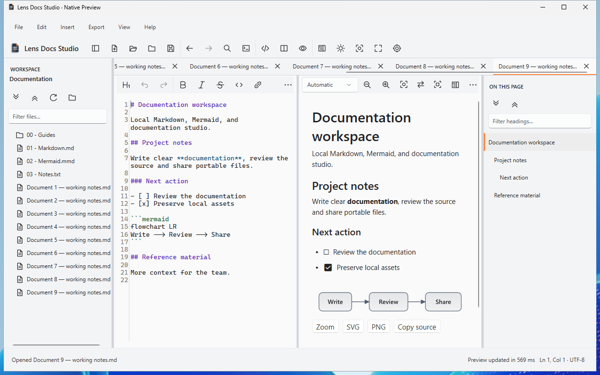 | 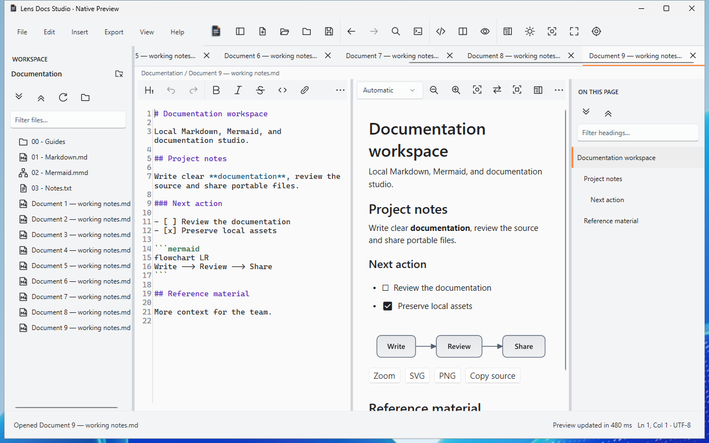 |

| Narrow Light | Wide Dark | Windows high contrast |
|---|---|---|
| 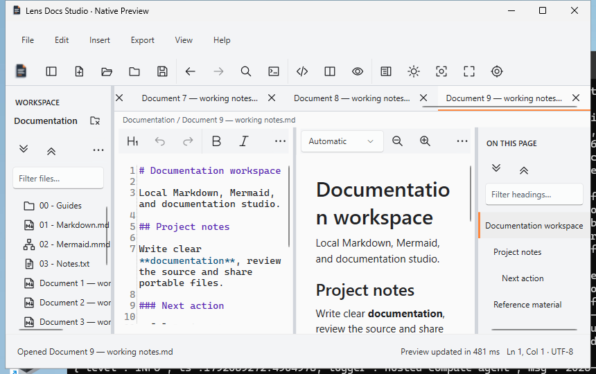 | 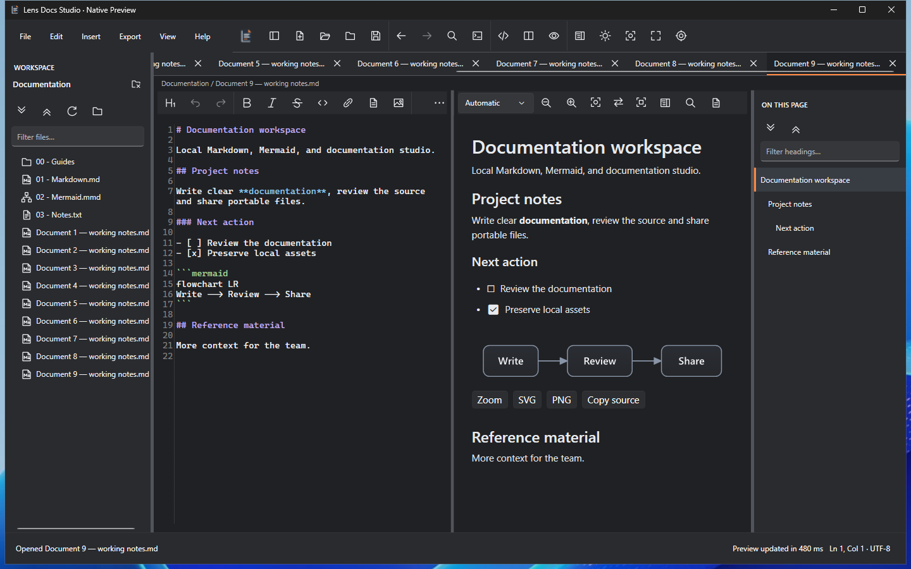 | 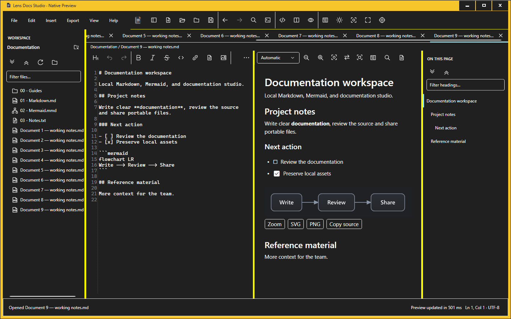 |

[Dark minimum window](images/ux-refinement/main-dark-860.png) and [high-contrast minimum window](images/ux-refinement/main-high-contrast-860.png) retain active-tab Close, genuine toolbar overflow, readable file shapes and vertical scrolling. Filenames and headings use their established trimming/scrolling behaviour at minimum width.

| Closed workspace with retained draft | Searchable staged Settings |
|---|---|
| 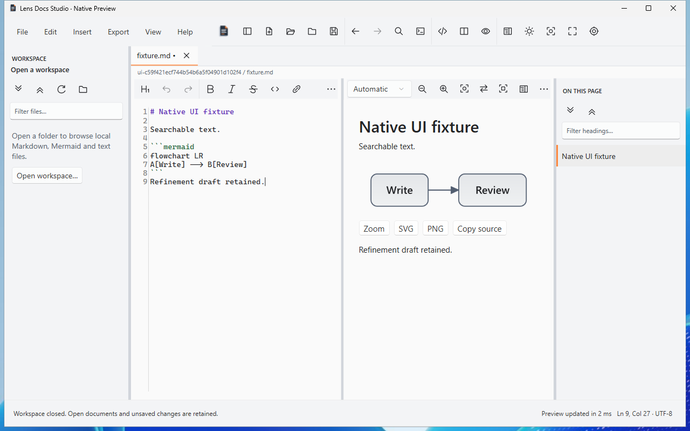 | 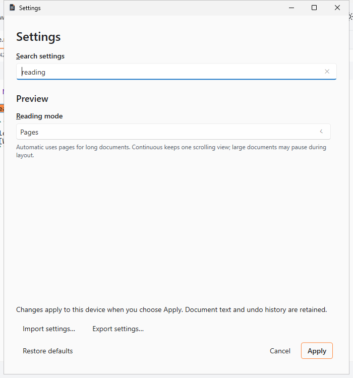 |

| Completion actions | Visible recent exports and actions |
|---|---|
| 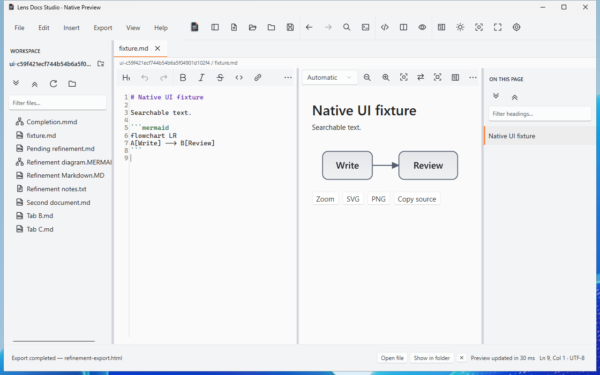 | 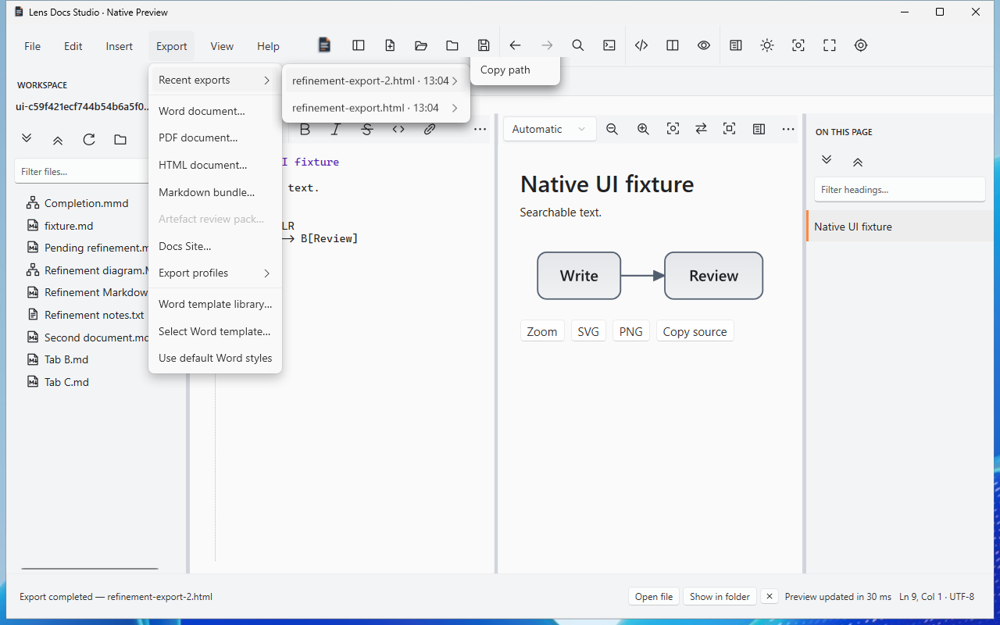 |

The [Explorer capture](images/ux-refinement/export-revealed.png) shows the second exact output selected. The same interaction checks cancellation of a real Save dialogue, sequential replacement, copy-path equality and rejection of a deleted output before shell opening. Open-file delegation is independently checked as an exact filename with UseShellExecute and no command arguments; the behaviour of every possible user-registered external handler is not certified.

The [branch web run](https://github.com/DouglasNLima/local-docs-studio/actions/runs/38735968924) passed 267 cases and failed an Edge mobile geometry assertion. Its retained screenshot is unstyled; the network trace records the initial app.css request failing with `net::ERR_NO_BUFFER_SPACE`, followed by a separate successful service-worker cache fetch. The equivalent PR run passed all 268 cases. CI now runs Chromium and Edge in separate Windows jobs (134 unchanged cases each), reducing shared browser/network resource pressure; both remain mandatory behind the original aggregate check name. Normal app navigation additionally requires the actual topbar stylesheet before UI assertions, without reloading, retrying input, changing deadlines or weakening menu bounds. A complete local run passed 268 cases and the two focused mobile cases pass with the stronger readiness check. No production web CSS, JavaScript or offline-cache contract was changed.

| Template library empty state | Imported formatting and safe omission warning |
|---|---|
| 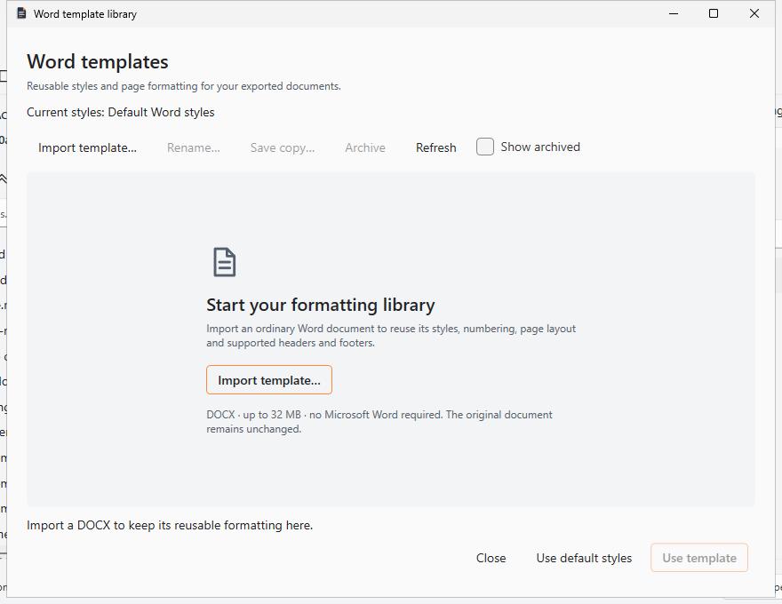 | 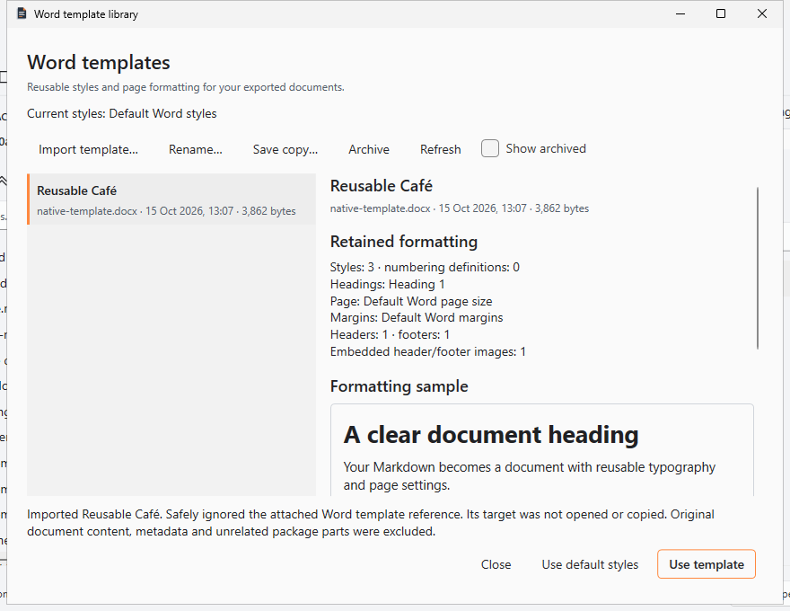 |

The [populated library](images/ux-refinement/template-library.png) retains its renamed selection and safe omission notes. These captures use synthetic material. No pixels, text or target paths from the private original appear in public evidence. Source/native checks also exercise copy, archive, restore, export and application restart.

| Settings scrolled to reading mode and zoom | Minimum-size layout stress capture |
|---|---|
| 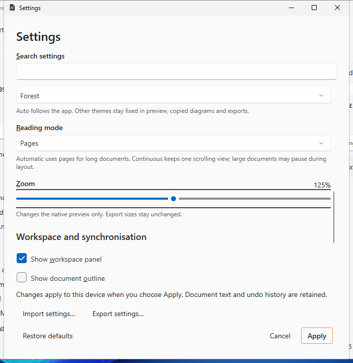 | 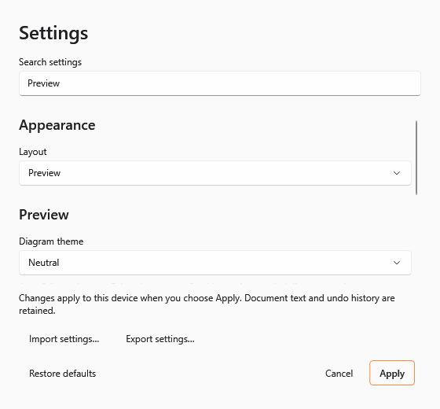 |

The [Dark minimum Settings capture](images/ux-refinement/settings-minimum-dark.png) is the corresponding hidden-window layout check. The diagram-theme label is above the scroll position in the genuine Settings capture; label/target geometry is checked independently. These images do not claim physical display scaling or screen-reader speech acceptance.

| Original monochrome shapes — Light | Original monochrome shapes — Dark |
|---|---|
| 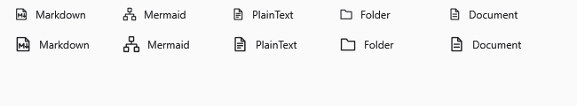 | 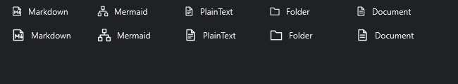 |

The atlases are native raster checks, with 16-pixel artwork above and 20-pixel artwork below. Actual Windows Light/Dark/high-contrast tree captures above independently show their placement beside filenames. Shape identity, not colour, distinguishes Markdown and Mermaid.

## Accepted regression and CI

The accepted candidate builds with zero warnings/errors. Its full Core run reports **1,146 passed, zero failed/skipped**. Native validation reports **40 diagram cases, zero failures**, with **13 persisted workspace/export checks**. Browser coverage remains **268 cases**: 134 Chromium and 134 Edge cases in independent Windows jobs, both required by the aggregate gate. The complete local browser suite also passed 268 cases; focused mobile checks pass with the stronger CSS readiness assertion.

Each full native workflow passes **75 UIA groups in four distinct contexts**: source executable, first installed launch, upgraded application and reinstalled application (**300 group executions per native workflow**). The focused UX workflow independently passes 10 groups. These counts describe grouped workflows, not individual assertions; duplicate copies of fixture JSON are not counted again.

| Event | Mandatory workflow | Result |
|---|---|---|
| Push | [Native Windows validation](https://github.com/DouglasNLima/local-docs-studio/actions/runs/38739187969) | PASS |
| Push | [Native visual/UX validation](https://github.com/DouglasNLima/local-docs-studio/actions/runs/38739187808) | PASS |
| Push | [Static web and both browsers](https://github.com/DouglasNLima/local-docs-studio/actions/runs/38739187649) | PASS |
| PR | [Native Windows validation](https://github.com/DouglasNLima/local-docs-studio/actions/runs/38739194740) | PASS |
| PR | [Native visual/UX validation](https://github.com/DouglasNLima/local-docs-studio/actions/runs/38739194647) | PASS |
| PR | [Static web and both browsers](https://github.com/DouglasNLima/local-docs-studio/actions/runs/38739194634) | PASS |

Feature-branch web runs validate the app; Pages deployment is skipped. PR workflows validate their merge checkout. The delivered packages below come from the exact branch-source candidate, not a relabelled PR merge build.

The installer lifecycle preserves **22 state files** and restores **13 actual tabs** after upgrade and after reinstall. The restoration check separately pins **18 non-rotating library/snapshot/asset files** and **13 workspace files**, while allowing normal session/preferences backup rotation and viewport updates. Tab identity/order, active source, settings and consent remain semantically intact. Shortcuts, native registration, original application icons, legacy registration and the previous Markdown default are checked. Visible wizard, interrupted-save recovery, package negative controls, signing-policy adapters and disposable-certificate trust checks also pass.

## Independently verified preview packages

Both self-contained Windows x64 versions were downloaded from the accepted [branch native workflow](https://github.com/DouglasNLima/local-docs-studio/actions/runs/38739187969) and independently inspected locally using `scripts/native/Test-NativePreviewPackage.ps1`. Installer/ZIP checksums, complete payload hashes, version/update metadata, Native/Core/apphost informational versions and exact source identity agree. Each contains **528 payload files**, the included .NET 10 WPF runtime and all **seven original icon frames** (16/24/32/48/64/128/256 pixels).

| Preview file | SHA-256 |
|---|---|
| 0.1.0-preview.433 installer | `5fe10e284a51ac76b518b64346550ed1ac51bab7cd25d0b0f51b3a6a9dd9c293` |
| 0.1.0-preview.433 portable ZIP | `e52e1602b2cfe6d50cc12c1900d94a46bea46f4d7c59793a39db06ffa38224b9` |
| **0.1.1-preview.433 installer** | `8eaa53d04bdc260eb457f44106d9526a84cbdaeffc762630b5122251b36a4361` |
| **0.1.1-preview.433 portable ZIP** | `59aed3b6d6184d279aff697d0676495019115fcf56765accc83b478bf4153596` |

Source revision for all four files: **`ef392b0df46243805e5596d160d2c077a1c9f8dd`**, source kind **branch-source**. The later `0.1.1-preview.433` pair is the review candidate. Filenames follow `LensDocsStudio.Native-<version>-win-x64-Setup.exe` and `LensDocsStudio.Native-<version>-win-x64.zip` in the workflow's `native-validation` artifact. Actions artifacts have the configured 14-day retention; downloaded local evidence is kept separately.

A separate metadata-only PE/resource inspection confirms the established native `DocumentPreview`, the adaptive panel and template window, the shipped `Icon.Markdown`, `Icon.Mermaid`, `Icon.PlainText` and `Icon.CloseWorkspace` resources, and no WebView2/Chromium/experimental Continuous viewer type or assembly reference. The payload contains no private DOCX, development source/PDBs or web application files. See the [package identity and inspection evidence](evidence/ux-refinement-packages.json). These inspections read metadata/resources; **no downloaded application or installer was executed on the ordinary desktop**.

## Readiness and remaining limits

| Scope | Status |
|---|---|
| Requested native functionality and private original DOCX compatibility | Implemented and verified |
| Synthetic security boundaries, user-data preservation, actual UIA/visual workflows and preview package identity | Verified within the documented fixtures and disposable Windows scope |
| Open-file Windows delegation | Exact safe filename/association descriptor and rejecting paths verified; every possible external registered handler is not certified |
| Word formatting sample | Illustrative native typography; complete original body/cover/page fidelity and Microsoft Word visual equivalence are not promised |
| Installation/upgrade | Verified same-revision two-version preview replacement, uninstall/reinstall and actual prior-session restoration; historical schema migration and SDK-free clean-machine certification remain unverified |
| Production signing and trusted update execution | Unavailable; both packages are `NotSigned`, unsigned updates stay blocked |
| Physical monitor DPI, screen-reader speech and broad assistive-technology acceptance | Unverified; native raster stress and actual high contrast do not establish these certifications |
| Continuous 250 ms input target | Existing limitation remains; the diagnostic target was preserved |

The accepted branch's Continuous observations record a **469.11 ms** maximum input gap for the list fixture and **262.98 ms** for the mixed fixture against the unchanged **250 ms** budget: both remain **FAIL**. Paragraph, table, quote and details observations pass that budget on this runner. These are environment-dependent diagnostics, not a controlled performance comparison or a responsiveness certification. Existing large-document/layout pauses remain; the rejected experimental viewer was not introduced.

The result is ready for a controlled **unsigned internal preview** with these explicit limits. No release, tag, merge, production trust bypass or change to the user's installed application was made. The private original remains unchanged, and its temporary DOCX test copies were removed after acceptance.
