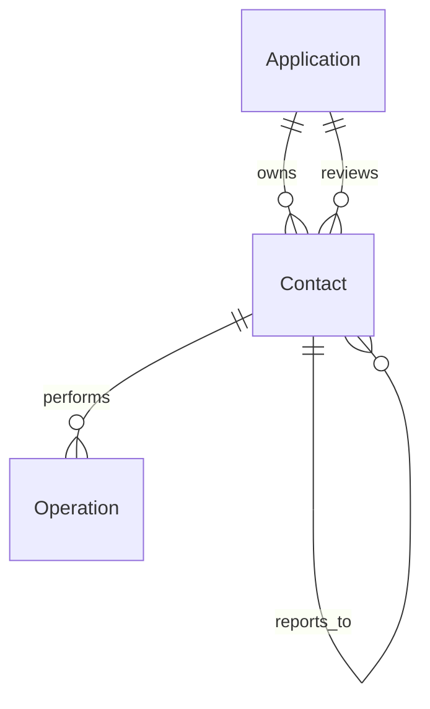
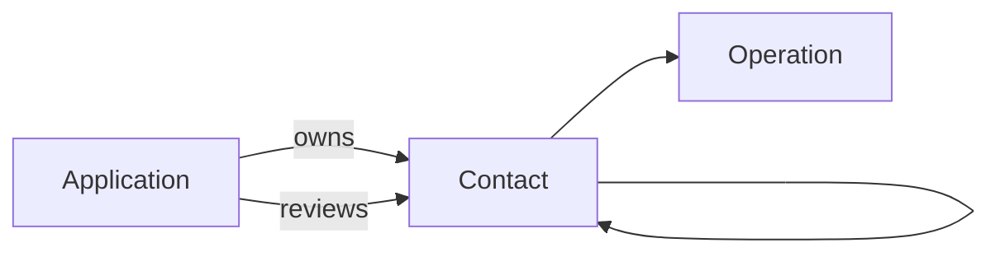
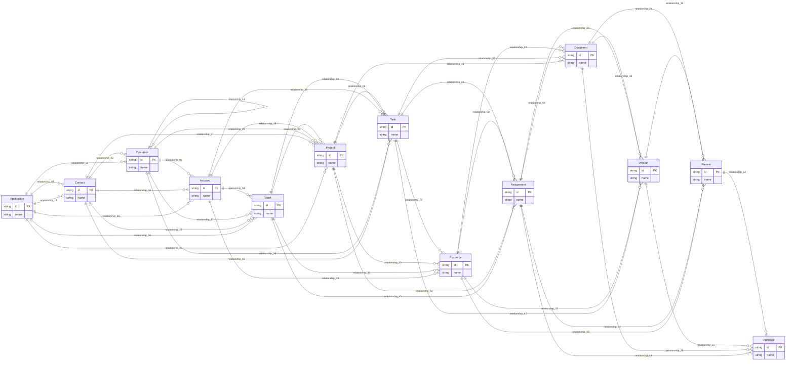

# Native desktop UX validation

Contact **contact** and con**tact**. Another CONTACT.

Formula $x_{contact}$ has searchable source.

## ER inspection

## Flowchart inspection

## Complex ER: 22 entities, 68 relationships

```mermaid
erDiagram
    direction LR
    Application {
        string id PK
        string name
    }
    Contact {
        string id PK
        string name
    }
    Operation {
        string id PK
        string name
    }
    Account {
        string id PK
        string name
    }
    Team {
        string id PK
        string name
    }
    Project {
        string id PK
        string name
    }
    Task {
        string id PK
        string name
    }
    Resource {
        string id PK
        string name
    }
    Assignment {
        string id PK
        string name
    }
    Document {
        string id PK
        string name
    }
    Version {
        string id PK
        string name
    }
    Review {
        string id PK
        string name
    }
    Approval {
        string id PK
        string name
    }
    Location {
        string id PK
        string name
    }
    Region {
        string id PK
        string name
    }
    Asset {
        string id PK
        string name
    }
    Product {
        string id PK
        string name
    }
    Order {
        string id PK
        string name
    }
    Invoice {
        string id PK
        string name
    }
    Payment {
        string id PK
        string name
    }
    Event {
        string id PK
        string name
    }
    Audit {
        string id PK
        string name
    }
    Application ||--o{ Contact : relationship_01
    Contact ||--o{ Operation : relationship_02
    Operation ||--o{ Account : relationship_03
    Account ||--o{ Team : relationship_04
    Team ||--o{ Project : relationship_05
    Project ||--o{ Task : relationship_06
    Task ||--o{ Resource : relationship_07
    Resource ||--o{ Assignment : relationship_08
    Assignment ||--o{ Document : relationship_09
    Document ||--o{ Version : relationship_10
    Version ||--o{ Review : relationship_11
    Review ||--o{ Approval : relationship_12
    Approval ||--o{ Location : relationship_13
    Location ||--o{ Region : relationship_14
    Region ||--o{ Asset : relationship_15
    Asset ||--o{ Product : relationship_16
    Product ||--o{ Order : relationship_17
    Order ||--o{ Invoice : relationship_18
    Invoice ||--o{ Payment : relationship_19
    Payment ||--o{ Event : relationship_20
    Event ||--o{ Audit : relationship_21
    Application ||--o{ Contact : relationship_22
    Operation ||--o{ Operation : relationship_23
    Application ||--o{ Operation : relationship_24
    Contact ||--o{ Account : relationship_25
    Operation ||--o{ Team : relationship_26
    Account ||--o{ Project : relationship_27
    Team ||--o{ Task : relationship_28
    Project ||--o{ Resource : relationship_29
    Task ||--o{ Assignment : relationship_30
    Resource ||--o{ Document : relationship_31
    Assignment ||--o{ Version : relationship_32
    Document ||--o{ Review : relationship_33
    Version ||--o{ Approval : relationship_34
    Review ||--o{ Location : relationship_35
    Approval ||--o{ Region : relationship_36
    Location ||--o{ Asset : relationship_37
    Region ||--o{ Product : relationship_38
    Asset ||--o{ Order : relationship_39
    Product ||--o{ Invoice : relationship_40
    Order ||--o{ Payment : relationship_41
    Invoice ||--o{ Event : relationship_42
    Payment ||--o{ Audit : relationship_43
    Application ||--o{ Account : relationship_44
    Contact ||--o{ Team : relationship_45
    Operation ||--o{ Project : relationship_46
    Account ||--o{ Task : relationship_47
    Team ||--o{ Resource : relationship_48
    Project ||--o{ Assignment : relationship_49
    Task ||--o{ Document : relationship_50
    Resource ||--o{ Version : relationship_51
    Assignment ||--o{ Review : relationship_52
    Document ||--o{ Approval : relationship_53
    Version ||--o{ Location : relationship_54
    Review ||--o{ Region : relationship_55
    Approval ||--o{ Asset : relationship_56
    Location ||--o{ Product : relationship_57
    Region ||--o{ Order : relationship_58
    Asset ||--o{ Invoice : relationship_59
    Product ||--o{ Payment : relationship_60
    Order ||--o{ Event : relationship_61
    Invoice ||--o{ Audit : relationship_62
    Application ||--o{ Team : relationship_63
    Contact ||--o{ Project : relationship_64
    Operation ||--o{ Task : relationship_65
    Account ||--o{ Resource : relationship_66
    Team ||--o{ Assignment : relationship_67
    Project ||--o{ Document : relationship_68
```

## Complex ER: 13 entities, 46 relationships

