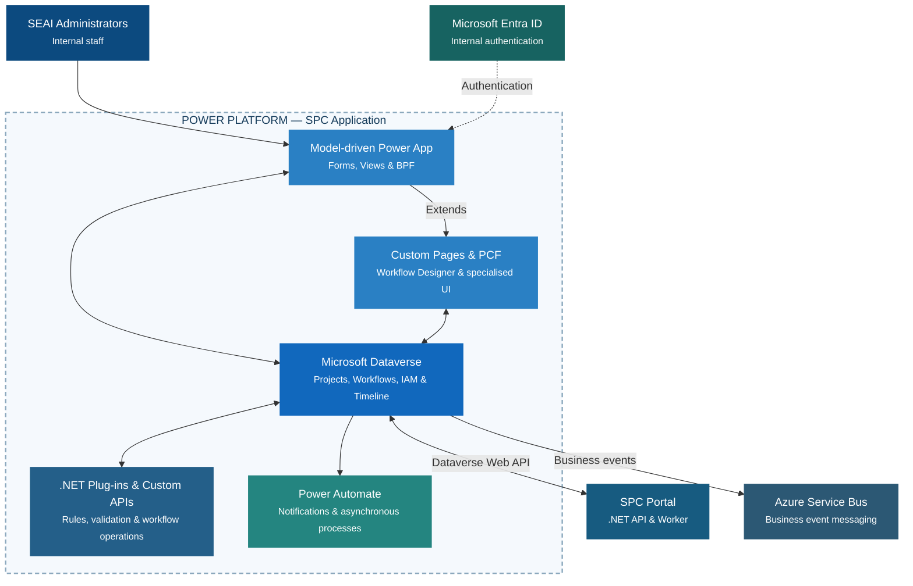

# 4. Power Platform Application Architecture

**SPC | Logical components and integration boundaries**

> **Workflow clocks and SLA timers:** The execution strategy is specified separately from this logical view.

*SPC · SEAI · Application architecture · Logical view*
